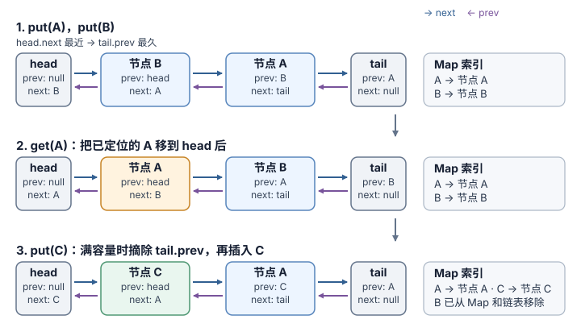

# 最近最少使用缓存怎样按键查找并更新最近使用顺序？

案例背景：用一份合成报表界面说明 Least Recently Used (LRU) cache（最近最少使用缓存）。容量为 2；A 表示账户 acct-17 的 report/42 游标页，B 表示同一账户的 report/41 页面，C 表示账户首页。先 `put(A)`、`put(B)` 放满缓存，再重新查看 A 并打开 C；结果应保留 A、C，淘汰最久未使用的 B。实际缓存受权限和查询条件影响时，键还须隔离账户/授权范围、过滤器和游标；命中缓存不能代替本次授权检查。

## 用 Map 插入顺序表示新近程度

Map 的迭代顺序是插入顺序。此实现把它当作从最旧到最新的队列：命中时先删键再重设，使它移到最新端；只调用 `set` 更新已有键不会改变其位置。对此实现，命中 `get` 和容量大于 0 时的 `put` 都算一次使用并更新顺序；未命中的 `get` 不改顺序，`has` 只查是否存在、不会刷新最近使用时间。构造参数须为非负整数，容量 0 时 `put` 不保留数据。若缓存最多容纳 c 项，存储空间随 c 线性增长为 O(c)。

实现接受任意 Map 键和值。`has` 能区分已存入 `undefined` 和键缺失；基本值按 SameValueZero 比较（例如 `NaN` 与自身匹配，`+0` 与 `-0` 是同一键），对象键按对象身份比较，所以内容相同但新建的数组仍是另一个键。

~~~javascript
class LRUCache {
  constructor(capacity) {
    if (!Number.isInteger(capacity) || capacity < 0) throw new RangeError('capacity must be a non-negative integer');
    this.capacity = capacity;
    this.cache = new Map();
  }
  has(key) { return this.cache.has(key); }
  get(key) {
    if (!this.cache.has(key)) return undefined;
    const value = this.cache.get(key);
    this.cache.delete(key);
    this.cache.set(key, value);
    return value;
  }
  put(key, value) {
    if (this.capacity === 0) return;
    if (this.cache.has(key)) this.cache.delete(key);
    else if (this.cache.size === this.capacity) {
      const oldestKey = this.cache.keys().next().value;
      this.cache.delete(oldestKey);
    }
    this.cache.set(key, value);
  }
}
~~~

> [!example] 容量为 2 的淘汰过程
> `put(A, 页面42)`、`put(B, 页面41)` 后，A 最旧、B 最新。`get(A)` 命中后顺序变成 B、A；`has(B)` 返回 true，但不改变顺序。`put(C, 首页)` 淘汰 B，留下 A、C。对已有键调用 `put` 会更新值并把该键移到最新端。
>
> | 操作 | 最旧 → 最新 | 返回或淘汰 |
> |---|---|---|
> | put(A) | A | — |
> | put(B) | A, B | — |
> | get(A) | B, A | 页面 42 |
> | has(B) | B, A | true，顺序不变 |
> | put(C) | A, C | 淘汰 B |

ECMAScript 要求 Map 的平均键访问时间为元素数量的次线性，但不承诺精确 O(1)。新键的 `put` 分支还读取 `.size`；规范的 getter 按语义列表统计未删除项，没有给出 O(1) 复杂度保证，而引擎可以另外维护计数。

这些保证也不能推出 `keys().next()` 取得最旧键有 O(1) 上界。规范描述迭代时按插入顺序前进并跳过已删除项；在数组式表示里，反复删后重插可能留下许多待跳过的位置，但规范也明确说明这种列表只是可观察语义模型、不是要求引擎采用的内部表示。因此只用 Map 的版本顺序正确且代码短，却不能仅凭 Map 键访问要求证明满容量淘汰操作 O(1)；`.size` 与迭代器的实际代价由引擎实现决定。

## 用双向链表加 Map 显式维护索引与顺序

Map 把键映射到链表节点；双向链表用 `prev`/`next` 保持新近顺序，`tail.prev` 直接定位待淘汰项。每次操作结束后，两种结构保持以下关系。非空时，`head.next` 指向最近使用的节点，`tail.prev` 指向最久未使用的节点；空链时 `head.next === tail` 且 `tail.prev === head`。每个真实节点恰好在链上一次，Map 中的键恰好指向相应节点。`head` 和 `tail` 是不进入 Map 的哨兵，因此插入头部和删除节点都不用分支处理空链或真实边界。此实现沿用上一节的调用约定：命中 `get` 或容量非零时的 `put` 刷新顺序；`has` 和未命中 `get` 不刷新，`has` 也能区分值为 `undefined` 与缺失。

~~~javascript
class ListNode {
  constructor(key, value) { this.key = key; this.value = value; this.prev = null; this.next = null; }
}
class LinkedLRUCache {
  constructor(capacity) {
    if (!Number.isInteger(capacity) || capacity < 0) throw new RangeError('capacity must be a non-negative integer');
    this.capacity = capacity;
    this.nodes = new Map();
    this.head = new ListNode(null, null);
    this.tail = new ListNode(null, null);
    this.head.next = this.tail;
    this.tail.prev = this.head;
  }
  has(key) { return this.nodes.has(key); }
  get(key) {
    const node = this.nodes.get(key);
    if (!node) return undefined;
    this._remove(node);
    this._addToFront(node);
    return node.value;
  }
  put(key, value) {
    if (this.capacity === 0) return;
    const existing = this.nodes.get(key);
    if (existing) {
      existing.value = value;
      this._remove(existing);
      this._addToFront(existing);
      return;
    }
    if (this.nodes.size === this.capacity) {
      const oldest = this.tail.prev;
      this._remove(oldest);
      this.nodes.delete(oldest.key);
    }
    const node = new ListNode(key, value);
    this.nodes.set(key, node);
    this._addToFront(node);
  }
  _addToFront(node) {
    node.next = this.head.next;
    node.prev = this.head;
    this.head.next.prev = node;
    this.head.next = node;
  }
  _remove(node) {
    node.prev.next = node.next;
    node.next.prev = node.prev;
  }
}
~~~

按同一组 A/B/C 操作看节点链接和 Map 索引。图中每行都是操作完成后的状态，从 `head` 向右按最近到最久排列，与上一节表格的最旧到最新方向相反；`has(B)` 不改变状态，所以不另画一行。Map 单独映射键到这些节点。橙色标出本次命中的 A，绿色标出新插入的 C；节点文字和箭头仍直接给出前后关系。

`get(A)` 先由 Map 找到 A。`_remove(A)` 将 A 的前驱 B 与后继 `tail` 接起来；随后 `_addToFront(A)` 把 A 插到哨兵 `head` 后。中间摘链期间 A 自己的 `prev`/`next` 暂时仍保存旧指针，紧接着的插入步骤会覆盖它们。此后 B 成为 `tail.prev`。满容量执行 `put(C)` 时，`tail.prev` 直接给出 B；摘除 B 后还要从 Map 删除 B，再创建 C、登记其节点并插入表头。

已知节点时，链表摘除或移到 head 只改固定数目的链接；从 `tail.prev` 取最旧项也是固定访问，所以这些链表步骤确定为 O(1)。在通常的可扩容哈希 Map 模型中，键查找、插入和删除的成本按期望均摊 O(1) 估算，读取 `.size` 按 O(1) 估算；基于这些假设，完整缓存 `get`/`put` 的成本是期望均摊 O(1)，其中写入扩容的重排成本也计入均摊分析。ECMAScript 对键访问的最低保证只是平均次线性，并未规定 `.size` 的复杂度。双链表版每条缓存项多一个节点和两条链接，连同 Map 共用空间 O(capacity)；节点分配与垃圾回收（GC）时间不在这个抽象操作计数内。

| 只用 Map | Map + 双向链表 |
|---|---|
| **刷新命中项 A：** 删除再重设；查找/更新由 Map 实现 | **刷新命中项 A：** Map 定位节点，再做固定次数的指针改写 |
| **满容量加入 C：** 先读 `.size`，再用 `keys().next()` 取最旧键；两者都没有规范 O(1) 界 | **满容量加入 C：** 先读 `.size` 判断是否已满；满时 `tail.prev` 即最旧节点，再删除 Map 项并把新节点插到头部 |
| 状态少、代码短；不能从标准推出淘汰 O(1) | 多一组指针和节点分配；在哈希 Map 插删查找期望均摊 O(1)、`.size` 读取 O(1) 的模型下，完整操作期望均摊 O(1) |

> [!example]- 可选：不使用 Map/Record 的数字键练习变体
> 这是一个受限练习：有效缓存值不能是 -1，因为 `get` 用 -1 表示未命中，而代码本身不拒绝写入 -1。实现用 `Object.create(null)` 建无原型索引，以数字键查节点；命中移到头部，满容量插入时淘汰尾节点。空表时 `head` 和 `tail` 都是 null；有一个节点时两者指向同一节点。键和值沿用 `number` 契约，不限于有限整数；对象索引把数字键转成属性名，所以 +0/-0 共用 `"0"`，NaN 共用 `"NaN"`，正负无穷分别成为属性名。文本 ID `9007199254740992` 与 `9007199254740993` 转成 Number 后都会舍入为 `9007199254740992`，不能再作为不同数字键区分。容量须为非负整数；对象属性访问的复杂度由引擎决定，ECMAScript 不保证精确 O(1)。
>
> 容量为 2 时沿用相同策略，`get(1)` 后 1 成为最近项，下一次加入 3 淘汰 2：
>
> | 操作 | head → tail（最近 → 最久） | 返回或淘汰 |
> |---|---|---|
> | `put(1, 10)` | 1 | — |
> | `put(2, 20)` | 2 → 1 | — |
> | `get(1)` | 1 → 2 | 10 |
> | `put(3, 30)` | 3 → 1 | 淘汰 2 |
> | `get(2)` | 3 → 1 | -1，未命中 |
>
> ~~~typescript
> class ListNode {
>   prev: ListNode | null = null;
>   next: ListNode | null = null;
>   constructor(readonly key: number, public value: number) {}
> }
> class NumericLRUCache {
>   private readonly index: { [key: string]: ListNode } = Object.create(null);
>   private head: ListNode | null = null;
>   private tail: ListNode | null = null;
>   private size = 0;
>   constructor(private readonly capacity: number) {
>     if (!Number.isInteger(capacity) || capacity < 0) throw new RangeError('capacity must be a non-negative integer');
>   }
>   get(key: number): number {
>     const node = this.index[key];
>     if (!node) return -1;
>     this.moveToHead(node);
>     return node.value;
>   }
>   put(key: number, value: number): void {
>     if (this.capacity === 0) return;
>     const existing = this.index[key];
>     if (existing) {
>       existing.value = value;
>       this.moveToHead(existing);
>       return;
>     }
>     if (this.size >= this.capacity) this.removeTail();
>     const node = new ListNode(key, value);
>     this.index[key] = node;
>     this.addHead(node);
>     this.size++;
>   }
>   private addHead(node: ListNode): void {
>     node.prev = null;
>     node.next = this.head;
>     if (this.head) this.head.prev = node;
>     this.head = node;
>     if (!this.tail) this.tail = node;
>   }
>   private remove(node: ListNode): void {
>     if (node.prev) node.prev.next = node.next;
>     else this.head = node.next;
>     if (node.next) node.next.prev = node.prev;
>     else this.tail = node.prev;
>     node.prev = null;
>     node.next = null;
>   }
>   private moveToHead(node: ListNode): void {
>     if (this.head === node) return;
>     this.remove(node);
>     this.addHead(node);
>   }
>   private removeTail(): void {
>     if (!this.tail) return;
>     const oldest = this.tail;
>     this.remove(oldest);
>     delete this.index[oldest.key];
>     this.size--;
>   }
> }
> ~~~

> [!info]- 来源
> - Map 使用 SameValueZero 区分键；Map 迭代按插入顺序；已存在键的 `set` 原位更新，删除后重设会追加；实现须提供平均次线性键访问。规范的 `.size` 语义按列表统计，且其逐项列表是可观察语义模型，并非引擎实现要求：[ECMAScript 2026, §§24.1、24.1.3.3、24.1.3.11–24.1.3.12、24.1.5.1](https://tc39.es/ecma262/2026/multipage/keyed-collections.html)。
> - 无 Map 变体以数字作对象索引时按 ToPropertyKey 转换；Number 安全整数之外的不同整数可能得到同一 Number 值：[ECMAScript 2026, §7.1.19 `ToPropertyKey`](https://tc39.es/ecma262/2026/multipage/abstract-operations.html#sec-topropertykey)、[§21.1.2.6 `Number.MAX_SAFE_INTEGER`](https://tc39.es/ecma262/2026/multipage/numbers-and-dates.html#sec-number.max_safe_integer)。
> - 容量 2 的状态和链表指针更新按本页代码复算。Node.js v26.13.0 运行了两种 JavaScript 实现；数字键练习以 TypeScript 5.7.2 严格模式编译并运行。上述结果只验证这些输入下的代码行为。
