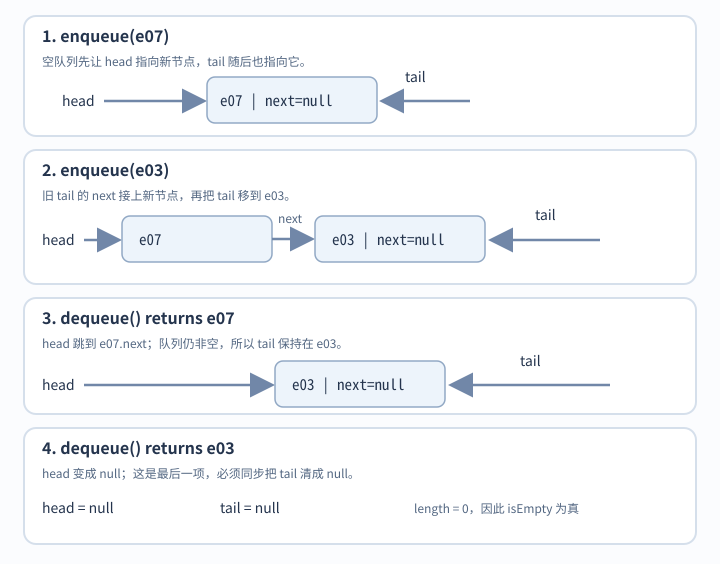
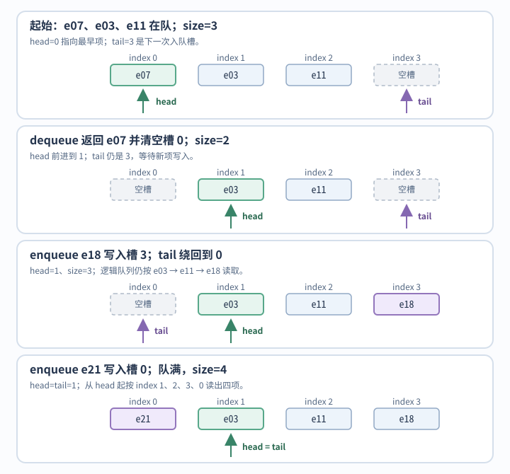
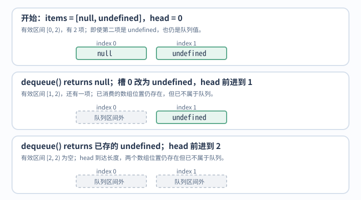
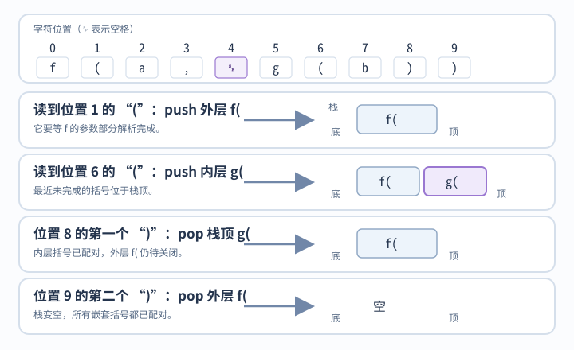

# 队列和栈怎样表示待处理工作？

案例背景：两种待处理工作，顺序要求正好相反。合成报表 42 的通知消费者要按到达顺序处理事件，例如 e07 先到就先处理，然后才是 e03，这是 first-in, first-out（FIFO，先进先出）的 queue（队列）。另一边，解析表达式 `f(a, g(b))` 时，每遇到左括号就把它的位置和所属的函数调用压入栈，遇到右括号就弹出最近一个尚未配对的左括号，这是 last-in, first-out（LIFO，后进先出）的 stack（栈）。选定顺序之后，还要设计好“空”的表示方式，让空队列或空栈不会与存进去的某个值（如 `null`、`undefined`）混淆。

## 队列怎样同时维护头、尾和空状态？

链表队列维护三个字段 `head`、`tail`、`length`。空队列时头尾都是 null、长度为 0；非空时 `head` 指向最早入队的项，`tail` 指向最新的项，且 `tail.next` 为 null。删除最后一项时要把头尾一起清空。对空队列读取会直接抛错，而不是返回某个特殊值，所以 null 和 undefined 都可以作为正常的队列值存入。

~~~javascript
class Queue {
  constructor() {
    this.head = null;
    this.tail = null;
    this.length = 0;
  }
  get isEmpty() { return this.length === 0; }
  enqueue(value) {
    const node = { value, next: null };
    if (this.tail) this.tail.next = node;
    else this.head = node;
    this.tail = node;
    this.length++;
  }
  dequeue() {
    if (this.isEmpty) throw new RangeError('queue is empty');
    const value = this.head.value;
    this.head = this.head.next;
    if (!this.head) this.tail = null;
    this.length--;
    return value;
  }
  peek() {
    if (this.isEmpty) throw new RangeError('queue is empty');
    return this.head.value;
  }
}
~~~

**链表队列以 `head` 指向最早项、`tail` 指向最新项；图中跟踪报表 42 的 e07、e03 两条通知入队和出队。**

链表队列的 `enqueue`、`dequeue` 和 `peek` 都只读写固定几个字段，所以单次 O(1)；这个界不计节点分配和垃圾回收的实际耗时。空间上，每项占一个节点（含 `next` 引用），另加 `head`、`tail`、`length` 三个 O(1) 的队列级字段。

链表每项都要分配一个节点。如果队列容量有上限，可以改用 ring buffer（环形缓冲区）：一个长度为 `capacity` 的固定数组 `items`，槽位循环复用。`capacity` 是正整数，`head` 是 `[0, capacity)` 内的整数下标，`size` 是 `[0, capacity]` 内的整数。从 `head` 开始，环绕数组读取 `size` 个槽，依次组成 FIFO 队列：第 `j` 项位于 `items[(head + j) % capacity]`，其中 `0 ≤ j < size`。下一个写入位置 `tail` 等于 `(head + size) % capacity`；只有 `size < capacity` 时它才指向空槽，队满时它与 `head` 重合，而那个槽里存的仍是队首项。因此不能靠 `head === tail` 判断空或满，要看 `size`。

`dequeue` 只在 `size > 0` 时读取并清空 head 槽，再令 `head = (head + 1) % capacity`、`size--`；空队时拒绝出队。`enqueue` 只在 `size < capacity` 时写入 tail 槽并令 `size++`；本文采用固定容量，满队时拒绝入队。固定容量下，入队和出队都只做常数次槽访问与字段更新，均为 O(1)。若另选扩容策略，触发扩容的那次还要复制槽位；几何倍增时单次成本可为 O(capacity)，连续入队的扩容成本摊还 O(1)。

用报表 42 的事件走一遍（状态写作 `(head,size,tail)`）：起初 e07、e03、e11 三个事件待处理，`capacity=4`，状态 `(0,3,3)`；出队 e07 后为 `(1,2,3)`；收到 e18 写入槽 3 后为 `(1,3,0)`；再把合成事件 e21 写入绕回的槽 0，队列依次为 e03、e11、e18、e21，状态 `(1,4,1)`。此时队满，`head` 与 `tail` 相同但 `size=4`；之后依次读完四项，又变成 `head=tail=1`、`size=0`。两种情况指针位置一样，只有 `size` 能区分空和满。

图中出队后清空槽位以释放对象引用；队列的有效项由 head 与 size 界定，不靠空槽值判空。

JavaScript 里最省事的队列是普通数组，但用法有讲究。直接用 `shift` 出队的问题是：对起初有 n 项、之后只出队不入队的普通密集数组，ECMAScript 2026 规定的 `shift` 步骤每次都要逐个把后续下标前移；若每次移动计为一次搬移，出空整个队列共 `(n−1)+…+1 = Θ(n²)` 次。这是规范步骤的抽象计数，引擎不一定真的执行这么多次物理复制。

更稳妥的做法是不动数组，只让一个 `head` 下标向前走。一次性的 BFS 扫描这样做就够了。长期运行的 FIFO 如果只增加 `head`，已消费的槽会一直持有对象引用、底层数组也会持续变长；可以清空已消费的槽并定期压缩，或改用上面的环形缓冲区复用空间。

由 `head` 下标而不是槽里的值判断空队列，队列就能安全保存 `null` 和 `undefined`。约定 `head` 是 `[0, items.length]` 内的整数，有效队列项恰好是后缀 `[head, items.length)`。出队时先读槽，再把这个已消费的槽设为 `undefined`，释放它对对象的引用，最后让 `head` 前进。判断空队列看 `head === items.length`，而不是看槽值；把槽设为 `undefined` 也不会删除这个下标，只说明它已在有效区间之外。

每次出队只有一次槽读取、一次槽赋值和一次 `head` 更新，所以是 O(1)。

~~~javascript
function dequeue(items, state) {
  if (state.head === items.length) throw new RangeError('queue is empty');
  const value = items[state.head];
  items[state.head] = undefined; // 释放对象引用；下标仍存在，不作为空队列信号
  state.head++;
  return value;
}
~~~

**边界输入 `[null, undefined]` 展示：`head` 从 0 推到 1、再到长度 2；第二个存储值即使是 `undefined` 仍可出队。**

这段代码只展示出队步骤，上例中 `state.head` 从 0 开始；完整实现还要定义入队，以及压缩策略或固定容量。若数组长期复用，压缩时要把 `[head, items.length)` 搬到开头并把 `head` 重置为 0，一次需搬移 O(items.length - head) 项；环形缓冲区则靠取模循环使用有限的槽位，无需压缩。

作为对比，下面保留一个旧练习中的数值队列：它不抛错，而是在空队列时让 `poll()` 返回 `null` 这个哨兵值。如果运行时有人把 `null` 入队，单看 `poll()` 的返回值就分不清“取到了 null”还是“队列为空”；这个类提供了 `size`，调用者可以先检查 `size` 再 `poll()`。入队的 `undefined` 会原样返回，不会与 `null` 哨兵混淆。参数类型写成 `number` 能否在编译期挡住 `null`/`undefined`，取决于 TypeScript 的 `strictNullChecks`：开启时才会拒绝。如果 API 希望每次只看返回结果就知道是否取到值，应改为返回带状态的结果对象，或在空时抛错。

> [!example]- 可选：数值专用 TypeScript 空值哨兵
> ~~~typescript
> interface QueueNode { val: number; next: QueueNode | null; }
> class NullableNumberQueue {
>   private head: QueueNode | null = null;
>   private tail: QueueNode | null = null;
>   private length = 0;
>   offer(val: number): void {
>     const node: QueueNode = { val, next: null };
>     if (this.tail) this.tail.next = node;
>     else this.head = node;
>     this.tail = node;
>     this.length++;
>   }
>   poll(): number | null {
>     if (!this.head) return null;
>     const value = this.head.val;
>     this.head = this.head.next;
>     if (!this.head) this.tail = null;
>     this.length--;
>     return value;
>   }
>   get size(): number { return this.length; }
> }
> ~~~

## 栈怎样保留最近未完成的工作？

回到括号匹配的例子。栈只在一端操作，用数组末尾的 `push`/`pop` 即可实现入栈和出栈。和队列一样，下面的 `Stack` 显式检查空栈并抛错，避免把栈中存的 `undefined` 误当作空栈。每个栈项保存一个左括号的位置和它所属的调用。若遇到右括号时栈已空，或扫描结束后栈里还有左括号，都说明括号不匹配。

~~~javascript
class Stack {
  constructor() { this.items = []; }
  get isEmpty() { return this.items.length === 0; }
  push(value) { this.items.push(value); }
  pop() {
    if (this.isEmpty) throw new RangeError('stack is empty');
    return this.items.pop();
  }
  peek() {
    if (this.isEmpty) throw new RangeError('stack is empty');
    return this.items[this.items.length - 1];
  }
}
~~~

**对表达式 `f(a, g(b))`，按字符位置跟踪两个左括号及调用标记入栈，右括号按后进先出配对。图中 `␠` 表示下标 4 处的空格。**

在几何扩容的动态数组模型下，个别 `push` 会因扩容复制而变慢，但摊到一系列插入上为 O(1)；末尾 `pop` 不移动其他元素。内存回收和数组收缩策略另计。处理嵌套深度未知的输入时，递归会受运行时调用栈大小限制，这时可以像本例一样改用显式栈。

> [!info]- 来源
> - 数组末端和首端操作的规范行为：[ECMAScript 2026 indexed collections](https://tc39.es/ecma262/2026/multipage/indexed-collections.html)，§23.1.3.22–23、§23.1.3.27（Array.prototype.pop/push/shift）；shift 对普通密集数组逐个处理后续下标。标准描述可观察步骤，不规定引擎执行相同数量的物理搬移。
> - 空值类型边界：[TypeScript `strictNullChecks` 配置说明](https://www.typescriptlang.org/tsconfig/strictNullChecks.html)：关闭时忽略 `null` / `undefined`，开启后将它们作为独立类型检查。
