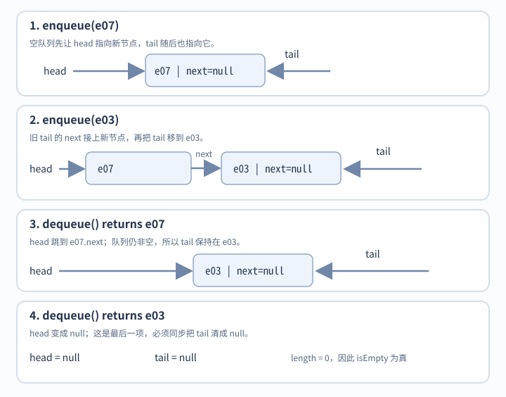
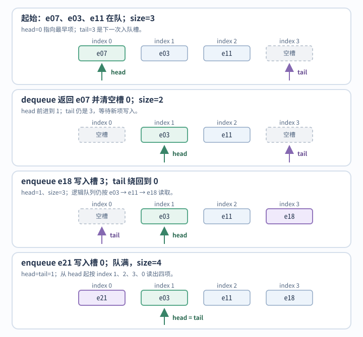
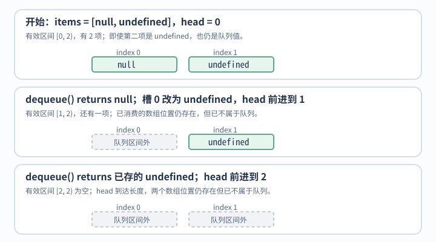
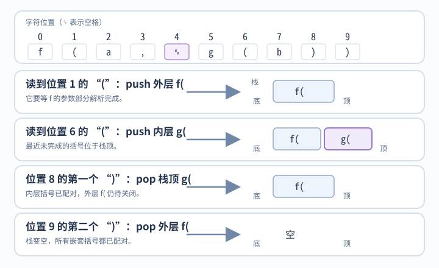

# 队列和栈怎样表示待处理工作？

案例背景：报表 42 的通知消费者要按到达顺序处理事件，例如先处理 e07，再处理 e03；扫描 `f(a, g(b))` 时，遇到左括号便把它的位置及所属调用标记压入栈，遇到右括号便弹出最近仍未匹配的标记。前者是 first-in, first-out (FIFO，先进先出) 队列，后者是 last-in, first-out (LIFO，后进先出) 栈。选好顺序后，还要让空状态和可存储值之间没有歧义。

## 队列怎样同时维护头、尾和空状态？

链表队列维护 head、tail、length：空时头尾均为 null 且长度为 0；非空时 head 指向最早项，tail 指向最新项且 tail.next 为 null。删除最后一项要同时清空头尾。空读抛错，因此 null 和 undefined 都可以是队列值。

~~~javascript
class Queue {
  constructor() {
    this.head = null;
    this.tail = null;
    this.length = 0;
  }
  get isEmpty() { return this.length === 0; }
  enqueue(value) {
    const node = { value, next: null };
    if (this.tail) this.tail.next = node;
    else this.head = node;
    this.tail = node;
    this.length++;
  }
  dequeue() {
    if (this.isEmpty) throw new RangeError('queue is empty');
    const value = this.head.value;
    this.head = this.head.next;
    if (!this.head) this.tail = null;
    this.length--;
    return value;
  }
  peek() {
    if (this.isEmpty) throw new RangeError('queue is empty');
    return this.head.value;
  }
}
~~~

**链表队列以 `head` 指向最早项、`tail` 指向最新项；图中跟踪报表 42 的 e07、e03 两条通知入队和出队。**

链表队列的 `enqueue`、`dequeue` 和 `peek` 都只访问或更新固定数量的字段，按此成本模型单次为 O(1)；这个界不计节点分配和垃圾回收的实际耗时。每项需一个节点及其 `next` 引用；`head`、`tail` 和 `length` 共用 O(1) 个队列级元数据。

容量有上限时，环形缓冲区可用长度为 `capacity` 的固定数组 `items` 循环复用槽位。`capacity` 是正整数，`head` 是 `[0, capacity)` 内的整数下标，`size` 是 `[0, capacity]` 内的整数。从 `head` 开始，环绕数组读取 `size` 个槽，依次组成 FIFO 队列：第 `j` 项位于 `items[(head + j) % capacity]`，其中 `0 ≤ j < size`。`tail` 是 `(head + size) % capacity`；只有 `size < capacity` 时它才指向空槽，满队时会与 head 重合，但该槽仍存着队列项。

`dequeue` 只在 `size > 0` 时读取并清空 head 槽，再令 `head = (head + 1) % capacity`、`size--`；空队时拒绝出队。`enqueue` 只在 `size < capacity` 时写入 tail 槽并令 `size++`；本文采用固定容量，满队时拒绝入队。固定容量下，入队和出队都只做常数次槽访问与字段更新，均为 O(1)。若另选扩容策略，触发扩容的那次还要复制槽位；几何倍增时单次成本可为 O(capacity)，连续入队的扩容成本摊还 O(1)。

具体状态沿用报表 42 的 e07、e03、e11：起初三个事件待处理，`capacity=4、head=0、size=3、tail=3`；出队 e07 后变为 `(head,size,tail)=(1,2,3)`；收到 e18 并写入槽 3 后变为 `(1,3,0)`；再将合成事件 e21 写入绕回的槽 0 后，队列为 e03、e11、e18、e21，状态为 `(1,4,1)`。满时 head 与 tail 相同但 `size=4`；再依序读完四项后，`head=tail=1、size=0`，因此 `size` 区分空与满。

图中出队后清空槽位以释放对象引用；队列的有效项由 head 与 size 界定，不靠空槽值判空。

一次性的 BFS 扫描可用数组与递增 head 下标。长期 FIFO 若只增加 head，会保留已消费的对象引用并让底层数组持续增长；可清空已消费槽并定期压缩，或用环形缓冲区复用空间。对起初有 n 项、中途没有入队、连续出队直到队列为空的普通密集数组，ECMAScript 2026 的 `shift` 抽象步骤逐个检查并写回后续下标；若成本模型把每次写回计为一次搬移，总写回量为 `(n−1)+…+1 = Θ(n²)`。这描述规范步骤的抽象计数，不表示引擎一定执行同样数量的物理复制或耗时。

用 head 而不是槽值表示空状态时，队列可以安全保存 `null` 和 `undefined`。假设 `head` 是 `[0, items.length]` 内的整数，且有效队列项恰是后缀 `[head, items.length)`。先读槽，再把已消费槽设为 `undefined` 以释放其中对象的引用，最后让 head 前进；判断空队列要看 `head === items.length`，不能看槽值。赋值为 `undefined` 不会删除数组下标，只表示该位置已不在队列的有效区间内。

按一次槽读取、一次槽赋值和一次 head 更新计，图中的 dequeue 是 O(1)。

~~~javascript
function dequeue(items, state) {
  if (state.head === items.length) throw new RangeError('queue is empty');
  const value = items[state.head];
  items[state.head] = undefined; // 释放对象引用；下标仍存在，不作为空队列信号
  state.head++;
  return value;
}
~~~

**边界输入 `[null, undefined]` 展示：`head` 从 0 推到 1、再到长度 2；第二个存储值即使是 `undefined` 仍可出队。**

此代码只展示出队步骤，队列从 `[null, undefined]` 开始时 state.head 为 0；真实实现还需定义入队、压缩或固定容量。长期数组若频繁复用，压缩时要把 `[head, items.length)` 搬到开头并重置 head，一次需搬移 O(items.length - head) 个项；环形缓冲区则用取模循环利用有限槽位。

旧数值队列以 `null` 作为空队列的返回哨兵。若运行时允许入队 `null`，只看 `poll()` 的返回值无法区分该值与空队列；这个类提供 `size`，调用者可在 `poll()` 前检查 `size`，据此区分。运行时入队的 `undefined` 会原样返回，与 `null` 哨兵不同。静态类型 `number` 是否排除 nullish 值取决于 TypeScript 的 `strictNullChecks`：启用时才会排除。若 API 需要每次都从返回结果本身判断是否取到值，可改用带状态的结果或空时抛错。其受限实现保留如下。

> [!example]- 可选：数值专用 TypeScript 空值哨兵
> ~~~typescript
> interface QueueNode { val: number; next: QueueNode | null; }
> class NullableNumberQueue {
>   private head: QueueNode | null = null;
>   private tail: QueueNode | null = null;
>   private length = 0;
>   offer(val: number): void {
>     const node: QueueNode = { val, next: null };
>     if (this.tail) this.tail.next = node;
>     else this.head = node;
>     this.tail = node;
>     this.length++;
>   }
>   poll(): number | null {
>     if (!this.head) return null;
>     const value = this.head.val;
>     this.head = this.head.next;
>     if (!this.head) this.tail = null;
>     this.length--;
>     return value;
>   }
>   get size(): number { return this.length; }
> }
> ~~~

## 栈怎样保留最近未完成的工作？

数组末尾 push/pop 表达栈的入栈和出栈；显式空检查可避免把已存的 undefined 当作空栈。这里每个栈项保存左括号的位置及其所属调用标记。遇到右括号而栈已空，或扫描结束后栈仍有未配对的左括号，都表示括号不匹配。

~~~javascript
class Stack {
  constructor() { this.items = []; }
  get isEmpty() { return this.items.length === 0; }
  push(value) { this.items.push(value); }
  pop() {
    if (this.isEmpty) throw new RangeError('stack is empty');
    return this.items.pop();
  }
  peek() {
    if (this.isEmpty) throw new RangeError('stack is empty');
    return this.items[this.items.length - 1];
  }
}
~~~

**对表达式 `f(a, g(b))`，按字符位置跟踪两个左括号及调用标记入栈，右括号按后进先出配对。图中 `␠` 表示下标 4 处的空格。**

在几何扩容的动态数组模型下，`push` 扩容复制会让单次插入成本升高，但把复制量摊到一系列插入后为 O(1)；末尾 `pop` 不移动其余项。运行时回收和具体收缩策略另计。未知输入深度的递归还受运行时栈大小限制，可改用显式栈。

> [!info]- 来源
> - 数组末端和首端操作的规范行为：[ECMAScript 2026 indexed collections](https://tc39.es/ecma262/2026/multipage/indexed-collections.html)，§23.1.3.22–23、§23.1.3.27（Array.prototype.pop/push/shift）；shift 对普通密集数组逐个处理后续下标。标准描述可观察步骤，不规定引擎执行相同数量的物理搬移。
> - 空值类型边界：[TypeScript `strictNullChecks` 配置说明](https://www.typescriptlang.org/tsconfig/strictNullChecks.html)：关闭时忽略 `null` / `undefined`，开启后将它们作为独立类型检查。
