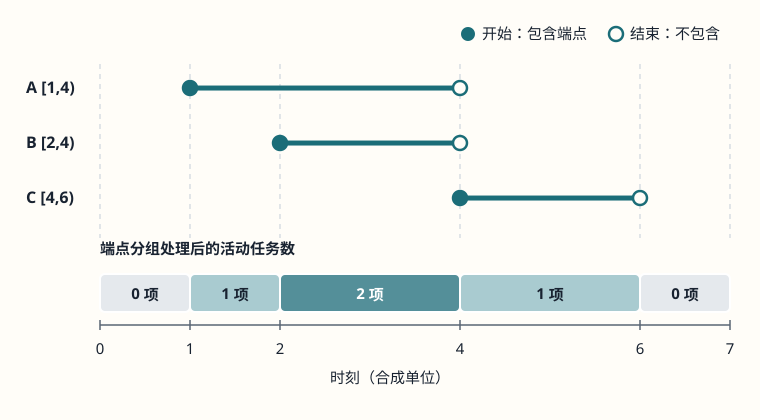

# 怎样在边界前进时维护一个有效窗口或活动区间？

案例背景：一份合成报表按到达时间记录事件。一个问题要找连续 k 条事件中净变化最大的窗口，另一个问题要找出处理耗时累计达到阈值时最短的连续事件段；资源预约表则要找同一时刻最多有多少任务占用资源。前两项是 fixed-size sliding window（固定宽度滑动窗口）和 variable-size sliding window（变长滑动窗口），第三项要用扫描线。三者都维护随边界变化的状态，但输入次序、状态不变量和移动理由各不相同。

本章统一用 [start, end) 表示半开区间：成员下标满足 start ≤ i < end，长度为 end - start；start = end 时窗口为空。相邻的 [a, b) 与 [b, c) 没有共同元素，位置 b 不属于前窗、只属于后窗。

## 固定宽度窗口：移出一项，再加入一项

假设按到达顺序记录每个事件对待处理任务数的净变化，完成任务可为负数。稠密一维数组 [4, -2, 3, 5] 的下标和值依次为 0:4、1:-2、2:3、3:5；求连续 3 条事件的最大净变化。第一段 [0, 3) 的和是 4 - 2 + 3 = 5。代码里的循环变量 `right` 是本轮新加入项的下标；加入下标 3 后，窗口的排他右界是 `right+1=4`，新段为 [1, 4)。只需移出下标 0 的 4、加入下标 3 的 5，得到 -2 + 3 + 5 = 6。

| 窗口 | 对应下标和值 | 本轮变化 | 和 |
|---|---|---|---:|
| [0, 3) | 0:4、1:-2、2:3 | 4 - 2 + 3 | 5 |
| [1, 4) | 1:-2、2:3、3:5 | 旧和 5 − 移出 4 + 加入 5 | 6 |

首窗 [0, k) 的和给 `best` 初值。其后每轮代码变量 `right` 是本轮新加入项的下标；更新并比较时，`sum` 恰好等于窗口 [right-k+1, right+1) 中所有值的和，`best` 是已经比较过的完整窗口最大和。固定宽度意味着每次右边界多含一项、左边界少含一项，所以只需增量更新这两项；不要求数据非负。代码要求 values 是稠密数组、每项和 k 都是 JavaScript 安全整数、k > 0；每次加减后窗口和也必须仍是安全整数，否则抛出 RangeError。若 n < k（包括空输入），没有完整窗口，返回 null。输入校验与窗口扫描各至多遍历 n 项，合计 O(n) 时间；除输入外只保留几个数值状态，额外空间 O(1)。这里按到达顺序计算；为了套用有序数组的双指针套路而先排序，会改变连续事件的含义。

~~~javascript
function maxFixedWindowSum(values, k) {
  if (!Array.isArray(values)) throw new TypeError('values must be an array');
  if (!Number.isSafeInteger(k) || k <= 0) throw new RangeError('k must be a positive safe integer');
  for (const value of values) {
    if (!Number.isSafeInteger(value)) throw new TypeError('values must contain safe integers');
  }
  if (values.length < k) return null;

  let sum = 0;
  for (let i = 0; i < k; i++) {
    sum += values[i];
    if (!Number.isSafeInteger(sum)) throw new RangeError('window sum exceeds the safe integer range');
  }
  let best = sum;

  for (let right = k; right < values.length; right++) {
    sum -= values[right - k];
    if (!Number.isSafeInteger(sum)) throw new RangeError('window sum exceeds the safe integer range');
    sum += values[right];
    if (!Number.isSafeInteger(sum)) throw new RangeError('window sum exceeds the safe integer range');
    if (sum > best) best = sum;
  }
  return best;
}

console.log(maxFixedWindowSum([4, -2, 3, 5], 3)); // 6
console.log(maxFixedWindowSum([], 1));            // null
~~~

若业务值为小数，需改用相应的数值精度约定；这段代码刻意不把浮点误差当成精确净变化。

## 变长窗口：只在扩展和收缩都可证明时使用

另一项报表指标是：按事件顺序找到处理耗时总和至少达到 5 毫秒的最短连续区间。输入是稠密数组 [2, 1, 3, 2]，所有耗时均为非负安全整数，target = 5 是正安全整数。代码变量 `right` 表示本轮要加入项的下标，不是排他边界：加入 `values[right]` 后，当前窗口是 [left, right+1)。每轮先加该项；达标时记录候选，再逐项移出 `left`，直到窗口不再达标。

| 操作后的状态 | 当前窗口 [left, right+1) | 和 | 决定 |
|---|---|---:|---|
| 加入下标 0 | [0, 1) | 2 | 未达 5，继续扩展 |
| 加入下标 1 | [0, 2) | 3 | 未达 5，继续扩展 |
| 加入下标 2 | [0, 3) | 6 | 达标，记录长度 3；移除下标 0 |
| 移除下标 0 | [1, 3) | 4 | 低于 5，结束本轮收缩，继续扩展 |
| 加入下标 3 | [1, 4) | 6 | 达标，比较候选长度 3；与现有 best 同长，保留先前值；移除下标 1 |
| 移除下标 1 | [2, 4) | 5 | 仍达标，记录长度 2；移除下标 2 |
| 移除下标 2 | [3, 4) | 2 | 低于 5，结束收缩 |

扫描结束，最短区间是 [2, 4)，即下标 2、3 的耗时 3 和 2；函数返回 `{ start: 2, end: 4, length: 2 }`，边界采用半开区间。状态是当前区间总和和目前最短候选。对每个 right，达标后逐步增加 left，依次检查仍可达标的更短后缀；因为值非负，某次移除使和低于阈值后，再移除只会保持或降低和，不可能得到有效后缀。若 left 已在更早轮越过某个起点，当时对应的达标区间已经比较过；之后以同一起点延长只会更长，因此不会漏掉全局最短解。left、right 都只向前；每项至多进入和离开一次，加上输入校验总计 O(n) 时间、O(1) 额外空间。若从未达标，返回 null；同长候选保留先发现的那个。

~~~javascript
function shortestWindowAtLeast(values, target) {
  if (!Array.isArray(values)) throw new TypeError('values must be an array');
  if (!Number.isSafeInteger(target) || target <= 0) {
    throw new RangeError('target must be a positive safe integer');
  }
  for (const value of values) {
    if (!Number.isSafeInteger(value) || value < 0) {
      throw new TypeError('values must contain non-negative safe integers');
    }
  }

  let left = 0;
  let sum = 0;
  let best = null;
  for (let right = 0; right < values.length; right++) {
    sum += values[right];
    if (!Number.isSafeInteger(sum)) throw new RangeError('window sum exceeds the safe integer range');

    while (sum >= target) {
      const candidate = { start: left, end: right + 1, length: right + 1 - left };
      if (best === null || candidate.length < best.length) best = candidate;
      sum -= values[left];
      if (!Number.isSafeInteger(sum)) throw new RangeError('window sum exceeds the safe integer range');
      left++;
    }
  }
  return best;
}

console.log(shortestWindowAtLeast([2, 1, 3, 2], 5)); // { start: 2, end: 4, length: 2 }
console.log(shortestWindowAtLeast([1, 2], 5));       // null
~~~

非负约束是这段代码正确性的前提，不是对输入的清洗偏好。代码要求 values 为稠密数组，项和 target 均为安全整数，target > 0，且每一步的 sum 仍在安全整数范围内。若绕过入口的非负检查，把相同移动规则照搬到输入 [1, -1, 5]、阈值 5 上，算法先得到整段 [0, 3) 的和 5，记录长度 3；移除 1 后和变成 4，于是停止收缩并返回长度 3。但 [2, 3) 只含 5，长度为 1。负数让扩展可以降低总和、移除左项也可以提高总和；原来的移动理由失效，不能照搬这个窗口算法。

## sweep line（扫描线）：先排序端点，再维护活动集合大小

预约区间是另一类输入：它们不按开始时间排列，需先把端点排序。对同一批合成任务，预约为 A=[1,4)、B=[2,4)、C=[4,6)；下面传给函数的次序故意为 C、A、B。区间采用半开约定，任务在开始时刻已占用资源，结束时刻则已释放；另一个任务可在该结束时刻开始而不与它重叠。

扫描线按时刻由小到大处理端点。在同一时刻，先结束 [a,t) 的任务，再开始 [t,b) 的任务；代码把同刻端点合成一组，先扣除结束数，再加开始数。`active` 只保存活动任务数，因为问题只问并发峰值；需要列出具体任务时才需保留任务身份。处理完时刻 t 的整组端点后，`active` 等于该时刻（开始端计入、结束端不计）及其右侧直到下一端点之间的任务数。该例的状态变化为：

| 时刻 | 结束 | 开始 | 处理后活动数 | 峰值 |
|---:|---|---|---:|---:|
| 1 | — | A | 1 | 1 |
| 2 | — | B | 2 | 2 |
| 4 | A、B | C | 1 | 2 |
| 6 | C | — | 0 | 2 |

峰值是 2。若逐个处理时刻 4 的端点，并在每项处理后更新 peak，先加入 C 会把临时 active 计为 3，错误抬高答案；代码先统计该时刻的 starts、ends，整组扣除结束数并加入开始数，再更新 peak，因此组内暂态不会计入峰值。为使 `events[i].time === time` 合并同一时刻，传入端点需使用同一个规范化 Number 值；若由不同浮点计算得到的近似值代表同一业务时刻，应先归一为统一刻度再扫描。

~~~javascript
function maxConcurrentHalfOpen(intervals) {
  if (!Array.isArray(intervals)) throw new TypeError('intervals must be an array');
  const events = [];
  for (const interval of intervals) {
    if (!interval || !Number.isFinite(interval.start) || !Number.isFinite(interval.end)) {
      throw new TypeError('each interval needs finite start and end values');
    }
    if (interval.start >= interval.end) {
      throw new RangeError('each interval must satisfy start < end');
    }
    events.push({ time: interval.start, kind: 1 });
    events.push({ time: interval.end, kind: -1 });
  }

  events.sort((a, b) => a.time - b.time);
  let active = 0;
  let peak = 0;
  for (let i = 0; i < events.length;) {
    const time = events[i].time;
    let starts = 0;
    let ends = 0;
    while (i < events.length && events[i].time === time) {
      if (events[i].kind === -1) ends++;
      else starts++;
      i++;
    }
    active -= ends; // [start, time) 到此已结束
    active += starts; // [time, end) 从此开始
    peak = Math.max(peak, active);
  }
  return peak;
}

console.log(maxConcurrentHalfOpen([
  { name: 'C', start: 4, end: 6 },
  { name: 'A', start: 1, end: 4 },
  { name: 'B', start: 2, end: 4 }
])); // 2
console.log(maxConcurrentHalfOpen([])); // 0
~~~

输入必须是数组；每项需有有限数值 start、end 且满足 start < end，空区间会被拒绝。事件生成及分组各为 O(n)，事件表占 O(n) 空间。若使用最坏 O(n log n) 的比较排序（例如归并排序或堆排序）处理 2n 个端点，总时间为 O(n log n)。ECMAScript 规定 `Array.prototype.sort` 的排序行为与比较器契约，但比较调用的具体序列由实现决定，不承诺这一渐近复杂度；这里的界是采用上述排序算法时的成本模型，不是 JavaScript API 保证。扫描线与保留到达顺序的窗口都维护局部状态，但前者先重排端点，后者不能改变原序列；两者的正确性分别来自半开端点分组规则和窗口的移动不变量。

> [!info]- 来源
> - 固定/变长窗口的双指针推进、每个元素有限次进入和离开：[Antti Laaksonen, Competitive Programmer’s Handbook, 2018 draft, §8.1 “Two pointers method” 与 §8.3 “Sliding window minimum”](https://cses.fi/book.pdf)。本页的求和窗口根据各自输入前提推导；带负值的失效例子由本页代码状态复算。
> - 端点排序后维护活动集合的扫描线思路：[Robert Sedgewick 与 Kevin Wayne，Algorithms, 4th ed. 配套网站，“Geometric Intersections”](https://algs4.cs.princeton.edu/93intersection/)，并参看作者实现 [IntervalIntersection.java](https://algs4.cs.princeton.edu/93intersection/IntervalIntersection.java.html)。该例讨论端点事件与活动区间；本页据此按半开预约区间分组事件，并只统计活动数量。
> - `Array.prototype.sort` 的稳定排序要求、比较器以及实现定义的比较调用序列：[ECMA-262, 2023, §§23.1.3.30–23.1.3.30.1](https://tc39.es/ecma262/2023/multipage/indexed-collections.html#sec-array.prototype.sort)。ECMA-262 未给本方法规定 O(n log n) 时间界；本页只在比较排序成本模型下给出该复杂度。
