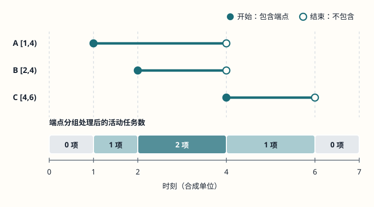

# 怎样在边界前进时维护一个有效窗口或活动区间？

案例背景：一份合成报表按到达时间记录事件，要回答三个问题：(1) 连续 k 条事件中，哪一段的净变化最大；(2) 处理耗时累计达到某个阈值的连续事件段，最短是哪一段；(3) 在一张资源预约表里，同一时刻最多有几个任务占用资源。前两个用 sliding window（滑动窗口），分别是固定宽度和可变宽度；第三个用 sweep line（扫描线）。三者都随着边界前进维护一份状态，但对输入次序的要求、状态满足的不变量、以及边界为何可以这样移动，各不相同。

本章统一用 [start, end) 表示半开区间：包含满足 start ≤ i < end 的下标，长度为 end - start；start = end 时区间为空。相邻的 [a, b) 与 [b, c) 没有公共元素，位置 b 只属于后一个区间。

## 固定宽度窗口：移出一项，再加入一项

每个事件按到达顺序记录它对待处理任务数的净变化，任务完成时为负数。数组 [4, -2, 3, 5] 的下标和值依次为 0:4、1:-2、2:3、3:5，求连续 3 条事件的最大净变化。第一段 [0, 3) 的和是 4 - 2 + 3 = 5。窗口右移一格得到 [1, 4)，不必重新求和：只需减去移出的下标 0 的 4、加上新进的下标 3 的 5，得 5 - 4 + 5 = 6。

| 窗口 | 对应下标和值 | 本轮变化 | 和 |
|---|---|---|---:|
| [0, 3) | 0:4、1:-2、2:3 | 4 - 2 + 3 | 5 |
| [1, 4) | 1:-2、2:3、3:5 | 旧和 5 − 移出 4 + 加入 5 | 6 |

代码中，首个窗口 [0, k) 的和作为 `best` 的初值。之后循环变量 `right` 是本轮新加入项的下标（注意不是排他右界）：更新后，`sum` 恰好等于窗口 [right-k+1, right+1) 的和，`best` 是目前比较过的所有完整窗口中的最大和。宽度固定，所以每轮右边多一项、左边少一项，增量更新这两项即可；这个做法不要求数据非负。

输入约束：values 是稠密数组，每项和 k 都是 JavaScript 安全整数，k > 0；每次加减后窗口和也必须仍是安全整数，否则抛出 RangeError。若 n < k（包括空数组），没有完整窗口，返回 null。输入校验和窗口扫描各遍历至多 n 项，合计 O(n) 时间；除输入外只保留几个数值，额外空间 O(1)。注意数据必须保持到达顺序：如果为了套用有序数组的双指针技巧先排序，“连续事件”就失去了意义。

~~~javascript
function maxFixedWindowSum(values, k) {
  if (!Array.isArray(values)) throw new TypeError('values must be an array');
  if (!Number.isSafeInteger(k) || k <= 0) throw new RangeError('k must be a positive safe integer');
  for (const value of values) {
    if (!Number.isSafeInteger(value)) throw new TypeError('values must contain safe integers');
  }
  if (values.length < k) return null;

  let sum = 0;
  for (let i = 0; i < k; i++) {
    sum += values[i];
    if (!Number.isSafeInteger(sum)) throw new RangeError('window sum exceeds the safe integer range');
  }
  let best = sum;

  for (let right = k; right < values.length; right++) {
    sum -= values[right - k];
    if (!Number.isSafeInteger(sum)) throw new RangeError('window sum exceeds the safe integer range');
    sum += values[right];
    if (!Number.isSafeInteger(sum)) throw new RangeError('window sum exceeds the safe integer range');
    if (sum > best) best = sum;
  }
  return best;
}

console.log(maxFixedWindowSum([4, -2, 3, 5], 3)); // 6
console.log(maxFixedWindowSum([], 1));            // null
~~~

如果业务值是小数，需要另定数值精度方案（例如换算成整数的最小单位）；这段代码只接受整数，不会把带浮点误差的结果当成精确的净变化。

## 变长窗口：只在扩展和收缩都可证明时使用

第二个问题的窗口宽度不固定：按事件顺序，找处理耗时总和至少为 5 毫秒的最短连续区间。输入是数组 [2, 1, 3, 2]，耗时都是非负安全整数，target = 5。和上一节一样，`right` 是本轮加入项的下标：加入 `values[right]` 后，当前窗口是 [left, right+1)。每轮先把新项加进来；只要窗口和达标，就记录候选，然后从左边移出一项，直到不再达标。

| 操作后的状态 | 当前窗口 [left, right+1) | 和 | 决定 |
|---|---|---:|---|
| 加入下标 0 | [0, 1) | 2 | 未达 5，继续扩展 |
| 加入下标 1 | [0, 2) | 3 | 未达 5，继续扩展 |
| 加入下标 2 | [0, 3) | 6 | 达标，记录长度 3；移除下标 0 |
| 移除下标 0 | [1, 3) | 4 | 低于 5，结束本轮收缩，继续扩展 |
| 加入下标 3 | [1, 4) | 6 | 达标，比较候选长度 3；与现有 best 同长，保留先前值；移除下标 1 |
| 移除下标 1 | [2, 4) | 5 | 仍达标，记录长度 2；移除下标 2 |
| 移除下标 2 | [3, 4) | 2 | 低于 5，结束收缩 |

扫描结束，最短区间是 [2, 4)，即下标 2、3 的耗时 3 和 2；函数返回半开区间 `{ start: 2, end: 4, length: 2 }`。整个过程只维护两项状态：当前窗口的和，以及目前最短的候选。

为什么不会漏解？两个指针都只向前，需要说明两种移动都不会跳过答案：

- **收缩何时停止**：固定 right，左端逐步右移，检查的是越来越短的后缀。值都非负，所以一旦移除某项使和低于阈值，再往右移只会让和保持或更小，不可能再达标，可以停止收缩。
- **left 不回退**：若 left 已越过某个起点 s，说明以 s 开头、到当时 right 为止的达标区间已经比较过；以 s 开头的更晚区间只会更长，不可能更优。

每项至多进入窗口一次、离开一次，加上输入校验总共 O(n) 时间，额外空间 O(1)。从未达标时返回 null；长度相同的候选保留先找到的那个。

~~~javascript
function shortestWindowAtLeast(values, target) {
  if (!Array.isArray(values)) throw new TypeError('values must be an array');
  if (!Number.isSafeInteger(target) || target <= 0) {
    throw new RangeError('target must be a positive safe integer');
  }
  for (const value of values) {
    if (!Number.isSafeInteger(value) || value < 0) {
      throw new TypeError('values must contain non-negative safe integers');
    }
  }

  let left = 0;
  let sum = 0;
  let best = null;
  for (let right = 0; right < values.length; right++) {
    sum += values[right];
    if (!Number.isSafeInteger(sum)) throw new RangeError('window sum exceeds the safe integer range');

    while (sum >= target) {
      const candidate = { start: left, end: right + 1, length: right + 1 - left };
      if (best === null || candidate.length < best.length) best = candidate;
      sum -= values[left];
      if (!Number.isSafeInteger(sum)) throw new RangeError('window sum exceeds the safe integer range');
      left++;
    }
  }
  return best;
}

console.log(shortestWindowAtLeast([2, 1, 3, 2], 5)); // { start: 2, end: 4, length: 2 }
console.log(shortestWindowAtLeast([1, 2], 5));       // null
~~~

入口处的非负检查是正确性的前提，而不只是输入清洗。（其他约束：values 为稠密数组，各项和 target 均为安全整数，target > 0，每一步的 sum 也在安全整数范围内。）假如绕过非负检查，在输入 [1, -1, 5]、阈值 5 上照搬同样的移动规则：算法先得到整段 [0, 3) 的和 5，记录长度 3；移除 1 后和变成 4，于是停止收缩，最终返回长度 3。但 [2, 3) 只含 5，长度为 1 才是答案。有了负数，扩展可能让和变小，移除左项也可能让和变大，上面“收缩何时停止”的理由就不成立了，不能照搬这个算法。

## sweep line（扫描线）：先排序端点，再维护活动集合大小

第三个问题的输入不再是有序的事件流，而是一批不按开始时间排列的预约区间，所以要先把端点排序。三个合成任务的预约为 A=[1,4)、B=[2,4)、C=[4,6)，传给函数时故意打乱为 C、A、B。区间是半开的：任务在开始时刻已占用资源，在结束时刻已经释放，所以另一个任务可以恰好在这个时刻开始，两者不算重叠。

扫描线按时刻从小到大处理端点。同一时刻有多个端点时，先结束形如 [a,t) 的任务，再开始形如 [t,b) 的任务；代码把同一时刻的端点合成一组，先减去结束数，再加上开始数。`active` 只记录活动任务的数量，因为问题只问并发峰值；若要列出具体是哪些任务，才需要保存任务身份。处理完时刻 t 的整组端点后，`active` 等于从 t 起、到下一个端点之前正在占用资源的任务数。该例的状态变化如下：

| 时刻 | 结束 | 开始 | 处理后活动数 | 峰值 |
|---:|---|---|---:|---:|
| 1 | — | A | 1 | 1 |
| 2 | — | B | 2 | 2 |
| 4 | A、B | C | 1 | 2 |
| 6 | C | — | 0 | 2 |

峰值是 2。如果逐个处理时刻 4 的端点、每处理一个就更新 peak，先处理 C 的开始会让 active 暂时变成 3，错误地抬高答案。代码先统计同一时刻的 starts 和 ends，整组处理完再更新 peak，所以组内的中间状态不会计入峰值。分组依赖 `events[i].time === time` 精确相等，所以同一业务时刻必须用完全相同的 Number 表示；如果时刻是经过不同浮点运算得到的近似值，应先统一换算到同一刻度（如整数毫秒）再扫描。

~~~javascript
function maxConcurrentHalfOpen(intervals) {
  if (!Array.isArray(intervals)) throw new TypeError('intervals must be an array');
  const events = [];
  for (const interval of intervals) {
    if (!interval || !Number.isFinite(interval.start) || !Number.isFinite(interval.end)) {
      throw new TypeError('each interval needs finite start and end values');
    }
    if (interval.start >= interval.end) {
      throw new RangeError('each interval must satisfy start < end');
    }
    events.push({ time: interval.start, kind: 1 });
    events.push({ time: interval.end, kind: -1 });
  }

  events.sort((a, b) => a.time - b.time);
  let active = 0;
  let peak = 0;
  for (let i = 0; i < events.length;) {
    const time = events[i].time;
    let starts = 0;
    let ends = 0;
    while (i < events.length && events[i].time === time) {
      if (events[i].kind === -1) ends++;
      else starts++;
      i++;
    }
    active -= ends; // [start, time) 到此已结束
    active += starts; // [time, end) 从此开始
    peak = Math.max(peak, active);
  }
  return peak;
}

console.log(maxConcurrentHalfOpen([
  { name: 'C', start: 4, end: 6 },
  { name: 'A', start: 1, end: 4 },
  { name: 'B', start: 2, end: 4 }
])); // 2
console.log(maxConcurrentHalfOpen([])); // 0
~~~

输入必须是数组，每项要有有限数值的 start、end 且 start < end，空区间会被拒绝。生成事件和分组扫描各为 O(n)，事件表占 O(n) 空间。对 2n 个端点排序，若用最坏 O(n log n) 的比较排序（如归并排序或堆排序），总时间为 O(n log n)。ECMAScript 规定了 `Array.prototype.sort` 的行为和比较器约定，但不规定比较调用的具体序列，也不承诺这个渐近界；这里的 O(n log n) 是按上述排序算法估算的成本，不是 JavaScript API 的保证。

最后对比一下：扫描线和滑动窗口都在边界前进时维护局部状态，但扫描线先重排端点，窗口则不能改变原序列；扫描线的正确性来自半开端点的分组规则，窗口的正确性来自指针移动的不变量。

> [!info]- 来源
> - 固定/变长窗口的双指针推进、每个元素有限次进入和离开：[Antti Laaksonen, Competitive Programmer’s Handbook, 2018 draft, §8.1 “Two pointers method” 与 §8.3 “Sliding window minimum”](https://cses.fi/book/book.pdf)。本页的求和窗口根据各自输入前提推导；带负值的失效例子由本页代码状态复算。
> - 端点排序后维护活动集合的扫描线思路：[Robert Sedgewick 与 Kevin Wayne，Algorithms, 4th ed. 配套网站，“Geometric Intersections”](https://algs4.cs.princeton.edu/93intersection/)，并参看作者实现 [IntervalIntersection.java](https://algs4.cs.princeton.edu/93intersection/IntervalIntersection.java.html)。该例讨论端点事件与活动区间；本页据此按半开预约区间分组事件，并只统计活动数量。
> - `Array.prototype.sort` 的稳定排序要求、比较器以及实现定义的比较调用序列：[ECMA-262, 2023, §§23.1.3.30–23.1.3.30.1](https://tc39.es/ecma262/2023/multipage/indexed-collections.html#sec-array.prototype.sort)。ECMA-262 未给本方法规定 O(n log n) 时间界；本页只在比较排序成本模型下给出该复杂度。
