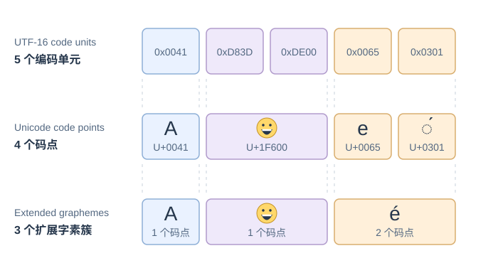

# 文本算法应按码元、码点还是字素簇处理？

报表 42 的事件描述可能含 emoji、组合重音或其他扩展文字。JavaScript 字符串索引、Unicode 码点和用户看到的字符不是同一种单位：先定义任务要计数、比较或切分什么，再实现算法。这里第一次说明三个单位：UTF-16 code unit（UTF-16 编码单元）、Unicode code point（Unicode 码点）和 extended grapheme cluster（扩展字素簇）。一个 UTF-16 编码单元是一个 16 位值；补充平面的 emoji 以代理对占两个编码单元、表示一个码点。组合重音本身是一个码点，但通常同前一个基字符组成一个扩展字素簇。

## 三种长度会怎样不同？

JavaScript String.length 返回 UTF-16 编码单元数。Array.from 对字符串迭代时把有效代理对组合成一个码点，孤立代理仍单独保留，但组合附加符仍是另一个码点。Intl.Segmenter 的 grapheme 模式按 locale（语言环境）与实现提供的分段规则给出字素簇；这通常接近用户感知字符，但规则可定制，不能把某个 Node 运行时的结果等同于当前 UAX #29 版本的每条边界规则。

同一个输入 `A😀e\u0301` 可以按三种单位划分。每个方框算作该行的一个单位；横向边界对齐原始 UTF-16 位置，不表示字符在屏幕上的显示宽度。`◌́` 中的虚线圆只是帮助看清组合重音，不属于输入。

~~~javascript
const sample = 'A😀e\u0301';
const codeUnits = sample.length;
const codePoints = Array.from(sample);
const segmenter = new Intl.Segmenter('en', { granularity: 'grapheme' });
const graphemes = Array.from(segmenter.segment(sample), part => part.segment);

console.log(codeUnits);              // 5
console.log(codePoints.length);      // 4
console.log(graphemes);              // ['A', '😀', 'é']
console.log(graphemes.length);       // 3
~~~

这里 A 占 1 个编码单元和 1 个码点；😀 是代理对，占 2 个编码单元、1 个码点；e 加 U+0301 组合重音占 2 个编码单元、2 个码点，却通常成为 1 个字素簇。字符计数不能代替存储大小：若限制请求字节数，还要另外按明确编码计算字节。

## 返回的索引按什么单位计？

字符串方法返回的位置通常是 UTF-16 编码单元偏移；把字符串先转成数组后，数组下标则数数组元素。`Intl.Segmenter` 的分段记录也用原字符串的编码单元偏移，所以可直接用 `part.index` 定位原始字符串。

~~~javascript
const indexedSample = 'A😀e\u0301';
const graphemeSegments = Array.from(
  new Intl.Segmenter('en', { granularity: 'grapheme' }).segment(indexedSample)
);
const graphemes = graphemeSegments.map(({ segment }) => segment);
const finalGrapheme = 'e\u0301';

console.log(indexedSample.length); // 5 UTF-16 code units
console.log(indexedSample.indexOf(finalGrapheme)); // 3 code-unit offset
console.log(Array.from(indexedSample).indexOf('e')); // 2 code-point array index
console.log(graphemeSegments.find(({ segment }) => segment === finalGrapheme).index); // 3 code-unit offset
console.log(graphemes.indexOf(finalGrapheme)); // 2 grapheme-array index
~~~

| 表达式 | 返回值 | 位置单位 |
|---|---:|---|
| `indexedSample.length` | 5 | 编码单元数量，不是索引 |
| `indexedSample.indexOf(finalGrapheme)` | 3 | 原字符串编码单元偏移 |
| `Array.from(indexedSample).indexOf('e')` | 2 | 码点数组下标 |
| Segmenter 记录的 `.index` | 3 | 原字符串编码单元偏移 |
| `graphemes.indexOf(finalGrapheme)` | 2 | 字素簇数组下标 |

因此码点数组或字素簇数组里的下标不能直接传给原字符串的 `slice`、`substring` 等方法；它们按编码单元解释参数。这里 `slice(2)` 会从 😀 的低代理 U+DE00 开始，`slice(3)` 才从 `e\u0301` 开始。若要在原文本中高亮或替换数组中的元素，应保留原字符串偏移（例如 Segmenter 的 `.index`），或显式建立数组下标到原偏移的映射。

Array.from 也不会自动把规范等价的不同码点序列变成相同序列。例如预组字符 é 与 e 加组合重音肉眼可相同，但码点逐个比较不同：'é' === 'e\u0301' 为 false，而 NFC 规范化后两者相等。若业务要求规范等价比较，可在明确边界使用 `normalize('NFC')`；保留原始输入时不要无意改写其码点序列。NFC/NFD 处理规范等价；NFKC/NFKD 还会合并部分兼容形式，适不适合取决于任务，不能当作显示文本的通用清理。规范化后的索引属于规范化副本：例如 `'e\u0301'.length` 是 2，`'é'.length` 是 1；若要改写原输入，不能把副本上的偏移直接套回原文。

## 回文和连续重复要比较什么单位？

原示例的回文函数按码点逆向比较，所以它把代理对当作单个元素，但不会把规范等价序列规范化；若要按用户可见单元比较，先用 Segmenter 切成字素簇。相同函数逻辑可接受不同切分结果：

~~~javascript
function isPalindromeByCodePoint(value) {
  const units = Array.from(value);
  for (let left = 0, right = units.length - 1; left < right; left++, right--) {
    if (units[left] !== units[right]) return false;
  }
  return true;
}

function splitGraphemes(value, locale = 'en') {
  const segmenter = new Intl.Segmenter(locale, { granularity: 'grapheme' });
  return Array.from(segmenter.segment(value), part => part.segment);
}

function isPalindromeByGrapheme(value) {
  const units = splitGraphemes(value);
  for (let left = 0, right = units.length - 1; left < right; left++, right--) {
    if (units[left] !== units[right]) return false;
  }
  return true;
}

const palindromeText = 'e\u0301x\u0301e';
console.log(isPalindromeByCodePoint(palindromeText)); // true
console.log(splitGraphemes(palindromeText));          // ['é', 'x́', 'e']
console.log(isPalindromeByGrapheme(palindromeText));  // false
~~~

同一个输入可因单位不同而得出不同结果：

码点序列是 `e, U+0301, x, U+0301, e`，镜像两端相等；默认字素簇则是 `e\u0301, x\u0301, e`，首尾不相同。

两个回文函数的输入约定是字符串，空字符串返回 true；它们用精确字符串相等比较，不做规范化或 case folding。规范化是另一个决定：`'éxe\u0301'` 按字素簇比较为 false，先作 NFC 后成为 `'éxé'`，再比较为 true。UAX #29 的默认扩展字素簇是可复现的分段规则，但语言或应用可进行 tailor（定制），也不是编码字节长度。

令 m 为码点数、g 为字素簇数、u 为 UTF-16 编码单元数。码点版本先物化 m 个码点，再做至多 floor(m/2) 次等值比较，时间与临时数组空间为 O(m)。字素簇版本的分段时间由 `Intl.Segmenter` 实现决定，ECMAScript 不给它渐进界。收集段需要 O(g) 项；在常见的逐编码单元字符串比较成本模型下，至多比较 floor(g/2) 对段，所比较的段文本总长不超过 O(u)，故分段后的物化与比较为 O(u+g)。数组保存 g 个段引用，段文本的额外存储最多 O(u)（运行时可共享底层字符串）。两种实现都不含规范化成本。

最长连续重复示例的输入约定为字符串；它按码点统计完全相同的连续项，并在并列时返回第一个最长段。空字符串返回空字符、长度 0。对 Array.from('😀😀A')，结果是字符 😀、长度 2，而按 UTF-16 下标遍历会把每个 emoji 拆成两个编码单元。令输入有 m 个码点，`Array.from` 创建 m 个数组项，循环处理每个码点和一次末尾哨兵，因此总时间 O(m)、辅助空间 O(m)。

对 `AABB` 逐轮追踪 `currentLength` 和 `bestChar/bestLength`。每轮开始时，`currentLength` 记录以 `i-1` 结尾的当前段长度；第 i 项与前项相同就延长当前段，否则先结算上一段并从当前字符开始新段。到 `i===characters.length` 时，结束哨兵强制结算尾段：

| i | 输入 | 动作 | 当前段 | 最佳段 |
|---:|---|---|---|---|
| 初始 | A | 初始化 | A/1 | A/1 |
| 1 | A | 与前项相同，延长 | A/2 | A/1 |
| 2 | B | 结算 A，再从 B 开始 | B/1 | A/2 |
| 3 | B | 与前项相同，延长 | B/2 | A/2 |
| 4 | 结束哨兵 | 结算 B；长度相同，不覆盖 | — | A/2 |

使用严格大于 `currentLength > bestLength` 使并列时保留先出现的 A；结束哨兵负责结算尾段。

~~~javascript
function longestConsecutive(value) {
  const characters = Array.from(value);
  if (characters.length === 0) return { char: '', len: 0 };

  let bestChar = characters[0];
  let bestLength = 1;
  let currentLength = 1;
  for (let i = 1; i <= characters.length; i++) {
    if (i < characters.length && characters[i] === characters[i - 1]) currentLength++;
    else {
      if (currentLength > bestLength) {
        bestLength = currentLength;
        bestChar = characters[i - 1];
      }
      currentLength = 1;
    }
  }
  return { char: bestChar, len: bestLength };
}
~~~

## 数字显示和大小写转换如何明确边界？

展示数值通常使用 Intl.NumberFormat，并显式指定 locale，避免依赖用户机器默认区域。格式化规则仍可能受运行时国际化数据版本影响；若输出用于协议或稳定快照，不应把本地化显示当作机器可解析格式。手写版本仅接受可选负号和 ASCII 十进制数字组成的整数字符串，不接受小数、空格或本地化数字。

~~~javascript
function formatNumber(value, locale = 'en-US') {
  return new Intl.NumberFormat(locale).format(value);
}

function formatIntegerThousands(text) {
  if (typeof text !== 'string' || text.trim() !== text || !/^-?\d+$/.test(text)) {
    throw new TypeError('expected an integer string');
  }
  const sign = text.startsWith('-') ? '-' : '';
  const digits = sign ? text.slice(1) : text;
  return sign + digits.replace(/\B(?=(\d{3})+(?!\d))/g, ',');
}
~~~

`Intl.NumberFormat` 按 locale 显示数值，也能接收 BigInt 和表示数值的字符串；手写函数则按三位给原始十进制文本插入逗号。下表显式调用 `Number(...)` 的一行，在格式化前就已丢失精度。用 `9007199254740993` 这个超过安全整数范围的文本作对照：

| 调用 | 输出 | 保留的信息 |
|---|---|---|
| `formatNumber(1234.5, 'en-US')` | `1,234.5` | en-US 数字显示规则 |
| `formatNumber(1234.5, 'de-DE')` | `1.234,5` | de-DE 数字显示规则 |
| `formatIntegerThousands('9007199254740993')` | `9,007,199,254,740,993` | 原整数字符串的全部数字 |
| `formatNumber('9007199254740993', 'en-US')` | `9,007,199,254,740,993` | 直接传入数字文本，未先转成 Number |
| `formatNumber(9007199254740993n, 'en-US')` | `9,007,199,254,740,993` | BigInt 表示的精确整数 |
| `formatNumber(Number('9007199254740993'), 'en-US')` | `9,007,199,254,740,992` | Number 转换时已舍入的数值 |

这个正则适合本例限定的 ASCII 整数字符串；普通回溯引擎可能在多个位置的前瞻中重复检查后缀，因此不对任意实现或输入规模声称线性时间。若要明确的单趟线性处理，可从右向左每三位分组再拼接，n 位输入需 O(n) 时间并生成 O(n) 输出；展示数字则优先使用 `Intl.NumberFormat`。

大小写切换示例的输入约定为字符串；它只变换 ASCII A–Z 与 a–z，其他码点保持不变。它不是适用于所有语言的大小写转换：Unicode 大小写映射可能依赖 locale，且转换前后长度也未必相同。若输入有 m 个码点、u 个编码单元，该函数逐码点处理一次并连接输出，时间 O(m+u)，临时映射数组 O(m)，结果字符串 O(u)；ASCII 大小写互换保持码点数和编码单元数不变。

~~~javascript
function switchAsciiCase(value) {
  return Array.from(value, character => {
    const code = character.codePointAt(0);
    if (code >= 65 && code <= 90) return String.fromCodePoint(code + 32);
    if (code >= 97 && code <= 122) return String.fromCodePoint(code - 32);
    return character;
  }).join('');
}
~~~

大小写转换也不等于 case folding（大小写折叠）。`toLowerCase()` 使用 Unicode 默认小写映射；`toLocaleLowerCase(locale)` 按指定语言环境执行小写映射。两者都可能因上下文或语言规则扩展、改变文本，ECMAScript 没有通用的 `String.prototype.caseFold()`。例如 `'ß'.toLowerCase()` 仍是 `ß`，而 Unicode 18 的完整默认折叠把 U+00DF 映射为 `ss`；`'I'.toLocaleLowerCase('tr')` 则得到土耳其语无点小写 i `ı`。

| 输入与操作 | 输出 | 用途差别 |
|---|---|---|
| `'ß'.toLowerCase()` | `ß` | Unicode 小写映射，不是完整折叠 |
| Unicode 18 完整默认 case fold：U+00DF | U+0073 U+0073（`ss`） | Unicode 默认大小写无关匹配 |
| Unicode 18 完整默认 case fold：U+FB03 `ffi` | `ffi` | 个别兼容字符有专门的折叠映射 |
| Unicode 18 完整默认 case fold：U+017F `ſ` | `s` | 折叠映射也可能合并特殊字母 |
| `'I'.toLocaleLowerCase('tr')` | U+0131（`ı`） | 语言环境指定的大小写转换 |
| `'İ'.toLowerCase()` | U+0069 U+0307（`i` 加组合点） | 小写映射可能扩展为多个码点 |

若任务要求不区分大小写，先定义用默认完整折叠还是特定语言规则，并对存入键和查询文本使用同一处理链；如果还要求规范等价，再规定规范化与折叠的顺序及版本。NFC 本身不折叠大小写或重音；case folding 也不是通用兼容规范化或去重音规则，不过个别兼容字符有自己的折叠映射（如表中 `ffi` → `ffi`），且输出不保证保留原规范化形式。需要 NFC 输出时还须按契约再次规范化。通用文本匹配应使用明确版本的 Unicode 数据或库，不要把 ASCII 示例函数或普通小写转换当成跨语言折叠。

## Trie 怎样共享前缀并限制候选输出？

在合成报表 42 的描述搜索中，输入框要查找以已输入前缀开头的标签。Trie（前缀树）把键拆成一串单位，让有相同前缀的键沿着同一条路径前进；本例沿用本章的码点单位，按 Unicode 码点建边。Array.from 会把有效代理对组合成一个码点，所以 😀 是一条边；组合重音若未规范化，则仍是另一条码点边，不等同于视觉上的一个字素簇。

匹配契约选择 NFC（Normalization Form C，规范化形式 C）：写入键和查询前缀各自先作 NFC，Trie 再检查规范化后的查询码点序列是否为规范化后键码点序列的前缀。因而预组字符 café 与 cafe 加 U+0301 的查询相同；键以规范化后的形式枚举。这个选择会改变原始字符串前缀的语义：原键 `'cafe\u0301'` 确实以原始字符串 `'cafe'` 开头，但键 NFC 后是 `'café'`，Trie 用前缀 `'cafe'` 查询会得到 `[]`。NFC 不是去重音或大小写折叠：`Report` 也不匹配 `report`；若产品要不区分大小写、去重音或处理兼容字符，必须另外定义匹配规则。保存原输入展示时，可在 terminal 的 value 中保留显示文本。

| 插入键 | NFC 后的码点路径 | terminal 标记 |
|---|---|---|
| re | r → e | e 节点是完整键 |
| report | 与 re 共享 r → e，再接 p → o → r → t | t 节点是完整键 |
| reporter | 继续共享 report，再接 e → r | 最后一个 r 是完整键 |
| review | 与 re 共享 r → e，再从 v 分支 | 最后一个 w 是完整键 |
| 😀report | 😀 → r → e → p → o → r → t | t 节点是完整键 |
| 先 café，后 cafe 加 U+0301 | 两次写入经 NFC 后都走 café 的同一条路径 | 第二次写入覆盖第一次的 value |

每个节点有一张从码点到子节点的 Map 和一个 terminal（键结束）标记。只有 terminal 为 true 才表示完整键；“存在这段前缀”不等于“前缀本身也是键”。因此 re 可以既是完整键，也有通向 report 和 review 的后续分支。共享路径存一次，但每个前缀节点及子边 Map 都占内存。

下面实现插入、精确查询和有限前缀枚举。枚举从前缀节点开始做 depth-first search（DFS，深度优先搜索）；terminal 先于后代输出，因此前缀本身若也是键会先出现。子边按 Map 的插入顺序访问，所以结果不承诺字典序；limit 限制返回候选数，显式栈按需取一个子边，不会为了遍历先复制整张子边表。按本例的插入顺序，`keysWithPrefix('re', 3)` 先输出完整键 `re`，沿 p 分支输出 `report`、`reporter`，达到 3 后停止，因此尚未访问 v 分支中的 `review`。

> [!example]- 可运行：码点 Trie
> ~~~javascript
> class TrieNode {
>   constructor() {
>     this.children = new Map();
>     this.terminal = false;
>     this.value = undefined;
>   }
> }
>
> class CodePointTrie {
>   constructor() {
>     this.root = new TrieNode();
>   }
>
>   normalizeKey(key) {
>     if (typeof key !== 'string') throw new TypeError('key must be a string');
>     return key.normalize('NFC');
>   }
>
>   nodeFor(key) {
>     let node = this.root;
>     for (const codePoint of Array.from(this.normalizeKey(key))) {
>       node = node.children.get(codePoint);
>       if (!node) return null;
>     }
>     return node;
>   }
>
>   insert(key, value) {
>     const normalized = this.normalizeKey(key);
>     let node = this.root;
>     for (const codePoint of Array.from(normalized)) {
>       if (!node.children.has(codePoint)) node.children.set(codePoint, new TrieNode());
>       node = node.children.get(codePoint);
>     }
>     node.terminal = true;
>     node.value = value;
>   }
>
>   has(key) {
>     const node = this.nodeFor(key);
>     return node !== null && node.terminal;
>   }
>
>   lookup(key) {
>     const node = this.nodeFor(key);
>     return node !== null && node.terminal
>       ? { found: true, value: node.value }
>       : { found: false };
>   }
>
>   keysWithPrefix(prefix, limit = 20) {
>     if (!Number.isSafeInteger(limit) || limit < 0) {
>       throw new RangeError('limit must be a non-negative safe integer');
>     }
>     const normalizedPrefix = this.normalizeKey(prefix);
>     const start = this.nodeFor(normalizedPrefix);
>     if (start === null || limit === 0) return [];
>
>     const results = [];
>     const path = [];
>     const stack = [{ node: start, entered: false, children: null }];
>     while (stack.length > 0 && results.length < limit) {
>       const frame = stack[stack.length - 1];
>       if (!frame.entered) {
>         frame.entered = true;
>         if (frame.node.terminal) {
>           results.push(normalizedPrefix + path.join(''));
>           if (results.length === limit) break;
>         }
>         frame.children = frame.node.children.entries();
>       }
>
>       const next = frame.children.next();
>       if (next.done) {
>         stack.pop();
>         if (stack.length > 0) path.pop();
>       } else {
>         const [codePoint, child] = next.value;
>         path.push(codePoint);
>         stack.push({ node: child, entered: false, children: null });
>       }
>     }
>     return results;
>   }
> }
>
> const trie = new CodePointTrie();
> trie.insert('re', 'prefix is also a complete key');
> trie.insert('report', 'report label');
> trie.insert('reporter', 'reporter label');
> trie.insert('review', 'review label');
> trie.insert('café', 'precomposed spelling');
> trie.insert('cafe\u0301', 'decomposed spelling replaces the same normalized key');
> trie.insert('😀report', 'emoji-prefixed key');
>
> console.log(trie.has('café'));                  // true
> console.log(trie.lookup('cafe\u0301'));         // { found: true, value: 'decomposed spelling replaces the same normalized key' }
> console.log('cafe\u0301'.startsWith('cafe'));    // true: raw-string prefix
> console.log(trie.keysWithPrefix('cafe'));        // []: separately NFC-normalized codepoint prefix
> console.log(trie.keysWithPrefix('re', 3));      // ['re', 'report', 'reporter']
> console.log(trie.keysWithPrefix('rep', 10));    // ['report', 'reporter']
> console.log(trie.keysWithPrefix('unknown', 5)); // []
> console.log(trie.keysWithPrefix('', 2));        // first two keys in trie traversal order
> ~~~

设 NFC 后的键含 m 个码点。插入和精确查询会先规范化一次，再把文本转为码点并沿 m 条边执行 Map 操作；在通常的哈希表平均 O(1) 子边访问模型下，路径查找/更新为期望 O(m)。规范化成本单独计为 `T_NFC(输入)`，不把它默认算作 O(m)；ECMAScript 规定 `normalize` 的结果形式，但不保证特定线性运行时间。规范化字符串和临时码点数组分别占 O(m) 空间；插入最多新建 m 个节点/边，已存在路径会复用。ECMAScript 对 Map 的要求也是平均次线性访问，严格 O(1) 同样是常见实现假设。

`keysWithPrefix` 的 `prefix` 先由 `normalizeKey` 规范化，再交给 `nodeFor`；而 `nodeFor` 又调用一次 `normalizeKey`，所以此例确实执行两次 NFC，第二次输入已经是 NFC。设规范化后前缀有 p 个码点和 u 个编码单元；设 DFS 实际访问 S 个节点、最大后缀深度 d、返回键字符串的编码单元总数 U、结果数 r。忽略实现相关的两次规范化成本后，前缀路径与 DFS/字符串构造的期望时间为 O(p + S + U)；完整时间另加 `T_NFC(原前缀)` 和 `T_NFC(规范化后前缀)`。不计 Trie 本身，规范化字符串占 O(u)，临时代码点数组占 O(p)，DFS 栈和码点路径占 O(d)，返回字符串占 O(U)，结果数组占 O(r) 个引用；合计 O(u+p+d+U+r)。limit 只限制返回条数，不保证访问节点数或输出字符总量为 O(limit)。若需要按语言区域排序的建议项，必须另外定义排序规则；本实现的 Map 插入顺序不等于语言排序。哈希表适合完整键的精确查找，不能直接定位整组前缀候选；按与前缀匹配一致的字典序排序时，匹配键形成连续区间，可以先二分找到起点再顺序输出；Trie 用更多节点和 Map 结构换取沿前缀直接定位。只有前缀查询足够常见时，这种空间取舍才值得。

> [!info]- 来源
> - JavaScript String 的 `length` 是 UTF-16 编码单元数、字符串迭代按码点处理、`indexOf`/`slice` 使用字符串偏移：[ECMAScript 2026, §22.1.3.9、§22.1.3.22、§22.1.3.36、§22.1.4.1](https://tc39.es/ecma262/2026/multipage/text-processing.html)。
> - Segmenter 的迭代位置是原字符串编码单元下标，分段记录 `.index` 返回 `startIndex`：[ECMA-402 2026, §§19.6–19.7](https://tc39.es/ecma402/2026/#segmenter-objects)，特别是 §19.7.1 `CreateSegmentDataObject`。
> - NFC 规范化 API：[ECMAScript 2026, §22.1.3.15 `String.prototype.normalize`](https://tc39.es/ecma262/2026/multipage/text-processing.html#sec-string.prototype.normalize)；该方法按最新 Unicode Standard 的规范化形式处理输入。规范等价、NFC/NFD 与 NFKC/NFKD 的区别：[UAX #15, Unicode 18.0.0, Revision 58, §§1.1–1.2](https://www.unicode.org/reports/tr15/tr15-58.html)，2026-08-12。
> - `toLowerCase` 的 Unicode 默认大小写映射及可能扩展码点数：[ECMAScript 2026, §22.1.3.28](https://tc39.es/ecma262/2026/multipage/text-processing.html#sec-string.prototype.tolowercase)；`toLocaleLowerCase` 语言环境映射、可扩展且上下文相关：[ECMA-402 2026, §20.1.2](https://tc39.es/ecma402/2026/#sec-string.prototype.tolocalelowercase)。Unicode 18 完整默认折叠按 UCD `CaseFolding.txt` 的 C+F 映射定义，U+00DF→U+0073 U+0073、U+FB03→U+0066 U+0066 U+0069、U+017F→U+0073；T 状态仅供 Turkic 选择，且该文件提醒 case folding 不保留 normalization form：[CaseFolding-18.0.0.txt](https://www.unicode.org/Public/18.0.0/ucd/CaseFolding.txt)，[UAX #44, Unicode 18.0.0, Revision 38](https://www.unicode.org/reports/tr44/tr44-38.html)。
> - Intl 构造器和本地化数字机制：[ECMA-402 2026 §8.2.7 `Intl.NumberFormat`](https://tc39.es/ecma402/2026/#sec-intl.numberformat)、[§8.2.10 `Intl.Segmenter`](https://tc39.es/ecma402/2026/#sec-intl.segmenter)、[§16 NumberFormat Objects](https://tc39.es/ecma402/2026/#numberformat-objects)；§16.5.16 `ToIntlMathematicalValue` 说明本例的数值字符串与 BigInt 如何跳过先转换为 Number 的步骤。字素簇默认边界与适用限制：[UAX #29, Unicode 18.0.0, Revision 49](https://www.unicode.org/reports/tr29/tr29-49.html)，2026-09-01；以 extended grapheme cluster 作默认分段，允许声明定制。
> - 运行复算：Node.js v26.13.0，ICU 79.1，Unicode 18.0，CLDR 49.0。只记录该运行时的输出，不据此断言其它运行时使用相同国际化数据或逐条采用 UAX #29 rev.49。
> - 数字安全整数上限：[ECMAScript 2026 Number.MAX_SAFE_INTEGER](https://tc39.es/ecma262/2026/multipage/numbers-and-dates.html#sec-number.max_safe_integer)，2⁵³−1。
> - Trie 的前缀路径、完整键终端标记和前缀枚举：[Robert Sedgewick 与 Kevin Wayne, Algorithms, 4th ed., §5.2 “Tries”](https://algs4.cs.princeton.edu/52trie/)，作者实现 [TrieST.java](https://algs4.cs.princeton.edu/code/edu/princeton/cs/algs4/TrieST.java.html) 使用 256 路扩展 ASCII；本页使用 Map 子边与码点，避免把该 ASCII 实现误当成通用 Unicode 代码。
> - Map 的平均访问时间要求和迭代顺序：[ECMAScript 2026, Keyed Collections, §24.1 Map Objects](https://tc39.es/ecma262/2026/multipage/keyed-collections.html#sec-map-objects)，实现须平均次线性；Map iterator 按插入顺序产生条目。本页 O(m) Trie 路径步数采用常见哈希 Map 的平均 O(1) 子边访问模型，非规范保证。
