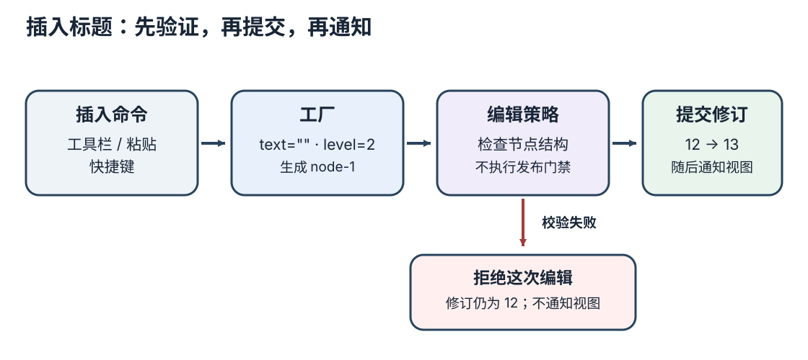
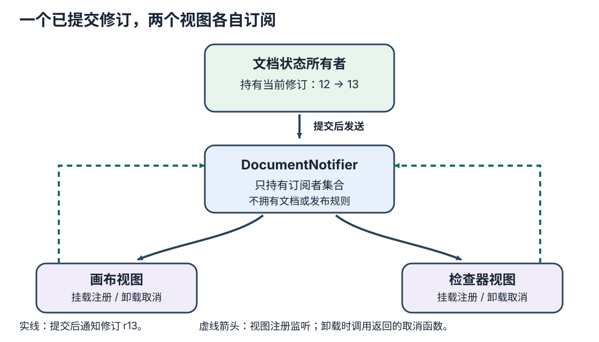

# 页面编辑器何时需要设计模式？

本章用一个合成的页面编辑器作案例：页面文档当前是 revision（修订）12，已有标题 `heading-1` 和按钮 `button-1`。编辑者从工具栏插入一个新标题，画布（显示页面的区域）与检查器（编辑选中节点属性的面板）都要看到插入后的新修订。

**design pattern（设计模式）**给反复出现的对象协作方式起了名字，但模式不会替系统决定谁拥有文档、哪些规则只在发布时检查、订阅何时结束。**GoF（Gang of Four，四人帮）**的原著《设计模式》在介绍每个模式时，也把适用情境、约束、结果和取舍写进说明，并恰好以文档编辑器为贯穿案例；模式不是可以机械套用的类图。

判断是否需要模式，先看哪种变化在反复出现。如果一次普通的函数调用或稳定的条件分支已经让修改范围很清楚，再加对象、注册步骤和清理责任只会让阅读时多跳几次。下文三节各有一个 JavaScript 代码块，它们按出现顺序在同一个模块中运行：工厂一节创建的 `heading` 会直接交给策略一节校验，再交给观察者一节的状态所有者提交。

## 创建规则变多时，用工厂集中入口

工具栏、粘贴和快捷键都能创建标题。若每个入口都各自填写默认属性、分配 ID（标识符），节点形状会逐渐不一致。此时 **factory（工厂）**适合集中这些创建规则；最初通常只是一个函数。

~~~javascript
const defaults = new Map([
  ['heading', { text: '', level: 2 }],
  ['button', { label: '按钮', variant: 'primary' }],
]);

let nextId = 1;

function createNode(type) {
  const initialProps = defaults.get(type);
  if (!initialProps) throw new RangeError('unknown component type');
  if (!Number.isSafeInteger(nextId)) throw new RangeError('node ID counter exhausted');

  const id = 'node-' + nextId;
  nextId += 1;
  return { id, type, props: { ...initialProps }, children: [] };
}

const heading = createNode('heading');
console.log(JSON.stringify(heading));
try {
  createNode('constructor');
} catch (error) {
  console.log(error.name);
}
~~~

这段程序输出一个 ID 为 `node-1` 的标题草稿，文本初始为空、层级为 2；`createNode('constructor')` 则抛出 `RangeError`。空文本只是编辑期的默认值：下一节的策略会检查字段类型和层级，而“发布时标题不能为空”这类要求不应塞进节点创建。用 `Map` 而不是普通对象登记默认值，是因为 `Map` 只认显式注册的类型，不会把对象原型上的 `constructor` 等同名属性误当成可创建的类型。若整个页面只有一处创建这种固定对象，直接写对象字面量更清楚。

这里的计数器只保证本次运行内分配的编号不重复。页面刷新、跨窗口协作或多个写入者并发时，它不能保证全局唯一，持久化系统需要由文档状态或专门的 ID 方案（如 UUID）负责。创建出的对象若没通过后续校验，计数器会留下空号，但不影响唯一性。这个简单函数也不是 GoF 中的 **Factory Method（工厂方法）**或 **Abstract Factory（抽象工厂）**：前者让子类决定实例化哪个类，后者创建相关对象族；本例没有这类变化需求。

## 行为可互换时，用策略

工厂产出的节点在提交前要先校验。不同组件类型有各自的编辑期结构规则；若不想让每次新增类型都往一个不断变长的条件块里加分支，可以把每种类型的校验放进各自的函数，按类型查找。**strategy（策略）**模式就是让调用方通过同一个契约，使用这些可以互换的算法。

~~~javascript
const editableValidators = new Map([
  ['heading', node => {
    const errors = [];
    if (typeof node.props.text !== 'string') errors.push('标题文本必须是字符串');
    if (!Number.isInteger(node.props.level) || node.props.level < 1 || node.props.level > 6) {
      errors.push('标题层级必须是 1 到 6 的整数');
    }
    return errors;
  }],
  ['button', node => (
    typeof node.props.label === 'string' ? [] : ['按钮标签必须是字符串']
  )],
]);

function validateEditableNode(node) {
  const validate = editableValidators.get(node.type);
  return validate ? validate(node) : ['未知组件类型：' + node.type];
}

function previewDraftNode(node) {
  const errors = validateEditableNode(node);
  if (errors.length > 0) throw new TypeError('invalid draft node');
  return { type: node.type, props: { ...node.props } };
}

const invalidHeading = {
  ...heading,
  props: { ...heading.props, level: 8 },
};
console.log(JSON.stringify({
  headingErrors: validateEditableNode(heading),
  invalidHeadingErrors: validateEditableNode(invalidHeading),
  preview: previewDraftNode(heading),
}));
~~~

输出中，空标题的编辑错误列表是 `[]`；把同一个 `node-1` 改成 8 级后，返回 `['标题层级必须是 1 到 6 的整数']`；预览保留空文本和 2 级结构。下一节的状态所有者会自己调用 `validateEditableNode(node)`，而不是相信调用者另外传来的错误列表。来自服务器或外部文件的节点，还要先通过通用的结构解析；这里的策略只校验已解析节点的类型特有字段，也不负责授权。

“编辑时合法”和“可以发布”必须由不同流程负责。空标题现在可以保存为草稿并预览；本例的产品发布规则另外要求标题非空，下一节会由发布入口针对某个具体修订检查这一条。若类型和规则数量很少且稳定，`switch` 更直接；只有变化确实分散时，策略注册才值得承担额外维护。

## 多个视图订阅同一修订时，用观察者

校验通过的节点要提交进文档，并让画布和检查器同时看到结果。插入命令接收前两节创建并校验过的同一个 `heading`。状态所有者（持有当前文档、唯一能提交修订的模块）无论最终接受还是拒绝，都会自己调用策略；只有没有错误时才创建新修订并提交，再把已提交的文档交给通知器，画布与检查器因此读到同一个修订。**observer（观察者）**模式让一个状态主体管理多个接收者；这里文档仍由状态所有者持有，通知器只持有订阅列表。

> [!example]- 状态提交、通知快照与指定修订的发布实现
>
> ~~~javascript
> class DocumentNotifier {
>   #listeners = new Set();
>
>   subscribe(listener) {
>     this.#listeners.add(listener);
>     return () => this.#listeners.delete(listener);
>   }
>
>   notify(document) {
>     const listeners = [...this.#listeners];
>     for (const listener of listeners) listener(document);
>   }
> }
>
> function freezeNode(node) {
>   return Object.freeze({
>     ...node,
>     props: Object.freeze({ ...node.props }),
>     children: Object.freeze([...node.children]),
>   });
> }
>
> function freezeDocument(document) {
>   return Object.freeze({
>     ...document,
>     nodes: Object.freeze(document.nodes.map(freezeNode)),
>   });
> }
>
> const state = {
>   current: freezeDocument({
>     revision: 12,
>     nodes: [
>       { id: 'heading-1', type: 'heading', props: { text: '首页', level: 1 }, children: [] },
>       { id: 'button-1', type: 'button', props: { label: '报名' }, children: [] },
>     ],
>   }),
> };
> const revisions = new Map([[12, state.current]]);
> const notifier = new DocumentNotifier();
> const received = [];
> const unsubscribeCanvas = notifier.subscribe(doc => received.push('canvas r' + doc.revision));
> const unsubscribeInspector = notifier.subscribe(doc => received.push('inspector r' + doc.revision));
> let notifying = false;
> let publishedRevision = 12;
>
> function commitEditableNode(node) {
>   if (notifying) return { ok: false, errors: ['通知期间不能同步提交编辑'] };
>   const errors = validateEditableNode(node);
>   if (errors.length > 0) return { ok: false, errors };
>
>   const exists = state.current.nodes.some(existing => existing.id === node.id);
>   const nodes = exists
>     ? state.current.nodes.map(existing => existing.id === node.id ? node : existing)
>     : [...state.current.nodes, node];
>   const next = freezeDocument({
>     ...state.current,
>     revision: state.current.revision + 1,
>     nodes,
>   });
>   state.current = next;
>   revisions.set(next.revision, next);
>
>   notifying = true;
>   try {
>     notifier.notify(next);
>   } finally {
>     notifying = false;
>   }
>   return { ok: true, revision: next.revision, nodeId: node.id };
> }
>
> function publishRevision(revision) {
>   const document = revisions.get(revision);
>   if (!document) throw new RangeError('draft revision not found');
>   for (const node of document.nodes) {
>     const errors = validateEditableNode(node);
>     if (errors.length > 0) return { ok: false, errors, publishedRevision };
>     if (node.type === 'heading' && node.props.text.trim().length === 0) {
>       return { ok: false, error: '标题发布时不能为空', publishedRevision };
>     }
>   }
>   publishedRevision = revision;
>   return { ok: true, publishedRevision };
> }
>
> console.log(JSON.stringify(commitEditableNode(invalidHeading)));
> console.log(JSON.stringify({ revision: state.current.revision, notifications: received.length }));
> console.log(JSON.stringify(commitEditableNode(heading)));
> console.log(JSON.stringify({
>   preview: previewDraftNode(state.current.nodes.find(node => node.id === heading.id)),
>   revision: state.current.revision,
>   notifications: received.join(', '),
> }));
> console.log(JSON.stringify(publishRevision(13)));
>
> const savedHeading13 = state.current.nodes.find(node => node.id === heading.id);
> const completedHeading = {
>   ...savedHeading13,
>   props: { ...savedHeading13.props, text: '首页标题' },
> };
> console.log(JSON.stringify(commitEditableNode(completedHeading)));
> console.log(JSON.stringify(publishRevision(14)));
> console.log(JSON.stringify({ notifications: received.join(', ') }));
> unsubscribeCanvas();
> unsubscribeInspector();
> ~~~

这段程序按顺序执行：先用 8 级标题尝试提交，策略返回错误，状态仍是 revision 12，通知数为 0。接着提交工厂生成的空标题，它通过编辑校验，状态所有者把它提交为 revision 13；预览得到描述符，画布和检查器都收到 `r13`。发布流程读取确切的 revision 13，因标题为空而拒绝，公开版本仍是 12。给同一个 `node-1` 填上文本后，状态所有者提交 revision 14，两个视图收到 `r14`，发布检查这次通过，公开版本切换到 14。这里只用一个“当前发布修订号”表示发布结果；不可变快照怎样创建和切换，见[页面文档和发布快照的数据模型](low-code-editor-data-model.md)。

`notify()` 开始时会复制一份接收者列表，所以本轮通知期间新增或取消订阅只影响之后的通知；即使某个回调在本轮中取消了别人的订阅，对方仍会收到本轮的通知。这份副本只固定接收者集合，并不保护文档内容。文档内容的保护靠不可变更新加 `Object.freeze`：每次提交都复制并冻结文档、节点、属性和子节点数组，画布和检查器只能读取。同步通知期间若有人再次提交，状态所有者会拒绝，避免嵌套提交让检查器先看到 `r14`、再看到旧的 `r13`。这段简化代码的属性只有字符串和数字，`freezeNode` 只冻结到 `props` 对象本身；属性值里若有嵌套的可变对象，也要按结构逐层复制冻结，或采用其他不可变约定。

若某个监听器抛错，异常会传回提交的调用者，本轮排在它后面的监听器收不到通知；但文档修订在通知前已经提交，`finally` 也会解除“通知期间禁止提交”的保护。若要求每个视图都必须收到通知，可以在通知边界另外定义错误隔离或重试。这会改变当前的错误语义，但本例不必为此再造一个事件队列。

订阅应随视图的生命周期结束：视图卸载时调用 `subscribe()` 返回的取消函数。`Set` 按插入顺序保存不同的监听器。为什么要先复制再遍历？因为直接迭代 `Set` 是“实时”的：遍历中删除尚未访问的项，它就会被跳过；遍历中新增的项，也会在本轮被访问到。快照避免了这两种意外，具体规则见来源条目中的 ECMAScript §§24.2.4.4、24.2.4.17–18 和 24.2.6.1。

浏览器的 `EventTarget` 也让对象直接管理自己的监听器，支持注册与移除，可以看作内置的观察者式 API；不过它还有事件捕获、冒泡和取消等额外语义。页面级事件分发细节见[浏览器怎样查询、更新 DOM 并响应用户输入？](../../frontend/browser/dom-events.md)；应用层消息总线与监听器重入见[JavaScript 事件总线在监听器中重入时怎样保持顺序？](../../frontend/javascript/event-bus-and-observer-patterns.md)。

与观察者容易混淆的是 **publish-subscribe（发布订阅）**：它把消息按主题交给一个中介路由，发布者只知道主题，不必知道具体接收者。例如中介可持有 `Map<topic, Set<listener>>`，订阅者收到返回的取消函数后从相同主题集合中移除自己。若多个独立插件要监听 `document:saved`，这种路由可能减少直接引用；但主题字符串和跨模块调用也会让消息来源更难追踪。画布和检查器天然属于这份文档，直接订阅文档通知器更容易沿着对象找到依赖；父子组件只有一个回调时，普通回调就够了。有多个接收者也不意味着必须创建全局事件总线。

## 共享实例有明确范围时，才用单例

工厂和策略都依赖一份“组件类型 → 默认值或校验函数”的注册表。若编辑器要求所有面板使用同一份注册表，必须先说清“同一份”指什么范围。**singleton（单例）**把“只有一个实例”和“全局访问点”绑在一起，但它不能自动保证浏览器的多个标签页、worker（工作线程）、多个进程或被重复打包的模块副本共享同一个对象。

多数编辑器只需在应用的组合入口（组装各模块的启动代码）创建一个 `EditorRuntime`，再把注册表传给画布、检查器和命令处理器。这样在一个应用内确实共享同一实例，而测试可以另外创建独立的运行时。JavaScript 模块级变量只在该模块实例内共享；它不意味着一个页面只有一个编辑器，更不保证不同模块副本共用实例。全局单例则隐藏依赖，容易让两个编辑器实例或不同测试相互污染。如果类的构造器仍公开，`getInstance()` 访问器也不能阻止调用方 `new` 出额外对象。只有全局访问点本身能解决明确问题时才承担这种耦合；否则显式创建和传递更容易观察生命周期。

## 用设计原则检查模式是否合适

前面四种模式各自解决了一个局部问题，最后要用设计原则检查它们合起来是否让修改更容易。沿“插入空标题”流程检查责任边界：工厂只负责节点初值与 ID；编辑期策略负责节点结构；状态所有者对策略结果作决定并提交修订；观察者只通知已提交的只读状态；发布服务另行检查指定修订能否成为公开版本。发布失败不会撤销可以保存、预览和继续编辑的草稿。

添加一种新节点类型时，开发者可能仍要修改类型定义、渲染器和发布规则。工厂或策略不会自动实现 Open/Closed Principle（开闭原则，对扩展开放、对修改关闭）；只有新变化能在局部扩展、而调用契约保持稳定时，修改范围才真正缩小。观察者让状态所有者不必逐个调用视图，但订阅清理、文档只读和错误传播仍要明确约定。上层流程依赖通知契约、下层通知器实现这个契约，是 Dependency Inversion Principle（依赖倒置原则）的一种接法。模式应该服务于变化边界，而不是成为又一份要套用的清单；这些原则的完整讨论见[如何让设计原则减少真实的修改成本？](software-design-principles.md)。

注意编号重合：本篇从 revision 12 插入空标题得到 revision 13；[页面文档和发布快照的数据模型](low-code-editor-data-model.md)也从 revision 12 出发，但做的是把 `heading-1` 的文案从“首页”改成“欢迎”，得到另一个 revision 13。两者是各自独立的教学路径，两个 revision 13 内容不同，不是同一文档的先后两步。本篇为聚焦对象协作，把节点简化成 `nodes` 数组；完整案例用 `rootIds` 加按 ID 索引的节点表保存文档树，撤销、持久化和发布快照的契约也在数据模型章节展开。组件数据由哪些前端对象拥有见[前端架构边界](frontend-architecture-boundaries.md)。

> [!info]- 来源
> - GoF 对模式适用情境、约束、结果与权衡的说明，及文档编辑器案例：[Gamma、Helm、Johnson、Vlissides, *Design Patterns: Elements of Reusable Object-Oriented Software*](https://www.oreilly.com/library/view/design-patterns-elements/0201633612/)。
> - `Set` 删除、默认值迭代入口与迭代器行为：[ECMAScript 2026, Keyed Collections, §§24.2.4.4、24.2.4.17–18、24.2.6.1](https://tc39.es/ecma262/2026/multipage/keyed-collections.html#sec-set-iterator-objects)，2026-11-12 核对。
> - `EventTarget` 的监听列表、注册、移除与事件分发：[WHATWG DOM Standard, §§2.7、2.9](https://dom.spec.whatwg.org/#interface-eventtarget)，2026-11-12 核对。
> - 设计原则与模式的关系：[Robert C. Martin, “Design Principles and Design Patterns” (2000), p. 4](https://objectmentor.com/resources/articles/Principles_and_Patterns.pdf)。
