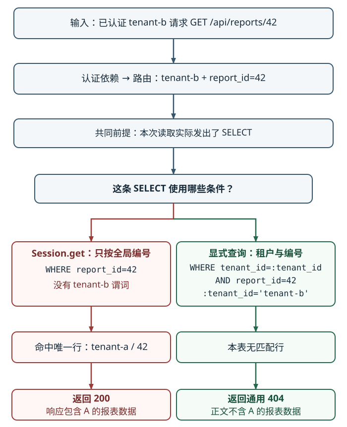

# 怎样用最小反例定位报表授权回归？

案例：一个多租户报表平台收到跨租户访问的回归报告。按需求，租户 `tenant-a` 读取自己的报表 42 应返回 200；另一个已认证的租户 `tenant-b` 即使猜中同一个全局编号 42，也只能得到 404。定位问题时，先把这条需求改写成可观察的输入和输出，再提出一个能被反例推翻的根因假设。若 B 收到了 200，就沿着可信主体、Application Programming Interface (应用程序接口，API) 的路由参数、实际取数方式、返回对象属于谁、响应怎样生成这几段逐一核对；不能只凭状态码猜根因，也不能预设“数据库一定发了查询”。完整路由的可运行回归测试见[怎样用测试边界验证一次报表服务改动？](../testing/software-testing-strategy.md)，本页只比较其中用到的 Structured Query Language (结构化查询语言，SQL) 条件。

图中的两列代码分别是下一节会介绍的重构后写法和修复写法，并且只画两者本次都实际发出 SELECT 的情况：红列的 `Session.get()` 只按全局主键读取，绿列的显式查询同时按租户和编号过滤。`Session.get()` 也可能不发 SQL，直接从本会话的 identity map (身份映射表) 返回已加载的对象，这条路径不在图中，排查方法在下文说明。状态码只提示结果，不能单独证明故障出在哪里。

## 先把症状变成可证伪假设

先固定这个合成模型：`report_id` 是全局主键，`tenant_id` 记录资源归属哪个租户；表中只有一行 `(tenant-a, 42, ready)`。假设一次重构把原来限定租户范围的查询：

~~~python
report = session.scalar(
    select(Report).where(
        Report.report_id == report_id,
        Report.tenant_id == tenant_id,
    )
)
~~~

替换成按主键取对象：

~~~python
report = session.get(Report, report_id)
~~~

SQLAlchemy 2.0 的 `Session.get()` 按主键取对象。使用默认选项时，如果对象已在当前 Session 的 identity map 中且未完全过期，它会直接返回该对象，不发 SELECT；对象不在 identity map 中或已完全过期时，才按主键查询数据库。显式设置 `populate_existing=True` 也会强制查询。无论走哪条路径，它都不会自动加上当前主体的租户授权条件。因为本例把 `report_id` 设为全局主键，`session.get(Report, 42)` 是合法主键读取，但不是所有权检查。若实际表用复合主键，应把相应键元组交给 `get`；仍要另行验证主体是否有权访问该资源。

原有测试只让 A 创建并读取自己的报表，所以重构前后都能通过：它证明了所有者能读，却没有检验授权边界。因此先列出这条路由应满足的全部结果：

| 主体 | 输入 | 预期结果 |
|---|---|---|
| `tenant-a` | `GET /api/reports/42` | 200，返回自己的报表 42 |
| `tenant-b` | 同一请求，主体已由可信认证接缝给出 | 按本例隐藏策略返回通用 404；正文不含 A 的归属或报表数据，且与请求不存在的 43 相同 |
| 无有效主体 | 同一请求 | 401，由本例的认证入口拒绝，并带适用的 `WWW-Authenticate` 认证质询 |

能暴露问题的最小反例只需要两样东西：数据库里属于 A 的报表 42，以及可信主体 B 对同一路由的一次读取。若还要验证本例“隐藏资源是否存在”的策略，就再比较 B 请求已存在的 A/42 和确实不存在的 43，确认两者状态码和通用正文都相同；只看到 404 状态码，不能证明正文没有泄露 A 的归属或数据。然后按实测结果缩小调查范围：

| B 的观察 | 它能说明什么 | 接下来核对什么 |
|---|---|---|
| 得到 200 | 保护条件可能丢失，但还不能单凭状态码定根因 | 确认当前主体、实际入口、取数调用及结果归属、缓存命中和响应映射 |
| 得到 404 | 状态码符合预期，但仍需确认响应没有带出 A 的数据 | 检查测试是否走到同一入口、确实使用 B、装入 A/42 数据，以及响应对象归属和正文；若要验证隐藏存在性，再与不存在的 43 比较 |

若 B 得到 200，就追踪这一次实际取数：认证依赖给出的是否是 B，路由是否把 `tenant-b` 和 42 都传了下去，读取调用到底返回了什么，响应是否真的用了这个对象。若发出了 SQL，就核对最终的 WHERE 条件和绑定值；若 `Session.get()` 直接从 identity map 返回，就核对调用时用的主键和返回对象的归属。B 得到 200 已违反约定的响应策略。要进一步把数据泄漏定位到这条读取路径，还需确认路径返回了 A 的行或对象，并且响应包含其数据。即使状态码为 404，正文透露报表归属也违反隐藏策略。若 SQL 正确限定了租户、查不到可见的行，响应却仍含 A 的数据，就继续追查旁路缓存、备用读取或序列化分支。反例只说明出了问题，本身不是根因证据。

## 沿调用路径找出丢失的条件

从公开入口向数据读取方向追踪同一个请求：

1. 确认请求到达哪条公开路由，是否经过认证依赖。
2. 核对依赖返回的主体来自已验证会话或令牌，而非任意客户端字段。
3. 查看路由是否把 `report_id` 和可信主体的 `tenant_id` 都传给数据层。
4. 检查实际取数方式和参数；若执行查询，再核对最终 SQL 或 object-relational mapping (对象关系映射，ORM)条件与绑定值。确认返回对象归属，以及 cache (缓存)是否绕过同一授权范围。
5. 追到错误映射和序列化，确认“查无当前主体可见行”没有被备用分支改成成功响应。

在这个例子中，路由仍然拿到了 `tenant_id`，但 `session.get` 只按全局主键取记录，根本没用到这个租户值。修正时要把报表编号和可信的租户值一起作为查询条件：

~~~python
report = session.scalar(
    select(Report).where(
        Report.report_id == report_id,
        Report.tenant_id == tenant_id,
    )
)
~~~

在实际代码里，还要核对 ORM 生成的查询，确认两个绑定值都进入了最终 SQL，而不是只存在于调用方的局部变量里。改用显式查询后，结果不再从 identity map 直接返回，每次都按租户条件查询。另外，若成功响应的 cache 键只包含 `report_id`，即使修好了数据库查询，请求仍可能命中缓存绕过检查；缓存返回之前也必须执行同样的主体范围检查。逐次授权规则、查询与缓存边界见[如何逐次授权租户内的报表资源？](../security/web-security-and-authentication.md)。

修完后，用同一入口和输入重放：A 仍得到 200；B 请求 A/42 和不存在的 43 都得到相同的通用 404，正文不含 A 的归属或报表数据；匿名请求得到 401，并带本例测试断言的 `WWW-Authenticate: Bearer realm="reports"` 质询。再检查相邻的参数校验、错误映射和缓存路径，确保修正没有改变无关的响应，也没有留下另一条绕行路径。真实路由、SQLite 查询和测试夹具的完整可运行例子见[测试边界页](../testing/software-testing-strategy.md)；那一页也说明了 SQLite 和 TestClient 不能代表生产数据库或真实网络。

## 自动审查意见怎样用证据指导改进？

安全扫描或代码审查 Agent（智能体）的 finding（审查发现）应能让另一位工程师沿着同一差异和执行路径复核。报告固定检查的基准与候选提交、覆盖或跳过范围和 finding 位置。每项结论再给出所依据的调用路径、授权条件、成立前提与可观察影响。引用应能重新打开，例如指向准确的差异行、测试名及运行记录、授权检查或响应证据。严重度和置信度要说明各自依据。若问题依赖未改动的上下文，也要指出它怎样与这次差异共同改变行为。

本例若报告“`tenant-b` 可读取 `tenant-a` 的报表 42”，证据应能沿可信主体 B、实际读取或缓存范围、对象归属和 HTTP 响应逐项回查，并指向通过认证入口运行的回归测试。单写“缺少租户过滤”不能证明数据进入了 B 的响应，单列一个 404 测试也不能证明它经过了这条路径。

核实误报时，沿同一个 B 请求继续检查路由、数据层、identity map、缓存和序列化。若 finding 只因 `session.get` 没有租户条件便断定泄露，要确认下游是否存在可靠的对象归属检查，且该检查在响应或缓存返回前执行。再用 A/42 与不存在的 43 验证实际入口的响应正文和状态。只有路径证据与测试结果共同表明 A 的对象不会进入 B 的响应，才可判为误报。否则应标为已确认或证据不足，而不是从 `session.get` 的名字、单条 404 或测试标签推断结论。

本例涉及跨租户数据，可以请熟悉该授权边界、未参与补丁编写的工程师独立验收。验收人拿到基准与候选提交、finding 引用和固定测试夹具后，独立确认主体来源、实际读取路径和测试入口，并重放前文已定义的 A/B 业务契约。保留验收人、候选版本、测试运行记录和未覆盖路径。无法重现或证据链断开的意见标为证据不足。

复核结论可归类为已确认、误报、重复或证据不足，并附相应依据。已确认问题进入回归集。其他结论再指向上下文、检测规则、报告门槛或待补的证据。修复提交、仓库写入权限和合并审批仍按仓库策略授权，自动审查结果只是供审查者核验的证据。Agent 工具的逐次授权见[生产 AI 如何阻止不可信内容诱导模型越权](../../ai-engineering/actions/prompt-injection-as-permission-confusion.md)。

仓库也可以把审查、修正和批准分配给不同角色。例如 2026 年 11 月发布的 Claude Ship 中，Code Review 提出并复核问题，PR Steward 可处理失败的检查并修改 PR，Claude Approvals 根据默认分支上的团队策略决定能否批准，合并仍受仓库的必需检查和分支保护约束。对这里的跨账户访问问题，团队可以把访问控制变更留给指定人员，并要求提交同一反例的修复前后结果。

## 独立阅读实现与测试

修复之后的代码评审，要能独立发现上面这类遗漏。做法是先从需求列出哪些请求必须被拒绝，再分别阅读实现和测试。实现侧要看改动后的公开路由、调用方、认证依赖、实际读取（无论是 SQL 查询还是 identity map 返回）、事务、缓存和响应分支；测试侧要确认用了归属不同的可信主体、测试经过被修改的入口、fixture (测试夹具) 接的是预期数据库，并且断言检查了“不应发生的成功响应”。同一个人或同一个 AI 模型同时写出的实现和测试，可能共享同一个遗漏的假设，所以测试全绿并不说明漏掉的授权条件已经被检查。

对这次回归，评审要能把四项证据串起来：主体 A/B 的实际输入，HTTP 状态码与正文，改动前后的查询条件，以及先失败、修复后通过的回归测试。若删掉租户条件后，所有者测试仍通过而 B 的 404 断言失败，就证明这组测试能区分两种实现。若结论还涉及数据库约束、消息代理重投或部署装配，先核实测试是否真的用了目标数据库、真实消息代理或部署路径；模拟会话、本地重复调用和健康探针都只覆盖各自那一层。测试层如何匹配具体失败边界见[怎样用测试边界验证一次报表服务改动？](../testing/software-testing-strategy.md)。

> [!example] 修复前后复验同一反例
> - **输入：** 数据库只有 A 持有的全局 `report_id=42`；认证依赖为请求给出可信主体 B。
> - **修复前 (重构之后)：** `session.get(Report, 42)` 可能从 identity map 返回 A/42，也可能按全局主键查询。确认实际返回的对象属于 A，且该对象进入 B 的 200 响应，才定位到这条越权路径；是否发出 SQL 要以本次执行为准。
> - **修复：** 用 `report_id=42` 和可信主体的租户值 `tenant-b` 同时过滤。
> - **修复后：** A 仍读到自己的行并得到 200；B 对已有的 A/42 与不存在的 43 都得到相同通用 404，正文不含 A 的归属或报表数据；匿名请求得到 401，测试同时核对模拟 Bearer 质询头。
>
> 这些输出只覆盖所测路由与缓存状态。后台导出、其他查询入口和缓存各自有独立访问路径，应按相应数据边界核对。

提交到共享分支的修复应只包含这次问题相关的改动，提交方法见[Git 怎样把通过验收的报表改动变成可追溯提交？](../version-control/git-essentials.md)。评审者应独立查看实际差异、需求边界和测试覆盖；具体的审批和合并门槛由仓库的规则决定。

> [!info]- 来源
> - SQLAlchemy 2.0 官方 [Session.get API](https://docs.sqlalchemy.org/en/20/orm/session_api.html#sqlalchemy.orm.Session.get)：若主键对象在身份映射表且未完全过期，默认调用可不发 SQL；过期对象会刷新，`populate_existing=True` 会强制查询；复合主键可用元组或字典表示。核对于 2026-11-12；实际包版本为 2.0.44。
> - IETF [RFC 9110](https://www.rfc-editor.org/rfc/rfc9110.html) §§15.5.2、15.5.4–15.5.5：401 必须含适用 `WWW-Authenticate` 质询；服务可用 404 隐藏当前禁止访问的资源，但正文是否披露归属仍需由响应与测试保证。核对于 2026-11-12。
> - GitHub 官方 [Reviewing proposed changes in a pull request](https://docs.github.com/en/pull-requests/how-tos/review-pull-requests/reviewing-proposed-changes-in-a-pull-request) 与[Giving reviews](https://docs.github.com/en/pull-requests/concepts/giving-reviews)：支持阅读文件差异、对具体改动评论和提交审查；代码根因与修复结论来自本页合成例的查询和测试证据。核对于 2026-11-12。
> - 租户授权的完整规则与缓存边界由[如何逐次授权租户内的报表资源？](../security/web-security-and-authentication.md)承担；本文只追踪一次范围条件回归。
> - **自动安全审查的范围与发现报告。** OpenAI，[Building Security Review into Your SDLC with Codex Security](https://developers.openai.com/blog/building-security-review-into-your-sdlc-with-codex-security)，2026-11-23，“Review at the right level”“Security context gives reviewers something to reason from”“An automated review loop returns reports”。文章提供产品工程实践说明，解释如何组织报告、修复建议与覆盖范围。目标仓库的效果仍需另行评估。
> - **审查、修改与批准的权限分工。** [Introducing Claude Ship](https://claude.com/resources/articles/introducing-claude-ship)，Anthropic，2026-11-23。发布时 Code Review 已正式推出，PR Steward 和 Claude Approvals 为 beta。
> - **Codex Security 当前审查实现。** OpenAI，[Review code changes for security](https://developers.openai.com/codex/security/plugin/code-changes)，在线文档，核对日期：2026-11-25。用于核对安全上下文、检查范围、finding 和覆盖状态等当前产品输出。具体字段以所用版本为准。
