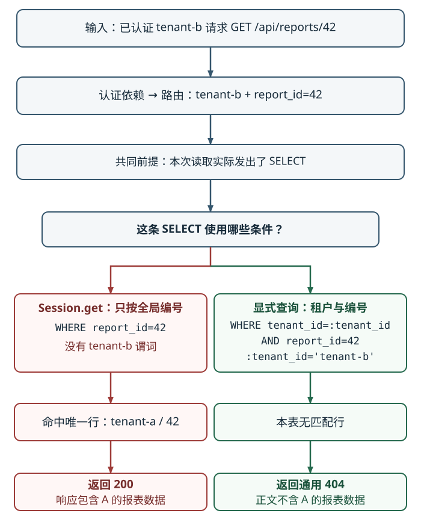

# 怎样用最小反例定位报表授权回归？

报表平台工程师收到跨租户访问回归：`tenant-a` 读取自己的报表 42 应返回 200；已认证的 `tenant-b` 猜中同一个全局编号时只能得到 404。定位时先把这条需求改写成可观察的输入和输出，再提出能被反例推翻的根因假设。若 B 收到 200，就沿可信主体、Application Programming Interface (应用程序接口，API)路由参数、实际取数方式、返回对象归属及响应映射逐段核对，不能仅凭状态码或预设“数据库一定发了查询”猜根因。完整路由的可运行回归测试见[怎样用测试边界验证一次报表服务改动？](../testing/software-testing-strategy.md)；本页会比较其中用到的 Structured Query Language (结构化查询语言，SQL)条件。

图只比较两种实现本次都实际发出 SELECT 时的路径：红列的 `Session.get()` 按全局主键读取，绿列的显式查询按租户与编号过滤。`Session.get()` 若从本会话 identity map (身份映射表)直接返回未完全过期的对象，就不会进入图示的 SQL 路径；此时应核对调用键、返回对象归属以及该对象是否进入响应。只有确认实际取得 A 的对象且响应映射使用了该对象，才能把漏掉的授权条件与越权 200 连起来。若查询条件和绑定值正确、结果为空，但响应仍含 A 的数据，就继续追查旁路缓存、备用读取或序列化分支。响应码提示结果，不单独证明故障位置。

## 先把症状变成可证伪假设

先固定这个合成模型：`report_id` 是全局主键，`tenant_id` 是资源所有者；表中有 `(tenant-a, 42, ready)`。假设一次重构把原有的租户范围查询：

~~~python
report = session.scalar(
    select(Report).where(
        Report.report_id == report_id,
        Report.tenant_id == tenant_id,
    )
)
~~~

替换成按主键取对象：

~~~python
report = session.get(Report, report_id)
~~~

SQLAlchemy 的 `Session.get()` 按映射对象的主键身份取对象：使用默认选项时，如果对象已在当前 Session 的 identity map (身份映射表)中且未完全过期，它可能直接返回而不发 SELECT；若对象不在 identity map 中或已完全过期，才会按主键查询。显式设置 `populate_existing=True` 也会强制查询。两种读取路径都不会自动加上当前主体的租户授权条件。因为本例把 `report_id` 设为全局主键，`session.get(Report, 42)` 是合法主键读取，但不是所有权检查。若实际表用复合主键，应把相应键元组交给 `get`；仍要另行验证主体是否有权访问该资源。

原测试只以 A 建立并读取自己的报表，所以在这次重构前后都可能通过；它证明了所有者能读，却没有区分授权边界。先列出该路由应满足的结果：

| 主体 | 输入 | 预期结果 |
|---|---|---|
| `tenant-a` | `GET /api/reports/42` | 200，返回自己的报表 42 |
| `tenant-b` | 同一请求，主体已由可信认证接缝给出 | 按本例隐藏策略返回通用 404；正文不含 A 的归属或报表数据，且与请求不存在的 43 相同 |
| 无有效主体 | 同一请求 | 401，由本例的认证入口拒绝，并带适用的 `WWW-Authenticate` 认证质询 |

最小反例只有两件东西：数据库里那条属于 A 的 42，以及一次可信主体 B 对相同路由的读取。要验证本例隐藏存在性的策略，还需比较 B 请求已存在的 A/42 与确实不存在的 43，确认状态和通用正文相同；只看 404 状态码不能证明正文不含 A 的归属或数据。然后按实测结果缩小调查范围：

| B 的观察 | 它能说明什么 | 接下来核对什么 |
|---|---|---|
| 得到 200 | 保护条件可能丢失，但还不能单凭状态码定根因 | 确认当前主体、实际入口、取数调用及结果归属、缓存命中和响应映射 |
| 得到 404 | 状态码符合预期，但仍需确认响应没有带出 A 的数据 | 检查测试是否走到同一入口、确实使用 B、装入 A/42 数据，以及响应对象归属和正文；若要验证隐藏存在性，再与不存在的 43 比较 |

若 B 得到 200，先追踪这次实际取数：认证依赖是否给出 B，路由是否把 `tenant-b` 与 42 传下去，读取调用究竟返回了什么，响应是否真的采用了该对象。若发出了 SQL，就核对最终谓词和绑定值；若 `Session.get()` 从 identity map 直接返回，就核对调用键和对象归属。只有实际取得 A 的行或对象并确认它进入 200 响应，才能证实这条授权回归。若 SQL 正确限定租户且查无可见行，但响应仍含 A 的数据，继续追踪旁路缓存、备用读取或序列化分支；不要把反例结果本身当作根因证据。

## 沿调用路径找出丢失的条件

从公开入口向数据读取方向追踪同一个请求：

1. 确认请求到达哪条公开路由，是否经过认证依赖。
2. 核对依赖返回的主体来自已验证会话或令牌，而非任意客户端字段。
3. 查看路由是否把 `report_id` 和可信主体的 `tenant_id` 都传给数据层。
4. 检查实际取数方式和参数；若执行查询，再核对最终 SQL 或 object-relational mapping (对象关系映射，ORM)条件与绑定值。确认返回对象归属，以及 cache (缓存)是否绕过同一授权范围。
5. 追到错误映射和序列化，确认“查无当前主体可见行”没有被备用分支改成成功响应。

在这个例子中，路由仍然拿到了 `tenant_id`，但 `session.get` 只按全局主键身份取记录，没有用这个租户值。修正数据库查询时，要把报表编号与可信租户值一起作为条件：

~~~python
report = session.scalar(
    select(Report).where(
        Report.report_id == report_id,
        Report.tenant_id == tenant_id,
    )
)
~~~

对实际代码还要核对 ORM 生成的查询或条件构造，确认两个绑定值进入最终查询，而不是只在调用者局部变量中存在。若通过 identity map 直接拿到对象，则确认查询分支没有执行，并按同一主体范围验证对象归属。若成功响应 cache 键只含 `report_id`，修好数据库查询仍可能被缓存命中绕开；缓存返回之前也必须执行同一主体范围检查。逐次授权规则、查询与缓存边界见[如何逐次授权租户内的报表资源？](../security/web-security-and-authentication.md)。

修完后重放同一入口和输入：A 仍为 200；B 对 A/42 与不存在的 43 都得到通用 404，正文不含 A 的归属或报表数据。匿名请求按本例入口策略为 401；真实认证方案还必须返回并测试适用的 `WWW-Authenticate` 质询。再检查相邻参数校验、错误映射和缓存路径，确保修正没有改变不相关响应或留下另一条绕行路径。真实路由、SQLite 查询及测试夹具的完整执行例子由[测试边界页](../testing/software-testing-strategy.md)承担；该测试页明确了 SQLite 和 TestClient 不能代表生产数据库或真实网络的范围。

## 独立阅读实现与测试

先从需求列出拒绝条件，再分别阅读实现和测试。实现侧要看改动后的公开路由、调用者、认证依赖、实际读取 (无论 SQL 查询还是身份映射表返回)、事务、缓存和响应分支；测试侧要确认输入主体可信且归属不同、测试经过被修改的入口、fixture (测试夹具)接上预期数据库，断言检查了不能发生的成功响应。模型或生成式改动的实现和测试可能共用一个遗漏假设，因此测试全绿并不表示漏掉的授权条件已经被检查。

对这次回归，要能把四项证据接起来：主体 A/B 的实际输入、HTTP 状态与正文、改动前后的查询条件、以及断言失败/恢复的回归测试。若把租户谓词删掉后，所有者测试通过而 B 的 404 断言失败，就证明测试能区分这两种实现。数据库约束、消息代理重投或部署装配需要额外结论时，先核实测试是否使用了目标数据库、真实消息代理或部署路径；模拟会话、本地重复调用和健康探针只覆盖各自接缝。测试层如何匹配具体失败边界见[怎样用测试边界验证一次报表服务改动？](../testing/software-testing-strategy.md)。

> [!example] 修复前后复验同一反例
> - **输入：** 数据库只有 A 持有的全局 `report_id=42`；认证依赖为请求给出可信主体 B。
> - **修复前 (重构之后)：** `session.get(Report, 42)` 可能从 identity map 返回 A/42，也可能按全局主键查询。确认实际返回的对象属于 A，且该对象进入 B 的 200 响应，才定位到这条越权路径；是否发出 SQL 要以本次执行为准。
> - **修复：** 用 `report_id=42` 和可信主体的租户值 `tenant-b` 同时过滤。
> - **修复后：** A 仍读到自己的行并得到 200；B 对已有的 A/42 与不存在的 43 都得到相同通用 404，正文不含 A 的归属或报表数据；匿名请求按本例策略得到 401，真实认证实现还要带适用的质询。
>
> 这些输出只覆盖所测路由与缓存状态。后台导出、其他查询入口和缓存各自有独立访问路径，应按相应数据边界核对。

在共享分支保留聚焦修复，再用[Git 怎样把通过验收的报表改动变成可追溯提交？](../version-control/git-essentials.md)记录源码快照。评审应独立看实际差异、需求边界和测试覆盖；具体审批与合并门槛由仓库政策决定。

> [!info]- 来源
> - SQLAlchemy 2.0 官方 [Session.get API](https://docs.sqlalchemy.org/en/20/orm/session_api.html#sqlalchemy.orm.Session.get)：若主键对象在身份映射表且未完全过期，默认调用可不发 SQL；过期对象会刷新，`populate_existing=True` 会强制查询；复合主键可用元组或字典表示。核对于 2026-11-12；实际包版本为 2.0.44。
> - IETF [RFC 9110](https://www.rfc-editor.org/rfc/rfc9110.html) §§15.5.2、15.5.4–15.5.5：401 必须含适用 `WWW-Authenticate` 质询；服务可用 404 隐藏当前禁止访问的资源，但正文是否披露归属仍需由响应与测试保证。核对于 2026-11-12。
> - GitHub 官方 [Reviewing proposed changes in a pull request](https://docs.github.com/en/pull-requests/how-tos/review-pull-requests/reviewing-proposed-changes-in-a-pull-request) 与[Giving reviews](https://docs.github.com/en/pull-requests/concepts/giving-reviews)：支持阅读文件差异、对具体改动评论和提交审查；代码根因与修复结论来自本页合成例的查询和测试证据。核对于 2026-11-12。
> - 租户授权的完整规则与缓存边界由[如何逐次授权租户内的报表资源？](../security/web-security-and-authentication.md)承担；本文只追踪一次范围条件回归。
