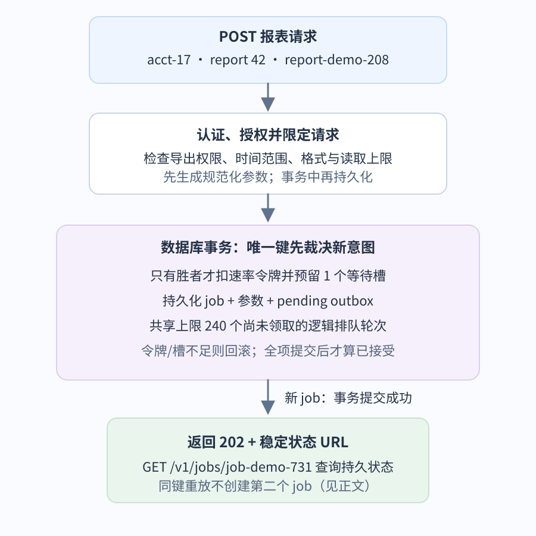
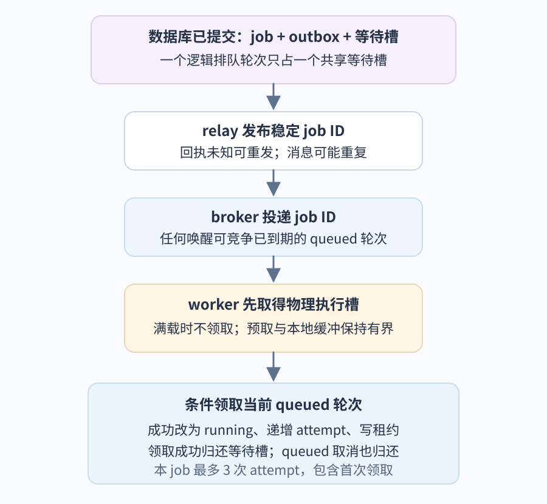
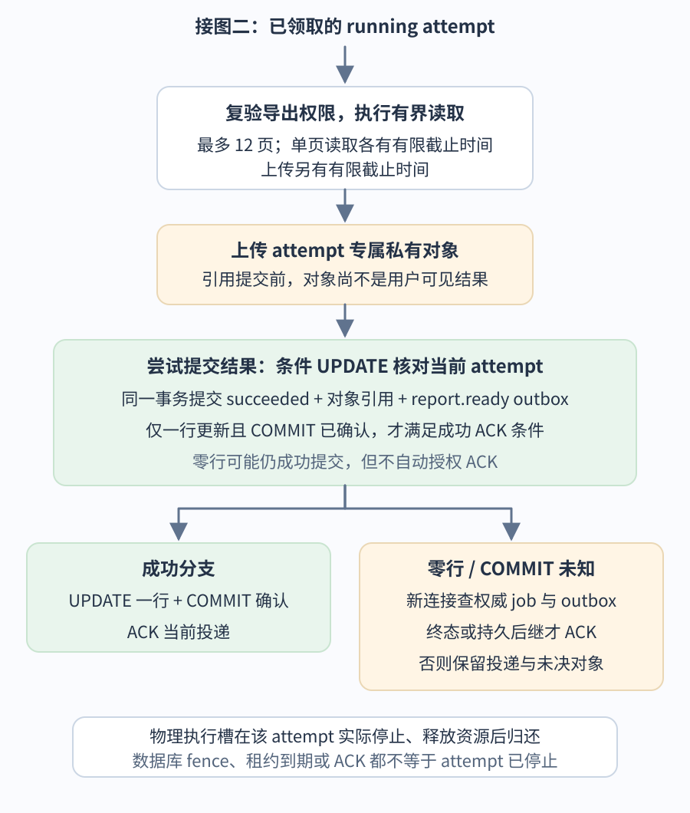

# 怎样设计一个可持久查询的账户报表？

**案例：** 用户为账户 `acct-17` 请求报表 42：只读有限时间范围内的账户活动，并导出 Comma-Separated Values (CSV，逗号分隔值) 文件。一次查询有时超出 Hypertext Transfer Protocol (HTTP，超文本传输协议) 请求预算；浏览器断线后，用户仍要查询状态，并在成功后七天内下载私有结果。客户端以 `report-demo-208` 作为 idempotency key (幂等键)，服务用 `job-demo-731` 标识已持久接受的 job (任务)；报表 ID、任务 ID 和幂等键不能互相替代。案例假设请求约 8 KiB，最多顺序读取 12 页，结果平均 128 KiB。

平均每秒 5 个新 job、峰值每秒 20 个新 job 且持续十分钟、每个 attempt (尝试) 平均六秒、每个 job 最多三个 attempt (含首次)，都是合成输入，不是测量值。

先决定是否真的需要异步化。若有界读取可以稳定在调用方截止时间和尾延迟目标内完成，同步接口只须校验、读取并返回 CSV，省掉状态、排队和清理生命周期。只有当工作可能超过请求预算、断线后仍须继续，或必须与 application programming interface (API，应用程序接口) 的执行资源隔离时，才创建可恢复的持久 job (任务)。队列保留唤醒，不增加处理能力；可持久的 job 才让用户在连接之外查到服务已接受什么、正在发生什么以及最终结果。

## 如何接受请求并让用户查询结果？

客户端可以发出如下请求：

~~~http
POST /v1/accounts/acct-17/reports
Idempotency-Key: report-demo-208
Content-Type: application/json

{"reportId":42,"period":"2026-Q2","format":"csv"}
~~~

服务先认证当前 principal (调用主体)，再检查它是否能为 `acct-17` 导出报表；然后验证时间范围、格式、页面数等有界条件，并生成会影响执行的规范化参数。请求参数若已可判定超过 12 页，就在接受前拒绝；读取中到第 12 页仍未完成时，worker (工作进程) 停止并提交有界失败，不能再无限分页。页数限制不限制单次 I/O 可能无限等待，因此每页读取和对象上传还各自配置并强制执行有限截止时间；具体时长须与客户端、存储和租约策略一起设定。

请求路径中的账户号和随机 job ID 不是授权凭据。`report:read` 不自动包含 `report:export`。后台 worker 使用服务身份访问有限数据，并在开始读取前重新确认原请求主体仍有本报表导出权限；若授权此时已撤销，则不读数据，提交有界的 `authorization_revoked` 失败结果。状态、取消和下载端点也各自检查调用者对该 job 与结果的当前访问权。

若条件满足，响应可为：

~~~http
HTTP/1.1 202 Accepted
Location: /v1/jobs/job-demo-731
Content-Type: application/json

{"jobId":"job-demo-731","status":"queued","cancelRequested":false,"statusUrl":"/v1/jobs/job-demo-731"}
~~~

HTTP 的 `202 Accepted` 表示请求已接受处理，但处理尚未完成，也不承诺之后一定成功。这个服务把“已接受”定义得更强：只有 job、待发布 outbox (事务发件箱) 意图和一个等待槽已在同一数据库事务提交，才返回 202。若数据库提交结果对 API 仍未知，就不能猜测成功；客户端使用原幂等键重试，已有 job ID 时也可查状态，数据库唯一键会把它与已提交记录重新关联。这个应用契约让 `202` 成为可查询的承诺，而不是“内存里排了一个后台任务”。

此处的 `202` 和过载响应是本服务定义的接口合同，具体成功与错误表示仍要有一致的 HTTP API 契约，见[如何设计可预期的 HTTP API 契约？](../backend/http-api-contracts.md)。如果客户端在请求仍可能提交时就超时，必须用同一幂等键和查询路径查证，不能创建一个新意图；其他超时、截止时间与重试边界见[请求超时后如何确认结果并安全重试？](../reliability/api-reliability-and-async-delivery.md#%E8%B6%85%E6%97%B6%E5%92%8C%E6%88%AA%E6%AD%A2%E6%97%B6%E9%97%B4%E8%AE%A9%E8%B0%83%E7%94%A8%E6%96%B9%E5%A4%84%E4%BA%8E%E4%BB%80%E4%B9%88%E7%8A%B6%E6%80%81%EF%BC%9F)。

幂等键在本例按 `(account_id, principal_id, key)` 唯一，并绑定规范化请求指纹，例如报表 ID、期间和格式。新请求在事务中尝试插入带唯一键的 job 身份；唯一约束裁决谁成为这项新意图的胜者。只有胜者才在**同一事务**内预留一个准入令牌与等待槽、补齐 job 参数并写入 outbox，再一起提交。若令牌或槽位不足，事务回滚，未提交的 job 行也消失，不留下已接受的半条记录。

相同键的并发败方等待唯一约束裁决后回滚，再用新事务读取胜者并比较指纹：同指纹返回同一个 job，不再扣令牌或占槽；异指纹返回冲突。

令牌与等待槽通过所有副本共享的配额行管理：扣减使用带余量条件的原子更新，或锁定该行后检查并扣减。两个不同幂等键也必须争用同一份余量，不能各自先读到最后一个空槽就都接受。这里的合成服务把令牌桶也放在同一数据库事务内；若改用外部限流器，必须另设可幂等确认或补偿的预留合同，不能假定数据库回滚会退回外部令牌。不能只先 `SELECT` 再 `INSERT`：并发请求可能都先查无记录。队列消息只携带稳定 job ID，不塞入原始正文或敏感筛选条件；worker 所需的规范化参数在 job 中单独持久保存，指纹只负责比较。

图一只画首次接受新 job 的成功路径。幂等重放不创建新 job：若并发唯一键争用使本事务失败，调用方先回滚，再读取胜者；同指纹返回同一个 job，异指纹返回冲突。等待槽达到共享上限 240 时事务回滚，在 202 前拒绝；数据库不可用或提交结果未知时，服务也不能声称接受成功。

状态查询返回 job 的持久状态与有界错误码。取消用 `DELETE /v1/jobs/job-demo-731` 表达“请求停止”，不代表计算已立即停止；运行中 job 可继续显示 `running` 并带 `cancelRequested=true`。只有 `succeeded` 且对象仍在保留期内，结果端点才允许下载。例：

~~~http
GET /v1/jobs/job-demo-731/result
~~~

每种终态都写 `terminal_at`；成功事务还以数据库时间写 `succeeded_at` 和 `result_expires_at = succeeded_at + 7 days`，与对象引用一起提交，结果从这次提交起对用户可见。job 与最小幂等映射从 `terminal_at` 起保留 14 天，以覆盖更长的重试窗口。

对象过期后 job 仍是 `succeeded`，端点返回 `result_expired`，同一幂等键仍指向原 job，不自动重建。删除 14 天后的幂等记录就不再提供窗口外重放保证；若业务要拒绝任意久以前的键，须保留能识别它的墓碑。

job 的 `status` 和 `attempt` 描述执行生命周期；若产品要说明报表读到的数据版本，应把版本作为结果元数据保存。若报表承诺一个精确的“截至时点”，请求还须持久化对应的数据水位或快照语义；有限时间过滤本身不保证多个分页读取来自同一快照。

## 任务、发件箱与队列怎样交接？

系统至少维护五个 job 状态；`cancel_requested` 是独立标志。`outbox.state` 是另一条生命周期，不可代替 job 状态。

| 持久状态 | 含义和下一步 |
| --- | --- |
| `queued` | 已接受但尚未领取的逻辑排队轮次，可能仍在 outbox 中待发布，也可能已进入 broker；持有一个共享等待槽；达到 `available_at` 后才能领取。 |
| `running` | worker 已成功条件领取，等待槽释放，当前 attempt 与有界 `lease_expires_at` 已写入。 |
| `succeeded` | 当前 attempt 的私有对象引用与成功状态已一起提交；同一事务还写入 `report.ready` outbox。 |
| `failed` | 不可重试错误、达到本 job 的最多三次 attempt (含首次)，或重试/恢复时没有等待槽；错误用可查询有限码表达，如 `authorization_revoked`、`attempts_exhausted`、`capacity_exhausted`。 |
| `cancelled` | 取消赢得状态竞争后的终态，不暴露结果对象引用。 |

job 行还需保存 job ID、账户与原请求主体、`report_id`、规范化参数、请求指纹与幂等键、创建时间、不可变的 `max_attempts=3` 策略、当前 attempt、租约、最早可领取时间 `available_at`、是否持有等待槽、`cancel_requested`、成功/终态时间、结果到期时间、私有结果引用和范围受限的错误码。初次任务的 `available_at` 取当前数据库时间，延迟重试则保存退避到期时间，relay 与 worker 使用同一数据库时间基准。

三次上限包括首次领取，最多允许两次重试；为已有 job 改部署配置时不能悄悄改变其上限。终态一旦提交就不再回到 `queued` 或 `running`；取消请求是字段，不是终态。outbox 有自己的 `pending` / `published` 状态。已确认发布的 outbox 行在满足审计和重放保留期后按策略清理；未决发布意图要保留，不能跟成功结果对象使用同一删除条件。每次新排队轮次产生独立唯一 outbox 意图，relay 的回写以该意图 ID 为条件，旧轮次的迟到确认不能把新轮次也误标为已发布。

从上节提交后的状态继续：job、等待槽与 `pending` outbox 已持久保存。未开始任务的上限 240 覆盖 outbox 和消息代理（broker）中相同逻辑 job 的等待轮次；它们迁移位置或重复投递都不会重复计数。提交后 API 才返回 202，独立 relay (转发进程) 扫描 outbox 并向选定 broker 发布稳定 job ID。

数据库与 broker 没有一个普通原子事务可同时覆盖双方。先提交 job 后直接发布，进程可能在两步间崩溃，留下无人唤醒的 job；先发消息再提交，数据库回滚后消息会引用不存在的 job。outbox 把业务提交和“将来必须发布”的意图放进同一数据库事务。relay 可能在 broker 接收后、回写发布状态前崩溃，于是再次发同一意图。因此消息可能重复；worker 依据数据库 job 状态和条件领取消重，而不是假设消息只投递一次。relay 只有按所选 broker 的契约核对发布结果、所需路由与持久性条件后，才把意图标为 `published`；publisher confirm (发布者确认) 本身未必证明目标路由正确。发布结果不证明 worker 已经处理；consumer acknowledgement (ACK，消费者确认) 也不证明报表成功。各 broker 的精确边界由其协议决定，见[发布确认、消费者确认与业务完成各证明什么？](../reliability/queue-delivery-and-acknowledgement.md)。

图二的终点是一个已取得执行权的 attempt：job 已变成 `running`，等待槽已经归还，但物理执行槽仍由这个 attempt 占用。领取条件未命中时，worker 归还刚预占的物理槽，再读权威 job 决定保留或确认投递；不能继续读数据。取得执行权后，才进入下图的读取和结果发布。

图三展开有权且成功读完后的结果发布，以及成功条件未命中的分支。worker 只有在取得本进程的物理执行槽后才领取；成功路径先完成有界读取并上传 attempt 专属私有对象，再在一个数据库事务里以当前 job 状态、attempt 和未取消条件写入 `succeeded`、对象键与 `report.ready` outbox。**只有条件更新恰好一行且 `COMMIT` 确认后，才走成功 ACK。**

更新零行时下面的 common table expression (公共表表达式，CTE) 不产生 ready，但整个事务仍可成功提交；零行本身不是 ACK 许可。此时要从新连接读权威 job 与 outbox：已持久终态或已提交且可恢复的后继路径才允许确认旧投递；若仍没有持久终点，就保留投递。提交结果未知时，一次读到旧 `running` 状态也不能证明原事务回滚。对象引用结局未决时不要把 attempt 对象当孤儿删除。取消、永久失败、重试和租约接管各有自己的 ACK 条件，具体投递 tag 与确认行为取决于 broker。

> [!example]- 对照 SQL 看同一事务怎样限定 ready 意图
> 下面的极简事务只展示状态更新与 ready 意图的原子边界，省略完整表定义、成功/终态时间戳和三次上限字段：若条件更新未命中，CTE 不产生行，`report.ready` 也不插入；外层事务仍可成功提交，所以不能仅凭 `COMMIT` 成功就 ACK。对象上传在事务外，因此可留孤儿；消费者不能因上传成功就报告结果可用。
>
> ~~~sql
> BEGIN;
> WITH completed AS (
>   UPDATE report_jobs
>   SET status = 'succeeded', result_object_key = :attempt_object_key
>   WHERE job_id = :job_id
>     AND status = 'running'
>     AND attempt = :attempt
>     AND cancel_requested = FALSE
>   RETURNING job_id, attempt
> )
> INSERT INTO report_outbox(operation_key, job_id, attempt, payload)
> SELECT :ready_operation_key, job_id, attempt, :ready_payload
> FROM completed;
> COMMIT;
> ~~~

relay 重发时重用数据库中同一条持久 outbox 意图和稳定操作键，不为未知结果造新通知。`report.ready` 与结果引用同事务，避免“ready 已发，job 仍在 running 或后来由 B 接管”的假成功通知。

## 工作进程重试怎样避免旧结果覆盖新结果？

队列中的 job ID 只是唤醒线索，不携带 attempt。worker 持有物理执行槽后，任何唤醒——包括上一轮迟到的旧投递——都可以条件竞争**当前**的 `queued` 轮次。领取事务只允许一个 worker 把状态改为 `running`、增加 attempt、设有限租约并归还本轮等待槽一次；投递本身不能创建新轮次。旧 attempt 能否写入由数据库当前状态和 attempt 栅栏决定，而不是靠辨认唤醒消息的新旧。队列预取量和进程内缓冲要有界，避免任务虽未获执行槽却已离开 broker 堆在内存中。物理槽与等待槽不同：前者表示活进程正在占用 CPU、连接、游标或上传句柄；后者只表示一个未开始的逻辑 job 等待被领取。

领取、取消、完成和恢复都要竞争数据库中的当前 job 行，条件字段至少包括 job ID、状态、attempt 和取消标志。租约到期**只让独立恢复器取得竞争接管资格**，不会自动撤销旧 worker 的提交权。到期后恢复器与原 worker 可能同时继续；若 worker 的成功事务先提交，job 成功，恢复器随后看到终态便不重排；若恢复器先把 job 原子改回 `queued`，旧 worker 的成功条件就不匹配。fencing (写权栅栏) 发生在恢复事务提交处，不是时钟到达租约时刻。

> [!example] A 停顿后，B 怎样接手同一份报表？
> A 领取 `job-demo-731 / attempt=1` 后停顿。租约到期时，A 还可能先提交成功；只有恢复器先提交 `running → queued`，才阻止 A 的旧成功更新。B 随后领取 `attempt=2` 并提交结果，A 再恢复时，条件 `attempt=1 AND status=running` 已不匹配，更新零行。A 的私有对象不会替换 B 的结果；A 自己占用的物理槽则要等 A 停止并释放资源。

本例把总尝试上限定为三次，初次领取也计一次。worker 发现可重试的暂时错误并停止当前工作后，或恢复器在租约到期后取得接管资格时，都用同一决策顺序：先核对 job 和当前 attempt；取消请求优先落为 `cancelled`，永久错误或 `attempt >= max_attempts` 落为 `failed`，否则只有预留到等待槽才可重排。

重排事务把 `queued`、下一次 `available_at`、新的 `pending` outbox 和一个等待槽一起提交；relay 按持久的 `available_at` 安排到期唤醒，过早重复到达不能越过 worker 的条件领取，且只有已持久安排到期唤醒时才可确认早到投递。槽已满时持久失败为 `failed/capacity_exhausted`，不能靠 broker 无限重投。恢复器只有在自己的事务提交时才 fence 旧 attempt；单纯发现 lease 到期不改变旧 worker 的写权。例：attempt 1 暂时失败、停止业务操作后预留槽并写退避唤醒，attempt 2 可以成功；若 attempt 1、2、3 都失败或失联，第三次后的恢复写 `attempts_exhausted` 终态，不再预留第四次。

若 relay、broker、worker 或数据库长期不可用，任务无法继续推进；有限的 attempt 截止时间、lease 扫描以及这些组件最终恢复并取得进展，是该例的活性条件。已排队任务仍持有等待槽，240 槽满后 API 停止接受新 job。

| 并发结果 | job 与等待槽 | 外部对象及投递 |
| --- | --- | --- |
| worker 成功先提交 | `running → succeeded`；提交结果引用及 `report.ready` 意图；无需等待槽。 | 当前 attempt 对象成为唯一公开引用，成功提交后可 ACK；恢复器不得重排。 |
| 运行中取消先标记 | 状态可暂时仍为 `running`，`cancel_requested=true`。 | worker 到有界检查点后条件提交 `cancelled` 与清理决定；在终态提交前不 ACK。 |
| 恢复器见到取消 | 条件写 `cancelled` 与对象清理/保留决定。 | 不重新排队、不占等待槽；决定持久后旧 delivery 可 ACK。 |
| 恢复器先提交接管，未取消、`attempt < max_attempts` 且存在空槽 | `running → queued`，同事务重新预留一个共享等待槽并新增 `pending` outbox；随后新 worker 领取并增加 attempt。 | 旧 attempt 被数据库状态栅栏阻止写结果；其物理执行槽仍要等旧 attempt 实际停止并释放资源才归还。 |
| 可重试失败/恢复时达到 `max_attempts` | 写 `failed` 与 `error_code='attempts_exhausted'`，不占槽、不新增 outbox。 | 这是持久终态；终态与必要清理决定持久后可 ACK，不再安排下一轮。 |
| 可重试失败/恢复时 240 槽已满且尚有 attempt 额度 | 写 `failed` 与 `error_code='capacity_exhausted'`，不占槽、不新增 outbox。 | 这是持久终态，不是无限 nack/requeue；终态与必要清理决定持久后可 ACK。 |

若 job 仍为 `queued` 且持有等待槽，取消事务可条件地写入 `cancelled` 和对象处理决定并只释放该槽一次。领取与取消同时发生时由 job 行的条件更新决定唯一胜者：领取先提交时已经释放等待槽，API 不能再释放一次，只能给 `running` 写 `cancel_requested=true`；取消先提交时 worker 领取条件不匹配。运行中 worker 在有界检查点发现取消请求后，以 job、状态、attempt 与取消标志为条件提交 `cancelled`；如果它先失联，租约到期后的恢复器提交相同的取消终态，不会为了取消去抢等待槽。`cancel_requested` 还不是 ACK 许可，终态或可靠后继恢复路径仍须先持久化。

“请求取消”“发出停止信号”“租约到期”“数据库已栅栏旧 attempt”都不证明旧 attempt 已停止。该 attempt 实际停止并释放它占有的连接、游标和上传资源后，才归还物理执行槽；同一进程仍可运行其他 attempt。若取消请求和成功提交同时发生，条件事务的提交顺序选出唯一终态：取消先写入时，成功条件失败；成功先提交时，取消端返回现有成功状态，不改写终态。

每个 attempt 写到独立、只用于该次尝试的私有对象键，例如 `reports/job-demo-731/attempt-2.csv`。B 成功后，A 迟到的数据库更新因状态或 attempt 不匹配而影响零行；A 的对象不会被用户下载。若旧 attempt 仍可能在被栅栏后开始上传，则一次孤儿扫描不够：只有上传能力已撤销或存在明确的最大上传启动/持续时间，且安全宽限和存储传播时间已过，再次确认对象键未被任何已提交结果引用，才删除。当前 attempt 确认停止与异步孤儿回收是两个独立责任，不需要为了清理孤儿继续占 worker 槽。

对象写入若选 Amazon S3，`If-None-Match: *` 可阻止覆盖当前同名对象；这是避免覆写的存储条件，并不能代替数据库 attempt 栅栏。另一种存储应按其写入条件语义设计，案例本身不依赖 S3。

## 何时应排队，怎样设容量边界？

沿用同一工作负载，4 个 worker 副本、每副本 2 个进程、每进程 8 个并行 attempt 槽，共 64 个物理执行槽；每个 attempt 平均占用六秒。若峰值每秒 20 个新 job 都被长期接受，且每个 job 只需一个 attempt，平均就需要 `20 × 6 = 120` 个并发 attempt，超过 64 槽；实际重试还会增加总 attempt 槽秒，租约恢复重叠时旧 attempt 仍占物理槽。队列只能暂存超出服务能力的任务，不能消除持续过载。容量页继续计算在假设的 70% 平均利用率下把准入目标设为每秒 7 个新 job、短时突发 30 个、未开始任务 240 个，并给出共享数据库连接池 200 的预算拆分。这里的 7 是**每秒 7 个新逻辑 job**，不是七秒等待时间。

准入要分别限制速率、短时 burst (突发) 和持久等待槽。相同幂等键重放返回既有 job，不算新逻辑 job，也不多占令牌或槽，但每个 HTTP 重放仍耗 API 计算资源。新 job 在 202 前同时拿到 job/outbox/等待槽；恢复器重排也必须先取得槽再提交新 outbox。已有 broker 深度很低不证明系统空闲：outbox 未发布的 queued job 仍在 240 槽统计中。持续容量不足时拒绝新任务；本例每个 job 最多三个 attempt (包含首次)，暂时失败与租约恢复都须在当前 job/attempt 条件下决定取消、耗尽、容量或重排。最多三次只限制开始次数，不是旧 attempt 立即停止的保证；被 fence 的 attempt 仍占物理槽直到该 attempt 停止并释放资源，故要用有限读取/上传截止时间及可观察的停止路径限制资源重叠。无等待槽时将 job 持久失败为 `failed/capacity_exhausted`，不可通过无限消息重排把存储和数据库压力转成看不见的积压。

上线时要让 API、relay、worker 的 schema (数据库结构与消息字段) 兼容窗口覆盖已经接受的任务；升级不能假定队列中只有新版本消息。运行中监控 API 受理时延、最老 pending outbox 与 queued job 年龄、broker 最老消息年龄和深度、活跃物理槽、成功完成分位数、重试/取消/容量失败、数据库连接池等待与 SQL 时长、对象存储用量。指标各自只覆盖一段路径；broker 没有积压，仍可能有旧 outbox 或数据库 queued 任务。容量估算与池上限见[如何估算并限制异步工作管线？](../reliability/api-capacity-and-backpressure.md)，各阶段的信号和响应见[怎样从报表服务信号定位发布后的故障？](../reliability/observability-slos-and-incident-response.md)。

**继续阅读：** [数据库约束与索引](../databases/database-constraints-and-indexes.md) 解释幂等唯一键；[事务隔离与预写日志](../databases/database-transactions-isolation-and-recovery.md) 解释数据库内的提交边界；[数据访问与连接池](../backend/data-access-and-connection-pools.md) 解释每个请求和 attempt 的 ORM 连接生命周期；[HTTP 协议与 WebSocket](../networking/http-protocols-and-websockets.md) 解释状态查询的传输边界；[发布确认与消费者确认](../reliability/queue-delivery-and-acknowledgement.md) 解释所选 broker 的具体行为。更长的通用系统设计问答见[AI 系统设计案例](../../ai-engineering/systems/ai-system-design-interview-questions.md)。

> [!info]- 来源
> - `202 Accepted`：请求已接受但处理未完成，协议不承诺操作最终会成功；[IETF RFC 9110](https://www.rfc-editor.org/rfc/rfc9110.html)，§15.3.3，核对于 2026-11-12。文中要求先持久提交再返回是本例服务比通用 HTTP 语义更强的应用合同。
> - 唯一约束、并发 `INSERT`、`ON CONFLICT` 和隔离级别：[PostgreSQL 18, Constraints](https://www.postgresql.org/docs/18/ddl-constraints.html)、[Index Uniqueness Checks](https://www.postgresql.org/docs/18/index-unique-checks.html)、[INSERT](https://www.postgresql.org/docs/18/sql-insert.html)、[Transaction Isolation](https://www.postgresql.org/docs/18/transaction-iso.html)，核对于 2026-11-12。唯一索引冲突检查会等待尚未提交的冲突行后再裁决；`READ COMMITTED` 下 `ON CONFLICT DO NOTHING` 可能因当前语句快照不可见的并发行而不插入，因此败方回滚后用新事务读胜者。[Data-modifying WITH Queries](https://www.postgresql.org/docs/18/queries-with.html) 支持将 `UPDATE ... RETURNING` 的实际行输入后续 `INSERT`；本例用 CTE 把 `report.ready` 限定到成功更新一行的情况。案例 SQL 与限流表不是文档中的完整 schema。
> - 数据库提交与消息通知的 dual-write 缺口、重复消息和消费者幂等：[AWS Prescriptive Guidance, Transactional outbox pattern](https://docs.aws.amazon.com/prescriptive-guidance/latest/cloud-design-patterns/transactional-outbox.html)，核对于 2026-11-12。
> - attempt 对象的可选防覆盖写入：[Amazon S3, Conditional writes](https://docs.aws.amazon.com/AmazonS3/latest/userguide/conditional-writes.html)，核对于 2026-11-12；所述数据库栅栏不依赖 S3。
> - 安全、可靠性、性能、运维与成本等非功能目标的通用背景：[Google Cloud Well-Architected Framework](https://docs.cloud.google.com/architecture/framework)，官方页面最后核阅于 2026-10-13，见“Pillars and perspectives”。[官方变更记录](https://docs.cloud.google.com/architecture/framework/whats-new) 记载其于 2024-08-27 移除 System Design 分类；本页不把它当作系统设计清单，具体异步化边界和报表状态是合成案例的分析。
