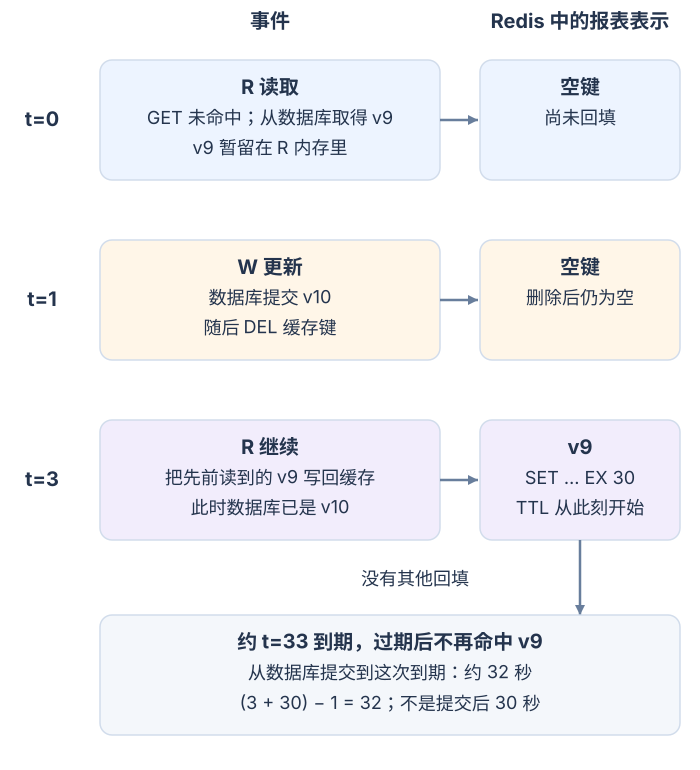

# 怎样缓存数据库读取并说明陈旧窗口？

**案例：** 报表 42 的已授权展示内容常被重复读取，适合放进 Redis 来减少主数据库查询；数据库仍是版本的权威来源。展示缓存里可能是版本 9，也可能在更新后变为版本 10。相反，后台任务 `job-demo-731` 的 `queued/running/succeeded` 状态和结果引用必须从权威数据库读取，不能用一个可能陈旧的缓存值回答。每次请求都要重新验证当前主体对账户和报表的访问权；缓存键不是授权凭据。

`cache-aside`（旁路缓存）由应用先查缓存，未命中时读取数据库，再把结果写回缓存。它减少重复读取，但带来两个需要由业务承受或显式解决的条件：命中值可能落后于数据库，Redis 故障时的大量未命中也会变成数据库压力。下文设 time to live（TTL，存活时间）为 30 秒；TTL 和报表值都是教学设定，不是线上推荐或测量结果。

## 一次读取和写入会经过哪些状态？

读取路径从授权开始：验证当前主体能否读取 `acct-17` 的报表 42，再取出获准的账户范围。这个案例缓存按语言生成、可由多个获准主体共享的报表表示，键为 `report:v1:acct-17:42:zh-CN`；权限筛选仍发生在每次请求中，缓存值不含主体专属字段。若命中后有字段需要按当前权限隐藏，命中路径和数据库回源路径都在返回前应用同一权限投影。若产品缓存的是已经按主体过滤的最终响应，键必须包含主体和权限版本等所有影响表示的范围，权限变化时也要让旧表示失效。缓存键不能代替当前访问检查。参见[如何逐次授权租户内的报表资源？](../security/web-security-and-authentication.md)。

- **命中：** Redis `GET` 取回共享报表表示，应用再按本次通过的权限检查生成响应；本次不读报表数据库。
- **未命中：** 应用按可信账户范围从数据库读取报表 42。若读到版本 9，缓存共享表示 `'{"version":9,"status":"ready"}'`，通过 `SET report:v1:acct-17:42:zh-CN ... EX 30` 设置 30 秒期限，再按当前权限生成响应。数据库错误、缓存错误不能被伪装成 `not-found`；缓存写入失败也不应丢弃已经读到的数据库结果。
- **确定不存在：** 只有数据库明确确认不存在时，才可短时缓存 `not-found`。创建资源时删除所有受支持语言的负缓存键；创建前已开始的未命中读取仍可能迟到回填负结果，也受后文 D+T 条件约束。
- **写入：** 在数据库事务中把报表从版本 9 更新到版本 10 并提交，再让失效流程删除该账户/报表的所有受影响表示键，而不是只删当前请求的 `zh-CN` 键。若语言集合有界，可以逐一生成键；transactional outbox（事务型发件箱）可把报表 ID 和变更类型连同事务提交，再由中继删除所有语言表示和负缓存。存在主体专属表示时还须覆盖其权限版本。先删后提交会让并发读者在数据库仍为 9 时回填版本 9；先提交再删避免这一顺序，但不能阻止已在途的旧读取稍后回填。

`GET`、`SET ... EX`、`DEL` 和 `TTL` 是这条路径所需的基本 Redis 命令。`TTL` 只报告键剩余寿命，不会告诉应用数据距数据库提交已经多旧。数据库提交和 Redis 删除属于两个系统，不能由一个普通数据库事务原子完成：如果提交后进程崩溃或 `DEL` 失败，原有缓存可能继续存在到过期。这个发件箱模式可在数据库提交时一同记录失效意图，再由 relay（中继器）重试 `DEL`；它使失效最终可重试，但在 relay 成功前仍允许旧值，且不能阻止失效后仍在途的旧读取再次回填。高成本报表后台任务的耐久状态和结果引用仍直接查询数据库，见[怎样设计可持久查询的账户报表？](../architecture/system-design-fundamentals.md)。

## 为什么存活时间不等于一致性保证？

`SET` 默认会替换这个键原有的 TTL；Redis 6.0 起可用 `KEEPTTL` 保留旧过期时间。本例的回填使用 `EX 30` 设置新的存活时间，计时从这次 `SET` 开始，而不是从数据库提交开始。因此 TTL 限制的是当前缓存条目从这次写入起保留多久，不能单独证明缓存值距数据库最新提交不超过 30 秒。

图中时间是相对秒数，事件间距不按比例绘制。`t=0`，读者 R 缓存未命中，从数据库读到版本 9，但尚未完成回填。`t=1`，写者 W 提交版本 10，再删除缓存键；键此时为空，却无法收回 R 已经读在内存中的版本 9。`t=3`，R 将旧版本 9 写入空键并设置 `EX 30`。若没有其他回填，Redis 键在 `t=3` 起可命中版本 9，约在 `t=33` 到期，过期后不再命中；相对 `t=1` 的数据库提交，陈旧命中可持续到近 32 秒。`32 = (3 + 30) - 1` 是指定时间和参数的手算结果，不是 Redis 运行测量。

要把这条时序推广成上界，需同时给出两个上限。令 **D** 为提交后仍允许旧表示被 Redis 成功写入的最长时间；D 必须覆盖所有可能读到旧值的来源（例如旧事务快照或滞后副本）、应用排队与重试，以及 Redis 接受回填前的延迟。只设置请求截止时间不够：截止时间之后仍能到达 Redis 的旧写入必须被丢弃或由栅栏拒绝。令 **T** 为所有可能含旧值的表示键的期限上限：每次成功写入都必须设置不超过 T 的 TTL，提交时已经存在的旧条目剩余 TTL 也必须不超过 T。命中不能续期或滑动延长 TTL，也不能用 `KEEPTTL` 保留一个超过 T 的旧期限。于是任何提交后的旧回填都不晚于提交后 D 写入，任何提交时已有的旧条目也至多再存活 T；在同一正常推进的计时基准上，按过期检查的时间粒度衡量，最后一次旧值命中不晚于 `D + T`。这不是不计时钟误差和执行延迟的墙钟承诺。若不能为 D 证明有限上限，TTL 本身不提供有限的全程陈旧上界。本例只有一个语言表示，D = 2 秒（提交 t=1 到成功回填 t=3），T = 30 秒，所以陈旧命中可逼近提交后 32 秒。多种表示时，D 与 T 要覆盖所有变体及其回填路径。

版本号比较也不能单独保证严格新鲜。报表已提交 v10、但失效尚未执行时，缓存中仍有 v9，版本比较并不妨碍读者直接命中 v9；DEL 后键为空，没有 v10 可供比较；若版本标记也放在可淘汰缓存中，它可能一起消失。只阻止低版本覆盖，只证明缓存内部不会被某次旧写降级，不证明缓存代表数据库当前版本。读己之写可携带刚提交的最低版本，并绕过缓存或只接受不低于该版本的值。要求每个请求都读到权威当前版本时，应在可见该提交的新鲜权威读路径查询，或在读取时取得与数据库提交一致的最新版本门槛，只接受不低于该门槛的缓存值。这种持久失效栅栏须覆盖空键、淘汰和所有表示变体。门槛只是持久化但异步更新，仍会留下提交到门槛更新之间的旧命中窗口；本章不声称单靠 Redis TTL/版本比较实现了这类协议。不能接受陈旧状态的后台任务、授权决定和余额仍应读权威源。

失效与监控也要区分不同时间。缓存写入时刻只能量出条目驻留时长，不能代表报表数据距数据库提交多久。可在样本中比较缓存表示的版本或 `updated_at` 与权威数据库当前值，并记录发现差异及其持续时间；若只记录 fill time，不应把它标成数据年龄或陈旧窗口。

对允许短暂陈旧的展示页，可使用可靠的写后失效和有界 TTL，并监控所有表示变体的失效结果。若 `DEL` 失败，原有键可继续到成功删除、淘汰或到期；若旧读取在删除后回填，仍须由 D 的约束和 TTL 覆盖。把更短 TTL 当作唯一补救不会修复回填顺序。

## 缓存击穿和 Redis 故障怎样限制？

一个热门键过期时，100 个并发请求可能同时 `GET` 未命中并各自读数据库，把一次正常读取放大成 100 次。TTL 加少量随机抖动能把许多不同键的到期时间错开；它不会拆散同一个热门键在同一刻过期的请求。

同一进程内的同键请求可用 single-flight（单飞请求合并），让一个调用者负责加载，其他调用者短暂等待；它不协调其他进程。跨进程可用有界 lease（租约）尽力合并：第一次 `GET` 未命中后，调用者用 `SET lock-key unique-token NX PX lease-ms` 领锁。`unique-token` 每次领取都新生成；`NX` 只在锁键不存在时写入，`PX` 后的期限单位是毫秒。成功领锁后必须再 `GET` 一次缓存：第一次未命中后，另一位持有者可能已回填并释放锁；若复查命中，就用当前权限生成响应并安全释放自己的锁，不再读数据库；只有复查仍未命中才回源并回填。未领到锁的调用者在请求截止时间内重查缓存，拿不到值就按回源预算等待、失败或回退。释放必须原子地比较 token 并只删除匹配锁：Redis 8.4 起可用 `DELEX lock-key IFEQ unique-token`；较早版本可用 Lua 脚本完成同一比较与删除。不能先 `GET` 比对、再单独 `DEL`，否则租约到期后旧持有者可能删掉新锁。若旧加载超过租约，第二个加载者仍可能开始，因此锁只减少重复工作，不是数据正确性的证明。

Redis 内存策略也会影响命中：达到内存上限时，所选 eviction（淘汰）策略可能在 TTL 到期前移除缓存键，这只会变成未命中，应按普通缓存未命中回源。若配置 `noeviction`，新缓存写入可能报错；主数据库已经读出的结果仍可返回，同时记录缓存写入失败。观测命中/未命中、Redis 命令失败、淘汰计数、回源量及连接池等待时间，才能分辨缓存缺失和数据库变慢。

Redis 不可达时，`GET` 报错不是普通缓存未命中。应用可以在请求截止时间、回源并发上限和数据库连接预算内读取主库；超出预算就返回暂时不可用。只有确实另存本地快照、端点允许陈旧响应且能核对快照年龄时，才考虑在 Redis 故障下返回该快照。不要把 Redis 错误或数据库错误吞成空值。缓存故障带来的回源峰值由[怎样限定 ORM Session 并排查连接池耗尽？](data-access-and-connection-pools.md)一同计入；该页展示回源 SQL 怎样申请并占用连接。

**接下来：** 高成本报表的持久后台任务状态、授权和结果引用见[怎样设计可持久查询的账户报表？](../architecture/system-design-fundamentals.md)。本章只缓存可容忍陈旧的展示读取；如何保证一次写入和数据库事务的原子性，见[库存约束怎样保护一次预留？](../databases/database-fundamentals.md)。

> [!info]- 来源
> - Cache-aside 的 miss 回源、读取后回填、写后失效、TTL 与热门键并发回源：[Redis, Cache-aside](https://redis.io/docs/latest/develop/use-cases/cache-aside/)，`Why the problem is hard` 与 `How Redis supports the solution`，核对于 2026-11-12。官方流程给出通用模式；本文的在途旧值竞态及 D+T 算例是按明确事件顺序推导的应用条件，不是官方承诺。
> - `SET key value EX seconds` 以秒设期，`PX` 以毫秒设期；成功的 `SET` 默认丢弃旧 TTL，除非显式用 `KEEPTTL`（Redis 6.0 起提供）；`NX` 仅在键不存在时写入：[Redis, SET](https://redis.io/docs/latest/commands/set/)，`EX`、`PX`、`NX` 和 `KEEPTTL`，核对于 2026-11-12。移除键及返回剩余 TTL 分别见 [DEL](https://redis.io/docs/latest/commands/del/) 和 [TTL](https://redis.io/docs/latest/commands/ttl/)；剩余寿命不是数据距权威提交的年龄。
> - 内存上限和淘汰策略、`noeviction` 下的写入拒绝、可按 `INFO` 查看淘汰和命令拒绝：[Redis, Key eviction](https://redis.io/docs/latest/develop/reference/eviction/)，`Using maxmemory`、`Eviction policies` 与 `Using the INFO command`，核对于 2026-11-12。
> - 单实例 `SET ... NX PX` 锁、随机且唯一的 token、期限单位和比较 token 后安全释放：[Redis, Distributed Locks](https://redis.io/docs/latest/develop/clients/patterns/distributed-locks/)，`Correct Implementation with a Single Instance`，并参照 [SET](https://redis.io/docs/latest/commands/set/)，核对于 2026-11-12。官方页说明 Redis 8.4 新增 `DELEX ... IFEQ`，更早版本可用 Lua 脚本原子比较并删除。本文增加“领锁后复查缓存”以避免前一持有者已经回填后的重复回源；这是应用流程，不是锁命令语义。单实例短租约只用于尽力合并缓存加载，不用于数据库正确性。
> - 旧事务快照在 PostgreSQL 18 Repeatable Read 下可继续看见事务开始前的版本：[PostgreSQL 18, Transaction Isolation](https://www.postgresql.org/docs/18/transaction-iso.html)，§13.2，尤其 Repeatable Read 的事务快照说明，核对于 2026-11-12。复制数据未同步时，回源也可能填入旧值：[Microsoft, Caching Guidance](https://learn.microsoft.com/en-us/azure/architecture/best-practices/caching#caching-and-eventual-consistency)，`Caching and eventual consistency`，核对于 2026-11-12。两者说明 D 要覆盖数据来源的陈旧期；具体 D 仍由部署的事务、复制和队列边界决定。
> - 过期边界与计时：[Redis 8.4.0 `keyIsExpired`](https://github.com/redis/redis/blob/8.4.0/src/db.c#L2475-L2483) 使用命令时间快照，并在 `now > when` 时判定过期；因此到期毫秒的等号处仍可能读到值，本文时序用“约 t=33 到期”，不写成严格半开区间。D+T 推导以同一正常推进的计时基准和普通过期读取为条件。
> - 在途旧填充可覆盖新缓存；仅靠缓存内版本记录还会在新版本键被淘汰后丢失较新版本知识：[Meta, Cache made consistent](https://engineering.fb.com/2022/06/08/core-infra/cache-made-consistent/)，开头的失效竞态和 version field 反例，2022-06-08。该案例支持“版本比较不等于最新读取”的边界，不提供本例的强一致协议。
> - `maxmemory` 淘汰策略及写入拒绝：[Redis, Key eviction](https://redis.io/docs/latest/develop/reference/eviction/)，`Using maxmemory`、`Eviction policies` 与 `Using the INFO command`，核对于 2026-11-12。缓存失效通知与数据库更新的双写缺口、outbox 把两者写入同一事务并处理重复通知：[AWS, Transactional outbox pattern](https://docs.aws.amazon.com/prescriptive-guidance/latest/cloud-design-patterns/transactional-outbox.html)，`Intent`、`Motivation` 与 `Issues and considerations`，核对于 2026-11-12。outbox 使失效意图可重试，仍不阻止失效后的在途旧读晚到回填。
> - 报表缓存键、逐次主体授权、表示维度齐全的缓存键、负缓存策略、读己之写和 job 状态必须查权威数据库是本章应用边界，见内部安全与报表设计链接；不是 Redis 命令承诺。没有连接 Redis 服务执行命令或故障测试。
