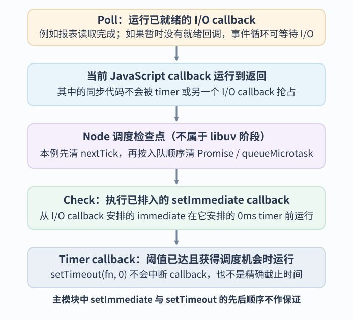
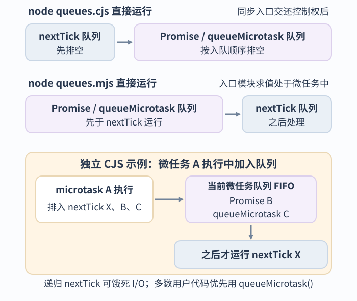

# Node.js 事件循环阶段与微任务队列如何交互？

**合成案例：** Node.js 服务收到 GET /api/reports/42。请求处理函数（handler）启动异步报表读取、安排一个计时器回调，然后返回。为让例子可以离线运行，下面用 CLI 主模块顶层代码代演 handler 同步发起工作并返回的部分，再用读取脚本文件的 I/O callback 展示读取完成后的调度。顶层 timeout 与 immediate 只校准 CLI 入口的顺序，不代表 HTTP handler 内的顺序。

Node.js 的事件循环（event loop）按阶段安排 I/O 回调和计时器，但主 JavaScript 线程一次只运行一个同步调用栈。调用异步 I/O API 后，函数可以先返回；数据就绪时，Node 再把回调交给该隔离环境（isolate）。底层 I/O 由驱动、操作系统和 libuv（Node.js 使用的跨平台 I/O 库）具体完成，不能仅凭返回 Promise 推断某个数据库驱动的实现。

## I/O 回调、定时器和 setImmediate() 何时推进？

先看概念顺序：Node 从一段由宿主派发的 JavaScript 回调（callback）重新取得控制权时，会在调度检查点清空 nextTick 和微任务（microtask）队列。检查点不是 libuv 阶段，也不只出现在阶段边界：同一阶段的两个 callback 之间也可能执行检查点；普通 JavaScript 嵌套函数返回给它的调用方不会触发这个交接。图只放大本例的 I/O→检查点→check/timer 交接，不表示所有阶段都只按这一条路径运行。

下表列出常见阶段及职责；它不是每轮实际执行顺序的时间线。特别是 libuv 1.45.0 调整了到期 timer 的检查位置，见表后说明。

| 阶段 | 在本例中要看什么 |
| --- | --- |
| timers（计时器） | 执行已达到时间门槛的 setTimeout / setInterval 回调；门槛过了也仍须等待可运行的调度机会 |
| pending callbacks（待处理回调） | 执行少数被推迟到下一轮的系统回调 |
| idle、prepare（内部阶段） | libuv 内部阶段，不是一般应用代码的回调点 |
| poll（I/O 轮询） | 处理大多数 I/O 回调；没有可运行 I/O 时，可能等待新事件 |
| check（检查） | 执行已排入的 setImmediate 回调 |
| close callbacks（关闭回调） | 处理部分 handle 的关闭事件 |

从 libuv 1.45.0 起（该版本随 Node.js v20.3.0 引入），默认循环模式在 poll 之后检查到期 timer；为兼容旧行为，进入默认循环前仍有一次预检查。较早版本每轮 poll 前也会检查 timer。无论版本如何，阶段名不能当作精确时钟：setTimeout(fn, 0) 在 Node.js v26.13.0 中按 1 毫秒门槛处理；计时器不会切断正在运行的回调，也不保证在指定毫秒恰好运行。

**最小可运行回放。** 为避免连接真实数据库，以下 CLI 主模块同步发起异步工作，代演 handler 发起读取后返回的部分；它的顶层 timer/immediate 仅用于校准 CLI 入口顺序。读取本脚本文件的 `fs.readFile` callback 代表“报表读取已完成”，只用来展示 I/O callback 返回时的队列交接，不模拟数据库驱动的底层传输或耗时。I/O callback 失败时只输出错误并结束该分支；成功时才登记后续队列：

~~~javascript
// 保存为 node-event-loop-io-demo.cjs；使用 Node.js v26.13.0 运行
const fs = require('node:fs');
console.log('CLI main module starts');
process.nextTick(() => console.log('nextTick checkpoint'));
Promise.resolve().then(() => console.log('Promise reaction'));
queueMicrotask(() => console.log('queueMicrotask'));
setTimeout(() => console.log('top-level timeout'), 0);
setImmediate(() => console.log('top-level immediate'));

fs.readFile(__filename, error => {
  if (error) {
    console.log('I/O failed; stop this branch');
    return;
  }

  console.log('I/O callback: report bytes are ready');
  process.nextTick(() => console.log('nextTick from I/O callback'));
  Promise.resolve().then(() => console.log('Promise from I/O callback'));
  queueMicrotask(() => console.log('queueMicrotask from I/O callback'));
  setTimeout(() => console.log('timer from I/O callback'), 0);
  setImmediate(() => console.log('immediate from I/O callback'));
});
~~~

Node.js v26.13.0 的一次本地运行输出：

~~~text
CLI main module starts
nextTick checkpoint
Promise reaction
queueMicrotask
top-level immediate
I/O callback: report bytes are ready
nextTick from I/O callback
Promise from I/O callback
queueMicrotask from I/O callback
immediate from I/O callback
top-level timeout
timer from I/O callback
~~~

这是一次运行记录，不是完整固定序列。CLI 主模块中 top-level timeout 与 top-level immediate 的相对先后不保证；文件 I/O 何时就绪也会影响它们相对 I/O callback 的位置。可依赖的局部事实是：同一个 I/O callback 排入的 immediate 在它排入的 0ms timer 前运行；该 callback 交还控制权后，Node 在继续调度之前处理 nextTick 与微任务。检查点跟宿主接管 callback 的边界有关，不是每个阶段结束时的统一钩子；下面用同阶段的两个 immediate 展示这一点。

~~~javascript
setImmediate(() => {
  console.log('immediate 1');
  process.nextTick(() => console.log('nextTick'));
  queueMicrotask(() => console.log('microtask'));
});
setImmediate(() => console.log('immediate 2'));
~~~

在 Node.js v26.13.0 中运行此 CLI 文件，输出为 `immediate 1 → nextTick → microtask → immediate 2`：Node 在同一 check 阶段的两个 callback 之间处理检查点。普通 JavaScript 函数的嵌套 `return` 仍在当前调用栈内，不会因此触发同一检查点。

如果某段同步 callback 花了 120ms，即使一个 100ms timer 已越过门槛，callback 仍会先跑完。timer 回调只能晚些得到执行；它不会中断 callback，也不会自动取消尚未完成的数据库查询。服务端应以明确的 deadline（截止时间）判断请求是否已超时。若要取消底层操作，必须用该驱动支持的取消机制；计时器本身只负责安排一段未来代码。

## nextTick 与 Promise 微任务的顺序为何会变？

process.nextTick() 使用 Node 管理的 nextTick 队列；Promise reaction（Promise 的处理回调）与 queueMicrotask() 共用 JavaScript 微任务队列。下面的排序示例都由 Node CLI 直接把文件作为主模块运行：CommonJS（CJS）主模块 `node queues.cjs` 在同步入口返回后的检查点先排空 nextTick，再排空微任务；ES module（ESM）主模块 `node queues.mjs` 的入口模块求值处于微任务处理中，所以模块代码安排的微任务先于 nextTick。这个差异取决于开始执行这段代码时是否已在处理微任务，不能只凭文件扩展名推断。

分别保存并直接以 Node CLI 运行以下两段代码；文件扩展名决定模块语法：

~~~javascript
// queues.cjs — Node.js v26.13.0
const { nextTick } = require('node:process');

Promise.resolve().then(() => console.log('promise'));
queueMicrotask(() => console.log('microtask'));
nextTick(() => console.log('nextTick'));
~~~

输出：

~~~text
nextTick
promise
microtask
~~~

~~~javascript
// queues.mjs — Node.js v26.13.0
import { nextTick } from 'node:process';

Promise.resolve().then(() => console.log('promise'));
queueMicrotask(() => console.log('microtask'));
nextTick(() => console.log('nextTick'));
~~~

输出：

~~~text
promise
microtask
nextTick
~~~

Promise 与 queueMicrotask 共享同一个先进先出（FIFO）微任务队列，因此这两段代码中它们按登记顺序运行。上下文差异不是 Promise 语言改了规则；在这个直接以 CLI 运行的例子里，ESM 入口模块在 Node 处理 Promise/microtask 队列时求值。

若 CJS 主模块顶层同步 `require()` 同一份 ESM 文件，求值发生在当前 CJS 同步栈内，不能套用“直接运行 ESM 主模块”的顺序。同步 `require(esm)` 仅适用于不含顶层 `await` 的 ESM 依赖图；上面的 `queues.mjs` 没有顶层 `await`。将两个文件保存在同一目录再运行：

~~~javascript
// require-esm-context.cjs — Node.js v26.13.0
require('./queues.mjs');
console.log('CJS require returned');
~~~

输出：

~~~text
CJS require returned
nextTick
promise
microtask
~~~

因此扩展名标明文件使用何种模块语法，但不独自决定它在 Node 调度器中的执行上下文。

还要注意微任务正在运行时发生的情况。以下是另一个独立的 CJS CLI 回放：

~~~javascript
// 保存为 node-event-loop-nested-tick.cjs；使用 Node.js v26.13.0 运行
Promise.resolve().then(() => {
  console.log('microtask A');
  process.nextTick(() => console.log('nextTick X'));
  Promise.resolve().then(() => console.log('microtask B'));
  queueMicrotask(() => console.log('queueMicrotask C'));
});
~~~

输出是 microtask A、microtask B、queueMicrotask C、nextTick X。A 运行时把 B 和 C 放进当前微任务队列，又把 nextTick X 单独排队；当前微任务队列先排空，Node 才处理新排入的 nextTick。不能把“nextTick 先于 Promise”推广到所有正在执行的上下文。

Node.js v26.13.0 将 process.nextTick() 标为历史状态（Legacy），并建议多数用户代码优先用 queueMicrotask()。旧库可能依赖 nextTick 的排序或额外参数，因此迁移时要保留并检查其既有调用契约。若递归调用 nextTick 不断制造工作，Node 会持续清空队列，迟迟不能进入 poll，I/O 回调也就无法推进。对一般可移植的同步调用后延续，用 queueMicrotask() 更合适。

一种仍可能需要兼容的旧 API 约定是：工厂函数先返回事件发射器（emitter），再于当前调用栈退栈后发出 ready，让调用方来得及注册监听器。callback API 也曾用 nextTick 延后交付同步发现的验证错误。下面只演示前一种顺序，不表示新代码应普遍选择 nextTick：

~~~javascript
const { EventEmitter } = require('node:events');

function createEmitter() {
  const emitter = new EventEmitter();
  process.nextTick(() => emitter.emit('ready'));
  return emitter;
}

const emitter = createEmitter();
emitter.on('ready', () => console.log('ready'));
~~~

运行输出 ready；若同步调用后的延续无需兼容 nextTick 特有顺序，优先使用 queueMicrotask()。

## 读报表请求在哪一步继续或停止？

把一次请求重新串起来：

| 时点 | 输入或状态 | Node 执行到的结果 |
| --- | --- | --- |
| handler 运行 | GET /api/reports/42；启动读取、排入 timer | 同步 handler 跑完并返回；timer/I/O 不能抢占它 |
| 等待或继续 | 读取仍未就绪 | poll 可等待 I/O；到期 timer 也可能先获得运行机会，但不会自动停止读取 |
| 读取成功 | 回调收到字节或驱动结果 | 处理当前 callback；控制权交还 Node 后处理 nextTick / 微任务，再继续调度；下一项不一定属于新阶段 |
| 读取失败 | callback 收到错误 | 请求代码进入错误处理并结束该分支；是否重试或取消由应用与驱动契约决定 |

本地回放只读取自己的脚本，成功分支可实际运行；数据库错误和请求取消的语义必须按具体驱动实现确认。浏览器有自己的事件循环、task 和渲染规则，不能把 Node 的 libuv 阶段图套过去，见[浏览器事件循环](../../frontend/runtime/event-loop.md)。Node 主线程、worker_threads、libuv threadpool 与进程的工作边界见[Node.js 如何在事件循环、工作线程与进程之间调度工作？](node-js-fundamentals.md)。

> [!info]- 来源
> - Node.js v26.13.0 的 nextTick Legacy 状态、额外参数与递归行为：[process.nextTick()](https://nodejs.org/download/release/v26.13.0/docs/api/process.html#processnexttickcallback-args)；CommonJS/ES module 队列排序：[When to use queueMicrotask vs process.nextTick](https://nodejs.org/download/release/v26.13.0/docs/api/process.html#when-to-use-queuemicrotask-vs-processnexttick)；CJS 主模块同步加载 ESM 的边界：[modules — Loading ECMAScript modules using require()](https://nodejs.org/download/release/v26.13.0/docs/api/modules.html#loading-ecmascript-modules-using-require)；核对日期：2026-11-12。文中的 CJS、ESM、同步 require(esm) 和嵌套队列代码已在该版本重放。
> - 阶段职责、poll 对 I/O 和 timer 的调度、Node.js v20.3.0 引入 libuv 1.45.0 后的 timer 检查变化、CLI 主模块与 I/O callback 中 timer/immediate 顺序，以及 nextTick 检查点的宿主交接边界：[Node.js Event Loop](https://nodejs.org/learn/asynchronous-work/event-loop-timers-and-nexttick)；精确的 libuv 引入版本：[Node.js v20.3.0 release notes](https://nodejs.org/en/blog/release/v20.3.0)；核对日期：2026-11-12。Learn 文档说明较早版本的阶段行为与当前版本差异。
> - setTimeout 的最小 delay 处理、时间门槛及“不会精确准点”的保证：[Node.js v26.13.0 Timers](https://nodejs.org/download/release/v26.13.0/docs/api/timers.html#settimeoutcallback-delay-args)；核对日期：2026-11-12。
> - libuv loop 阶段与网络 I/O callback 的运行线程：[libuv Design overview](https://docs.libuv.org/en/v1.x/design.html#the-i-o-loop)；核对日期：2026-11-12。具体数据库驱动实现不由本地文件回放证明。
