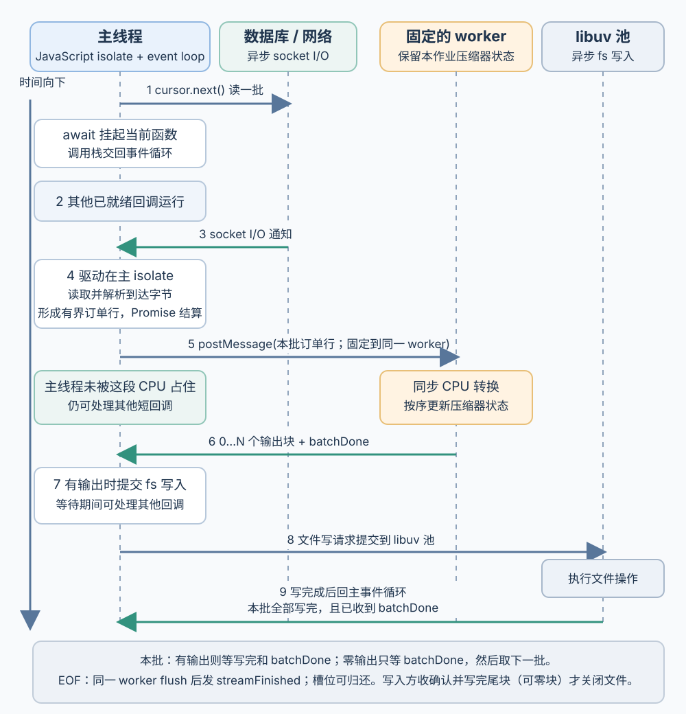
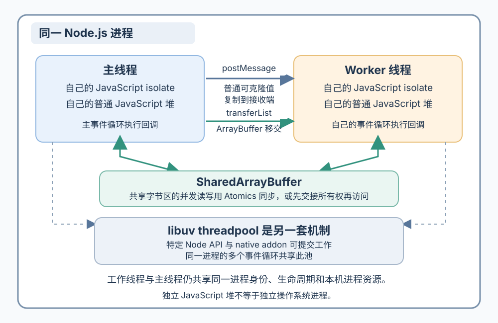
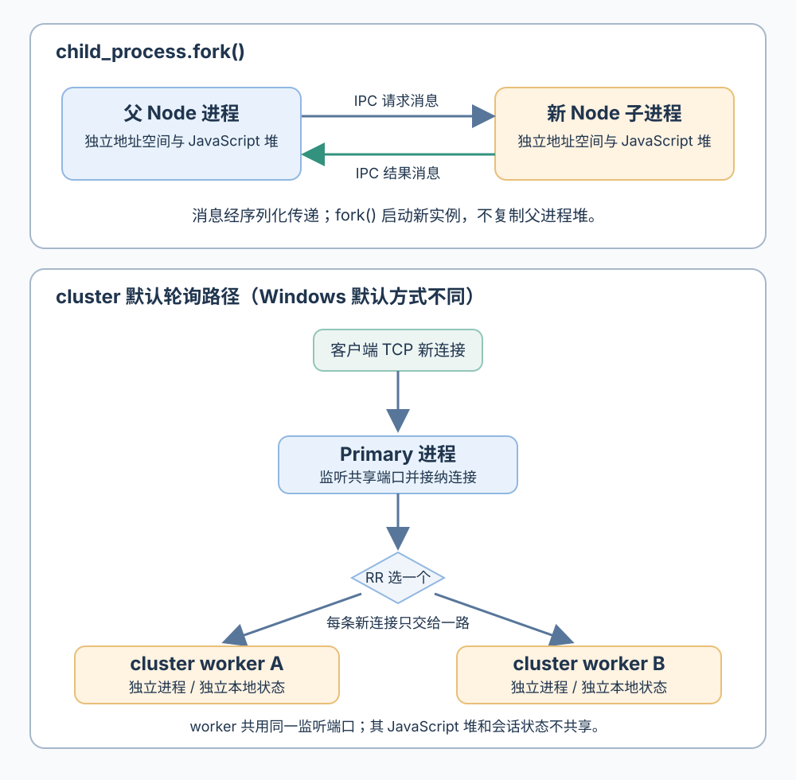

# Node.js 如何在事件循环、工作线程与进程之间调度工作？

**合成案例：** API 收到导出 acct-17 报表的请求：异步数据库游标逐批读取订单行，服务把它们转换并压缩后写出文件；同一服务还要响应其他用户请求。沿用前一章的教学假设：数据库驱动通过网络 socket 等待读取；CPU 阶段使用应用或第三方库提供的同步、有状态增量压缩器，而不是 Node 内置的异步 zlib 流。每批输入有上限，压缩交给有界 `worker_threads` 池。这里要看 Node.js v26.13.0 如何把等待和 JavaScript 计算安排到不同线程或进程，并说明跨边界传递的数据。

图中是一种可能的执行交错，不按时间比例绘制；步骤 7–9 是本批产生输出块时的写入分支，没有输出块时只等 `batchDone`。socket 通知报告 I/O 已就绪或操作已完成，并不等于数据库行已经生成；在本例里，驱动在主 isolate 的回调中取得并解析字节、组出有界订单行，`cursor.next()` 的 Promise 才结算。工作线程运行同步 CPU 代码或 libuv 池处理异步文件写入时，主事件循环仍可运行其他已就绪回调；消息或文件完成回调仍要等相应的事件循环获得执行机会。写入方何时停止提交数据、`write()` 与 `drain` 的通用规则见 [Node.js 流如何传播背压？](node-stream-backpressure-and-cleanup.md)。

## 默认的 JavaScript 执行路径是什么？

Node.js 进程中的每个 JavaScript isolate（隔离环境）都有自己的 JavaScript 执行线程和事件循环（event loop）。主线程一次执行一个 JavaScript 回调；回调调用异步 API（application programming interface，应用程序编程接口）后可以注册后续处理并返回。若在回调里运行一段很长的同步循环，它会一直占住该 isolate 的线程，直到循环结束或代码主动让出控制权；这期间同一事件循环不能运行其他 JavaScript 回调。

`await` 本身不会创建线程，也不会把表达式自动交给后台。等待的 Promise 尚未结算时，`async` 函数会挂起并把控制权还给事件循环；Promise 结算后，函数剩余部分作为 JavaScript 工作在原来发起它的 isolate 中继续运行。因而，“异步”等于“调用方不必同步等结果”，不等于“所有工作都在另一个线程执行”。事件循环阶段、`process.nextTick()` 和 Promise 微任务的顺序见 [Node.js 事件循环阶段与微任务队列如何交互？](node-event-loop-and-microtasks.md)。

若网络读取失败，驱动返回的 Promise 会拒绝，`await` 后的代码通过同一 isolate 的异常路径处理；Node 不会自动重试，也不会因调用方退出等待就自动取消底层操作。连接是否可取消、如何释放，属于具体驱动和应用的契约。

Node.js v26.13.0 下，常见 I/O 与计算路径可按具体 API 区分：

| 报表中的操作或 API | 等待或计算发生在哪里 | JavaScript 回调在哪里继续 |
| --- | --- | --- |
| 假设中的异步数据库驱动、网络 socket | 数据在网络中传输时，主 JavaScript 调用栈不必等待；运行时使用操作系统提供的异步 socket I/O 机制，具体采用就绪通知还是完成通知取决于平台 | 在发起操作的 isolate 事件循环中运行。驱动若使用其他实现，须按驱动契约确认 |
| `node:fs` 回调和 Promise 式文件系统 API（不含 `fs.FSWatcher`）、`dns.lookup()`、`crypto.pbkdf2()` / `scrypt()` / 回调形式的 `randomBytes()` 等特定加密 API，以及异步 `node:zlib` API | 已在池线程中执行的工作占用线程，包括它阻塞在系统调用中的时间；仍在队列中的提交任务等待空闲线程。执行时间长的工作可能拖慢同池其他 API | 回到提交该任务的事件循环 |
| 普通同步 JavaScript | 当前 JavaScript 线程执行；Node 不会因为函数很耗 CPU 就自动把它搬走 | 当前回调返回后，事件循环才能继续 |
| `node:worker_threads` | 应用创建的工作线程运行 JavaScript；可用于 CPU 密集型 JavaScript | 结果通过消息在接收方的事件循环中处理 |

libuv threadpool 与应用创建的 `worker_threads` 不是同一个池。v26.13.0 报告所带 libuv 版本为 1.53.0；libuv 将其线程池描述为在同一进程的多个事件循环之间共享。它服务的是特定 Node API 与 native addon 提交的工作，不会替应用运行任意一段 JavaScript。DNS 是一个常见边界：`dns.lookup()` 使用该池，而 `dns.resolve()` 通过异步 DNS 网络请求工作，不占用这个池。反过来，工作线程也不是处理一般网络等待的捷径：Node 内置异步 I/O 对此通常更合适。不要只从函数返回 Promise 推断其底层机制，先查该 API 的契约。

## 该把计算放在哪种执行资源上？

按 acct-17 的路径，异步数据库读取可以在主事件循环等待；若把压缩循环直接留在该线程，它会阻塞同一 isolate 的其他回调。案例的 CPU 片段无法在主路径的响应预算内完成，所以把有界批次交给工作线程。此处的同步增量压缩器是明确的案例假设，并非 Node 内置 zlib 的接口承诺：Node 异步 zlib API 使用 libuv threadpool，若改用它，计算的运行位置和共享池资源会不同。

| 选择 | 适合什么工作 | 成本与条件 |
| --- | --- | --- |
| 主事件循环上的异步 API | 数据库、网络等有适用异步 API 的 I/O 等待 | 让出调用栈不代表操作或缓冲区消失；同步 JavaScript 仍会阻塞该事件循环 |
| libuv threadpool 中的 API | Node 明确使用该池的文件、DNS、加密或压缩操作 | 共享有限池槽位；长任务会使其他同池任务排队。它不是可任意提交 JavaScript 的应用工作池 |
| `worker_threads` | CPU 密集型 JavaScript，且可以承担消息传递与线程管理成本 | 同一进程中的另一条 JavaScript 线程，可并行执行；需限制线程数、排队任务和输入字节 |
| `child_process` | 需要独立进程生命周期、地址空间或更强故障边界的工作 | 启动、内存和 IPC 成本；进程边界本身不构成权限沙箱 |
| `cluster` | 多个 Node 进程共同提供 HTTP/TCP 服务 | 每进程各有堆、缓存、连接池和运行时；连接分发不共享进程内会话，也不保证吞吐线性增长 |

如果多个导出任务同时进入，不能为每个任务无限创建一个工作线程。使用有限 worker pool（工作线程池）与有界等待队列；队列满时由服务明确拒绝、等待或施加上游背压。容量如何按阶段估算见 [如何估算并限制异步工作管线？](../reliability/api-capacity-and-backpressure.md)。进程、线程与响应预算的一般选择见 [何时选线程、进程或异步 I/O？](../operating-systems/processes-threads-and-concurrency.md)。

## Node 工作线程如何接收任务并回传数据？

`worker_threads` 在同一 Node.js 进程中创建另一条 JavaScript 执行线程。工作线程有自己的 JavaScript isolate 和普通堆，因此主线程中的普通对象不会因为地址相同而自动变成可见的共享对象；两条线程仍属于同一操作系统进程，共享进程生命周期和操作系统身份。Node.js 默认通过 `postMessage()` 传数据：普通可克隆值经 structured clone（结构化克隆）复制；把可转移的 `ArrayBuffer` 列入 transfer list（转移列表）则交出这块内存的所有权，发送方原来的视图会变为不可用；`SharedArrayBuffer` 才让双方访问同一块字节。若两线程可能并发访问同一共享区，使用 `Atomics` 建立同步；也可通过消息明确交接访问权，确保一方写入时另一方不同时读取或写入。

acct-17 的每批订单行可作为一个有界消息发送给 worker。若发送 `Buffer`，接收端按结构化克隆得到的是 `Uint8Array`，需要 Buffer API 时可在接收侧转换。转移时要使用本次任务独占且可转移的 backing `ArrayBuffer`，例如单独分配的 `new ArrayBuffer(n)`；不要直接转移池化 `Buffer` 的 `.buffer`。池化 Buffer 通常不能转移，克隆时还可能复制整个 Buffer 池。转移后主线程不能再读取已交出的视图。无论复制还是转移，消息数量、数据量与等待队列都要受控。

本例按一个简化的作业协议串起批次与压缩流：

1. 作业从有界等待队列取出并分配 worker 槽后，固定到该线程；仍在队列中的作业不占工作线程。压缩器状态留在这个 worker 中，所有输入批次按序发给同一个 worker。等待读库或写入完成时，worker 可以暂时不执行 CPU 指令，但这个运行中的作业仍保留它的槽位。
2. 每批 worker 按序回传零个或多个输出块，再单独发送 `batchDone`。完成确认独立于块数量，所以没有输出字节的批次也能结束。主线程按序提交这批的异步文件写入；本例等所有输出写入完成并收到 `batchDone` 后，才请求下一批。`node:fs` 的异步文件操作使用 libuv threadpool；主事件循环在写入待完成期间仍可处理其他已就绪回调。
3. 这个批次边界比普通流背压更严格：对于处于正常可写状态的 `Writable`，`write()` 返回 `true` 表示可以继续提交块，不表示写入已完成；返回 `false` 才应暂停并等 `drain`。本例选择等本批写入操作全部完成及 `batchDone` 两项条件都满足后再读下一批。写操作完成不等于文件已经物理持久化。
4. 游标读到 EOF 后，主线程通知同一个 worker 冲刷压缩流。worker 发完全部尾块、清除作业的压缩状态后再发 `streamFinished`；收到它表示 worker 不会再产出字节，协调者可归还槽位。文件写入方收到 `streamFinished`，并确认所有尾块都已写完（也可能没有尾块）后，才关闭临时文件。临时文件发布与取消的竞争顺序见[前一章的单一作业协调者](../operating-systems/processes-threads-and-concurrency.md)。

下面用同一个小型 Fibonacci 输入演示 `Worker` 的任务和结果消息。它只展示 API 形状；`fib(10)` 很轻，运行结果不能证明线程会加速任务。

~~~javascript
// 保存为 worker-fib.cjs；使用 Node.js v26.13.0 运行
const { Worker, isMainThread, parentPort } = require('node:worker_threads');

function fib(n) {
  let a = 0;
  let b = 1;
  for (let i = 0; i < n; i++) [a, b] = [b, a + b];
  return a;
}

if (isMainThread) {
  const worker = new Worker(__filename);
  worker.once('error', error => {
    console.error(error);
    process.exitCode = 1;
  });
  worker.once('message', result => console.log(result));
  worker.postMessage(10);
} else {
  parentPort.once('message', n => parentPort.postMessage(fib(n)));
}
~~~

输出 `55`。真实 CPU 任务应复用一个有界工作线程池，而不是每次请求都构造 `Worker`。同步 JavaScript 正在占用 worker 时，worker 的消息回调也要等到当前回调让出后才能执行；若工作必须响应取消，需在片段间交还事件循环或检查共享停止标志，细节见前一章[线程工作取消的顺序](../operating-systems/processes-threads-and-concurrency.md)。工作线程出现未捕获 JavaScript 错误时，父线程可通过 `Worker` 的 `error` 事件处理；它仍不是隔离 native 崩溃的独立进程边界。

## 子进程怎样接收一个计算任务？

`child_process.fork()` 会启动一个新的 Node.js 进程并建立 IPC（进程间通信）通道；它不是 POSIX `fork(2)`，不会复制正在运行的父进程内存。`send()` 的消息会序列化后在另一侧解析；默认是 JSON，数字 `10` 和 `55` 可直接往返。子进程拥有独立地址空间，但若没有另行设置凭据和操作系统策略，它不因此失去父进程用户本来能访问的资源；它不是安全沙箱。

下面仍用同一个输入计算 `fib(10)`，只展示父进程和子进程间的请求与结果消息，不是生产任务队列：它没有排队上限、重复任务保护或 supervisor 级别的重启策略。

~~~javascript
// 保存为 report-child.cjs；使用 Node.js v26.13.0 运行
const { fork } = require('node:child_process');

function fib(n) {
  let a = 0;
  let b = 1;
  for (let i = 0; i < n; i++) [a, b] = [b, a + b];
  return a;
}

if (process.argv[2] === 'worker') {
  process.on('message', ({ n }) => {
    process.send({ result: fib(n) });
  });
} else {
  const child = fork(__filename, ['worker']);
  child.once('error', error => {
    console.error(error);
    process.exitCode = 1;
  });
  child.once('message', ({ result }) => {
    console.log(result);
    child.disconnect();
  });
  child.send({ n: 10 });
}
~~~

输出 `55`。若传输较大的订单批次，IPC 仍需序列化和数据复制；也可显式传递受支持的 socket/handle。进程只隔开地址空间，不会自动隔开磁盘、网络、CPU 配额或数据库连接额度。

## cluster 怎样把 HTTP 连接交给多个进程？

`cluster` 创建的是 Node 子进程，不是 `worker_threads`。常见的默认 round-robin（轮询）路径由 primary 在监听端口上接收新 TCP 连接，再把每条连接交给一个 worker；Windows 默认使用另一种由 worker 自行接受连接的方式。Node 不提供应用级路由保证：cluster 按连接安排，持久连接上的多条 HTTP 请求仍可落在同一进程，登录会话或缓存也不会在 worker 间自动共享。若要共享这些状态，应使用进程外存储或明确的通信协议。

~~~javascript
// 保存为 cluster-report.cjs；使用 Node.js v26.13.0 运行
const cluster = require('node:cluster');
const http = require('node:http');
const { availableParallelism } = require('node:os');

const configuredLimit = 2; // 教学配置；不是通用容量建议
const workerCount = Math.min(availableParallelism(), configuredLimit);

if (cluster.isPrimary) {
  for (let i = 0; i < workerCount; i++) cluster.fork();
  cluster.on('exit', (worker, code, signal) => {
    console.error('worker exited', worker.id, code, signal);
  });
} else {
  http.createServer((request, response) => {
    response.end(`report API served by process ${process.pid}`);
  }).listen(8000);
}
~~~

示例的 worker 退出回调只记录事件；Node 不会自动补充进程或决定重启退避策略，生产服务需要明确这些恢复行为。上限 `2` 只是教学配置。Node 文档建议用 `os.availableParallelism()` 估算可用并行度，而不是用 `os.cpus().length`；实际进程数还要按容器 CPU 配额、请求时延与每进程连接池等总资源预算决定。每个进程都有独立 JavaScript 堆、缓存与按进程设置的池；进程数增大通常会提高内存需求，但操作系统也可能共享只读页面，因此不是严格按进程数成倍增长。若本例运行 2 个 cluster worker，并为每个服务 worker 配置 2 个 CPU 工作线程槽位和最多 5 个数据库连接，服务配置上限就是 4 个计算槽位与 10 个连接。4 个槽位不保证有 4 个处理单元能同时运行；共享 CPU 配额或数据库容量更小时，仍会排队。

若用 PM2 管理多个实例，可显式给出数量，例如 `pm2 start app.js --name api -i 2`，再用 `pm2 list` 或 `pm2 monit` 查看，用 `pm2 reload api` 发起集群重载。PM2 的 reload 可能在重载超时时退化为 restart。在支持 POSIX 信号的平台上，停止时默认先发 `SIGINT`，应用若未在默认 `kill_timeout` 约 1600 ms 内退出，PM2 会发 `SIGKILL`。需要更换首个停止信号时，可配置 `PM2_KILL_SIGNAL`；应用必须处理部署实际发来的信号并排空请求、工作线程与连接池。完整的关闭次序见 [Node.js 服务如何排空并关闭？](node-service-shutdown.md)。

> [!info]- 来源
> - `worker_threads` 的 CPU 适用场景、消息和共享内存：[Node.js v26.13.0, Worker threads](https://nodejs.org/download/release/v26.13.0/docs/api/worker_threads.html)，2026-11-12 核对；本页工作线程 Fibonacci 示例于 Node.js v26.13.0 重放。
> - structured clone、ArrayBuffer 转移后发送方视图失效、池化 Buffer 不能直接转移，以及 Buffer 接收为 Uint8Array：[Node.js v26.13.0, Worker threads, TypedArray/Buffer 注意事项](https://nodejs.org/download/release/v26.13.0/docs/api/worker_threads.html#considerations-when-transferring-typedarrays-and-buffers)，2026-11-12 核对。
> - 子进程 `fork()` 的新 Node 实例、IPC 序列化和默认 JSON 模式：[Node.js v26.13.0, Child processes, `fork()` / IPC](https://nodejs.org/download/release/v26.13.0/docs/api/child_process.html#child_processforkmodulepath-args-options)，示例于 Node.js v26.13.0 重放，输出 `55`。
> - `cluster` 共享服务端口、连接调度方式及进程内会话不共享：[Node.js v26.13.0, Cluster, “How it works”](https://nodejs.org/download/release/v26.13.0/docs/api/cluster.html#how-it-works)，2026-11-12 核对。
> - `availableParallelism()` 与 `os.cpus().length` 的区别：[Node.js v26.13.0, OS](https://nodejs.org/download/release/v26.13.0/docs/api/os.html#osavailableparallelism)，2026-11-12 核对。
> - 异步文件系统 API 使用 libuv threadpool；`dns.lookup()` 与 `dns.resolve()` 的不同实现；`crypto.pbkdf2()`、`scrypt()` 等指定 API 与异步 zlib API 使用该池：[Node.js v26.13.0, File system](https://nodejs.org/download/release/v26.13.0/docs/api/fs.html#threadpool-usage)、[DNS](https://nodejs.org/download/release/v26.13.0/docs/api/dns.html#implementation-considerations)、[Crypto](https://nodejs.org/download/release/v26.13.0/docs/api/crypto.html)、[Zlib](https://nodejs.org/download/release/v26.13.0/docs/api/zlib.html#threadpool-usage-and-performance-considerations)，2026-11-12 核对。
> - 普通可写状态下 `Writable.write()` 的 `true` / `false`、`drain` 与写操作完成的区别：[Node.js v26.13.0, Stream, `writable.write()`](https://nodejs.org/download/release/v26.13.0/docs/api/stream.html#writablewritechunk-encoding-callback)，2026-11-12 核对。
> - 多线程共享字节区的同步指导：[ECMAScript Shared Memory Guidelines](https://tc39.es/ecma262/multipage/memory-model.html#sec-shared-memory-guidelines)，2026-11-12 核对。
> - libuv threadpool 的全局共享范围、工作线程执行任务及完成回调返回事件循环：[libuv 1.x, Thread pool work scheduling](https://docs.libuv.org/en/v1.x/threadpool.html)，Node.js v26.13.0 本机 `process.versions.uv` 输出 `1.53.0`。
> - Node.js 返回依赖版本字符串及 v26.13.0 的当前版本状态：[Node.js v26.13.0, `process.versions`](https://nodejs.org/download/release/v26.13.0/docs/api/process.html#processversions)，[Node.js 下载页](https://nodejs.org/en/download/)，2026-11-12 核对。
> - PM2 集群重载失败后的 restart 回退、`SIGINT` 与 `kill_timeout` 的终止顺序，以及可配置的 `PM2_KILL_SIGNAL`：[PM2, Cluster Mode](https://pm2.keymetrics.io/docs/usage/cluster-mode/)、[Graceful Start/Shutdown](https://pm2.keymetrics.io/docs/usage/signals-clean-restart/)、[Environment Variables](https://pm2.keymetrics.io/docs/usage/environment/)，2026-11-12 核对。
