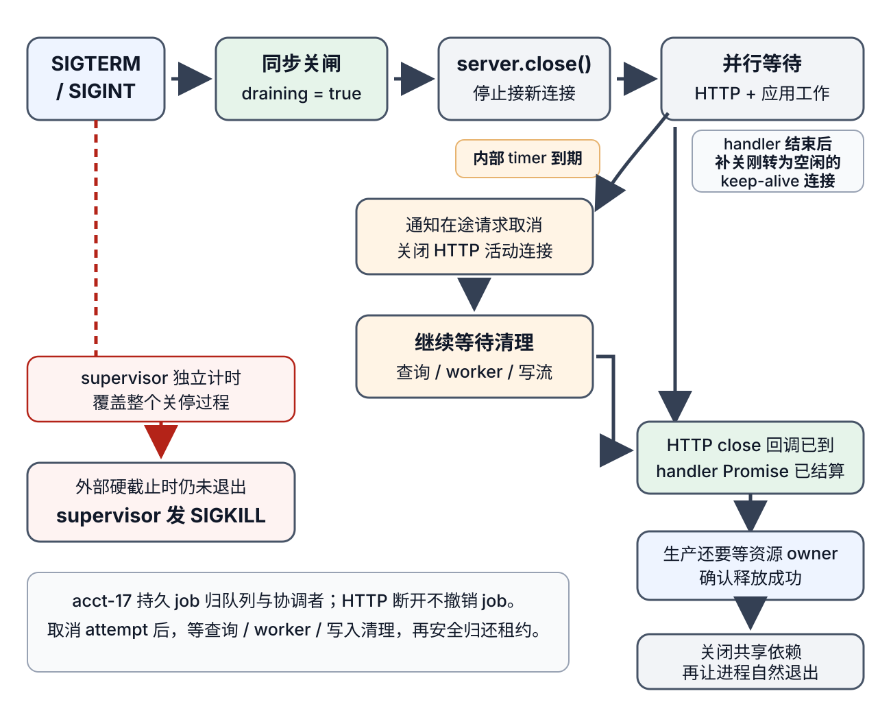

# Node.js 服务如何排空并关闭？

**案例接续 acct-17：** 报表服务收到 `SIGTERM` 时，可能正把账户活动报表行流给一个 HTTP 响应，也可能有已经持久接受、由队列拥有的报表作业。两者的所有者不同：请求流可以在请求取消后结束；持久作业不能只因客户端断开而被撤销。本页的小型回放只模拟三条教学报表行直接流向 HTTP 响应，聚焦服务关停；它不冒充真实数据库、worker 或作业队列。持久作业的停止与发布边界会单独对照前两章。

## 为什么要先拒绝工作再关闭连接？

关停信号到达后，先在本进程内同步设 `draining = true`，再把 readiness（就绪状态）标为 false。负载均衡器或编排器收到不就绪状态需要时间；因此 handler 仍要在开始新报表或副作用之前检查 draining。尚在 keep-alive 连接上的新请求也可能到达，直接拒绝并回 `503`、`Connection: close`。之后调用 `server.close()` 停止接新连接；Node.js v19 起它也会关闭调用时的空闲连接。已有活动响应可以继续写完。本页回放还在应用 handler 结束后调用 `server.closeIdleConnections()`，主动收掉刚变空闲的 keep-alive 连接，以满足本例的关停时间预算；这不是说每个 Node.js v19+ 服务都必须额外调用它。

HTTP Server 的关闭回调只说明它拥有的普通 HTTP 连接已经收尾，不证明已启动的 handler、数据库游标、worker、文件写入或后台任务都停下。相反，deadline 时 `server.closeAllConnections()` 可以强制关闭 HTTP(S) 连接，却不会自动取消 handler 正在等的查询或 CPU 工作。服务要分别等待 HTTP 关闭与应用任务集合归零；若服务还提供 WebSocket 或 HTTP/2，应由对应协议的 server / session owner 停止接收、关闭会话并确认结束；不能只看普通 HTTP Server 回调。

下面的精简脚本把教学用 `acct-17` 三行 CSV 直接流给当前客户端。生成器、流管线和请求响应的完成/取消关系沿用 [Node.js 流如何传播背压？](node-stream-backpressure-and-cleanup.md) 的说明。脚本默认每行延迟 100 ms；本地 deadline 回放用 --slow 改为 600 ms。两者都用可取消 timer 代替数据库查询，不代表真实查询耗时；真实驱动若不支持取消，pending 查询完成前仍不能关闭它的连接池。

> [!example]- 可运行的关停重放
>
> ~~~javascript
> // 保存为 shutdown-demo.cjs；使用 Node.js v26.13.0 运行
> const http = require('node:http');
> const { Readable } = require('node:stream');
> const { pipeline } = require('node:stream/promises');
> const { setTimeout: sleep } = require('node:timers/promises');
>
> const rowDelayMs = process.argv.includes('--slow') ? 600 : 100;
> const rows = [
>   'event-1,acct-17,12',
>   'event-2,acct-17,8',
>   'event-3,acct-17,-2',
> ];
> const inFlight = new Set();
> const requestControllers = new Set();
> let draining = false;
> let shutdownPromise;
>
> function track(promise) {
>   inFlight.add(promise);
>   promise.then(
>     () => inFlight.delete(promise),
>     () => inFlight.delete(promise),
>   );
>   return promise;
> }
>
> async function waitForInFlight() {
>   while (inFlight.size > 0) {
>     await Promise.allSettled([...inFlight]);
>   }
> }
>
> async function* acct17Csv(signal) {
>   try {
>     yield 'id,accountId,amount\n';
>     for (const row of rows) {
>       await sleep(rowDelayMs, undefined, { signal });
>       signal.throwIfAborted();
>       yield row + '\n';
>     }
>   } finally {
>     console.log('report source cleanup complete');
>   }
> }
>
> async function handleRequest(request, response) {
>   if (draining) {
>     response.writeHead(503, { Connection: 'close' });
>     response.end('service draining');
>     return;
>   }
>   if (request.method !== 'GET' || request.url !== '/reports/acct-17.csv') {
>     response.writeHead(404, { Connection: 'close' });
>     response.end('not found');
>     return;
>   }
>
>   const controller = new AbortController();
>   requestControllers.add(controller);
>   const abortOnPrematureClose = () => {
>     if (!response.writableFinished) {
>       controller.abort(new Error('client disconnected'));
>     }
>   };
>   response.once('close', abortOnPrematureClose);
>
>   try {
>     response.writeHead(200, { 'Content-Type': 'text/csv; charset=utf-8' });
>     await pipeline(
>       Readable.from(acct17Csv(controller.signal), { objectMode: false }),
>       response,
>       { signal: controller.signal },
>     );
>   } catch (error) {
>     const cancelledClose = controller.signal.aborted && error.code === 'ERR_STREAM_PREMATURE_CLOSE';
>     if (error.name !== 'AbortError' && !cancelledClose) throw error;
>     console.log('report response stopped:', error.message);
>   } finally {
>     response.off('close', abortOnPrematureClose);
>     requestControllers.delete(controller);
>   }
> }
>
> const server = http.createServer((request, response) => {
>   const task = track(handleRequest(request, response));
>   task.catch(error => {
>     console.error('request failed:', error);
>     process.exitCode = 1;
>     if (!response.destroyed) response.destroy(error);
>   });
> });
>
> function markReadiness(ready) {
>   console.log('ready:', ready);
> }
>
> async function closeOwnedResources() {
>   // 本回放只有可取消 timer 与日志。生产还须逐个等待资源 owner 确认释放成功，不能把 handler Promise settled 当成释放证明。
>   console.log('resource cleanup complete');
> }
>
> const listening = new Promise((resolve, reject) => {
>   const onListening = () => {
>     server.off('error', onListenError);
>     resolve();
>   };
>   const onListenError = error => {
>     server.off('listening', onListening);
>     reject(error);
>   };
>   server.once('listening', onListening);
>   server.once('error', onListenError);
> });
> listening.catch(error => {
>   console.error('server startup failed:', error);
>   process.exitCode = 1;
> }); // 若绑定失败，保留拒绝给 shutdown 使用并记录启动失败。
> server.listen(0, '127.0.0.1', () => {
>   if (!draining) markReadiness(true);
>   console.log('listening:', server.address().port);
> });
>
> function shutdown(signal) {
>   if (shutdownPromise) return shutdownPromise;
>   draining = true;
>   markReadiness(false);
>   console.log('received:', signal);
>
>   const deadline = setTimeout(() => {
>     console.log('deadline: abort in-flight request streams and close HTTP connections');
>     for (const controller of requestControllers) {
>       controller.abort(new Error('shutdown deadline'));
>     }
>     server.closeAllConnections();
>   }, 1_000);
>
>   const closeHttpServer = async () => {
>     await listening;
>     return new Promise((resolve, reject) => {
>       server.close(error => error ? reject(error) : resolve());
>     });
>   };
>
>   shutdownPromise = (async () => {
>     try {
>       const serverClosed = closeHttpServer();
>       const workResults = await Promise.allSettled([waitForInFlight()]);
>       server.closeIdleConnections(); // handler 结束后再关刚转为空闲的 keep-alive 连接。
>       const httpResults = await Promise.allSettled([serverClosed]);
>       const results = [...workResults, ...httpResults];
>       let failed = false;
>       // 这只证明本例的 HTTP 和 handler Promise 已结算，不证明任意资源 owner 已成功释放。
>       // fulfilled 表示两个关停等待都成功返回；handler 本身失败由 task.catch 记录。
>       const lifecycleWaitSucceeded = results.every(result => result.status === 'fulfilled');
>       for (const result of results) {
>         if (result.status === 'rejected') {
>           failed = true;
>           console.error('shutdown lifecycle failed:', result.reason);
>         }
>       }
>       if (!lifecycleWaitSucceeded) {
>         console.error('shutdown wait failed; cannot confirm HTTP closure or application wait, keep dependencies open');
>         process.exitCode = 1;
>         return;
>       }
>       clearTimeout(deadline); // HTTP 和应用等待条件都已结束；依赖清理另有 supervisor 硬截止。
>       try {
>         // 本例没有外部资源。生产应先核对各 owner 的释放结果；失败或未知时保留相关依赖。
>         await closeOwnedResources();
>       } catch (error) {
>         failed = true;
>         console.error('resource cleanup failed:', error);
>       }
>       if (failed) process.exitCode = 1;
>     } finally {
>       clearTimeout(deadline);
>     }
>   })();
>   return shutdownPromise;
> }
>
> function onShutdown(signal) {
>   shutdown(signal).catch(error => {
>     console.error('shutdown failed:', error);
>     process.exitCode = 1;
>   });
> }
>
> process.on('SIGTERM', onShutdown);
> process.on('SIGINT', onShutdown);
> ~~~

**本机回放（Node.js v26.13.0）：** 默认每行 100 ms 时，在首个响应块到达后发送 SIGTERM；客户端仍收到完整三行 CSV，生成器清理、HTTP 关闭和资源清理都在 1 秒 deadline 前完成，进程 exit code 为 0。使用 `--slow`（每行 600 ms）时，客户端只收到表头与 event-1；deadline 回调发出取消并强关 HTTP 连接，连接关闭后生成器执行 `finally`，管线以 `ERR_STREAM_PREMATURE_CLOSE` 结算，`inFlight` 中的 handler 随后全部结算并继续资源清理，进程仍以 0 退出。正常排空时，handler 集合归零后补调 `server.closeIdleConnections()`，HTTP close 回调随之完成；本机移除这次补调的对照中，正文虽已完整，HTTP 收尾仍等到了 1 秒 deadline。另对慢模式在首块后间隔 150 ms 发两次 SIGTERM：两次信号共用同一个 `shutdownPromise`，没有触发默认信号退出；deadline 后生成器与资源清理均有日志，最终 exit 0。

脚本将 HTTP handler 的**完整 Promise**登记到 `inFlight`，包含流结束和 `finally` 中移除请求控制器的步骤。正常写完时，响应结束后 handler Promise 才完成；随后补关刚转为空闲的 keep-alive 连接，并等待 HTTP close 回调。客户端提前断开时，响应 `close` 会触发该请求取消。两项生命周期都已结算后才清理依赖。deadline 到达时，脚本先对请求流发协作取消，再关闭 HTTP(S) 连接；取消可以令本例中的 timer 与生成器停止；deadline 回放里，先通知取消并强关 HTTP 连接，随后生成器运行 `finally`；管线以 `ERR_STREAM_PREMATURE_CLOSE` 结算，`inFlight` 集合归零后才清理依赖。代码仅在本请求 signal 已触发时把它当作预期停止。它不能保证真实数据库、文件系统或第三方 API 已撤销在途操作。`server.closeAllConnections()` 放在 `server.close()` 之后调用，以免在关停期间另有连接进入。

## 哪些完成状态允许关闭资源？

“收到信号”“连接断了”和“任务结束”是不同事实。示例里的 `lifecycleWaitSucceeded` 表示 `server.close()` 回调与 `waitForInFlight()` 两项等待都成功返回。`waitForInFlight()` 等到完整 handler Promise 结算，但不要求业务 handler 本身成功；`task.catch` 会记失败与退出码。本例没有真实数据库池或 worker，所以这个等待结果不能当作生产资源已释放的证据。生产还要等每个资源 owner 确认成功释放；清理失败或状态未知时，不关闭仍可能被使用的那项依赖。

| 资源或副作用 | 等待到什么状态 | 不能据此推出什么 |
| --- | --- | --- |
| HTTP listener 和普通 HTTP(S) 连接 | `server.close()` 的回调；启动 `server.close()` 后，超时强制路径可不等回调就调用 `closeAllConnections()` | 被强制关掉响应，不代表 handler 内的 JS、查询或 worker 已结束；若还提供 WebSocket 或 HTTP/2，须由相应 server / session owner 关闭并确认 |
| 请求内 CSV 流 | `pipeline()` fulfilled 表示流正常结束；reject 表示失败/取消路径已由流管线结算，本例生成器也先完成 `finally` | 部分响应字节不能撤回，也不能证明客户端已经完整读取或保存正文 |
| 数据库游标和连接 | 等 pending `next()` 完成或驱动的取消确认，再关闭游标并释放连接 | Node 的 `AbortSignal` 不会自动变成任意驱动的取消请求 |
| worker 与批次 | 当前消息、写出、尾块或停止确认到达；压缩状态清除，槽按所有权规则归还 | 发出取消信号或关闭 HTTP socket 不等于 worker 已停 |
| 临时文件与发布 | 文件流结束并关闭；若进入发布，则以 `rename` 等提交操作的真实成功/失败结果为准 | 写入 Promise 被本地取消不能证明文件或远端服务没有副作用 |
| 已持久受理的 acct-17 job | 队列授予本次执行的 lease（租约）；job owner 停止接新 job，并让当前 attempt 达到完成状态，或清理后安全归还租约 / 让队列重试 | API 客户端断开不撤销已持久接受的 job |

前两章中的 worker 导出把一个作业固定到 worker，逐批读、压缩和写出；EOF 后还要等压缩器发送全部尾块、写入方关闭临时文件。服务收到关停时，先停止队列继续领取新作业。当前 attempt 可在预算内完成；若策略要求在 deadline 取消，则由同一 job 协调者停止拉取、取消查询并等待查询结束、worker 的停止/收尾确认与已提交写入，再关闭并清理本 attempt 的临时文件，最后安全归还本次执行的租约。它不能把请求连接关闭误记成 job 已取消。

取消与发布正在同一个 job 协调者里竞争时，仍按既定顺序裁决：若 job 还在 `running` 且取消先被接受，不提交文件发布；若先进入 `publishing` 并提交 rename，就等待真实成功或失败，不能让晚到的本地取消覆盖结果。若进程在提交后被硬杀，结果可能未知；重启后按 job ID、专属目标路径和持久化状态核对或幂等重试，不要凭 handler 退出推断“肯定没发布”。客户端已收到部分流响应也不能回滚先前已提交的数据库或对象存储副作用。

## deadline 与 supervisor 如何配合？

示例的 1 秒 deadline 与 timer 延迟只为回放不同分支：默认每行 100 ms 让在途响应有机会正常排空，`--slow` 的每行 600 ms 会进入 deadline 取消分支。它们不是生产 SLA，也不保证真实操作在这一秒内终止。真实服务要为停止接单、协作取消、查询/worker 清理、文件关闭和资源池关闭保留时间。内部 deadline 应早于部署管理器的硬终止时间，并留出根据实际清理时长确定的余量。内部 timer 依赖事件循环运行；若 JavaScript 同步代码长时间阻塞，回调也不能准时执行。最外层 supervisor 自己的硬截止才会强停仍未退出的进程，图中的 SIGKILL 指这个外部动作。

在支持这些信号的 POSIX 部署上，注册 `SIGTERM` 或 `SIGINT` listener 会移除相应默认退出行为；应用要自己走完关停路径，不要在 cleanup 前直接调用 `process.exit()`。脚本用 `process.exitCode` 记录失败，并让已关闭的 handle 自然结束进程。deadline timer 保持引用，避免事件循环空闲时在它执行前退出。若不响应取消的请求仍持有数据库连接，等待会继续；不能为了让进程按时退出而提前关闭正在使用的依赖。最外层 supervisor 到硬截止后可以强制杀进程，但强杀不能替代持久任务恢复与未知副作用的对账。

PM2 对 stop、restart 和 reload 默认先发 `SIGINT`；可改 `PM2_KILL_SIGNAL`。`kill_timeout` 默认 1600 ms，届满后发 `SIGKILL`；生产配置要把应用自己的 drain deadline 和清理余量放在这个截止之前，或同步调整 PM2 配置。若服务还提供 WebSocket 或 HTTP/2，另由对应 server / session owner 停止接收、关闭并确认会话结束；HTTP server 的 `closeAllConnections()` 不会替这些协议连接完成应用清理。

**接下来：** HTTP server 的 connection 生命周期与请求/任务所有权在此收束；账户报表何时算持久完成，以及重试如何查询未知结果，见[请求超时后如何确认结果并安全重试？](../reliability/api-reliability-and-async-delivery.md)。

> [!info]- 来源
> - `server.close()` 停止接受新连接，并从 Node.js v19 起关闭调用时的空闲连接；`server.closeIdleConnections()` 可在活动 handler 完成后再次关闭转为空闲的 keep-alive 连接；关闭回调与连接结束：[Node.js v26.13.1, HTTP, `server.close()`](https://nodejs.org/download/release/v26.13.1/docs/api/http.html#serverclosecallback)、[`server.closeIdleConnections()`](https://nodejs.org/download/release/v26.13.1/docs/api/http.html#servercloseidleconnections)，2026-11-12 核对。
> - `server.closeAllConnections()` 会关闭现有 HTTP(S) 活动连接，建议在 `server.close()` 后调用以避免竞态；不负责关闭 WebSocket 等其它协议的 socket；HTTP/2 会话也应由自己的 session owner 收尾：[Node.js v26.13.1, HTTP, `server.closeAllConnections()`](https://nodejs.org/download/release/v26.13.1/docs/api/http.html#servercloseallconnections)，2026-11-12 核对。
> - `SIGTERM` / `SIGINT` listener 会移除相应默认 handler；可监听 signal 并自行决定清理何时完成：[Node.js v26.13.1, Process, Signal events](https://nodejs.org/download/release/v26.13.1/docs/api/process.html#signal-events)，2026-11-12 核对。
> - 活动 `Timeout` 默认保持事件循环运行；`unref()` 后在无其他活动时进程可能先退出：[Node.js v26.13.1, Timers, `timeout.unref()`](https://nodejs.org/download/release/v26.13.1/docs/api/timers.html#timeoutunref)，2026-11-12 核对。
> - 带 `AbortSignal` 的 `pipeline()` 会销毁管线流并以 `AbortError` 结束；只有实际接收该 signal 的异步生成器操作才会协作取消：[Node.js v26.13.1, Stream, Promises API](https://nodejs.org/download/release/v26.13.1/docs/api/stream.html#streams-promises-api)，2026-11-12 核对。
> - PM2 默认 SIGINT，支持将信号改为 SIGTERM，默认 `kill_timeout` 1.6 秒后发 SIGKILL：[PM2, Graceful Start/Shutdown, Signals flow](https://pm2.keymetrics.io/docs/usage/signals-clean-restart/)，2026-11-12 核对。
> - 持久 job 的逐批确认、EOF 尾块、running/publishing 取消竞争与本地重命名边界：见[何时选线程、进程或异步 I/O？](../operating-systems/processes-threads-and-concurrency.md)与[Node.js 如何在事件循环、工作线程与进程之间调度工作？](node-js-fundamentals.md)。
