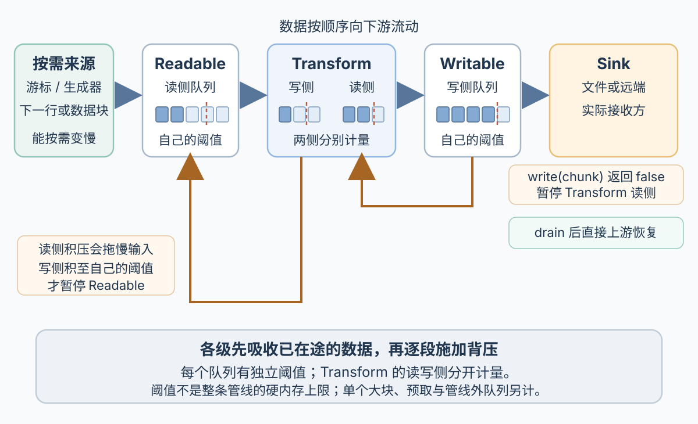

# Node.js 流如何传播背压？

**案例接续 acct-17：** [Node.js 运行时章的导出任务](node-js-fundamentals.md#node-工作线程如何接收任务并回传数据)从数据库逐批读取账户活动行，工作线程用同步增量压缩器生成字节，再写入本作业的临时文件。这里有意缩小并切换实现：用 Node.js 原生 `Readable → Transform → Writable` 管线处理同一账户的三条教学报表行，观察缓冲、backpressure（背压）、文件结束和取消。这个小例子使用 `node:zlib` 的 `createGzip()`，不代表运行时章选择的压缩执行位置，也不模拟对象存储的发布确认。

## 什么状态表示写入方该等一等？

Readable（可读流）产生数据块；Writable（可写流）接收数据块；Duplex（双工流）的可读与可写两侧独立工作；Transform（转换流）是一种 Duplex，一侧接收输入，另一侧输出转换后的块。对处于正常可写状态的 Writable，`write(chunk)` 先接收当前块：若调用返回 `true`，当前可以继续提交；若返回 `false`，当前块已经被接收，但内部写缓冲已达到 `highWaterMark`（缓冲阈值），此时停交后续块，等 `drain` 再继续。`drain` 表示 Writable 的底层实现已处理到可以恢复写入；它不证明文件已持久化或远端应用已收到数据。

若流已结束、销毁或报错，`false` 不再保证当前块已被接收，也不保证之后会发出 `drain`；这时处理 `error`、`close` 或管线失败结果，而不是继续等待 `drain`。

`highWaterMark` 是各流队列自己的阈值：Readable 据此决定是否继续拉取，Writable 据此反馈上游是否该暂停交块；它不是整条管线的硬性内存上限。按 Buffer 缓冲时计字节；队列里保留为 JavaScript 字符串时按 UTF-16 code unit（码元）计，例如 Readable 调用 `setEncoding()`，或 Writable 设置 `decodeStrings: false`；对象模式按对象个数计。Writable 默认会把字符串转成 Buffer。`Readable.from()` 默认使用对象模式；下面明确设置 `objectMode: false`，让每一行按流的非对象模式处理。Readable、Writable 各有自己的队列；Transform 也分别维护写侧和读侧缓冲。因此每个阶段的阈值、单个大块、驱动的预取和管线外队列都要计入内存预算。只有生产者能响应需求时，背压才能让它减慢；若生产者另有后台预取，或先把全部行装进数组，流无法自动限制那部分工作。

使用 `pipe()` 或 `pipeline()` 时，背压先沿相邻流传播：若 Writable 的 `write(chunk)` 返回 `false`，Node 暂停直接上游的可读侧（这里是 Transform 的读侧）。若 gzip 仍有输出，它会留在 Transform 的读缓冲；这个队列持续积压到阈值后，Transform 会延后处理后续输入，使写侧消化变慢。写侧还可继续吸收已经在途的数据；当它自己的队列也达到阈值，`Transform.write()` 才会返回 `false`，让 pipe 暂停更早一段的 Readable。两侧缓冲独立计量，阈值可以相同，反馈只沿相邻流逐段传。`drain` 使直接上游恢复，缓冲逐段退下后各段继续工作；这不是 sink 一次性向整条管线广播暂停。手写 `write()` 循环则必须自己遵守 `false` / `drain` 契约。选 `pipeline()` 主要是连接流并统一处理错误和结束，不会自动给管线外的任务队列、数据库预取或远端副作用设置上限。



## 如何按需读取报表行并调用游标清理？

下面把合成游标包装成异步生成器：数组只模拟三条固定教学报表行；每次 `next()` 取一行，生成器不会另存整份 CSV。它逐行格式化 CSV，`Readable.from()` 按需读取这些字符串，再经 gzip Transform 写入本地文件。这里的本地文件只用于演示流的接口；每次运行创建独占临时目录，只清理该目录；实际导出仍由任务协调者决定何时发布。

~~~javascript
// 保存为 export-report.cjs；使用 Node.js v26.13.0 运行
const { createWriteStream } = require('node:fs');
const { mkdtemp, rm } = require('node:fs/promises');
const { Readable } = require('node:stream');
const { pipeline } = require('node:stream/promises');
const { createGzip } = require('node:zlib');
const { tmpdir } = require('node:os');
const { dirname, join } = require('node:path');

function openReportCursor(accountId) {
  const rows = [
    { id: 'event-1', accountId, amount: 12 },
    { id: 'event-2', accountId, amount: 8 },
    { id: 'event-3', accountId, amount: -2 },
  ];
  let index = 0;
  let closed = false;
  return {
    async next() {
      if (index === rows.length) return null;
      return rows[index++];
    },
    async close() {
      closed = true;
      console.error('cursor closed:', closed);
    },
  };
}

function openPendingCursor(accountId, controller) {
  let started = false;
  let release;
  return {
    next() {
      if (started) return Promise.resolve(null);
      started = true;
      const pending = new Promise(resolve => {
        release = resolve;
      });
      console.error('1 next started; query is pending');
      setTimeout(() => {
        console.error('2 request abort');
        controller.abort();
      }, 20);
      setTimeout(() => {
        console.error('3 release pending query');
        release(null);
      }, 100);
      return pending;
    },
    async close() {
      console.error('4 cursor closed after query release');
    },
  };
}

function csvCell(value) {
  const text = String(value);
  return /[",\r\n]/.test(text) ? '"' + text.replace(/"/g, '""') + '"' : text;
}

async function* reportRows(accountId, signal, openCursor) {
  const cursor = openCursor(accountId);
  try {
    while (!signal.aborted) {
      const row = await cursor.next();
      signal.throwIfAborted();
      if (row === null) return;
      yield row;
    }
  } finally {
    await cursor.close();
  }
}

async function* csvRows(accountId, signal, openCursor) {
  yield 'id,accountId,amount\n';
  for await (const row of reportRows(accountId, signal, openCursor)) {
    yield [row.id, row.accountId, row.amount].map(csvCell).join(',') + '\n';
  }
}

async function exportReport(signal, openCursor = openReportCursor) {
  const tempDir = await mkdtemp(join(tmpdir(), 'acct17-report-'));
  const tempPath = join(tempDir, 'report.csv.gz.part');
  try {
    await pipeline(
      Readable.from(csvRows('acct-17', signal, openCursor), { objectMode: false }),
      createGzip(),
      createWriteStream(tempPath, { highWaterMark: 32 * 1024 }),
      { signal },
    );
  } catch (error) {
    console.error('pipeline rejected:', error.name);
    try {
      await rm(tempDir, { recursive: true, force: true });
      console.error('removed this run temp directory:', tempDir);
    } catch (cleanupError) {
      throw new AggregateError(
        [error, cleanupError],
        'export failed and this run temp directory could not be removed: ' + tempDir,
      );
    }
    throw error;
  }
  return tempPath;
}

async function main() {
  const abortReplay = process.argv.includes('--abort-replay');
  const controller = new AbortController();
  const openCursor = abortReplay
    ? accountId => openPendingCursor(accountId, controller)
    : openReportCursor;

  try {
    const outputPath = await exportReport(controller.signal, openCursor);
    if (abortReplay) {
      await rm(dirname(outputPath), { recursive: true, force: true });
      console.error('unexpected success in abort replay; removed this run directory');
      process.exitCode = 1;
      return;
    }
    process.stdout.write(outputPath + '\n');
  } catch (error) {
    if (abortReplay && error.name === 'AbortError') {
      return;
    }
    console.error('export failed:', error);
    process.exitCode = 1;
  }
}

main().catch(error => {
  console.error('unexpected top-level failure:', error);
  process.exitCode = 1;
});
~~~

把代码保存为 `export-report.cjs` 后可直接重放：

~~~sh
report_path="$(node export-report.cjs)"
printf '产物：%s\n' "$report_path"
gzip -dc < "$report_path"
~~~

解压结果应为：

```csv
id,accountId,amount
event-1,acct-17,12
event-2,acct-17,8
event-3,acct-17,-2
```

成功时命令打印本次运行独占目录内的产物路径并保留文件。输入数组只模拟三条固定游标记录；流生成器逐行产出，不会另存整份 CSV。代码没有刻意制造慢 sink：`32 KiB` 仅是本地文件写流的阈值，短小的四行输出不证明实际触发 `write(chunk) === false` 或 `drain`。`createGzip()` 是 Node 内置异步 zlib Transform，压缩工作由 libuv threadpool（线程池）执行；这与运行时章的自建 JavaScript worker 不同。

`openReportCursor()` 是教学 mock，不代表生产 job 的数据读取方式。生产 worker 要从已经持久接受且已授权的 job 读取账户、时间范围和页数上限，不能重新信任队列正文。现有报表设计最多顺序读 12 页，每页最多 100 行；不足 100 行时结束，若第 12 页仍满则以范围超限失败，不能静默截断。每页各用一个短事务；读完一页先归还连接，再压缩与写出，而且不承诺所有页面来自同一数据库快照，见[如何限定 ORM Session 并排查连接池耗尽？](data-access-and-connection-pools.md)。若换成一直持有数据库游标的长流，下游背压可能延长事务和连接的占用时间，需计入连接池与 worker 槽预算。确需同一快照时，应明确采用有界长事务或版本化快照并核算代价，不能静默把短事务分页换成长游标。

若要重放挂起读取期间的取消，运行 `node export-report.cjs --abort-replay`。该路径在首次 `cursor.next()` 已开始并挂起后，20 ms 触发 abort，100 ms 才释放模拟查询；日志顺序应是 next 开始、请求取消、查询释放、finally 调用并等待 `cursor.close()`、管线以 `AbortError` 拒绝、清理本次运行的临时目录。预期没有产物路径写到 stdout，退出码为 0。

## 输入结束、写完和取消分别能证明什么？

正常路径中，`cursor.next()` 返回 `null` 表示合成结果集耗尽；它不是在读取文件时遇到的 EOF。生成器离开 `try` 后会在 `finally` 调用并等待 `cursor.close()`，然后不再产出 CSV；这只表示它等待了关闭操作，不保证真实 driver 的关闭一定成功。源 Readable 的数据耗尽后发出 `end`；输入结束后，gzip 仍可能产生尾块，写入方随后才结束。Transform 的输出块数量不必等于输入块数；压缩器须把尾块交给写入方后，文件写流才可能完成，所以不能把“最后一行已送进压缩器”当成文件完整。

| 可观察状态 | 它说明什么 | 它没有证明什么 |
| --- | --- | --- |
| 源 Readable `end` | 所有源输入块已被消费，没有更多输入 | gzip 读侧结束或下游已写完、文件已持久化 |
| Writable `finish` | 调用 `end()` 后，所有写入数据已交给底层系统处理 | 数据已在断电后仍可恢复，或 HTTP 客户端已收到完整正文 |
| 文件流 `close` | 流及其文件描述符等底层资源已关闭 | 内容已满足所需的崩溃持久性 |
| `pipeline()` Promise fulfilled | 管线按正常路径完成 | 报表业务记录已成功发布或远端对象存储已持久接受 |

本例用默认自动关闭的本地文件流。若业务要求本地文件经过系统重启仍可恢复，需要另外按平台和文件系统契约请求 `fsync` 等持久化操作；`finish` 和 `close` 本身都不报告这项持久化保证。若目标是 HTTP 响应或对象存储，使用相应协议/SDK 的确认定义。对客户端下载而言，服务器本地响应流完成不等于客户端应用收到并保存了全部字节。

取消与失败走另一条路径。`pipeline(..., { signal })` 在信号触发时销毁仍参与管线的流，并以 `AbortError` 拒绝；这会停止继续沿流发送数据，但不会撤回已交给文件系统或远端的字节，也不会自动取消不属于流的数据库请求。生成器会在 `finally` 调用并等待自己拥有的游标 `close()`；若取消时它正等待 `cursor.next()`，而驱动不支持取消，只有等该查询结束，代码才能检查 signal 并运行 `finally`。等待 `close()` 返回本身不证明游标/连接已成功释放；owner 仍要按 driver 的结果确认状态，不能在 pending query 期间提前归还连接。

本例把同一个 signal 传给 `pipeline()`，并在 `await cursor.next()` 之后检查它。模拟 `close()` 会成功；若真实 driver 的关闭操作失败，本例的 `finally` 只保证调用并等待它，不把 `AbortError` 分支当成成功释放的证明。`--abort-replay` 用一个真实挂起的 `next()` 重放在途取消：20 ms 时触发 abort，100 ms 时释放模拟查询；观察到生成器的 `finally` 和 `pipeline()` 的 `AbortError` 都在查询释放后出现。真实数据库驱动是否有可用的取消 API、取消何时确认，要以该驱动的契约为准。

文件写流遇到取消或错误时，已写出的部分内容仍可能留在文件中。本例先用 `mkdtemp()` 创建本次运行独占的临时目录，再写入其中；只在管线 Promise 拒绝且其流已停止后删除这个目录，正常完成则打印并保留产物路径。这里没有实现重命名或业务发布。本地文件使用本次 attempt 独占的临时路径；数据处理和写入完成后，是否通过 `rename` 发布由作业协调者裁决。生产对象存储则使用本次 attempt 独占的私有对象键；完整上传后，仍须由当前 attempt 在数据库中按条件提交结果引用并将 job 置为 `succeeded`，对象上传成功本身不等于任务已完成。取消/普通错误时的本地清理不会覆盖进程崩溃；强杀也可能留下本例的本地临时目录或生产上传的私有对象。生产环境中遗留的私有对象应由独立回收责任方处理：只有 attempt 已被接管或 job 已终结、持久状态确认没有结果引用，且有界的上传时限与额外安全宽限期都已过去，才可删除，见[工作进程重试怎样避免旧结果覆盖新结果](../architecture/system-design-fundamentals.md#工作进程重试怎样避免旧结果覆盖新结果)。若一次远端写入结果未知，不能因本地 Promise 被取消就假设远端未生效；要用专属对象键、幂等标识或服务端状态查询来确认。已持久接受的 acct-17 job 也不应仅因最初 HTTP 请求断开就自动取消。作业取消与发布竞争的顺序见[何时选线程、进程或异步 I/O？](../operating-systems/processes-threads-and-concurrency.md)，HTTP 服务在 SIGTERM 下如何等待流和工作退出见[Node.js 服务如何排空并关闭？](node-service-shutdown.md)。

**接下来：** 这章跟踪一条流内部的缓冲、收尾和清理；HTTP 请求、worker 和持久队列的并发上限见[如何估算并限制异步工作管线？](../reliability/api-capacity-and-backpressure.md)。

> [!info]- 来源
> - `Writable.write()` 返回 `false` 后停止写到 `'drain'`；`highWaterMark` 是阈值；buffering 对象/字节/字符串单位；每种 stream 状态与背压说明：[Node.js v26.13.1, Stream, Buffering 与 Writable streams](https://nodejs.org/download/release/v26.13.1/docs/api/stream.html#buffering)、[`write()`](https://nodejs.org/download/release/v26.13.1/docs/api/stream.html#writablewritechunk-encoding-callback)、[`drain`](https://nodejs.org/download/release/v26.13.1/docs/api/stream.html#event-drain)，2026-11-12 核对。
> - `pipeline()` 的 Promise、AbortSignal 销毁流、错误关闭管线；流 API 不包括它们外部的数据库请求：[Node.js v26.13.1, Stream, Promises API](https://nodejs.org/download/release/v26.13.1/docs/api/stream.html#streams-promises-api)，2026-11-12 核对。
> - `Readable.from()` 的输入、对象模式和 `end`；Transform 可能零到多个输出块，结束时可用 `_flush()` 生成尾块；Writable `finish` 与底层资源 `close`：[Node.js v26.13.1, Stream](https://nodejs.org/download/release/v26.13.1/docs/api/stream.html#streamreadablefromiterable-options)、[`end`](https://nodejs.org/download/release/v26.13.1/docs/api/stream.html#event-end)、[`finish`](https://nodejs.org/download/release/v26.13.1/docs/api/stream.html#event-finish)、[`close`](https://nodejs.org/download/release/v26.13.1/docs/api/stream.html#event-close)、[`_flush()`](https://nodejs.org/download/release/v26.13.1/docs/api/stream.html#transform_flushcallback)，2026-11-12 核对。
> - gzip 是基于 Node stream 的 Transform；非同步 zlib API 用 Node 内部 threadpool；关闭/结束压缩流完成当前 gzip 成员，不应把中间 `flush()` 与最终完成混为一谈：[Node.js v26.13.1, Zlib, Compressing or decompressing streams](https://nodejs.org/download/release/v26.13.1/docs/api/zlib.html#zlib)、[Threadpool usage and performance considerations](https://nodejs.org/download/release/v26.13.1/docs/api/zlib.html#threadpool-usage-and-performance-considerations)、[Flushing](https://nodejs.org/download/release/v26.13.1/docs/api/zlib.html#flushing)，2026-11-12 核对。
> - `mkdtemp()` 建立唯一临时目录；本地文件流默认的描述符自动关闭、`fs.rm()` 和 `FileHandle.sync()` 的操作系统/设备特定语义：[Node.js v26.13.1, File system, `fs.mkdtemp()`](https://nodejs.org/download/release/v26.13.1/docs/api/fs.html#fspromisesmkdtempprefix-options)、[`fs.createWriteStream()`](https://nodejs.org/download/release/v26.13.1/docs/api/fs.html#fscreatewritestreampath-options)、[`fs.rm()`](https://nodejs.org/download/release/v26.13.1/docs/api/fs.html#fsrmpath-options-callback)、[`filehandle.sync()`](https://nodejs.org/download/release/v26.13.1/docs/api/fs.html#filehandlesync)，2026-11-12 核对。
> - 取消生成器中外部 `cursor.next()` 的完成等待是对本页代码的实际运行观察，不推广到任一数据库驱动；真实驱动取消契约未在本例测试。
