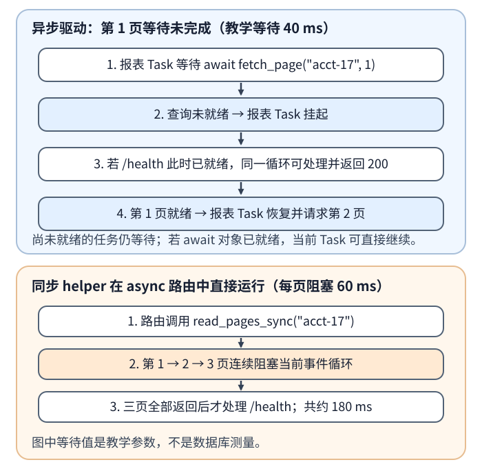
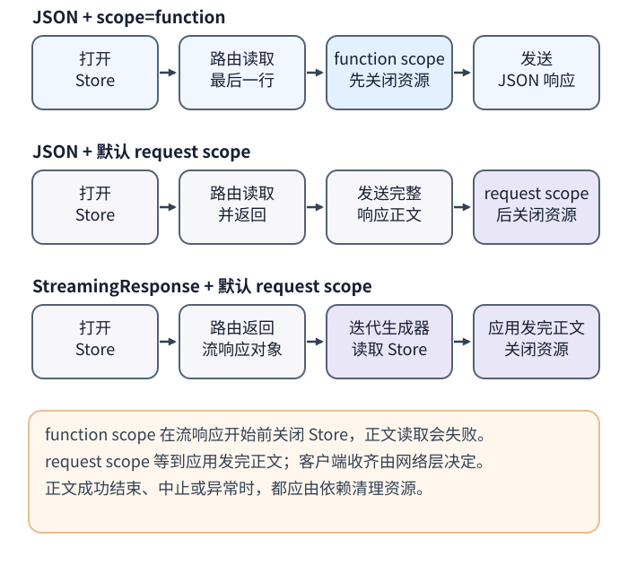

# 异步 FastAPI 接口为什么仍会阻塞？

**案例：** FastAPI 收到 acct-17 的报表请求，异步数据库驱动分三页读取结果。第 1 页尚未就绪时，报表任务（Task）会挂起；若此时 `/health` 已就绪，同一事件循环（event loop）便可先处理它。第 1 页就绪后，报表任务恢复并继续顺序读取下一页。若路由直接调用同步数据库辅助函数，当前事件循环会一直等到三页同步调用全部返回，期间其他就绪请求只能等待调度。资源还必须活到最后一次使用它的阶段。

## 从 async def 到运行中的协程，中间发生什么？

调用 async def 函数先得到协程对象（coroutine object）；FastAPI 在请求 Task 中调用路由，再由事件循环驱动这个 Task。Task 是事件循环推进协程的调度单位；同一时刻只运行一个 Task 的同步代码。Task 在等待尚未就绪的 Future（异步结果对象）或输入/输出（I/O）时挂起，事件循环才有机会推进其他就绪任务。数据库返回第 1 页时，等待对象就绪，报表 Task 恢复并拿到结果；它处理这一页后再 await 第 2 页。

await 表示等待一个可等待对象，不保证每次都会切换任务：如果对象已经就绪，当前任务可以直接继续。async def 也不会自动把函数搬到线程。直接调用 time.sleep()、同步数据库驱动或很长的 Python 计算时，当前任务没有把控制权交回事件循环；事件循环要等它返回才能处理其他任务。

按所调用的 API 选择运行边界：

| 写法 | 执行位置与适用边界 |
| --- | --- |
| 在 async def 中 await 原生异步数据库或 HTTP API | I/O 未完成时挂起当前 Task，让事件循环处理其他就绪任务；这是报表分页的主路径。 |
| 在 async def 中直接调用同步辅助函数 | 辅助函数在当前事件循环线程执行；FastAPI 不会拦截你直接调用的普通函数。 |
| 把 FastAPI 路由或依赖本身声明为 def | FastAPI/Starlette 通过 AnyIO 工作线程执行同步代码。线程容量有限，调用超过容量时会等待。 |
| 在异步路由中对短期阻塞 I/O 使用 asyncio.to_thread() | 由 asyncio 默认执行器（executor）的线程执行；它与 AnyIO 的同步路由/依赖限额分开配置。 |
| 把纯 Python 的 CPU 密集工作交给有界进程池或独立工作进程（worker） | 避免长时间占用事件循环，并可用多个进程并行；要承担进程调度、序列化和内存成本。 |

下面用合成的每页等待 40 毫秒演示原生异步读取；它只是模拟 I/O 等待，不是数据库测量。同步分支用每页阻塞 60 毫秒，便于观察事件循环被占住的顺序。

~~~python
import asyncio
import time

from fastapi import Depends, FastAPI

app = FastAPI()

async def fetch_page(account: str, page: int) -> dict[str, object]:
    await asyncio.sleep(0.04)  # 合成等待：模拟异步 I/O
    return {"account": account, "page": page}

def fetch_page_sync(account: str, page: int) -> dict[str, object]:
    time.sleep(0.06)  # 合成阻塞：模拟同步 I/O
    return {"account": account, "page": page}

async def read_pages_async(account: str) -> list[dict[str, object]]:
    rows = []
    for page in range(1, 4):
        rows.append(await fetch_page(account, page))
    return rows

def read_pages_sync(account: str) -> list[dict[str, object]]:
    return [fetch_page_sync(account, page) for page in range(1, 4)]

def load_settings() -> dict[str, str]:
    return {"region": "demo"}

@app.get("/reports/{account}")
async def report(account: str, settings: dict[str, str] = Depends(load_settings)):
    return {"region": settings["region"], "rows": await read_pages_async(account)}

@app.get("/blocking/{account}")
async def blocking_report(account: str):
    # 同步辅助函数直接运行在事件循环线程。
    return {"rows": read_pages_sync(account)}

@app.get("/offloaded/{account}")
async def offloaded_report(account: str):
    return {"rows": await asyncio.to_thread(read_pages_sync, account)}

@app.get("/sync-route/{account}")
def sync_route(account: str):
    # FastAPI 会把它交给 AnyIO worker thread。
    return {"rows": read_pages_sync(account)}

@app.get("/health")
async def health():
    return {"status": "ok"}
~~~

/reports/acct-17 每页等待时都会给事件循环一个处理其他任务的机会；/blocking/acct-17 在路由中直接运行三次同步读取，事件循环要等约 180 毫秒的合成阻塞结束后才能处理 /health。/offloaded 在 asyncio 默认 executor 中运行同一同步函数；/sync-route 则由 FastAPI/Starlette 调度到 AnyIO worker thread。后两条路径都让事件循环继续运行，但它们各自消耗不同的线程容量，卸载不会消除下游数据库或文件操作本身的成本。

/reports 路由还通过 Depends(load_settings) 接收一个普通 def 依赖。FastAPI 主动调用的同步依赖会进 AnyIO worker thread；这和 async 路由里直接调用同步辅助函数是不同的调用边界。

Starlette 文档说明，默认 AnyIO 工作线程限额（worker thread limiter）有 40 个并发令牌（token），FastAPI 的同步依赖和 Starlette 的若干同步操作也会使用这份容量；本机 AnyIO 4.12.1 的默认值复放为 40。它是并发上限，不是需要填满的目标。提高上限会允许更多线程同时执行，可能增加线程和下游资源压力；仍要按每进程的线程与连接预算评估。asyncio 默认 executor 的配置不受这个限额控制。同时应按资源预算限制等待队列，并在入口做准入控制；执行并发上限本身不会限制有多少调用在排队。

对 CPython 3.11，Global Interpreter Lock（全局解释器锁，GIL）意味着多个普通 Python 线程通常不能同时执行 Python 字节码。因此把 CPU 密集的纯 Python 函数放进 asyncio.to_thread() 可以避免直接占住事件循环，却通常不能获得多核并行；选择进程池或独立 worker 更合适。CPython 3.13 起提供可选的 free-threaded（自由线程）构建，3.14 起进入正式支持阶段但仍是可选构建；扩展库可能重新启用 GIL，实际收益和线程安全仍要按所用解释器及依赖验证。

`await fetch_page(...)` 仍在当前请求 Task 中顺序读取各页；await 不会自动创建并发任务。若一个请求要并发查询多个页面，需用 `asyncio.create_task()` 或 Python 3.11 的任务组（TaskGroup）中的 `create_task()` 显式建立子 Task，创建者仍要收集结果并等待结束；TaskGroup 会在退出作用域前等待组内任务完成。不要留下无人管理的后台 Task，也不要让并发 Task 共用同一个 ORM `AsyncSession`；每个 Task 都要有自己的会话。请求或 worker 执行尝试也应各自持有短生命周期会话，数据库连接池的等待与上限见[怎样限定 ORM Session 并排查连接池耗尽？](data-access-and-connection-pools.md)。

## 任务取消时，函数、线程和远端操作分别会怎样？

Task.cancel() 是取消请求：事件循环在下一次调度机会向协程注入 CancelledError。协程可以在 finally 中关闭游标、会话或临时文件；清理后通常应继续传播取消，让调用方按取消处理。若捕获后普通返回，调用方可能观察到正常结果而不是取消；若吞掉 `asyncio.timeout()` 发出的取消，超时作用域也可能正常退出，不抛 TimeoutError。任务组可能因此把子任务当作正常完成，偏离调用方预期的取消控制流。

asyncio.timeout(秒数) 也靠事件循环调度取消。若一个同步函数把事件循环堵住，截止时间到达时取消回调不能运行。用本机 CPython 3.11.13 复放：asyncio.timeout(0.01) 包住 time.sleep(0.05)，代码约 0.05 秒后正常离开，没有抛出 TimeoutError。若阻塞调用返回后，协程仍在 scope 内等待一个尚未就绪的异步操作，事件循环才有机会运行迟到的取消回调；本机复放中紧接着 `await asyncio.sleep(0)` 仍正常退出，而等待正时长的异步操作时才观察到 TimeoutError。因此超时不是中断任意同步函数的机制。

取消等待 `asyncio.to_thread(blocking_call)` 的 Task，会让异步调用方停止等待。如果函数已经在线程中运行，Python 不会强制杀掉该线程；若工作还在 executor 排队而未开始，则可能在执行前被取消。线程仍可能在使用文件、连接或其他资源。释放连接池、关闭共享句柄前，应确认线程已经结束。对 asyncio.to_thread()，可传入 threading.Event 作为停止信号并让函数定期检查；AnyIO worker 则可用 from_thread.check_cancelled() 做协作式检查。

客户端超时或断线也不证明远端副作用已停止：写操作可能没到服务端、可能已回滚，也可能已提交但响应丢失。对于持久报表 job（后台任务），应通过权威状态查询结果，显式请求取消并确认 worker 已停止；不要把一次 HTTP 断线当成 job 终态。完整的重试与状态确认边界见[请求超时后如何确认结果并安全重试？](../reliability/api-reliability-and-async-delivery.md)。

## FastAPI 的 yield 依赖应何时释放？

yield 依赖适合把资源打开和清理放在同一生命周期中，例如异步数据库会话或游标。FastAPI 带 yield 的依赖默认使用请求作用域（request scope）：FastAPI 在调用路由前解析依赖时打开，应用发送完响应正文后清理。这里“发送完”指ASGI（异步服务器网关接口）的 `http.response.body` 最终帧已发送，不代表客户端已从网络收齐字节。指定 `Depends(scope="function")` 时，函数作用域（function scope）会在路由函数返回后、响应发送前清理。

这些依赖 scope 参数从 FastAPI 0.121.0 起支持；下面的行为在 FastAPI 0.128.0、Starlette 0.47.2 上核对。

下面从小型 JSON 响应切换到较大的 CSV（逗号分隔值）流，比较资源的最后使用点。

CSV 路由可以先返回 StreamingResponse，再由正文生成器逐块读取数据库游标。如果依赖使用 scope="function"，路由一返回 Store 就已关闭，正文生成器后续读取会失败。让 request scope 覆盖整个应用正文发送；若正文发送结束、流中止或出错，依赖退出逻辑仍须在 finally 中清理资源。反过来，若路由已经读完资源并生成完整 JSON，function scope 可以在应用发送响应前释放它，减少资源占用时间。

下面用另一个独立的最小应用验证这个边界。其中的 `Store` 是合成对象：`close()` 会标记关闭状态，之后的 `read_row()` 明确抛出 `RuntimeError`。这是教学用的资源契约，不代表某个数据库驱动固定使用该异常类型。

~~~python
import asyncio
from collections.abc import AsyncIterator
from typing import Annotated

from fastapi import Depends, FastAPI
from fastapi.responses import StreamingResponse

app = FastAPI()

class Store:
    def __init__(self) -> None:
        self.closed = False

    async def read_row(self) -> bytes:
        await asyncio.sleep(0)
        if self.closed:
            raise RuntimeError("Store is closed")
        return b"acct-17,42\n"

    async def close(self) -> None:
        self.closed = True

async def get_store() -> AsyncIterator[Store]:
    store = Store()
    try:
        yield store
    finally:
        await store.close()

@app.get("/row")
async def read_row(
    store: Annotated[Store, Depends(get_store, scope="function")],
):
    row = await store.read_row()
    return {"row": row.decode().strip()}

@app.get("/stream")
async def stream_rows(
    store: Annotated[Store, Depends(get_store)],
):
    async def body():
        yield b"account,report_id\n"
        yield await store.read_row()

    return StreamingResponse(body(), media_type="text/csv")
~~~

在合成驱动的 ASGI trace 中，/row 的顺序是 `open → read → close → 发送 JSON`；/stream 是 `open → 发送 CSV 表头 → 读取 Store → 发送正文结束 → close`。路由返回 StreamingResponse 时，正文生成器尚未读取行；默认 request scope 让 Store 留到应用发送完最后一帧。这个边界是 ASGI 发送完成，不是客户端实际收齐字节。反过来，把 `/stream` 的依赖改成 `Depends(get_store, scope="function")` 再运行，会得到 `open → close → response.start(200) → CSV 表头 → read 抛 RuntimeError`，不会发送最终正文帧：证明路由函数返回时过早关闭了仍要供生成器读取的资源。

直接流式响应把连接、游标和请求生命周期绑在一起，正文尚未发完时会继续占资源；客户端断开也不是可查询的持久任务结果。若报表要由后台可靠生成并可稍后下载，本仓的报表案例会在同一事务中受理 job、写入 outbox 并占用等待槽，事务提交后返回 202。worker 在自己的 attempt 内重新获取会话和连接，先完成 CSV 私有对象写入，再在任务仍为 `running`、attempt 匹配且未请求取消的条件下提交结果引用与 `succeeded` 终态；这和请求内的 StreamingResponse 是两种生命周期。job 的持久流程见[怎样设计一个可持久查询的账户报表？](../architecture/system-design-fundamentals.md)。

> [!info]- 来源
> - Python 3.11 async def 返回协程、Task 等待 Future 时挂起以及事件循环一次运行一个 Task：[Coroutines and Tasks](https://docs.python.org/3.11/library/asyncio-task.html#coroutines)，§Coroutines、§Task Object；并发作用域：[§Task Groups](https://docs.python.org/3.11/library/asyncio-task.html#task-groups)。核对于 2026-11-12，相关调度示例于 CPython 3.11.13 重放。
> - SQLAlchemy 2.0 的 `AsyncSession` 不可在并发 Task 间共享：[Using AsyncSession with Concurrent Tasks](https://docs.sqlalchemy.org/en/20/orm/extensions/asyncio.html#using-asyncsession-with-concurrent-tasks)；核对日期：2026-11-12。
> - asyncio.timeout() 通过取消当前 Task 实现截止时间，asyncio.to_thread() 使用独立线程并主要面向阻塞 I/O：[Python 3.11 Coroutines and Tasks](https://docs.python.org/3.11/library/asyncio-task.html#timeouts)，§Timeouts、§Running in Threads；Future 已开始运行后 cancel() 不能终止它：[Python 3.11 concurrent.futures](https://docs.python.org/3.11/library/concurrent.futures.html#concurrent.futures.Future.cancel)。核对于 2026-11-12；超时和已运行线程取消分支于 CPython 3.11.13 本机重放。
> - asyncio.to_thread() 将函数提交到默认线程执行器：[Python 3.11 Event Loop](https://docs.python.org/3.11/library/asyncio-eventloop.html#executing-code-in-thread-or-process-pools)，§Executing code in thread or process pools；纯 Python CPU 工作使用进程池的标准接口也见此节。
> - FastAPI 的同步 path operation 和同步依赖在线程池执行，直接调用的普通 helper 不会被 FastAPI 改变调用方式：[FastAPI Concurrency and async / await](https://fastapi.tiangolo.com/async/)，§Very Technical Details / Path operation functions、Dependencies、Other utility functions；文档及 FastAPI 0.128.0、Starlette 0.47.2、AnyIO 4.12.1 行为核对于 2026-11-12。
> - Starlette 使用 AnyIO 运行同步端点、依赖和内部同步操作；默认 limiter 为 40 tokens：[Starlette Thread Pool](https://starlette.dev/threadpool/#concurrency-limitations)，§Concurrency Limitations。AnyIO limiter 不影响 asyncio 默认 executor：[AnyIO Working with threads](https://anyio.readthedocs.io/en/stable/threads.html)，§Adjusting the default maximum worker thread count；文档及本机 4.12.1 默认 token 数核对于 2026-11-12。
> - Python 不能强杀已运行线程；threading.Event 可用作显式停止信号：[Python 3.11 threading](https://docs.python.org/3.11/library/threading.html#event-objects)，§Event objects。AnyIO worker 也可用 from_thread.check_cancelled() 实现协作式检查：[AnyIO Working with threads](https://anyio.readthedocs.io/en/stable/threads.html)，§Reacting to cancellation in worker threads；两页核对于 2026-11-12。
> - yield 依赖默认 request scope；function scope 在路由返回后、响应发送前退出：[FastAPI Dependencies with yield](https://fastapi.tiangolo.com/tutorial/dependencies/dependencies-with-yield/)，§Early exit and scope。该 scope 功能从 [FastAPI 0.121.0 release notes](https://fastapi.tiangolo.com/release-notes/#01210) 加入；文档及样例于 FastAPI 0.128.0、Starlette 0.47.2 核对于 2026-11-12，生成器退出顺序以本机 ASGI trace 核对。
> - Starlette 0.47.2 的 StreamingResponse 迭代正文并发送分块；断连或发送错误会结束/取消流生成任务，使请求作用域有机会退出：[pinned responses.py](https://github.com/Kludex/starlette/blob/0.47.2/starlette/responses.py#L220-L278)。实现核对于 2026-11-12；正文与依赖顺序在本机 ASGITransport trace 核对，这不是 TCP 断线测试。
> - `http.response.body` 的最终 ASGI 事件用 `more_body=False` 表示应用已发送完响应正文：[ASGI HTTP Response Body](https://asgi.readthedocs.io/en/stable/specs/www.html#response-body-send-event)，§Response Body；核对日期：2026-11-12。客户端是否已收齐字节由网络层决定。
> - CPython 3.11 普通线程受 GIL 限制；free-threaded 构建的可选支持和扩展模块可能重新启用 GIL：[Python support for free threading](https://docs.python.org/3/howto/free-threading-python.html)，§Installation、§The global interpreter lock in free-threaded Python；3.14 的正式支持阶段见 [PEP 779](https://peps.python.org/pep-0779/)，§Abstract。两页核对于 2026-11-12。
