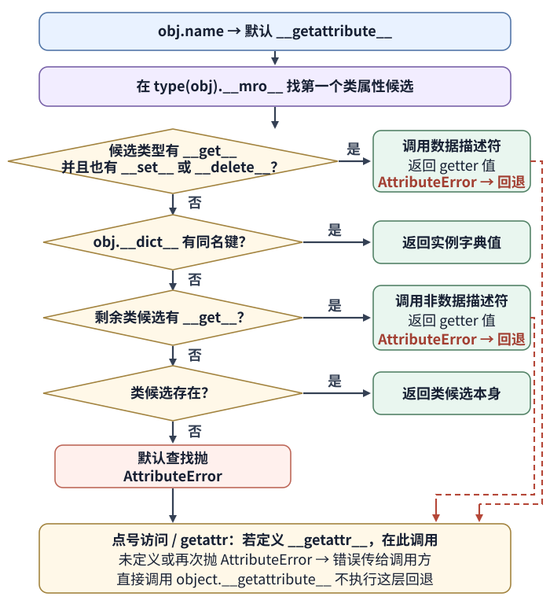
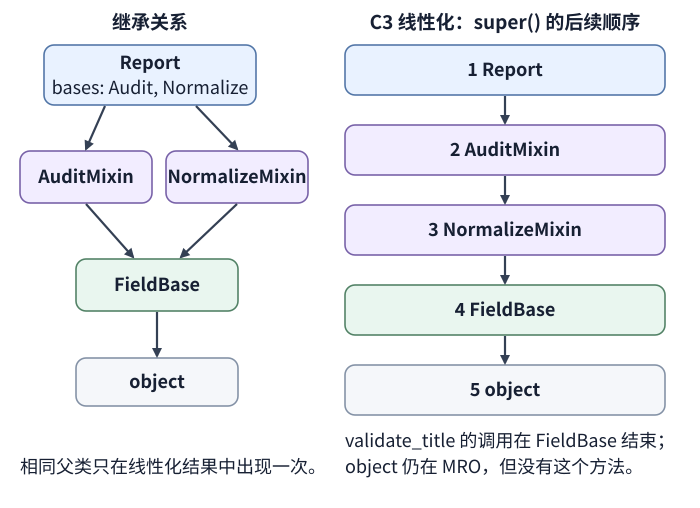

# Python 实例属性何时来自对象字典，何时变成描述符或绑定方法？

**承接前篇：** [前篇](python-fundamentals.md)的 CSV worker 接受了 `evt-1` 与 `evt-3`，并沿共享标签列表把第一条记录改为 `['new', 'priority', 'reviewed', 'shared']`。本篇在独立代码中重建这两条记录；现在标题输入改成 `"  November  "`，要求读取得到规范化后的 `November`，空白标题则拒绝。我们还要解释普通类属性、描述符和实例字典同名时由谁响应，以及同一验证方法如何沿多继承顺序协作。

本篇只讨论普通类实例的显式读写，例如 `report.title`、`report.title = value` 和 `getattr(report, name)`。类对象本身的元类查找、特殊语法触发的隐式特殊方法查找，以及代理类的额外规则不属于这条路径。

方法解析顺序（method resolution order，MRO）是从当前类沿基类继续查找属性时使用的顺序。

图的前半展示默认 `__getattribute__` 的查找链；当它以 `AttributeError` 结束，普通点号访问和两参数 `getattr()` 才进入末端的 `__getattr__` 回退。描述符 getter 自己抛出 `AttributeError` 也会进入该回退；若重写的 `__getattribute__` 抛出同一错误，也会走这条外层回退，详见下文。

## 为什么同名实例键不会取代标题验证器？

descriptor（描述符）是其类型定义了 `__get__`、`__set__` 或 `__delete__` 的对象。要让点号访问自动调用它，描述符对象必须作为属性放在类字典中，或被实例类型的某个基类继承；把描述符对象放进实例字典只会得到那个普通对象。

下面的 `NonEmptyText` 将公开的 `title` 管理在实例字典的 `_title` 键里。`__set_name__` 在类创建时收到它所属的类和属性名；`__get__` 在类访问时返回描述符本身，在实例访问时读存储键；`__set__` 把校验交给实例的 `validate_title` 协议，成功后才写入规范化值。

这个实现要求宿主实例有 `__dict__`，并提供 `validate_title`；后面的 `Report` 同时满足这两个前提。

~~~python
class NonEmptyText:
    def __set_name__(self, owner, name):
        self.public_name = name
        self.storage_name = "_" + name

    def __get__(self, instance, owner=None):
        if instance is None:
            return self
        try:
            return instance.__dict__[self.storage_name]
        except KeyError:
            raise AttributeError(self.public_name) from None

    def __set__(self, instance, value):
        if not isinstance(value, str):
            raise TypeError("title must be text")
        normalized = instance.validate_title(value)
        instance.__dict__[self.storage_name] = normalized
~~~

这个描述符定义了 `__get__` 和 `__set__`，所以它是 data descriptor（数据描述符）。读取时，若类 MRO 找到这样的候选，描述符 getter 会先于 `report.__dict__` 执行；赋值时，默认属性设置会先调用它的 `__set__`。因此，即使实例字典里也出现 `title` 键，普通的 `report.title` 仍由描述符决定。

以下类和对象继续使用前篇的 `Report` 与事件数据。`NonEmptyText.__set__` 调用 `report.validate_title`；该函数由类中的普通函数描述符绑定到当前实例，再通过 `super()` 进入审计、去空格和非空检查步骤。

~~~python
events = []

class FieldBase:
    def validate_title(self, value):
        events.append("FieldBase")
        if not value:
            raise ValueError("title must contain non-whitespace text")
        return value

class NormalizeMixin(FieldBase):
    def validate_title(self, value):
        events.append("NormalizeMixin.before")
        result = super().validate_title(value.strip())
        events.append("NormalizeMixin.after")
        return result

class AuditMixin(FieldBase):
    def validate_title(self, value):
        events.append("AuditMixin.before")
        result = super().validate_title(value)
        events.append("AuditMixin.after")
        return result

class Report(AuditMixin, NormalizeMixin):
    title = NonEmptyText()
    category = "monthly"

    def __init__(self, title, rows):
        self.title = title
        self.rows = rows

    def validate_title(self, value):
        events.append("Report.validate_title")
        return super().validate_title(value)

    def __getattr__(self, name):
        events.append(f"__getattr__({name})")
        if name == "row_count":
            return len(self.rows)
        raise AttributeError(name)

    def publish(self):
        return f"Published {self.title} ({len(self.rows)} events)"

source_rows = [
    {
        "id": "evt-1",
        "status": "ready",
        "count": 3,
        "tags": ["new", "priority", "reviewed", "shared"],
        "note": "account\nexport",
    },
    {
        "id": "evt-3",
        "status": "ready",
        "count": 2,
        "tags": ["review"],
        "note": "year-end",
    },
]
report = Report("  November  ", source_rows)
print(Report.title is vars(Report)["title"])
print(vars(Report)["title"].storage_name)
print(report.title, report.__dict__["_title"])
print([row["id"] for row in report.rows])
print(events)
~~~

输出为 `True`、`_title`、`November November`、`['evt-1', 'evt-3']`，校验轨迹为 `Report.validate_title → AuditMixin.before → NormalizeMixin.before → FieldBase → NormalizeMixin.after → AuditMixin.after`。赋值 `self.title = title` 不是直接把标题字符串放进 `report.__dict__`：它触发类上的数据描述符，空格先被去掉，随后 `FieldBase` 检查结果非空，最后才写入 `_title`。直接查看 `vars(Report)["title"]` 会取得描述符对象；`Report.title` 则通过类属性访问调用 `__get__(None, Report)`，本例同样返回它自身。

正常点号访问和直接改字典不是同一操作。下面先把一个同名键直接塞进实例字典，再通过语法赋值空白标题：

~~~python
report.__dict__["title"] = "forged instance value"
print(report.title, report.__dict__["title"], report.__dict__["_title"])

try:
    report.title = "   "
except ValueError as error:
    print(type(error).__name__, str(error))
print(report.title)
~~~

结果是 `November forged instance value November`，接着抛出 `ValueError title must contain non-whitespace text`，最后 `report.title` 仍为 `November`。直接写 `__dict__` 绕开了 `__set__`，但正常读取仍先调用数据描述符；描述符约束的是普通属性访问协议，不是防止任意代码篡改内部状态的安全边界。

## 实例字典、类属性和两种描述符怎样排优先级？

对默认实例读取，Python 先沿 `type(obj).__mro__` 找到第一个定义该名称的类属性候选，再按候选的 descriptor 能力和实例字典决定返回值。关键条件是“数据描述符并且有 `__get__`”：只有这种可读取的数据描述符会在读取时压过同名实例值。

| 类 MRO 找到的候选 | 实例字典有同名键 | `obj.x` 的结果 |
| --- | --- | --- |
| 有 `__get__` 且有 `__set__` 或 `__delete__` 的数据描述符 | 有或没有 | 调用描述符的 `__get__` |
| 定义了 `__get__`、没有 `__set__` / `__delete__` 的非数据描述符 | 有 | 返回实例字典值 |
| 同一个非数据描述符 | 没有 | 调用描述符的 `__get__` |
| 没有 `__get__` 的类候选，包括只定义 `__set__` / `__delete__` 的描述符 | 有 | 返回实例字典值 |
| 没有 `__get__` 的类候选 | 没有 | 返回类候选本身 |
| 没有类候选 | 有 | 返回实例字典值 |
| 没有类候选 | 没有 | 默认查找抛 `AttributeError`，之后才尝试 `__getattr__` |

这张读取表假定普通实例有 `__dict__`；若实例没有字典，查找会略过这一步。有 `__set__` 或 `__delete__` 就属于数据描述符，即使没有 `__get__`；不过，没有 getter 的对象不能在读取时计算属性值，所以它不会压过实例字典，实例字典缺少该键时则直接读到类上的描述符对象。

赋值有自己的分派规则。类候选定义了 `__set__` 时，`obj.x = value` 会调用它；只定义 `__delete__` 的数据描述符也会拦截默认赋值，但由于没有 `__set__`，赋值会抛出 `AttributeError`，已有的同名实例键不会被替换。setter 自己拒绝值时，异常同样向外传播。只有类上没有拦截这次赋值的描述符且实例有 `__dict__` 时，默认赋值才会写入实例字典；没有实例字典也可能无法新增属性。读取优先级表不能代替设置规则。

下面的 `DeleteOnly` 只实现删除协议。即使实例字典已有 `value`，点号赋值也会由类候选拦截并报错，旧值保持不变：

~~~python
class DeleteOnly:
    def __delete__(self, instance):
        pass

class Holder:
    value = DeleteOnly()

holder = Holder()
holder.__dict__["value"] = "kept"
try:
    holder.value = "new"
except AttributeError as error:
    print(type(error).__name__, str(error), holder.__dict__["value"])
~~~

CPython 3.11.13 输出 `AttributeError __set__ kept`。

`@property` 是数据描述符。普通类函数是非数据描述符：`report.publish` 会调用函数的 `__get__`，得到一个绑定方法（bound method），其中 `__self__` 是 `report`、`__func__` 是类字典里的函数。函数只有放在类上、经实例读取时才按这条路径绑定；将普通函数直接存进实例字典，读取会得到原函数，不会自动补上 `self`。因为函数是非数据描述符，实例字典可以遮住它；这也解释了为什么对单个实例做 monkey patch（运行时替换）只影响那个实例。

~~~python
print(report.category)
report.category = "draft"
print(report.category, Report.category)

bound = report.publish
print(bound.__self__ is report, bound.__func__ is vars(Report)["publish"])
print(bound())
report.__dict__["publish"] = "temporary label"
print(report.publish)
del report.__dict__["publish"]
print(report.publish())
~~~

输出先是 `monthly`，之后是 `draft monthly`：普通类值在实例没有同名键时提供默认值，赋值创建实例自己的遮蔽值。方法部分依次输出 `True True`、`Published November (2 events)`、`temporary label` 和恢复后的 `Published November (2 events)`。

普通点号访问和两参数 `getattr(obj, "x")` 的外层分派，会在 `__getattribute__(self, name)` 抛出 `AttributeError` 时调用类上定义的 `__getattr__(self, name)`；这个错误可以来自默认读取，也可以来自重写后的 `__getattribute__`。若没有 `__getattr__`，或回退方法再次抛出 `AttributeError`，错误传给调用方。描述符 `__get__` 抛出 `AttributeError` 也会触发同一回退。`__getattribute__` 为每次显式属性读取提供入口，默认实现是 `object.__getattribute__`，其中包含上述描述符和实例字典顺序。重写它会接管默认路径；若要保留该路径，应在实现里委托给 `object.__getattribute__(self, name)`，并避免用 `self.other` 读取内部状态而递归。

可以从 `row_count` 看出默认回退和直接调用的区别。`report.row_count` 与 `getattr(report, "row_count")` 都在默认查找失败后调用 `Report.__getattr__`；直接调用 `object.__getattribute__` 只做默认查找本身，不会自行调用回退。

~~~python
events.clear()
print(report.row_count, getattr(report, "row_count"))
try:
    object.__getattribute__(report, "row_count")
except AttributeError:
    print("direct object.__getattribute__: AttributeError")
print(events)
~~~

前两次访问都得到 `2`，事件列表只记录两次 `__getattr__(row_count)`；直接调用 `object.__getattribute__` 抛出 `AttributeError`，没有额外调用 `__getattr__`。在属性找到了数据描述符、但 getter 因内部值缺失而抛出 `AttributeError` 时，默认查找也以这个错误结束，外层属性语法再尝试 `__getattr__`，而不是回头读取同名实例字典值。

下面故意只调用 `Report.__new__` 而不运行 `__init__`，让 `_title` 缺失；同时在实例字典放入伪造的同名 `title` 键。描述符 getter 抛出 `AttributeError` 后，点号访问调用 `__getattr__("title")`；回退也抛错，所以最终仍是 `AttributeError`，字典里的伪造值没有被读出。这只用于显露查找分支，正常业务对象仍通过 `Report(...)` 初始化。

~~~python
events.clear()
incomplete = Report.__new__(Report)
incomplete.__dict__["title"] = "forged instance value"
try:
    incomplete.title
except AttributeError as error:
    print(type(error).__name__)
print(events)
~~~

本机输出是 `AttributeError` 和 `['__getattr__(title)']`。本例在 getter 错误发生前确实已经有 `incomplete.__dict__["title"]`；这一步表明该错误会直接转入 `__getattr__`，查找不会返回去读取同名实例字典键。

## 菱形继承中，`super()` 为什么会到达另一个 mixin？

标题描述符调用的是绑定到当前 `Report` 实例的 `validate_title` 方法。零参数 `super()` 会从“当前方法定义的类”在“该实例真实类型的 MRO”中的位置之后继续查找；它不是按当前类定义里的直接父类名称固定跳转。MRO 因此决定这条校验链的下一站。

`Report(AuditMixin, NormalizeMixin)` 声明审计 mixin 在前，规范化 mixin 在后；两者共同继承 `FieldBase`。C3 线性化保留每个基类已有的顺序，也保留子类声明的直接基类顺序，并让共同的 `FieldBase` 只进入最终 MRO 一次。

可按 C3 规则推导：

~~~text
L(AuditMixin) = [AuditMixin, FieldBase, object]
L(NormalizeMixin) = [NormalizeMixin, FieldBase, object]
L(Report) = [Report] + merge(
    [AuditMixin, FieldBase, object],
    [NormalizeMixin, FieldBase, object],
    [AuditMixin, NormalizeMixin],
)
~~~

每轮从各列表当前首项中，选第一个不出现在任何其他列表剩余尾部的类，将它追加到结果，并从所有以它开头的剩余列表移除首项。先选 `AuditMixin`；从第一张线性化列表和直接基类列表同时移除它后，剩余序列为 `[FieldBase, object]`、`[NormalizeMixin, FieldBase, object]`、`[NormalizeMixin]`。此时 `FieldBase` 虽是第一张表的首项，却出现在第二张表的尾部，暂时不能选。选择 `NormalizeMixin` 后，也从以它开头的两张表同时移除，剩余为 `[FieldBase, object]`、`[FieldBase, object]` 和空表；于是依次选出 `FieldBase` 与 `object`。所以 `Report.__mro__` 是 `[Report, AuditMixin, NormalizeMixin, FieldBase, object]`。若某轮仍有剩余项却选不出合法候选，继承约束相互冲突，类定义会失败并抛出 `TypeError`。

本例的轨迹是 `Report.validate_title → AuditMixin.validate_title → NormalizeMixin.validate_title → FieldBase.validate_title`。`FieldBase` 是校验链终点，没有下一层 `validate_title` 要委托。`AuditMixin` 中的 `super()` 从 `AuditMixin` 在 `Report` 实例 MRO 的位置继续，因此抵达 `NormalizeMixin`，不是其定义时写的 `FieldBase`。每层 mixin 都要遵守共同约定：参数形状兼容，并在需要链条继续时调用 `super()`；省掉一次调用会截断后续步骤。

改变直接基类顺序会改变 MRO，也会改变同一套 `super()` 的执行顺序：

~~~python
print([cls.__name__ for cls in Report.__mro__])

class NormalizeFirst(NormalizeMixin, AuditMixin):
    pass

print([cls.__name__ for cls in NormalizeFirst.__mro__])
events.clear()
print(NormalizeFirst().validate_title("  November  "))
print(events)
~~~

`NormalizeFirst` 的 MRO 是 `[NormalizeFirst, NormalizeMixin, AuditMixin, FieldBase, object]`，同一输入仍规范化为 `November`，轨迹则变为 `NormalizeMixin.before → AuditMixin.before → FieldBase → AuditMixin.after → NormalizeMixin.after`。这段代码直接调用只含两个 mixin 的 `NormalizeFirst`，所以轨迹没有 `Report.validate_title`；它比较的是两个 mixin 的相对顺序。这个相对顺序随直接基类声明变化，而 `super()` 的语义不变。对一个方法是否值得组合多个 mixin，应看这些步骤是否真有可组合的共同契约；若调用顺序难以说明，显式组合对象或直接调用命名步骤更容易阅读。

> [!info]- 来源
> - 描述符的定义、必须作为类属性才自动触发、`__set_name__`、实例读取优先级、函数绑定和 `super` 触发 descriptor binding：[Python 3.15.2 Descriptor Guide](https://docs.python.org/3.15/howto/descriptor.html)，Descriptor Protocol、Invocation from an Instance、Invocation from Super、Automatic Name Notification、Functions and Methods，核对于 2026-11-12。
> - 显式读取由 `__getattribute__` 处理；当它抛出 `AttributeError` 时外层 `__getattr__` 才回退，且 descriptor getter 的错误也可进入回退：[Python 3.15.2 Language Reference, Customizing Attribute Access](https://docs.python.org/3.15/reference/datamodel.html#customizing-attribute-access)，核对于 2026-11-12。
> - 类候选查找、默认实例属性查找：[Python 3.15.2 Language Reference, Custom Classes and Class Instances](https://docs.python.org/3.15/reference/datamodel.html#custom-classes)，核对于 2026-11-12。C3 线性化每轮选择候选首项并移除所有以它为首的列表项：[Python 3.15.2 MRO HOWTO](https://docs.python.org/3.15/howto/mro.html#the-c3-method-resolution-order)，核对于 2026-11-12。
> - 零参数 `super()` 从当前类之后沿实例类型的 MRO 查找；MRO 同时供 `getattr` 和 `super` 使用：[Python 3.15.2 Built-in Functions, `super`](https://docs.python.org/3.15/builtins/functions.html#super)，核对于 2026-11-12。
> - 固定实现 CPython 3.11.13 的数据描述符/实例字典/非数据描述符读取顺序与实例设置顺序：[Objects/object.c `_PyObject_GenericGetAttrWithDict` / `_PyObject_GenericSetAttrWithDict`](https://github.com/python/cpython/blob/v3.11.13/Objects/object.c#L1242-L1438)。默认设置路径见 [`_PyObject_GenericSetAttrWithDict`](https://github.com/python/cpython/blob/v3.11.13/Objects/object.c#L1390-L1425)。只实现 `__delete__` 的类候选也进入 descriptor setter 路径，缺少 `__set__` 时由描述符设置槽抛出错误：[Objects/typeobject.c `slot_tp_descr_set`](https://github.com/python/cpython/blob/v3.11.13/Objects/typeobject.c#L7822-L7839)。
> - 固定实现 CPython 3.11.13 的 `__getattribute__` / `__getattr__` 调度、`super_getattro` 的 MRO 后续查找、以及 C3 合并算法：[Objects/typeobject.c](https://github.com/python/cpython/blob/v3.11.13/Objects/typeobject.c#L7645-L7710)、[`super_getattro`](https://github.com/python/cpython/blob/v3.11.13/Objects/typeobject.c#L8812-L8883)、[`pmerge` / `mro_implementation`](https://github.com/python/cpython/blob/v3.11.13/Objects/typeobject.c#L1841-L2000)，本例在 CPython 3.11.13 重放。
