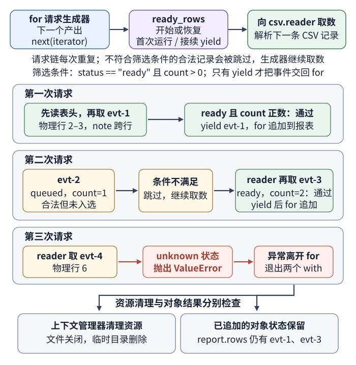
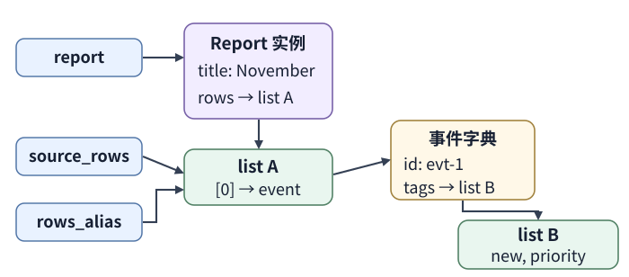

# Python 的值、迭代器与资源生命周期如何工作？

**案例：** 一个报表工作进程（worker）读取合成 comma-separated values（CSV，逗号分隔值）文件，把状态为 `ready` 且数量为正的事件加入 `Report("November", source_rows)`。第一条事件的引号字段跨两行；最后一条事件含无效状态。我们要追踪名字指向哪些对象、修改会不会共享、生成器何时交付每行，以及坏记录出现后哪些状态保留、哪些资源关闭。

图中的 `for` 循环每次请求生成器的下一个产出时才推进生成器。前几行已经加入 `report.rows` 后，后续坏记录仍可抛出异常；异常离开 `with` 块会关闭文件并清理临时目录，却不会撤销已修改的 Python 对象。

本例的 Python 代码块按页面顺序在同一进程执行，后面的代码沿用前面创建的 `Report` 实例和列表；解析阶段会把 `evt-1`、`evt-3` 加入该列表。

## 创建 Report 时，名字绑定到什么？

Python 中数据由对象表示。每个对象有 identity（身份）、type（类型）和值。身份在对象存续期间不变；`is` 比较是否为同一对象，`id(obj)` 返回代表身份的整数。类型决定对象支持哪些操作以及值的范围；它不像列表内容那样可随意原地修改，但也不能说成绝对不可改变：在 CPython 3.11.13 中，`class A: pass` 和 `class B: pass` 这两个普通类的实例布局兼容。对 `obj = A()` 先保存 `saved_id = id(obj)`，再执行 `obj.__class__ = B`，会得到 `type(obj) is B` 且 `id(obj) == saved_id`。这个受限赋值不会替换对象本身。对象结束生命周期后，另一个对象可能复用同一个 `id()`，所以它不是跨运行或长期保存的业务标识。`==` 比较值是否相等，具体相等规则也可由类型定义。

名字只是命名空间（namespace）中的绑定，执行赋值通常是让名字指向某个已有对象，并不复制对象；多个名称指向同一对象也称 aliasing（别名）。普通类调用通常先由 `__new__` 取得实例，再由 `__init__` 初始化该实例；`__init__` 本身不负责创建新实例。下面的 `Report` 把标题和传入的列表存为实例属性：

~~~python
class Report:
    def __init__(self, title: str, rows: list[dict[str, object]]) -> None:
        self.title = title
        self.rows = rows

source_rows = []
report = Report("November", source_rows)
rows_alias = report.rows
print(report.rows is source_rows, rows_alias is source_rows)
~~~

输出是 `True True`：`report` 指向新建的 `Report` 实例，而 `source_rows`、`report.rows` 和 `rows_alias` 指向同一个列表对象。`self.rows = rows` 只保存对列表的引用，没有复制列表或其中的对象。实例的 `__dict__` 保存这些普通属性绑定；本例暂时没有 descriptor（描述符）截获 `title` 的读写，下一篇会在相同 `Report` 案例中加入这层机制。

## 生成器如何把一条记录交给报表？

可迭代对象（iterable）能提供迭代器；迭代器（iterator）逐次返回值，结束时以 `StopIteration` 表示没有下一值，`for` 会处理这个结束信号。生成器函数包含 `yield`：调用它只返回一个生成器对象，函数体要等到 `for` 循环或 `next()` 请求下一值才继续执行。`list(generator)` 则会立即消费后续产出并存入列表；它会持续推进，直至耗尽或异常中断，不再保留逐条消费的内存优势。生成器让处理方不必先把整个输入读成列表；但已经产生的副作用不会因之后出错而自动回滚。

下面的代码块接在上段之后。生成器检查 CSV 表头、列数、状态和整数数量，把 `tags` 拆成列表，只交付 `status == "ready"` 且 `count > 0` 的事件；合法的 `queued` 事件仍会被过滤掉。`csv.reader.line_num` 表示读过的源文件物理行数；一条引号字段跨多行的 CSV 记录会使它大于记录序号。文本文件使用 `newline=""`，让 CSV 模块按自己的规则处理换行。

~~~python
import csv
from collections.abc import Iterator
from pathlib import Path
from tempfile import TemporaryDirectory
from typing import TextIO

def ready_rows(source: TextIO) -> Iterator[dict[str, object]]:
    reader = csv.reader(source)
    try:
        headers = next(reader)
    except StopIteration:
        return

    expected = ["id", "status", "count", "tags", "note"]
    if headers != expected:
        raise ValueError("unexpected CSV header")

    for values in reader:
        line_number = reader.line_num
        if len(values) != len(headers):
            raise ValueError(f"CSV physical line {line_number}: wrong column count")

        fields = dict(zip(headers, values))
        status = fields["status"]
        if status not in {"ready", "queued"}:
            raise ValueError(
                f"CSV physical line {line_number}: unknown status {status!r}"
            )
        try:
            count = int(fields["count"])
        except ValueError as error:
            raise ValueError(
                f"CSV physical line {line_number}: count must be an integer"
            ) from error

        row = {**fields, "count": count, "tags": fields["tags"].split("|")}
        if status == "ready" and count > 0:
            yield row

CSV_TEXT = (
    "id,status,count,tags,note\n"
    'evt-1,ready,3,new|priority,"account\n'
    'export"\n'
    "evt-2,queued,1,backlog,skip\n"
    "evt-3,ready,2,review,year-end\n"
    "evt-4,unknown,1,bad,invalid\n"
)

source = None
path = None
try:
    with TemporaryDirectory() as directory:
        path = Path(directory) / "events.csv"
        path.write_text(CSV_TEXT, encoding="utf-8")
        with path.open(encoding="utf-8", newline="") as source:
            for row in ready_rows(source):
                report.rows.append(row)
except ValueError as error:
    print(f"Rejected input: {error}")

print(source.closed, path.exists())
print([row["id"] for row in report.rows])
print(repr(report.rows[0]["note"]))
~~~

本机以 CPython 3.11.13 执行上述代码块，解析阶段输出：

~~~text
Rejected input: CSV physical line 6: unknown status 'unknown'
True False
['evt-1', 'evt-3']
'account\nexport'
~~~

每次 `for row in ready_rows(source)` 请求生成器的下一个产出，都会让它开始运行或从上次 `yield` 处恢复；控制顺序是外层 `for` 请求 `ready_rows`，生成器再向 `csv.reader` 取一条 CSV 记录。第一次请求先读表头，再取到跨物理行 2–3 的 `evt-1`；`note` 的值是含换行的 `'account\nexport'`，事件满足 `status == "ready" and count > 0`，所以生成器 `yield` 它，循环追加到报表。第二次请求从上次 `yield` 处恢复，先取得合法但状态为 `queued` 的 `evt-2`，条件不成立，生成器继续向 `csv.reader` 取数，再 `yield` 满足条件的 `evt-3`。第三次请求恢复后读到物理行 6 的 `evt-4`，状态 `unknown` 不合法，于是抛出异常而不再产出值。

生成器只借用调用方已打开的 `source`，它不负责打开或关闭流。在本例中，异常从循环传播后，两个上下文管理器按嵌套顺序退出：内层文件上下文关闭文件，外层 `TemporaryDirectory` 删除路径，然后异常才被 `except` 捕获。打印的 `True False` 分别是 `source.closed` 和 `path.exists()`：`source` 这个名称仍指向已关闭的流对象，`path` 仍是一个 `Path` 值，但它所指位置已不存在。外部的 `report` 仍引用原列表，已经追加的两条记录不会随资源退出而撤销。若结果必须全有或全无，应先验证并暂存，再在合适的事务边界提交；`with` 调用退出协议，是否回滚由上下文管理器实现决定；这里的文件和临时目录清理不会回滚列表修改。自定义 context manager 的 `__exit__` 还可以通过返回真值抑制块内异常，或在清理失败时抛出新异常。因此，判断错误能否到达外层 `except`，也要检查退出协议；本例两个管理器在成功清理后让原异常继续传播。

## 改对象和改名字，影响范围有什么不同？

现在 `report.rows` 已含 `evt-1`、`evt-3`。对象图只展开第一条记录：实例的 `rows` 属性、`source_rows` 和 `rows_alias` 三条引用路径指向同一行列表；列表里的事件字典又指向一只标签列表。

list 和 dict 是可变对象，原地追加或更新会改变同一对象的值；给名字重新赋值则只改变该名字的绑定。浅拷贝（shallow copy）只创建最外层容器，其成员引用仍可能共享：

~~~python
rows_alias[0]["tags"].append("reviewed")
copied_rows = report.rows.copy()
copied_rows[0]["tags"].append("shared")
print(report.rows[0]["tags"])

rows_alias = []
print(len(report.rows))
~~~

输出依次是 `['new', 'priority', 'reviewed', 'shared']` 和 `2`。第一行通过别名修改原列表中第一条事件的标签。`copy()` 创建另一只行列表，但 `copied_rows[0]` 和 `report.rows[0]` 仍指向同一个事件字典，字典中的 `tags` 也仍是同一列表；所以通过复制列表再修改嵌套标签，原报表也能观察到变化。最后把 `rows_alias` 改绑到新列表，不会替 `report.rows` 重新绑定。若需要独立修改标签，应重建对应的事件字典和 `tags` 列表；只有确实需要隔离整棵对象图时，再考虑 `deepcopy`（深拷贝）。

函数调用也会为形参建立新的局部名称，并让它们引用传入的对象。函数原地修改形参所指的列表，调用方可见；函数把形参改绑到另一只列表，不会改掉调用方的名称。另一个常见共享点是默认值：默认表达式在执行 `def` 时求值一次，后续调用会继续使用同一对象。

~~~python
def unsafe_add(item, items=[]):
    items.append(item)
    return items

print(unsafe_add("first"))
print(unsafe_add("second"))

def add(item, items=None):
    if items is None:
        items = []
    items.append(item)
    return items

print(add("first"))
print(add("second"))
~~~

前两次 `unsafe_add` 共用默认列表，结果依次是 `['first']` 和 `['first', 'second']`。`add` 在每次未提供列表时新建一只，因此结果分别是 `['first']` 和 `['second']`。如果 `None` 也是有意义的输入，再用独立 sentinel（哨兵值）表示“未提供”。

不可变也要按对象边界理解：字符串不能原地改写；元组不能替换它的成员，但成员若是列表，仍可修改那只列表。`set` 保存不重复元素但没有序列索引；`dict` 将键映射到值，插入顺序从 Python 3.7 起是语言保证（CPython 3.6 中只是实现细节）。这些性质都不意味着名称本身不可重新绑定。

## 类型提示和虚拟环境能保证什么？

type hint（类型提示）中的 `TextIO`、`Iterator` 和返回类型帮助读者、IDE 与静态类型检查器理解预期形状；Python 默认不会因为实际对象不符合注解而拒绝它。示例中的输入验证由表头检查、状态判断和 `int()` 转换执行，而不是由类型注解执行。文件也不应等垃圾回收时才关闭；`with` 语句使用上下文管理器（context manager）在确定的控制流边界执行关闭。

这份示例只用 Python 标准库，可直接保存为文件后运行。虚拟环境（virtual environment）以创建命令所调用的基础 Python 为基准，并隔离项目安装的包；它不会替项目安装一个独立于基础解释器的 Python 版本。创建时选定解释器，再用该环境中的 Python 运行程序与安装依赖，例如：

~~~sh
python3.11 -m venv .venv
.venv/bin/python python-fundamentals-example.py
~~~

项目需要第三方依赖时，也使用同一个环境的解释器运行 `-m pip`，例如 `.venv/bin/python -m pip install httpx`；这样安装位置与程序运行环境一致。上面的 `.venv/bin/` 是 POSIX 环境路径。

本章先用普通实例属性建立 `Report` 对象和列表的状态。下一篇沿用 `November` 报表及其事件数据，把 `title` 改成会验证输入的数据描述符，并说明属性读取、实例字典、绑定方法和多继承如何共同决定结果：[Python 实例属性何时来自对象字典，何时变成描述符或绑定方法？](python-attribute-lookup-and-mro.md)。异步接口如何让同一类报表读取跨过 I/O 等待，以及资源需要活到什么时候，见[异步 FastAPI 接口为什么仍会阻塞？](python-async-and-fastapi.md)。

> [!info]- 来源
> - 对象身份、类型、可变性、不可变容器中的可变成员，以及不要依赖对象立即终结：[Python 3.15.2 Language Reference, Data model §3.1](https://docs.python.org/3.15/reference/datamodel.html#objects-values-and-types)，核对于 2026-11-12。受限 `__class__` 赋值须兼容 `__slots__`：[Python 3.15.2 Language Reference, `__slots__`](https://docs.python.org/3.15/reference/datamodel.html#object.__slots__)；固定实现 CPython 3.11.13 的兼容性检查和类型指针替换：[Objects/typeobject.c `compatible_for_assignment` / `object_set_class`](https://github.com/python/cpython/blob/v3.11.13/Objects/typeobject.c#L4715-L4869)。`id()` 在对象生命周期内唯一、恒定，生命周期不重叠的对象可能复用该值：[Python 3.15.2 Built-in Functions, `id`](https://docs.python.org/3.15/library/functions.html#id)；CPython 3.11.13 中它由对象指针转成整数：[Python/bltinmodule.c `builtin_id`](https://github.com/python/cpython/blob/v3.11.13/Python/bltinmodule.c#L1197-L1225)。
> - 类调用通常经 `__new__` 取得实例并由 `__init__` 初始化；名字可别名引用同一对象：[Python 3.15.2 Language Reference, Classes / Basic customization](https://docs.python.org/3.15/reference/datamodel.html#classes)，[Python 3.15.2 Tutorial, Classes §9.1](https://docs.python.org/3.15/tutorial/classes.html#a-word-about-names-and-objects)，核对于 2026-11-12。
> - 字典插入顺序从 3.7 起是语言保证，CPython 3.6 中是实现细节：[Python 3.15.2 Built-in Types, Dictionary](https://docs.python.org/3.15/library/stdtypes.html#dict)，核对于 2026-11-12。
> - 函数默认参数在函数定义时求值：[Python 3.15.2 Tutorial, Default Argument Values](https://docs.python.org/3.15/tutorial/controlflow.html#default-argument-values)，核对于 2026-11-12。
> - 生成器函数、`yield` 与按需迭代：[Python 3.15.2 Language Reference, Yield expressions](https://docs.python.org/3.15/reference/expressions.html#yield-expressions)，核对于 2026-11-12。
> - 多行 CSV 记录与 `reader.line_num` 的物理行计数、打开文件时的 `newline=""`：[Python 3.15.2 `csv` library](https://docs.python.org/3.15/library/csv.html#csv.csvreader.line_num)，本例于 CPython 3.11.13 重放。
> - `with` 语句的进入、退出和异常传播：[Python 3.15.2 Language Reference, The with statement](https://docs.python.org/3.15/reference/compound_stmts.html#the-with-statement)；文件流作为上下文管理器在块退出时关闭：[Python 3.15.2 `io.IOBase`](https://docs.python.org/3.15/library/io.html#io.IOBase)；临时目录上下文退出时清理：[Python 3.15.2 `tempfile.TemporaryDirectory`](https://docs.python.org/3.15/library/tempfile.html#tempfile.TemporaryDirectory) 和固定实现 [CPython 3.11.13 `Lib/tempfile.py`](https://github.com/python/cpython/blob/v3.11.13/Lib/tempfile.py#L857-L949)，本例记录了实际资源状态。
> - Python 运行时默认不强制函数和变量注解：[Python 3.15.2 `typing`](https://docs.python.org/3.15/library/typing.html)，核对于 2026-11-12。
> - 虚拟环境隔离包安装位置，并由创建命令选定基础解释器：[Python 3.15.2 `venv`](https://docs.python.org/3.15/library/venv.html)，核对于 2026-11-12。
