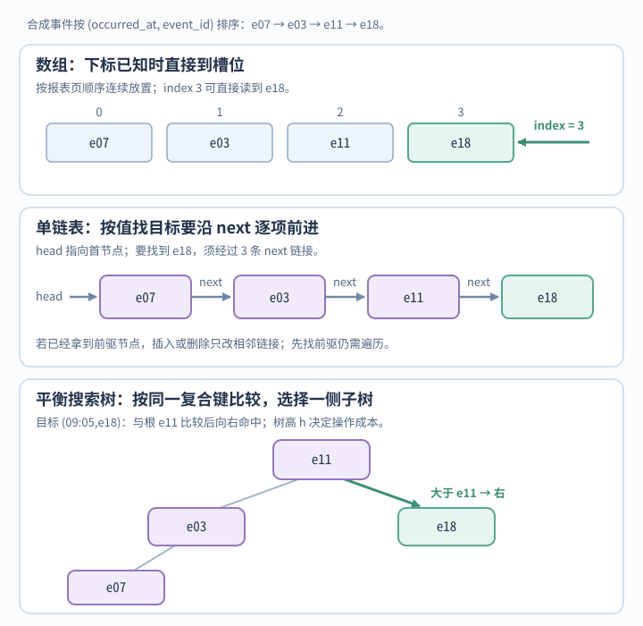

# 数组、链表、树和哈希表各靠什么找到目标、维护顺序？

一种数据结构快不快，取决于它怎样找到目标、改动时要更新哪些链接、能不能保持顺序；同一组数据换一种访问方式，最合适的结构就可能不同。本章比较数组、链表、搜索树、B/B+ 树、哈希表和 Trie 这三方面的差别，以及各自复杂度界的前提。读者手上已有[首章](invariants-and-cost-models.md)的选型步骤和成本口径（`Map`/`Set` 按期望 O(1) 计、均摊与最坏的区别）。

## 选结构先问三件事

沿用主线一的案例：报表 42 事件页里的四条演示记录，按 `(occurred_at, event_id)` 排序为 `e07`(09:00)、`e03`(09:02)、`e11`(09:02)、`e18`(09:05)。页面要按位置取第几条、按 `event_id` 找某一条、按时间顺序遍历，偶尔还要插入新到的事件。对每种结构问三件事：

1. **靠什么定位目标？** 下标、沿链接逐个走、按键比较选一侧，还是用哈希值算出位置？
2. **改动时更新什么？** 搬移后续元素、改几个相邻链接，还是重新平衡、重分桶？
3. **是否保持顺序？** 遍历时能不能直接得到键的顺序？

图中三种结构各自找到 `e18`：数组知道下标 3 就直接读槽位；单链表从 `head` 沿 `next` 走三步；搜索树按同一复合键比较，目标 `(09:05, e18)` 先与根 `e11` 比较，大于它就走到右孩子。

| 结构 | 定位 | 插入、删除 | 顺序与前提 |
|---|---|---|---|
| 数组 | 已知下标 O(1)；按值扫描 O(n)；按该键排序后二分 O(log n) | 中间位置 O(n)，后续元素要搬移；末尾追加均摊 O(1) | 存放顺序即遍历顺序；连续存放，扫描局部性好 |
| 单链表 | 按值或位置 O(n) | 已持有前驱时 O(1)，否则先找前驱 | 保持插入顺序；删除需要前驱 |
| 双向链表 | 裸链表按值 O(n)，通常配外部索引 | 已持有节点时 O(1) | 每节点多存前后两个引用 |
| 平衡搜索树 | O(log n) | O(log n) | 中序遍历即键序；靠不变量限制树高 |
| 非平衡搜索树 | 最坏 O(n) | 最坏 O(n) | 递增插入会退化成链 |
| 哈希表 | 期望 O(1) | 期望 O(1)，扩容均摊 | 不保持键序；依赖哈希分布 |
| Trie | 长度 m 的键约 O(m) | 沿路径增删 | 共享前缀；选子边的成本与内存另计 |

## 复合键有序的数组，对子字段并不有序

这一页按“先时间、后 ID”排序，并不意味着 `event_id` 单独有序：`e03` 的时间晚于 `e07`，ID 却更小。所以：

- 用完整排序键 `(occurred_at, event_id)` 做精确查找或找边界，可以在数组上二分；比较器要怎样与字段类型、空值位置和排序规则对齐，见[有序数据怎样让二分查找和双指针安全排除候选？](ordered-search-and-two-pointers.md)。
- 只知道 `event_id` 时不能二分。可以另建一个以 `event_id` 为键的哈希索引，按 ID 期望 O(1) 找到记录；代价是多一份内存，而且这个索引不提供时间顺序。
- 搜索树同理：它按复合键比较，查找时也必须给出完整的键。

数据库的复合索引有同样的性质：按 `(a, b)` 建的索引能按 `a` 或 `(a, b)` 定位，单给 `b` 就用不上这份顺序，见[约束与索引一章](../data/constraints-and-indexes.md)。

## 链表的 O(1) 只在已经拿到节点时成立

“链表插入删除 O(1)”有一个隐藏前提：手上已经有目标节点（双向链表）或它的前驱（单链表）。如果要先按值找到它，整个操作就是 O(n) 的扫描加 O(1) 的改链。所以链表很少单独用来按键查找；需要“按键找到节点、再 O(1) 移动它”时，要配一个从键到节点的哈希索引，这正是 LRU 缓存的结构，见[怎样同时按键查找并维护最近使用顺序？](lru-cache.md)。

链表还有一项渐近分析看不到的成本：节点分散在内存里，遍历时每一步都要等上一个节点的地址读出来才能访问下一个。连续数组的扫描因此往往更快，原因见[同样是 O(n)，为什么连续扫描往往比链表遍历快？](memory-hierarchy-and-locality.md)。

## 搜索树的成本按树高计

binary search tree (BST，二叉搜索树) 的每个节点把键分成两侧：左子树的键不大于它，右子树的键不小于它。查找、插入、删除都沿一条根到叶的路径走，所以成本是 O(h)，h 是树高。h 不会自动是 O(log n)：按复合键递增的顺序插入 `e07`、`e03`、`e11`、`e18`，每个新键都比已有的大，每次都挂在最右端，树退化成一条长度为 4 的链，查找最坏 O(n)。

balanced search tree (平衡搜索树) 用一条不变量限制树高。red-black tree (红黑树) 是常见的一种，规则是：

- 每个节点是红色或黑色，根和叶哨兵（空孩子）视为黑色；
- 红节点的孩子必须是黑色；
- 从任一节点到其后代叶哨兵的每条路径上，黑节点数相同。

最短路径全黑、最长路径红黑交替，所以最长路径不超过最短路径的两倍，树高为 O(log n)；插入或删除破坏规则时，用重新着色和旋转在 O(log n) 内恢复。于是搜索、插入、删除最坏都是 O(log n)。这些界把一次键比较算作常数；若字符串或复合键的比较成本随长度增长，还要乘上比较成本。

怎样按前序、中序、后序遍历一棵树，怎样用显式栈取中序第 k 小，又怎样把扁平的 `parentId` 记录安全地还原成树，见支线[怎样遍历一棵树，又怎样把扁平记录安全地还原成树？](trees-traversal-and-reconstruction.md)。

> [!info] 实例：标准库有序容器的承诺不能互推（Java SE 25、C++ 标准草案）
> - **Java `TreeMap`**：API 文档写明基于红黑树，并保证 `containsKey`、`get`、`put`、`remove` 为 O(log n)。键按自然顺序或构造时给定的 `Comparator` 排序；`Comparator` 若与 `equals` 不一致，`TreeMap` 仍能工作，但违反 `Map` 接口的通用约定。
> - **C++ `std::map`**：按 `Compare` 的严格弱序维护唯一键。标准只规定操作复杂度，不规定底层用什么树：`find` 与不带位置提示的单元素 `insert` 为 O(log n)；`erase(iterator)` 均摊 O(1)；`erase(first, last)` 为 O(log n + k)，k 是被删元素数。
>
> 一种库的实现方式不能推出另一种库的保证：从“`std::map` 通常是红黑树”推不出标准承诺了树形，从 `TreeMap` 的文档也推不出别的语言的有序容器复杂度。

## 数据在磁盘上时，为什么按页计成本？

数据放在磁盘或 SSD 上时，一次读取的单位是一个存储页，读一页的代价远大于在内存里比较几次键。成本单位因此从“比较次数”变成“读了多少页”，二叉树就不合适了：它每个节点只有一个键，树高约 log₂ n，每下一层都可能多读一页。

- **B-tree (B 树)** 让每个节点容纳很多键和孩子，一个节点对应一页。分支数大，树就矮，从根到叶只需读少数几页。B 树的内部节点也可以保存记录或记录引用。
- **B+ tree (B+ 树)** 的内部节点只存导航用的键，叶节点保存记录或指向记录的条目，叶页按键顺序相互链接。找到范围的起点后，沿叶链顺序读下去就能完成范围扫描，不必回到上层。

具体数据库的页大小和索引布局以产品文档为准。索引列顺序怎样决定能否用上一份索引，见[约束与索引一章](../data/constraints-and-indexes.md)；InnoDB 聚簇索引与二级索引的布局见 [InnoDB 支线](../data/mysql-innodb-locks-and-logs.md)。

## 哈希表：不保序，换来期望常数时间的精确查找

如果只需按 `event_id` 精确查找、不需要顺序，哈希表通常比树快。它用键的哈希值选出一个桶，再在桶内处理冲突。不同的键可能落进同一个桶，这叫 collision (碰撞)。

- **期望 O(1) 的前提。** 桶内的平均条目数由 load factor (负载因子，条目数除以桶数) 决定。负载因子受控、哈希值分布良好时，查找和插入是期望 O(1)；分布很差时，大量键挤进少数桶，单次操作退化。若键的哈希和相等比较本身随内容长度增长，也要计入。
- **扩容是均摊的。** 条目数超过“容量 × 负载因子”时，表扩容并按新容量重新分桶。这一次要处理全部条目，是 Θ(n)；摊到一串插入上才是均摊常数。扩容能拆开一部分碰撞，但拆不开哈希值完全相同的键。
- **负载因子是空间与碰撞的取舍。** 负载因子高，桶少、省空间，但碰撞多；低则用更多桶换更少碰撞。遍历一张哈希表要走过所有桶，预留容量过大会让遍历变慢。
- **相等契约。** 相等的键必须有相同的哈希值，否则同一个键可能被放进两个桶。键放入表之后，若又修改了参与哈希或相等判断的字段，它就留在旧哈希值对应的桶里，之后按新值查找会找不到它。
- **不保序。** 哈希表适合按键精确查找，不提供按键顺序的遍历，也不支持“找第一个不小于目标的键”这类边界查询。

### 实例：Java `HashMap` 的契约与 OpenJDK 的实现

Java SE 25 `HashMap` 的公共契约：允许一个 `null` 键和多个 `null` 值；不保证迭代顺序；不是线程安全的；哈希分布合理时 `get`/`put` 为常数时间；默认初始容量 16、负载因子 0.75，条目数超过两者之积就扩容；遍历时间与“容量 + 条目数”成正比。Java SE 17 的 API 在这些方面相同。它要求 `equals` 相等的对象 `hashCode` 也相等，这是上面相等契约在 Java 里的写法。

下面是 OpenJDK 源码的实现细节，不是 `Map` 接口的保证（OpenJDK 25u 与 17u 维护分支于 2026-11-11 对照，两者一致）：

- 计算桶下标前，先用 `h ^ (h >>> 16)` 把哈希高位扩散到低位，再取 `h & (容量 − 1)`。对扩散后的值 `h`：容量 16 时，`h = 1` 与 `h = 17` 都落在桶 1；扩容到 32 后，分别落在桶 1 和桶 17。
- 一个桶的链表过长时可能转成红黑树（树化），阈值 `TREEIFY_THRESHOLD = 8`；但表容量小于 `MIN_TREEIFY_CAPACITY = 64` 时，先扩容而不树化。

用普通 `putVal` 向链表桶追加节点的路径看：桶里已有 8 个碰撞节点、再追加第 9 个时，若表容量已达 64，这次 `put` 把该桶树化。若表从容量 16 开始、其中只有这些扩散后哈希值完全相同的键，第 9 个碰撞项触发扩容到 32，第 10 个触发扩容到 64，第 11 个才树化。若这些键只是在旧表中同桶而哈希值不同，扩容时可能分到不同的桶，计数就不同。这个计数只描述这条源码路径，不能推广到 `compute`/`merge`；树桶也不保证严格的 O(log n)：键实现 `Comparable` 时有助于区分哈希值相同的项，但哈希分布差仍会拖慢整体。

## 按前缀查找：Trie

trie (前缀树) 让共享前缀的键共用一条路径，适合“找所有以某前缀开头的键”。设 m 为键在遍历时的单元数（字节、码元或码点，取决于实现）：如果每一层都能以期望常数时间选出子边，查找约为 O(m)，与表里有多少个键无关；否则还要加上每个节点选子边的成本。子边用数组、哈希表还是有序列表表示，决定了选边成本和总内存：数组按符号直接取下标，但每个节点都要为整个字母表留槽。按什么文本单位建 Trie、前缀查询该选哈希、有序数组还是 Trie，见支线[文本算法应按码元、码点还是字素簇处理？](text-units-and-unicode.md)。

## 本章产出与下一步

现在可以按访问方式为一组数据选结构：按位置读和顺序扫描用数组；已持有节点后的 O(1) 改链用链表，按键找节点要另配索引；需要键序和边界查询用平衡树，数据在外存时用 B+ 树；只要精确查找用哈希表；前缀查询用 Trie。每个界都带着它的前提：下标已知、持有节点、树高受控、哈希分布良好。

本章两条支线把这些结构组合起来：树的遍历与扁平记录还原（[支线](trees-traversal-and-reconstruction.md)），哈希表加双向链表实现 LRU（[支线](lru-cache.md)）。主线的下一个问题是：待处理的工作按到达顺序或按“最近未完成”顺序取出时，该用队列还是栈，又怎样实现才不在出队时搬移元素？见[待处理的工作该用队列还是栈，各怎样实现？](queues-stacks-and-empty-states.md)。

> [!info]- 来源
> - 有序容器契约（“实例：标准库有序容器”）：[Java SE 25 TreeMap API](https://docs.oracle.com/en/java/javase/25/docs/api/java.base/java/util/TreeMap.html) 的 red-black tree、键序、`Comparator` 与 `equals` 一致性及 `containsKey`/`get`/`put`/`remove` 成本；[C++ draft, associative container requirements §23.2.7](https://eel.is/c++draft/associative.reqmts) 的 `find`/`insert`、`erase(iterator)` 与 `erase(first, last)` 复杂度。
> - 红黑树规则与树高 O(log n)、BST 退化（“搜索树的成本按树高计”）：[Sedgewick & Wayne, *Algorithms*, 4th ed., §3.2 Binary Search Trees](https://algs4.cs.princeton.edu/32bst/)（按序插入使树退化）、[§3.3 Balanced Search Trees](https://algs4.cs.princeton.edu/33balanced/)（红黑树高度不超过约 2 lg n）。
> - B+ 树结构（“数据在磁盘上时”）：[Silberschatz, Korth & Sudarshan, *Database System Concepts*, 7th ed., Chapter 14 slides](https://db-book.com/slides-dir/PDF-dir/ch14.pdf)，14.20–14.22：内部节点作导航，叶节点保存记录指针并按键顺序链接。
> - `HashMap` 公共契约、默认容量与负载因子、扩容、迭代成本（“实例：Java HashMap”）：[Java SE 25 HashMap API](https://docs.oracle.com/en/java/javase/25/docs/api/java.base/java/util/HashMap.html)；[Java SE 17 HashMap API](https://docs.oracle.com/en/java/javase/17/docs/api/java.base/java/util/HashMap.html)（2026-11-13 核对）。
> - 哈希扩散、`TREEIFY_THRESHOLD`、`MIN_TREEIFY_CAPACITY` 与 `putVal`/`treeifyBin` 路径：[OpenJDK 25u HashMap 源码](https://github.com/openjdk/jdk25u/blob/master/src/java.base/share/classes/java/util/HashMap.java)、[OpenJDK 17u HashMap 源码](https://github.com/openjdk/jdk17u/blob/master/src/java.base/share/classes/java/util/HashMap.java)，2026-11-11 对照；第 9～11 个碰撞项的计数按该路径推演。
