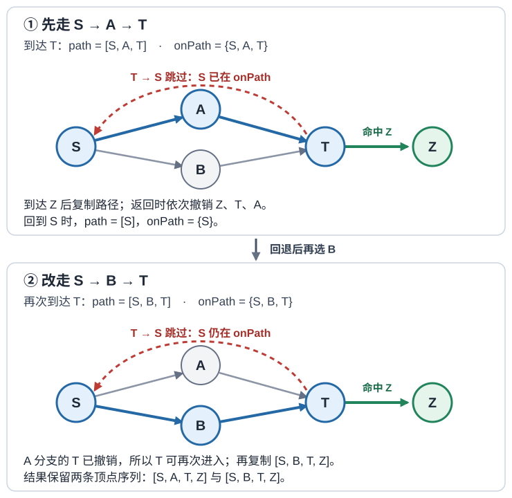

# 搜索状态图时，何时永久标记节点，何时必须回退？

前几章的边界只沿一条序列前进。状态一旦能分叉、又能汇合，搜索就得回答两个问题：一个“状态”由什么确定；一个状态什么时候可以永久标记为“处理完了”，什么时候只能临时标记、回退时撤销。本章用一张独立的合成路网回答四个问题，它们的差别全在标记什么、何时标记。

## 案例：一张有环、有会合点的路网

站点 S 要把包裹送到 Z。路网是有向图：S 可到 A、B；A 与 B 都通往会合点 T；T 可以回到 S，也可以到 Z。T→S 这条回边让图里出现环，T 让两条路线汇合。

~~~mermaid
flowchart LR
    S((S)) --> A((A))
    S --> B((B))
    A --> T((T))
    B --> T
    T -.->|回边| S
    T --> Z((Z))
~~~

同一张图依次回答：

1. 跳数最少的路线是哪条？（BFS）
2. 不重复经过站点的路线有哪些？（回溯枚举简单路径）
3. 把边读作依赖时，能否排出执行顺序？（拓扑排序）
4. 给路段加上非负耗时后，代价最低的路线是哪条？（Dijkstra）

代码约定：图用 `Map<顶点 ID, 邻居数组>` 表示，每个顶点都是键（没有出边时对应空数组），邻居也必须是图中的键，邻居数组按给定顺序扫描。复杂度假设邻接表已建好，`Map`/`Set` 操作和堆的一次比较按期望 O(1) 计，短 ID 的处理成本视为常数；这个模型与规范保证的差别见[首章](invariants-and-cost-models.md)。V 为顶点数，E 为边数。

## 先定状态键

搜索前先决定用什么代表一个状态，也就是 state key (状态键)：两个到达方式若对后续搜索完全等价，就该映射到同一个键。

- 在本例的 BFS 和 Dijkstra 里，站点 ID 就够了：从某站点出发能走哪些边、每条边多少代价，只取决于当前站点，与之前怎么走来无关。
- 如果持有的钥匙、剩余预算这类到达信息会改变后续可走的边，就必须把它们并入状态键，例如 `(站点, 钥匙集合)`。只按站点去重，会把实际不同的状态当成同一个，漏掉答案。
- 枚举简单路径时，一条路线是否合法取决于它已经经过哪些站点，这段历史不能并进全局键里，只能另用 `onPath` 记录当前分支。

[动态规划章](dynamic-programming.md)的“状态”是同一个概念：状态只记后续转移需要的信息。

## 标记什么、何时标记：四类搜索对照

四个问题都沿着边扩展候选状态，区别如下。后文每一节展开一行。

| 搜索 | 标记什么 | 何时标记 | 标记会撤销吗 | 前提 | 时间 |
|---|---|---|---|---|---|
| BFS（无权最短路） | 顶点已被发现，并记下首个父节点 | 首次**入队**时 | 不撤销，全局有效 | 只求最少边数 | O(V + E) |
| 回溯（枚举简单路径） | 顶点在当前路径上 | 进入分支时 | **返回时撤销** | 结果数可能指数级 | O(C + L)，见下文 |
| 拓扑排序（Kahn） | 每个顶点剩余的入度 | 前驱出队时减一，归零入队 | 不撤销 | 图无环 | O(V + E) |
| Dijkstra（非负权最短路） | 暂定距离；最终“已定型” | 暂定距离随松弛更新；最小项**出堆**时才定型 | 暂定距离可被改小，定型后不变 | 边权非负 | 惰性堆 O(V + E log E) |

最容易错的是把一行的标记规则搬到另一行：把 BFS 的全局 visited 用于枚举路径会漏路线；在 Dijkstra 里入堆就定型会得到非最优距离。

## BFS：首次入队时全局标记

breadth-first search (BFS，广度优先搜索) 用先进先出队列按层扩展：先处理距 S 一条边的顶点，再处理两条边的。队列里的顶点按发现距离非递减排列，所以一个顶点第一次被发现时，就已经找到了它的最少边数路径。之后再从别的路线到达它，不可能更短，可以全局去重。

用 `parent` 同时记录“已发现”和首个父节点，并在入队时就写入。如果等出队时才标记，同一个顶点可能被不同前驱重复排进队列。

| 处理的顶点 | 新发现的邻居 | 队列（队首→队尾） | `parent` 新增 |
|---|---|---|---|
| S | A、B | A、B | A←S，B←S |
| A | T | B、T | T←A |
| B | T 已发现 | T | — |
| T | S 已发现，Z | Z | Z←T |
| Z | 到达目标 | — | — |

从 Z 沿父节点回溯得到 S→A→T→Z，共 3 条边。若邻接表把 B 放在 A 前，会返回 S→B→T→Z；两条都是最少边数路径，返回哪条由邻接顺序决定。

~~~javascript
const routes = new Map([
  ['S', ['A', 'B']],
  ['A', ['T']],
  ['B', ['T']],
  ['T', ['S', 'Z']],
  ['Z', []]
]);

function shortestUnweightedPath(graph, start, target) {
  if (!graph.has(start) || !graph.has(target)) return null;
  const parent = new Map([[start, null]]); // 同时是全局 visited；所以 null 不能作顶点 ID
  const queue = [start];
  for (let head = 0; head < queue.length; head++) {
    const vertex = queue[head];
    if (vertex === target) break;
    for (const next of graph.get(vertex)) {
      if (parent.has(next)) continue;
      parent.set(next, vertex); // 入队时标记
      queue.push(next);
    }
  }
  if (!parent.has(target)) return null;
  const path = [];
  for (let v = target; v !== null; v = parent.get(v)) path.push(v);
  return path.reverse();
}

shortestUnweightedPath(routes, 'S', 'Z'); // ['S', 'A', 'T', 'Z']
~~~

起点或目标不存在、目标不可达时返回 `null`；起点等于目标时返回 `[start]`。每个顶点入队一次，每条边检查一次，时间 O(V + E)，额外空间 O(V)。出队用递增的 `head` 下标而不是 `shift`，队首前进时不搬移剩余元素，原因见[队列和栈章](queues-stacks-and-empty-states.md)。

全局 visited 在这里成立，是因为每个顶点只需保留一条最短路线的父节点。这不意味着一个顶点只能出现在一条合法路线上，下一节就是反例。

## 回溯：标记只属于当前路径，返回时撤销

要列出所有不重复经过站点的路线（simple path (简单路径)），S→A→T→Z 和 S→B→T→Z 都应输出。BFS 的 `parent` 只记住了 T 的第一个父节点 A；如果把全局 visited 用于路径枚举，T 经 A 标记后，经 B 到达 T 的分支会被错误剪掉。

backtracking (回溯) 沿候选边选下一站并递归扩展，返回上一层时撤销刚加入的站点。`onPath` 只表示“这个顶点在当前候选路径上”：它拒绝 T→S，因为 S 已在路径里；而回到 S 尝试 B 分支时，A 分支留下的 T 标记已经撤销，T 可以再次进入。

~~~javascript
function allSimplePaths(graph, start, target) {
  const results = [];
  if (!graph.has(start) || !graph.has(target)) return results;
  const path = [start];
  const onPath = new Set([start]);

  function visit(vertex) {
    if (vertex === target) {
      results.push(path.slice());
      return;
    }
    for (const next of graph.get(vertex)) {
      if (onPath.has(next)) continue; // 只有本路径内重复才构成环
      onPath.add(next);
      path.push(next);
      visit(next);
      path.pop();
      onPath.delete(next); // 撤销，让别的分支复用 next
    }
  }

  visit(start);
  return results;
}

allSimplePaths(routes, 'S', 'Z'); // [['S', 'A', 'T', 'Z'], ['S', 'B', 'T', 'Z']]
~~~

结果用顶点序列区分路线，所以邻接数组里不能有重复邻居，否则同一路线会输出两次；若平行边本身代表不同路线，结果里还要记下走的是哪条边。

成本取决于搜索到的分支数，而不是图的大小。在完全有向图中，只算恰好经过全部 V−2 个中间顶点的简单路径就有 (V−2)! 条。令 C 为实际检查的候选边数、L 为复制到结果中的路径总长度，时间是 O(C + L)；即使最终结果很少，搜索也可能探索大量到不了目标的前缀。只需要一条路线时，不要枚举全部路线。递归栈、`path` 与 `onPath` 占 O(V)。图很深时可能超出调用栈，可改用显式栈保存递归状态（见[队列和栈章](queues-stacks-and-empty-states.md)），但回退时仍必须撤销 `onPath`。

## 拓扑排序：入度归零才可执行

topological sort (拓扑排序) 回答“这些依赖能否排成一个执行顺序”。把边 u→v 读作“u 必须先于 v 完成”。若 T→S 也是依赖，S→A→T→S 就成环：既要求 S 先于 T，又要求 T 先于 S，不存在合法顺序。若 T→S 只是回程路线，就从依赖图中删去它，剩下的是 directed acyclic graph (DAG，有向无环图)。

Kahn 算法为每个顶点维护尚未满足的入边数（入度）。入度为 0 表示现在可以执行；取出它后，每个后继解除一项依赖，归零的进入 ready 队列。删去 T→S 后：

| 操作 | ready 队列 | 输出 | 入度变化 |
|---|---|---|---|
| 初始化 | S | — | S=0，A=1，B=1，T=2，Z=1 |
| 取出 S | A、B | S | A、B：1→0 |
| 取出 A | B | S、A | T：2→1 |
| 取出 B | T | S、A、B | T：1→0 |
| 取出 T | Z | S、A、B、T | Z：1→0 |
| 取出 Z | — | S、A、B、T、Z | — |

~~~javascript
function topologicalOrder(graph) {
  const indegree = new Map(Array.from(graph.keys(), v => [v, 0]));
  for (const neighbors of graph.values()) {
    for (const next of neighbors) indegree.set(next, indegree.get(next) + 1);
  }
  const ready = Array.from(graph.keys()).filter(v => indegree.get(v) === 0);
  const order = [];
  for (let head = 0; head < ready.length; head++) {
    const vertex = ready[head];
    order.push(vertex);
    for (const next of graph.get(vertex)) {
      indegree.set(next, indegree.get(next) - 1);
      if (indegree.get(next) === 0) ready.push(next);
    }
  }
  return order.length === graph.size ? order : null; // null：不存在完整顺序
}

const dependencies = new Map([
  ['S', ['A', 'B']], ['A', ['T']], ['B', ['T']], ['T', ['Z']], ['Z', []]
]);
topologicalOrder(dependencies); // ['S', 'A', 'B', 'T', 'Z']
topologicalOrder(routes);       // null：T→S 使依赖成环
~~~

保留 T→S 时，S、A、B、T、Z 的初始入度是 1、1、1、2、1，ready 队列一开始就为空。返回 `null` 不等于给出了环：剩下的顶点里，S、A、B、T 在环上，Z 只是被环阻塞。

每个顶点和每条边各处理常数次，时间 O(V + E)，额外空间 O(V)。同一时刻入度为 0 的顶点可能不止一个，所以合法的拓扑序可能有多种；本实现的输出顺序取决于 Map 的键顺序和邻接表扫描顺序。业务要求特定顺序时，要显式加优先级规则（例如 ready 换成按优先级出队的堆），不能把任意一个拓扑序当成唯一答案。

## Dijkstra：出堆才定型，过期项跳过

回到路网本身（T→S 仍可走），给每条边加上非负耗时：S→A 为 1，S→B 为 4，A→T 为 6，B→T 为 1，T→S 为 2，T→Z 为 1。BFS 找到的 S→A→T→Z 只有 3 条边，代价却是 1 + 6 + 1 = 8；S→B→T→Z 代价 4 + 1 + 1 = 6。边数最少与代价最低是两个问题。

Dijkstra 算法用最小堆，每次取出暂定距离最小、尚未定型的顶点，对它的每条出边做 relaxation (松弛)：若 `dist[v] + weight < dist[w]`，就更新 w 的距离和前驱，并把新距离压入堆。这里用“惰性”写法：不修改堆中的旧项，距离改善后旧项留在堆里成为过期项，弹出时若其距离不等于当前 `dist`，直接跳过；再用 `settled` 集合保证每个顶点只处理一次。

| 弹出 | 更新 | 堆中待处理（可能含过期项） | 说明 |
|---|---|---|---|
| S:0 | A=1，B=4 | A:1、B:4 | 从源点展开 |
| A:1 | T=7 | B:4、T:7 | 暂时经 A |
| B:4 | T 从 7 改为 5 | T:5、T:7 | 新项入堆，T:7 过期 |
| T:5 | Z=6；S 已定型，跳过 T→S | Z:6、T:7 | Z:6 只是暂定 |
| Z:6 | — | T:7 | Z 此刻才定型 |
| T:7 | — | — | 7 ≠ dist[T]=5，跳过 |

最终距离 `S=0, A=1, B=4, T=5, Z=6`，最短路线 S→B→T→Z。注意 Z 在处理 T 时就有了距离 6，但那时只是入堆；要等 Z:6 作为最小的未定型项出堆，才能确认它是最优值。

**为什么出堆即可定型？** 反证：假设刚弹出的 v 还有一条更短的路线。沿这条路线从源点出发，找到第一条“起点 u 已定型、终点 x 未定型”的边。u 出堆时松弛过 u→x，所以堆中 x 的有效距离不超过这条路线到 x 的长度。边权非负，路线到 x 的前缀不超过整条路线，而整条路线比 `dist[v]` 短，所以 x 的有效项小于 `dist[v]`，x 应先于 v 出堆，矛盾。

这个论证依赖“前缀不超过整条路线”，负权边会破坏它。给图加一条 B→A、权重 −5：A 在距离 1 时已经定型；之后处理 B:4 时，经 B 到 A 的候选是 4 − 5 = −1，但 A 已定型而被跳过，错误地保留了 1。所以实现应先扫描全图，发现负权就拒绝；含负权的图改用 Bellman–Ford 等能处理负边的算法（前提是无负环），不能因为某个负权样例碰巧算对就继续用 Dijkstra。

> [!example]- 可运行：惰性 Dijkstra
> 依赖[堆章](heaps-and-priority-queues.md)的二叉堆 `BinaryHeap(higher)`：构造时传入“谁优先”的比较函数，提供 `size`、`push(item)` 和 `pop()`（返回最优先项）。这里传 `(a, b) => a.distance < b.distance`，即最小堆。
>
> ~~~javascript
> function dijkstra(graph, source) {
>   for (const edges of graph.values()) {
>     for (const { to, weight } of edges) {
>       if (!Number.isSafeInteger(weight) || weight < 0) throw new RangeError('weights must be non-negative integers');
>       if (!graph.has(to)) throw new RangeError('every destination must be a graph vertex');
>     }
>   }
>   const distances = new Map(Array.from(graph.keys(), v => [v, Infinity]));
>   const previous = new Map();
>   const settled = new Set();
>   const heap = new BinaryHeap((a, b) => a.distance < b.distance);
>   if (!graph.has(source)) return { distances, previous };
>   distances.set(source, 0);
>   heap.push({ vertex: source, distance: 0 });
>
>   while (heap.size > 0) {
>     const { vertex, distance } = heap.pop();
>     if (distance !== distances.get(vertex) || settled.has(vertex)) continue; // 过期项
>     settled.add(vertex); // 出堆才定型
>     for (const { to, weight } of graph.get(vertex)) {
>       if (settled.has(to)) continue;
>       const candidate = distance + weight;
>       if (candidate < distances.get(to)) {
>         distances.set(to, candidate);
>         previous.set(to, vertex);
>         heap.push({ vertex: to, distance: candidate });
>       }
>     }
>   }
>   return { distances, previous };
> }
>
> function weightedPath({ distances, previous }, source, target) {
>   if (!(distances.get(target) < Infinity)) return null;
>   const path = [target];
>   while (path[path.length - 1] !== source) path.push(previous.get(path[path.length - 1]));
>   return path.reverse();
> }
>
> const weightedRoutes = new Map([
>   ['S', [{ to: 'A', weight: 1 }, { to: 'B', weight: 4 }]],
>   ['A', [{ to: 'T', weight: 6 }]],
>   ['B', [{ to: 'T', weight: 1 }]],
>   ['T', [{ to: 'S', weight: 2 }, { to: 'Z', weight: 1 }]],
>   ['Z', []]
> ]);
> const result = dijkstra(weightedRoutes, 'S');
> console.log(result.distances.get('Z'));         // 6
> console.log(weightedPath(result, 'S', 'Z'));     // ['S', 'B', 'T', 'Z']
> ~~~
>
> `weightedPath` 必须传入运行 `dijkstra` 时的同一个 source；目标不可达时返回 `null`。

成本：每个顶点定型一次并扫描一次出边，所以至多成功松弛 E 次；加上起点，惰性堆最多处理 E + 1 个项，时间 O(V + E log E)，空间 O(V + E)。支持 decrease-key (原地降低键值) 的索引优先队列让每个顶点在堆中只占一项，堆空间降到 O(V)，时间写作 O((V + E) log V)。无论哪种实现，距离表、前驱表、堆项和 `settled` 都必须对应同一张图、同一组边权。

## 状态和顺序都定下来之后

本章产出一条判断规则：先定状态键，再按问题选标记时机——全局最短层次用入队时永久标记，枚举合法路线用路径内标记并在回退时撤销，依赖顺序看入度，非负代价等出堆再定型。拓扑排序还给出一个事实：在无环的状态图上，按拓扑序处理每个状态时，它依赖的状态都已处理完。下一章[动态规划怎样定义状态并安排更新顺序？](dynamic-programming.md)正是利用这一点：状态图无环、子问题被反复请求时，按依赖顺序把每个状态算一次并存下来。

> [!info]- 来源
> - 邻接表遍历、BFS 按边数找最短路并在首次发现时记录父边：[Sedgewick 与 Wayne, *Algorithms*, 4th ed., §4.1 “Undirected Graphs”](https://algs4.cs.princeton.edu/41graph/)，作者实现 [BreadthFirstPaths.java](https://algs4.cs.princeton.edu/code/edu/princeton/cs/algs4/BreadthFirstPaths.java.html)；原理同样适用于本页的有向邻接表。
> - DAG 才有拓扑序与队列版拓扑排序：[*Algorithms*, 4th ed., §4.2 “Directed Graphs”](https://algs4.cs.princeton.edu/42digraph/)，作者实现 [TopologicalX.java](https://algs4.cs.princeton.edu/code/edu/princeton/cs/algs4/TopologicalX.java.html)。本页采用 Kahn 入度实现。
> - Dijkstra 的非负权前提、松弛与索引优先队列复杂度：[*Algorithms*, 4th ed., §4.4 “Shortest Paths”](https://algs4.cs.princeton.edu/44sp/)，作者实现 [DijkstraSP.java](https://algs4.cs.princeton.edu/code/edu/princeton/cs/algs4/DijkstraSP.java.html)；惰性重复入堆让堆项与边数同阶：[LazyDijkstraSP.java](https://algs4.cs.princeton.edu/44sp/LazyDijkstraSP.java.html)。
> - 四个问题的状态表、负权反例与输出均按本页代码复算。
