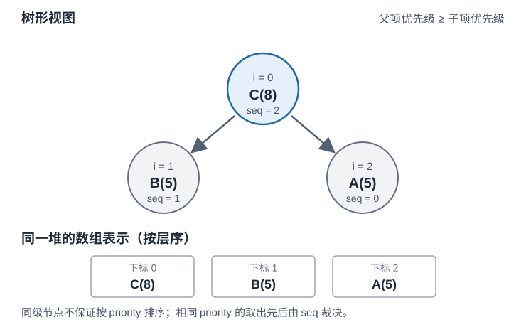

# 不断加入任务时，怎样持续取出最高优先级？

任务不断到来、每次要取出当前最紧急的一项时，不必每次把全部任务重新排序：priority queue (优先队列) 只要求“插入”和“取出最高优先级”两个操作，binary heap (二叉堆) 只维护父子之间的顺序，就能让两者都在 O(log n) 内完成。本章讲堆序是什么、插入和取出怎样修复它、为什么一次建堆是线性的、同优先级的任务怎样按先到先出，以及怎样用一个固定大小的堆筛出 Top K。读者手上已有[上一章](queues-stacks-and-empty-states.md)的队列与“空”的表示，以及[首章](invariants-and-cost-models.md)的成本口径。本章给出的二叉堆是工程基础里唯一的一份实现，图搜索中的 Dijkstra 算法也用它。

## 何时用优先队列，而不是排序

本章换一个独立的小例子：一个后台调度器不断收到待处理任务，每当有执行资源空出来，就取出当前最紧急的一项。如果每次取之前都把整个集合排序一遍，大部分工作花在重复整理那些顺序没变的旧任务上。

判断用哪一种：

- **元素持续到达，每次只要当前极值**：用优先队列。插入和取出各 O(log n)。
- **元素一开始全部已知，最终要完整排序**：直接排序一次更简单。
- **n 很大，只要前 K 名**：用容量为 K 的堆，只保留 K 个候选，见下文 Top K。

## 堆序：数组上的完全二叉树

本章用最大堆：优先级数值越大越紧急。二叉堆是一棵完全二叉树（除最后一层外都填满，最后一层从左向右填），按层从左到右存进数组。用 0 起始下标：

- 下标 `i` 的两个孩子是 `2i + 1` 和 `2i + 2`；
- `i > 0` 的父节点是 `floor((i − 1) / 2)`。

完全二叉树没有空洞，所以不需要指针，下标算术就能找到父子。

heap order (堆序) 只要求一件事：每个父项的优先级不低于它的孩子。比较关系可以传递，沿任何一条路径往上都不会变低，所以根就是全体的最高项。除此之外没有别的顺序：兄弟之间、不同子树之间都没有约定，数组整体也不是排好序的。

例子里有四个任务：A 和 B 的优先级都是 5，A 先到；C 的优先级是 8；D 的优先级是 2。按 A、B、C 的顺序插入后，树形和数组如下（`seq` 是到达序号，下文解释）：



箭头只表示父子堆序。C(8) 在根；B(5) 在下标 1、A(5) 在下标 2，两者是兄弟，堆序不规定它们谁在左。

## 插入上浮，取出下沉

堆序被破坏只会发生在一条路径上，修复也只沿这条路径走：

- **插入（上浮）**：新项放在数组末尾，与父项比较；比父项高就交换，继续向上，直到父项不低于它或到达根。
- **取出（下沉）**：记下根，把末项移到根；它与两个孩子中较高的那个比较，孩子更高就交换，继续向下，直到不低于两个孩子或到达叶子。

完整走一遍。同优先级时到达较早者优先（规则见下一节）：

| 操作 | 堆数组（层序） | 发生的修复 |
|---|---|---|
| 插入 A(5) | [A(5)] | 只有根，无需调整 |
| 插入 B(5) | [A(5), B(5)] | B 与父项 A 同为 5，A 先到，不交换 |
| 插入 C(8) | [C(8), B(5), A(5)] | C 放在下标 2，高于父项 A，上浮到根 |
| 插入 D(2) | [C(8), B(5), A(5), D(2)] | D 放在下标 3，低于父项 B，留在原处 |
| 取出 | [A(5), B(5), D(2)] | 返回 C；末项 D 移到根，孩子 B、A 都高于 D，二者同为 5 而 A 先到，D 与右孩子 A 交换 |

n 个节点的完全二叉树高 `H = floor(log₂ n)`，上浮或下沉最多走 H 层。按元素比较和交换次数计，`push` 和 `pop` 都是 O(log n)，`peek` 只读根是 O(1)，堆占 n 个数组槽位。数组追加偶尔触发扩容，按[首章的均摊口径](invariants-and-cost-models.md#三种界各承诺什么)计为均摊 O(1)，不改变上面的界。

## 一次建堆为什么是 O(n)

如果元素一开始就全部已知，不必逐个 `push`（累计 O(n log n)），可以自底向上建堆（heapify）：把数组原样当成完全二叉树，从最后一个非叶节点 `floor(n/2) − 1` 开始，向根的方向逐个对每个节点做下沉。处理到某个节点时，它的两棵子树已经是堆，下沉一次就让以它为根的子树也成为堆。

总成本是线性的，因为大多数节点靠近叶子，只能下沉很少几层。高度为 h 的节点至多有 `ceil(n / 2^(h+1))` 个，每个最多下沉 h 层，所以总工作量不超过

Σ_{h=0..H} h · ceil(n / 2^(h+1)) = O(n)。

直观地说：一半节点是叶子，下沉 0 层；四分之一下沉至多 1 层；八分之一至多 2 层……级数 Σ h / 2^(h+1) 收敛到 1，乘以 n 仍是 O(n)。代价是必须一开始就拿到整批元素。

## 同优先级谁先出：次级键与严格弱序

只比较优先级的堆不保证同优先级任务的先后。上浮和下沉在相等时不交换，但取出时末项被移到根再下沉，会打乱同级项的相对位置。要得到“同优先级先到先出”，必须把到达顺序显式写进比较规则：入队时给每项附一个从 0 递增的 `sequence`，只在优先级相等时比较它，序号小的优先。稳定性完全来自这个次级键，而不是堆本身。

比较函数 `higher(a, b)`（a 是否应排在 b 之前）必须构成 strict weak ordering (严格弱序)：

- 没有元素比自身优先；
- 优先关系可传递：a 先于 b、b 先于 c，则 a 先于 c；
- 两项互不优先时视为同档，同档关系也可传递。

此外，元素留在堆中期间，它参与比较的字段不能改变。改了某个任务的优先级而不调整堆，堆序就可能在那一处被破坏，根不再一定是最高项；要么把它删掉重新插入，要么重建整个堆。

`sequence` 在下面的实现里用 BigInt，长期运行也不会越过安全整数上限；它的位数只随累计入队次数的对数增长，比较成本按[首章的数值口径](invariants-and-cost-models.md#数值表示：安全整数与位数成本)视为近似常数。

## Top K：根是淘汰线

换一组输入：一次收到一批带分数的候选，只返回分数最高的 K 项，同分时先到者优先。思路是反过来用一个最多 K 项的最小堆，让根始终是保留集合里“最差”的一项（分数最低；同分时到得最晚）。根就是淘汰线：

- 堆未满 K 项时，直接插入候选；
- 堆满后，只有候选分数严格高于根时，才取出根、插入候选；与根同分的新候选直接丢弃，因为根比它先到。

依次读入 A(8)、B(5)、C(5)、D(7)、E(1)，K = 3：

| 读入 | 保留集合 | 根（淘汰线） | 动作 |
|---|---|---|---|
| A(8) | A | A(8) | 未满，插入 |
| B(5) | A、B | B(5) | 未满，插入 |
| C(5) | A、B、C | C(5) | 插入后已满；B、C 同分，较晚的 C 是淘汰线 |
| D(7) | A、D、B | B(5) | 7 高于根 5，取出 C、插入 D |
| E(1) | 不变 | B(5) | 1 不高于根，丢弃 |

最后把保留的三项按分数降序、同分按先后排序，得到 A、D、B。

设 `k' = min(K, n)`。扫描 n 个候选，每个至多引起一次规模不超过 k' 的堆调整，共 O(n log(k' + 1)) 次比较（加 1 只是让 k' = 1 时式子不为零，此时每次调整是常数，扫描为 O(n)）；最后对 k' 项排序，按比较排序模型 O(k' log(k' + 1))。同分项由序号明确定序，结果不依赖内置排序是否稳定。额外空间是 O(k')，不含调用方已持有的输入。同样的更新规则也适用于逐项到达的流式输入，全程只保留 K 个候选。若 K 接近 n 且最终要全部排好，直接排序更直接，见[分区怎样改变快速排序的时间和空间代价？](partitioning-and-sorting-costs.md)。

## 实现：一份二叉堆，三种用法

实现分两层，各自的接口边界如下：

- **`BinaryHeap(higher)` 只管结构。** 比较规则由调用者注入，`higher` 不是函数时抛 `TypeError`。最大堆、最小堆、带次级键的稳定堆，都只是换一个 `higher`。
- **空堆返回 `null`，但不会和任务值混淆。** `StableMaxPriorityQueue` 把每个任务包成冻结的记录 `{ priority, sequence, value }` 再入堆，所以非空时 `peek()`/`pop()` 返回的总是一个记录对象；即使任务的 `value` 本身是 `null`，返回值也不是 `null`。这是[上一章“空”的表示](queues-stacks-and-empty-states.md#“空”怎样表示，才不会和存入的值混淆)里“把值包进记录对象”的做法。冻结记录也防止调用方在堆中途改动比较字段。
- **`toArray()` 返回堆布局的浅拷贝，不是排序结果。** `topK` 拿到它之后还要再排序一次。
- **输入校验。** 优先级和分数必须是有限的 Number，`K` 必须是非负安全整数；`topK` 先校验整批输入再开始筛选，返回原对象的引用，不改写输入数组。`topK` 的序号是数组下标，不会越过安全整数，所以用普通 Number。

> [!example]- 可运行：二叉堆、稳定最大优先队列与 Top K
> ```javascript
> class BinaryHeap {
>   constructor(higher) {
>     if (typeof higher !== 'function') throw new TypeError('higher must be a function');
>     this.higher = higher;
>     this.items = [];
>   }
>   get size() { return this.items.length; }
>   peek() { return this.items.length === 0 ? null : this.items[0]; }
>   push(value) {
>     const items = this.items;
>     items.push(value);
>     let i = items.length - 1;
>     while (i > 0) {
>       const parent = Math.floor((i - 1) / 2);
>       if (!this.higher(items[i], items[parent])) break;
>       [items[i], items[parent]] = [items[parent], items[i]];
>       i = parent;
>     }
>   }
>   pop() {
>     const items = this.items;
>     if (items.length === 0) return null;
>     const root = items[0];
>     const last = items.pop();
>     if (items.length > 0) {
>       items[0] = last;
>       let i = 0;
>       while (true) {
>         const left = 2 * i + 1;
>         const right = left + 1;
>         let best = i;
>         if (left < items.length && this.higher(items[left], items[best])) best = left;
>         if (right < items.length && this.higher(items[right], items[best])) best = right;
>         if (best === i) break;
>         [items[i], items[best]] = [items[best], items[i]];
>         i = best;
>       }
>     }
>     return root;
>   }
>   toArray() { return this.items.slice(); }
> }
>
> class StableMaxPriorityQueue {
>   constructor() {
>     this.sequence = 0n;
>     this.heap = new BinaryHeap((a, b) =>
>       a.priority > b.priority ||
>       (a.priority === b.priority && a.sequence < b.sequence)
>     );
>   }
>   get size() { return this.heap.size; }
>   peek() { return this.heap.peek(); }
>   push(priority, value) {
>     if (!Number.isFinite(priority)) throw new TypeError('priority must be finite');
>     this.heap.push(Object.freeze({ priority, sequence: this.sequence, value }));
>     this.sequence += 1n;
>   }
>   pop() { return this.heap.pop(); }
> }
>
> function topK(values, k) {
>   if (!Array.isArray(values)) throw new TypeError('values must be an array');
>   if (!Number.isSafeInteger(k) || k < 0) throw new RangeError('k must be a non-negative safe integer');
>   for (const item of values) {
>     if (!item || !Number.isFinite(item.score)) {
>       throw new TypeError('values must contain items with finite scores');
>     }
>   }
>   if (k === 0 || values.length === 0) return [];
>   const worstFirst = (a, b) =>
>     a.score < b.score || (a.score === b.score && a.sequence > b.sequence);
>   const heap = new BinaryHeap(worstFirst);
>   for (let i = 0; i < values.length; i++) {
>     const candidate = { score: values[i].score, sequence: i, value: values[i] };
>     if (heap.size < k) {
>       heap.push(candidate);
>     } else if (candidate.score > heap.peek().score) {
>       heap.pop();
>       heap.push(candidate);
>     }
>   }
>   return heap.toArray()
>     .sort((a, b) => b.score - a.score || a.sequence - b.sequence)
>     .map(item => item.value);
> }
>
> const tasks = new StableMaxPriorityQueue();
> tasks.push(5, 'A');
> tasks.push(5, 'B');
> tasks.push(8, 'C');
> tasks.push(2, 'D');
> console.log(tasks.pop().value); // C
> console.log(tasks.pop().value); // A
> console.log(tasks.pop().value); // B
> console.log(tasks.pop().value); // D
> console.log(tasks.pop());       // null
>
> const scored = [
>   { id: 'A', score: 8 }, { id: 'B', score: 5 }, { id: 'C', score: 5 },
>   { id: 'D', score: 7 }, { id: 'E', score: 1 },
> ];
> console.log(topK(scored, 3).map(t => t.id)); // [ 'A', 'D', 'B' ]
> console.log(topK(scored, 0));                // []
> ```

## 本章产出与下一步

优先队列用于持续调度：堆只维护父子顺序，插入上浮、取出下沉，各 O(log n)；整批已知时自底向上建堆 O(n)；同级先后靠显式序号和严格弱序。固定大小的堆用于筛选：根是淘汰线，扫描 O(n log K)，只占 O(K) 空间。[图搜索中的 Dijkstra](graph-search-and-backtracking.md) 用这份堆按当前最短距离取出顶点。

堆只维护部分顺序。当数据整体有序时，可以做得更多：一次比较就排除一半候选，或者让两个指针从两端相向推进。下一个问题是：有序数据怎样让二分查找和双指针安全地排除候选？见[有序数据怎样让二分查找和双指针安全排除候选？](ordered-search-and-two-pointers.md)。

> [!info]- 来源
> - 完全二叉树的数组表示、上浮与下沉、插入与删除极值的 O(log n) 界、自底向上 heapify 的线性比较次数（“堆序”“插入上浮，取出下沉”“一次建堆为什么是 O(n)”）：[Sedgewick & Wayne, *Algorithms*, 4th ed., §2.4 Priority Queues](https://algs4.cs.princeton.edu/24pq/)；该书用 1 起始下标，本页改为 0 起始，堆序相同。高度为 h 的节点数上界与求和由本页推导。
> - 用到达序号作次级键实现稳定优先队列（“同优先级谁先出”）：[*Algorithms*, 4th ed., §2.5 的 StableMinPQ.java](https://algs4.cs.princeton.edu/25applications/StableMinPQ.java.html)。
> - `Array.prototype.sort` 的比较器一致性与稳定性（“Top K”最终排序）：[ECMAScript 2026, §23.1.3.30](https://tc39.es/ecma262/2026/multipage/indexed-collections.html#sec-array.prototype.sort)；复杂度按比较排序模型计，口径见首章。
> - 操作表、Top K 表与代码输出由本页在 Node.js v26.13.1 上运行复算。
