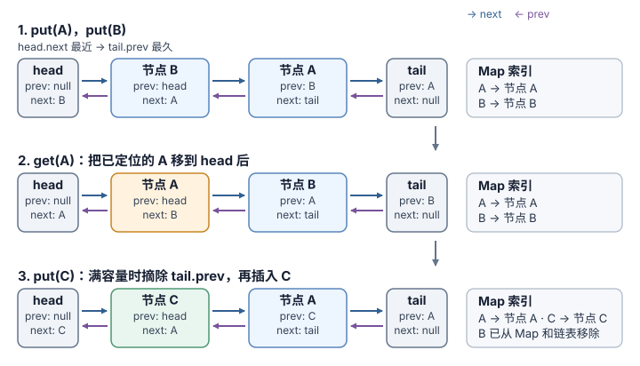

# 怎样同时按键查找并维护最近使用顺序？

Least Recently Used cache (LRU 缓存，最近最少使用缓存) 满了就淘汰最久没被用过的一项。它要同时做两件事：按键快速找到缓存项，以及随时知道哪一项最久未用。单靠一种结构做不好：哈希表能按键找，却不记顺序；链表能记顺序，按键找却要 O(n)。本章先用 JavaScript `Map` 的插入顺序给出最短的实现，说明它的复杂度为什么证明不了，再用“哈希表 + 双向链表 + 哨兵”给出可以论证的 O(1) 版本。读者手上已有[上一章](data-structures-by-access-pattern.md)的结论：链表的 O(1) 改链只在已经拿到节点时成立，哈希表按键精确查找、不保序。

## 案例：容量为 2 的页面缓存

一个报表界面在前端缓存用户最近看过的页面。为便于手算，容量设为 2，涉及三个页面：

| 键 | 页面 |
|---|---|
| A | 账户 `acct-17` 报表 42 的某一游标页 |
| B | 同一账户报表 41 的页面 |
| C | 该账户首页 |

操作顺序：`put(A)`、`put(B)` 放满缓存；用户回到 A（`get(A)`）；界面检查 B 是否在缓存里（`has(B)`）；最后打开 C（`put(C)`）。期望结果：淘汰最久未用的 B，保留 A 和 C。

动手之前先约定哪些操作算一次“使用”，因为它决定了淘汰谁：

- 命中的 `get` 算使用，把该项移到最近端；
- `put` 算使用：新键插到最近端，已有键更新值并移到最近端；
- 未命中的 `get` 不改变任何顺序；
- `has` 只检查存在，不算使用。若把 `has(B)` 也算使用，B 就成了最近项，`put(C)` 会淘汰 A。

容量须为非负整数；容量为 0 时 `put` 什么也不保存。缓存最多 c 项时，空间为 O(c)。

## 最短的实现：`Map` 的插入顺序

`Map` 按插入顺序迭代，可以直接当作一条“最旧 → 最新”的队列：

- **刷新**：命中时先 `delete` 再 `set`，键就移到最新一端。只对已有键调用 `set` 会原位更新值，**不**改变位置，所以必须先删。
- **淘汰**：满容量插入新键时，`keys().next()` 给出最旧的键，删掉它。

```javascript
class LRUCache {
  constructor(capacity) {
    if (!Number.isInteger(capacity) || capacity < 0) {
      throw new RangeError('capacity must be a non-negative integer');
    }
    this.capacity = capacity;
    this.cache = new Map();
  }
  has(key) { return this.cache.has(key); }
  get(key) {
    if (!this.cache.has(key)) return undefined;
    const value = this.cache.get(key);
    this.cache.delete(key);
    this.cache.set(key, value);
    return value;
  }
  put(key, value) {
    if (this.capacity === 0) return;
    if (this.cache.has(key)) this.cache.delete(key);
    else if (this.cache.size === this.capacity) {
      this.cache.delete(this.cache.keys().next().value);
    }
    this.cache.set(key, value);
  }
}
```

> [!example] 容量为 2 的淘汰过程
> | 操作 | 最旧 → 最新 | 返回或淘汰 |
> |---|---|---|
> | `put(A, 页面42)` | A | — |
> | `put(B, 页面41)` | A, B | — |
> | `get(A)` | B, A | 页面 42 |
> | `has(B)` | B, A | `true`，顺序不变 |
> | `put(C, 首页)` | A, C | 淘汰 B |

**键与“未命中”。** 键的相等沿用 `Map` 的 SameValueZero：`NaN` 与自身匹配，`+0` 与 `-0` 是同一个键；对象键按引用比较，内容相同但新建的对象是另一个键。所以用对象描述页面时，先把它规范化成字符串再当键。`get` 未命中返回 `undefined`，与“存了 `undefined`”分不清，需要区分时先调 `has`；“空”的几种表示方式各有什么代价，见[队列与栈一章](queues-stacks-and-empty-states.md)。

## 为什么 `Map` 版的 O(1) 证明不了

这个版本行为正确，但它的复杂度没有规范保证，原因有三处：

- ECMAScript 只要求 `Map` 的平均键访问时间相对元素数次线性，不承诺 O(1)（主线一统一按期望 O(1) 的模型计，口径见[首章](invariants-and-cost-models.md#规范保证与实现模型)）。
- 插入分支读取 `.size`：规范把这个 getter 描述为逐项统计未删除的条目，没有给出 O(1) 界，引擎可以另外维护计数，但这不是规范承诺。
- `keys().next()` 取最旧键：规范描述的迭代沿插入顺序前进、跳过已删除的项。若引擎用数组式结构存储，反复“删除再插入”可能留下许多待跳过的空位。

规范也说明这份逐项列表只是描述可观察行为的模型，不要求引擎照此实现。所以结论是“证明不了”，不是“一定慢”：实际代价取决于引擎。要得到能论证的 O(1)，就得自己维护顺序。

## 哈希表 + 双向链表：各管一件事

可论证的版本把两件事拆给两种结构：

- `Map` 只负责“键 → 链表节点”；
- 双向链表用 `prev`/`next` 维护新近顺序，表头一侧最近，表尾一侧最久。

为什么这样搭配：拿到节点之后，双向链表把它摘下或插到表头只改固定几个指针；单链表摘除节点需要前驱，而前驱要从头找。节点里还要存自己的键，因为淘汰时是从链表尾拿到节点，再凭 `node.key` 去删 `Map` 里的条目。

**不变量。** 每次操作结束后：

- `head` 与 `tail` 是不进 `Map` 的 sentinel (哨兵) 节点。非空时 `head.next` 是最近使用的节点，`tail.prev` 是最久未使用的节点；空时 `head.next === tail` 且 `tail.prev === head`。
- 每个真实节点在链上恰好出现一次，`Map` 里每个键恰好指向它的节点，两者条目数相同。

哨兵让“在头部插入”和“摘除任一节点”都只有一种写法：真实节点的前后总有一个节点（可能是哨兵），不必为空表、首节点、尾节点分别写分支。

```javascript
class ListNode {
  constructor(key, value) { this.key = key; this.value = value; this.prev = null; this.next = null; }
}

class LinkedLRUCache {
  constructor(capacity) {
    if (!Number.isInteger(capacity) || capacity < 0) {
      throw new RangeError('capacity must be a non-negative integer');
    }
    this.capacity = capacity;
    this.nodes = new Map();
    this.head = new ListNode(null, null);
    this.tail = new ListNode(null, null);
    this.head.next = this.tail;
    this.tail.prev = this.head;
  }
  has(key) { return this.nodes.has(key); }
  get(key) {
    const node = this.nodes.get(key);
    if (!node) return undefined;
    this.#unlink(node);
    this.#insertAfterHead(node);
    return node.value;
  }
  put(key, value) {
    if (this.capacity === 0) return;
    const existing = this.nodes.get(key);
    if (existing) {
      existing.value = value;
      this.#unlink(existing);
      this.#insertAfterHead(existing);
      return;
    }
    if (this.nodes.size === this.capacity) {
      const oldest = this.tail.prev;
      this.#unlink(oldest);
      this.nodes.delete(oldest.key);
    }
    const node = new ListNode(key, value);
    this.nodes.set(key, node);
    this.#insertAfterHead(node);
  }
  #insertAfterHead(node) {
    node.prev = this.head;
    node.next = this.head.next;
    this.head.next.prev = node;
    this.head.next = node;
  }
  #unlink(node) {
    node.prev.next = node.next;
    node.next.prev = node.prev;
  }
}
```

调用约定与 `Map` 版相同。下图用同一组操作展示链表和 `Map` 索引；每行是一次操作后的状态，从 `head` 向右按“最近 → 最久”排列，方向与上一节的表相反。`has(B)` 不改变状态，没有单独画出。



- **`get(A)`**：`Map` 直接给出 A 的节点。`#unlink(A)` 把 A 的前驱 B 与后继 `tail` 连起来；此时 A 自己的 `prev`/`next` 还指着旧邻居，紧接着的 `#insertAfterHead(A)` 会覆盖它们。完成后 A 在 `head` 之后，B 成为 `tail.prev`。
- **`put(C)`**：缓存已满，`tail.prev` 直接给出最旧的 B；从链上摘下 B，再用 `B.key` 删掉 `Map` 条目；然后创建 C 的节点，登记进 `Map`，插到 `head` 之后。结果是 C、A，与 `Map` 版一致。

**成本。** 已知节点时，摘除和插到表头各改四个以内的指针，从 `tail.prev` 取最旧项是一次访问，这些链表步骤确定是 O(1)，与缓存大小无关。完整的 `get`/`put` 还包括 `Map` 的查找、插入、删除和读取 `.size`；按可扩容哈希表的模型，前三者期望均摊 O(1)，`.size` 按 O(1) 计，于是整次操作期望均摊 O(1)。空间 O(capacity)：每项多一个节点和两条链接。节点分配与垃圾回收的时间不在这个操作计数里。

| | 只用 `Map` | `Map` + 双向链表 |
|---|---|---|
| 刷新命中项 | 删除再重设，顺序由 `Map` 内部维护 | `Map` 定位节点，再改固定几个指针 |
| 满容量淘汰 | `.size` 与 `keys().next()`，都没有规范 O(1) 界 | `.size` 判满，`tail.prev` 即最旧节点 |
| 能论证的界 | 无，取决于引擎 | 期望均摊 O(1)（哈希模型下） |
| 代价 | 代码短、状态少 | 多一组指针和每项一次节点分配 |

**链表在这里为什么不慢。** 链表遍历慢，是因为每一步都要等上一个节点的 `next` 读出来，见[同样是 O(n)，为什么连续扫描往往比链表遍历快？](memory-hierarchy-and-locality.md)。LRU 从不遍历链表：`Map` 直接给出节点，每次操作只碰这个节点和它的两个邻居。若去掉 `Map` 改为沿链表找键，查找就回到 O(n)，指针追逐也回来了。

## 练习写法里的常见隐患

算法练习里常见一种只用数字键、不用 `Map` 的写法，有几处会改变结果的边界：

- **用 −1 表示未命中，却允许存 −1。** `get` 返回 −1 时分不清是“存的就是 −1”还是“没有这个键”。要么拒绝存哨兵值，要么返回带状态的结果，理由同[队列与栈一章](queues-stacks-and-empty-states.md)对“空”的讨论。
- **用普通对象当索引。** 属性名都会经 ToPropertyKey 变成字符串，所以数字 `1` 与字符串 `"1"` 是同一个键；没有用 `Object.create(null)` 建对象时，`"constructor"` 这类名字还会命中原型上的属性。`+0`/`-0` 合并、所有 `NaN` 合并则与 `Map` 相同。
- **把文本 ID 转成 Number。** 超出安全整数后不同的 ID 会舍入成同一个值：`Number("9007199254740993")` 得到 `9007199254740992`，与 `9007199254740992` 撞键。ID 应保持字符串。
- **不用哨兵。** 空表时 `head`、`tail` 都是 `null`，只有一个节点时二者指向同一节点；摘除和插入都要为这两种情况写分支，漏一处就会断链。

## 放进真实缓存前：键要包含授权范围

页面内容随账户、权限和查询条件变化时，缓存键必须包含这些维度（账户或授权范围、过滤器、游标），否则一份页面会被交给不该看到它的请求；命中缓存也不替代本次请求的授权检查。本例 A 与 B 只差报表号，但若同一浏览器换了账户登录，`report-42` 这样的短键就会把上一个账户的页面交出去。LRU 结构只决定“满了淘汰谁”，键的维度、写后失效和数据最多旧多久，见[加了缓存之后，读到的数据最多会旧多久？](../data/caching-and-staleness.md)。

## 本章产出与回到主线

LRU 是“按键定位”和“维护顺序”两种需求的组合：`Map` 版靠插入顺序一并解决，行为正确但复杂度只能看引擎；哈希表 + 双向链表 + 哨兵把两件事分开，在哈希模型下每次 `get`/`put` 期望均摊 O(1)，并且先约定好哪些操作算“使用”。被淘汰的项再被读取时只是一次未命中，回源即可。

回到主线：LRU 用链表维护“最近”一端，队列和栈则只按到达先后取出。它们怎样实现才不在出队时搬移元素，见[待处理的工作该用队列还是栈，各怎样实现？](queues-stacks-and-empty-states.md)。

> [!info]- 来源
> - `Map` 的 SameValueZero 键相等、按插入顺序迭代、已有键 `set` 原位更新而删除后重设会追加到末尾、平均次线性访问要求、`.size` 按列表统计、逐项列表只是可观察语义模型（“最短的实现”“为什么 `Map` 版的 O(1) 证明不了”）：[ECMAScript 2026, §24.1、§24.1.3.3、§24.1.3.11–24.1.3.12、§24.1.5.1](https://tc39.es/ecma262/2026/multipage/keyed-collections.html)。
> - 对象属性名经 ToPropertyKey 转换、安全整数上界（“练习写法里的常见隐患”）：[ECMAScript 2026, §7.1.19 ToPropertyKey](https://tc39.es/ecma262/2026/multipage/abstract-operations.html#sec-topropertykey)、[§21.1.2.6 `Number.MAX_SAFE_INTEGER`](https://tc39.es/ecma262/2026/multipage/numbers-and-dates.html#sec-number.max_safe_integer)。
> - 容量 2 的状态表、两种实现的淘汰结果、`has` 不刷新、`Number("9007199254740993")` 的舍入：本页代码在 Node.js v26.13.1 上运行复算。
