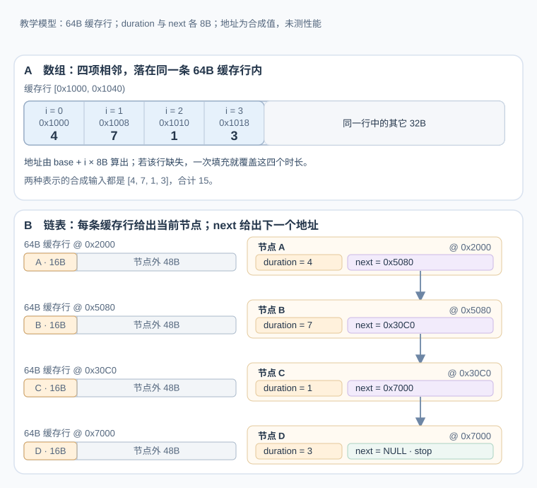
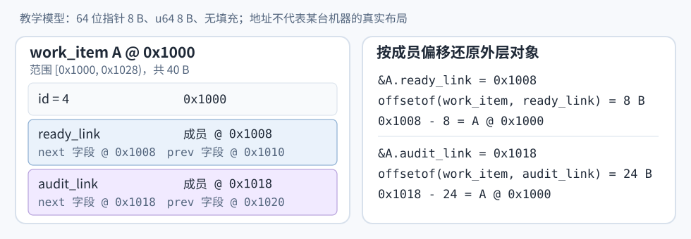
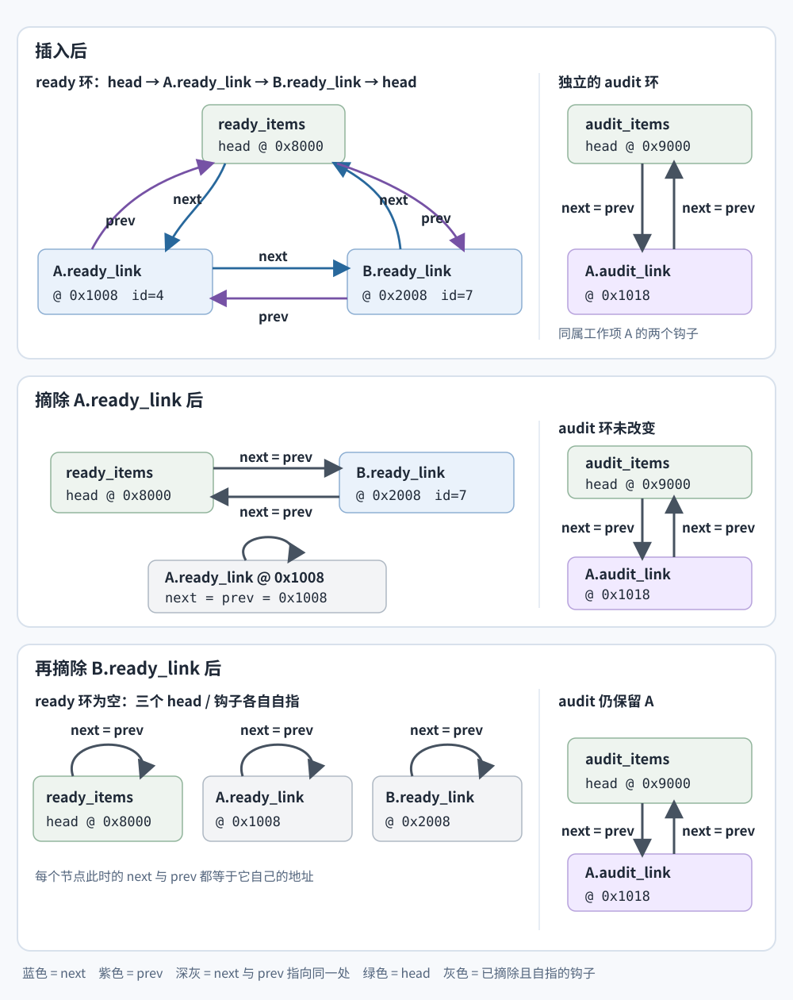

# 同样是 O(n)，为什么连续扫描往往比链表遍历快？

前面各章的复杂度都只数比较、转移或指针更新的次数。本章回答这些次数之外的成本：数据要从内存搬进 CPU，搬多少、何时才知道下一次该读哪里，决定了同样 O(n) 的两种遍历为什么耗时可以差很多。读完应能根据访问模式判断该选连续布局还是节点式布局，并知道 Linux 的侵入式链表省掉了什么、没有省掉什么。

例子独立于主线一的事件页，只为把内存位置画清楚：累计四个时长 `[4, 7, 1, 3]`，和为 15。一份存在数组里；另一份存在链表里，每个节点额外保存 `next` 指针。下文统一用一个教学布局：时长和指针各 8 B，链表节点无填充、共 16 B，cache line (缓存行) 为 64 B，地址都是合成值。图和算例只说明布局与传输量，不是性能测量。

## 复杂度数的是步数，不是搬运

两种遍历都访问 n 项，都是 O(n)。复杂度不表示处理器要传输多少字节、何时知道下一次读取的地址，也不表示要等多少次缓存未命中。

- **数组**：第 i 项地址等于基址加 i × 8 B，不必读完第 i 项就知道第 i+1 项在哪。四项相邻，落在同一条 64 B 缓存行里。
- **链表**：节点 A 的 `next` 是 `0x5080`。处理器要先取得 A 所在的缓存行，读到这个地址，才能发出读取节点 B 的请求；这次读取依赖上一次读取的结果。

> [!example] 同一缓存层的填充次数
> 假设图中涉及的缓存行起初都不在所观察的缓存层，也没有预取抢先填充：
> - 数组：1 次填充，64 B，已包含全部四个时长。
> - 链表：四个节点在四条不同的行，4 次填充，共 4 × 64 = 256 B，而真正用到的只有 4 × 16 = 64 B。
>
> 这只比较这一层的传输量，不是耗时比。链表行分散是人为假设：多个节点若落在同一行，后续节点可以复用那次填充，但仍要先读到当前节点的 `next` 才能确定下一个地址。数组跨越多行时也需要相应更多的填充。

## 延迟与带宽是两种约束

一次内存读取的 latency (延迟) 是从请求发出到数据可用的时间；bandwidth (带宽) 是单位时间能传送的数据量。读取命中 cache (缓存) 时，数据由相应的缓存层提供；未命中就要从更远的缓存层或主存取得。数据到达后，依赖它的指令才能执行。缓存的层数、容量、带宽和延迟随处理器和系统配置变化，代码不能假定固定数值。

两种约束对应两种瓶颈：

- **等得久**：一条依赖链上的每次读取都要等上一次的结果，延迟直接累加。
- **搬不动**：彼此独立的读取可以同时在途、重叠等待，但共享同一份带宽。流式循环若平均每项实际传输 s 字节、可用带宽 B 字节/秒，且已受带宽限制，吞吐上限约为 B/s 项/秒。这个估算不含计算时间，也预测不了一次依赖读取要等多久。

缓存按行取得数据，相邻字节会随同带回；之后访问相邻元素，就有机会直接命中，这是 spatial locality (空间局部性)。短时间内再次使用同一数据，它仍在缓存中的机会较高，这是 temporal locality (时间局部性)。缓存行也是 cache coherence (缓存一致性) 处理的常用粒度，后文的伪共享就发生在这一层。局部性只提高命中机会，不保证命中。

> [!info] 历史：memory wall
> Wulf 与 McKee 在 1995 年指出，处理器速度与内存供数能力的差距在不断扩大，称之为 memory wall (内存墙)。程序在关键路径上等数据或已达带宽上限时，再提高算术吞吐也未必能加速；工作集已在缓存里、或计算量占主导时，内存供数就不一定是瓶颈。

## 数组：下一个地址可以提前算出

~~~c
#include <stddef.h>
#include <stdint.h>

uint64_t sum_array(void) {
    uint64_t durations[] = {4, 7, 1, 3};
    size_t count = sizeof durations / sizeof durations[0];
    uint64_t total = 0;
    for (size_t i = 0; i < count; i++) {
        total += durations[i];
    }
    return total;
}
~~~

`&durations[i]` 的字节地址是基址加 i 乘元素大小。（C 的指针加法本身已按元素大小前进，不能再额外乘一次 `sizeof`。）

本例四项只占一条行，体现的是同一次填充内的空间复用。数组跨越多条行时，处理器不必等当前行返回就能算出后续地址：许多 hardware prefetcher (硬件预取器) 能识别这种规律并提前取数，处理器也可能让多个独立读取同时在途，这种能力常称为 memory-level parallelism (内存级并行，MLP)。

这些只是机会，不是保证。上面的 `total` 有逐次累加依赖；编译器是否展开循环、改用多个累加器，硬件能否同时发出多个读取，取决于编译结果、可用的请求资源和目标处理器。不能只凭代码外形承诺向量化或吞吐量。

## 链表：先拿到 next 才知道下一站

~~~c
#include <stddef.h>
#include <stdint.h>

struct event_node {
    uint64_t duration;
    struct event_node *next;
};

uint64_t sum_events(struct event_node *head) {   /* 假设无环、尾节点 next 为 NULL */
    uint64_t total = 0;
    for (struct event_node *node = head; node != NULL; node = node->next) {
        total += node->duration;
    }
    return total;
}
~~~

每轮从当前节点读 `next`；只有这个值可用后，程序才知道下一个节点的地址。这种 pointer chasing (指针追逐) 让整条链形成地址依赖：节点分散且各行都未命中时，demand load (按需读取) 只能一个接一个地发出，每个依赖都可能暴露一次完整的等待。

这不等于 CPU 整体停住。乱序执行的处理器仍可做链外的独立工作，其他线程或另一条独立的链也能产生在途请求；只是链上的依赖指令仍要等数据，处理器若没有别的就绪工作，等待就会拖慢整体进度。常见的顺序流预取器难以预测任意散布的指针链；部分处理器能识别固定步幅的地址模式，降低有效延迟；software prefetch (软件预取) 是否有益要对目标负载测量。

## 选数组还是链表：看操作、布局和分配

| 操作 | 数组 | 链表 |
|---|---|---|
| 按下标访问 | O(1) | O(n) |
| 按值查找 | O(n)，连续扫描；有序时可二分 | O(n)，指针追逐 |
| 中间插入或删除 | O(n) 移动，但移动范围连续，可用优化过的批量操作 | 已持有目标节点和所需链接时 O(1)；需先扫描定位时整体仍 O(n) |
| 分配 | 整块分配，扩容时整体搬移 | 每个节点一次分配；对象池能降低分配成本，但不保证链表顺序就是地址顺序 |

所以，主要工作是按顺序扫描时，连续数组常是更好的起点；系统频繁改动已知节点、要求节点地址稳定，或同一对象要参加多个关系时，链表才可能更合适。节点大小、未命中次数、锁竞争和访问顺序都会改变实际成本，结论要用代表性的数据规模和访问模式测量。Linux 内核文档也提醒，能满足需求的简单数组通常有更好的数据局部性。

“频繁改动已知节点”的典型例子是 LRU 缓存：哈希表按键直接给出节点，节点又持有前驱和后继，所以把它移到最近使用端只需有限次链接更新；没有这个索引而要遍历链表找键，查找仍是 O(n)，指针追逐也没有消失。完整结构见[怎样同时按键查找并维护最近使用顺序？](lru-cache.md)；各结构靠什么定位、怎样维护顺序，见[数组、链表、树和哈希表各靠什么找到目标、维护顺序？](data-structures-by-access-pattern.md)。

## 实例：各语言的“数组”保证什么布局

写下“数组”不等于得到连续内存。以下按各语言标准或实现文档核对（2026-11-11）：

| 语言或类型 | 布局保证 |
|---|---|
| C 数组 | 元素连续；多维数组按行优先排列 |
| C++ `std::vector<T>`（`T` 非 `bool`） | 连续存储 |
| C++ `std::vector<bool>` | 专门化，不属于上面的连续保证 |
| C++ `std::list<T>` | 标准只规定操作、迭代器与复杂度，不规定节点布局 |
| JavaScript `Array` | 规范只定义索引属性、长度和操作行为，不承诺连续存储；V8 用 packed、holey 等元素种类优化常见数组，这是实现状态，不是语言承诺 |
| JavaScript `TypedArray` | 以固定数值类型查看 `ArrayBuffer` 的一段字节；程序仍无法据此推断物理地址或缓存行 |

## 访问模式还影响哪些选择

同一视角能解释许多看似无关的选择。它们是定位瓶颈的线索，不是脱离负载的通用结论：

| 选择 | 访问模式上的差别 |
|---|---|
| 行遍历与列遍历 | C 按行优先存放二维数组，按最后一维顺序扫描地址连续；按列扫描是跨距读取，缓存利用率更低 |
| false sharing (伪共享) | 多个核心访问同一缓存行、且至少一方写入时，彼此独立的字段也会引起一致性流量；纯并发读取不构成伪共享。Linux 的 `perf c2c` 可定位被争用的行，再对照结构布局 |
| B-tree 与红黑树 | B-tree 的一页存放许多键，一次页读取排除大量候选；指针式红黑树逐节点追逐。以 PostgreSQL 为例，B-tree 叶页还用右兄弟链接支持有序范围扫描；数据库侧见[约束与索引章](../data/constraints-and-indexes.md) |
| 扁平与节点式哈希表 | 扁平表（如 Abseil Swiss Tables）把元数据密集存放、分组探测；节点式表把值放在独立节点，较易保持元素地址稳定，但查找多一次间接访问 |
| 无分支代码与可预测分支 | 去掉分支可能增加无效工作或数据依赖；分支预测稳定时，保留分支也可能更快 |

## 侵入式链表：把节点嵌进对象之后，生命周期由谁管？

链表有时是对的选择。Linux 内核为此用了一种不同的链表写法，值得单独看它省掉了什么、又把哪些责任留给了调用者。

**钩子嵌在对象里。** `struct list_head` 只含 `next`、`prev` 两个指针。把它作为成员嵌进业务对象，通用链表代码只修改这些指针，不必为对象参加的每种关系另外分配一个包装节点。表头本身也是一个 `list_head`，充当环形双向链表的哨兵；空表时它的两个指针都指向自己。

设一个工作项要同时放进待处理队列和审计队列：

~~~c
struct work_item {
    u64 id;
    struct list_head ready_link;  /* 待处理队列的钩子 */
    struct list_head audit_link;  /* 审计队列的钩子 */
};
~~~

每种同时存在的关系需要一个钩子，每个钩子仍是两个指针，所以链接的存储成本并没有消失。链中的指针指向嵌入的钩子，而不是对象起始地址。按教学布局（指针和 `u64` 各 8 B、无填充），工作项 A 位于 `0x1000`，`ready_link` 在 `0x1008`，`audit_link` 在 `0x1018`：

**`container_of` 从钩子找回对象。** `container_of(ptr, type, member)` 概念上从钩子地址减去 `offsetof(type, member)`：`0x1008 − 8 = 0x1000`，`0x1018 − 24 = 0x1000`。`list_entry()` 和 `list_for_each_entry()` 都建立在它之上，后者让循环变量直接指向外层对象。它只是地址计算：要求传入的指针确实指向该类型的那个成员，不会查找节点，也不消除遍历时读取 `next` 的依赖。它是内核宏，不是标准 C；当前 mainline 的 `container_of()` 会丢掉 `const`，新代码优先用 `container_of_const()`。

**插入和摘除只改固定数量的链接。** 下图是 A、B 依次尾插 ready 队列、A 同时在 audit 队列，然后依次摘下 A、B 的 ready 钩子时的状态：

`list_add_tail` 和 `list_del_init` 改动的指针数与链表长度无关，但这不是整个操作的耗时保证：查找节点、取锁、等缓存都要另算。`list_del_init` 只把这个钩子摘下并重置为自指；它不释放对象，也不碰同一对象的 `audit_link`，所以图中 A 摘下 ready 后仍在 audit 环里。

使用时有几条规则，违反任一条都会留下悬空指针或数据竞争：

- **入链期间对象不能搬移。** 邻居保存的是钩子地址，对象一挪，邻居仍指向旧地址。浅拷贝也不会把副本加入链表：A、B 已依次入 ready 时，A 的副本得到 `next = 0x2008`（B 的钩子）、`prev = 0x8000`（表头），但链中没有谁指向副本。副本要独立使用，先对它的每个钩子调用 `INIT_LIST_HEAD`，再分别入链。
- **“钩子自指”判断未入链，只在同一把锁下成立。** 初始化或 `list_del_init` 后钩子自指，入链后指向邻居，所以可以用 `list_empty(&item->ready_link)` 防止重复挂入；前提是所有插入和摘除都持同一把锁。它也回答不了“这个对象在哪张表里”。
- **safe 迭代不等于并发安全。** `list_for_each_entry_safe` 预先保存下一个游标，让循环体可以删除当前项；它不防并发修改，也不保证保存的下一个节点在被别人释放后仍可访问。所有读写要由同一把合适的锁保护；mutex 可睡眠，不能用在中断上下文。
- **链表不管对象的生命周期。** 释放对象前，要摘掉它所有仍挂着的钩子，并确认没有别的读者或引用者。只从 ready 摘下、仍在 audit 里的工作项不能释放；锁也不会替还在等锁的参数保活，需要调用者的所有权或引用计数。
- **RCU 摘除后的钩子在宽限期内不能复用。** 读多写少时，RCU (read-copy-update，读-复制-更新) 让读者在 `rcu_read_lock()`/`rcu_read_unlock()` 之间用 `list_for_each_entry_rcu()` 遍历而不持写者的锁，写者之间仍须串行，读者可能短暂看到刚删除的项。`list_del_rcu()` 摘除后保留 `next` 供在途读者继续前进（`prev` 被标为 poison），所以不能立刻 `INIT_LIST_HEAD`、重新插入或释放；要等 `synchronize_rcu()` 返回，或 `call_rcu()` 登记的回调在宽限期后执行，才能回收或复用。要保持尾插顺序用 `list_add_tail_rcu()`（`list_add_rcu()` 插在表头之后）。

**什么时候划算，以及它不解决什么。** 对象由当前模块拥有、入链期间地址稳定、要参加多种频繁更新的关系，且省掉包装节点的分配有实际价值时，侵入式链表很合适。但它不会把对象放进连续内存：相邻节点可能相隔很远，遍历仍要先取 `next` 再去下一处，指针追逐一点没少。它简化的是关系表示和已知节点的更新，不是缓存局部性；主要操作是顺序扫描时，仍应先考虑数组。

另外，非侵入式链表也不一定“每个元素分配两次”：C++ 标准只规定 `std::list` 的语义与复杂度，以 GCC 15.2 的 libstdc++ 为例，元素直接存放在节点自带的对齐存储里。这是一个实现样本，不是所有实现的保证。

## 主线一的产出：一份带成本模型的选型

到这里，主线一给出的选型要写明四件事：输入提供什么保证（有序、非负、无环、子问题重叠）；需要哪些操作；复杂度在哪种成本模型下成立（最坏、期望还是均摊，规范保证还是实现模型）；以及比较次数之外，数据布局会让真实耗时落在哪里。主线三的索引直接用到这些结论：B-tree 用页读取而不是指针追逐计成本，复合索引的列序就是复合键比较器的顺序，见[约束守住哪些规则，索引又怎样服务读取？](../data/constraints-and-indexes.md)。主线二从单个进程的执行开始，问的是程序怎样并发、等待和释放资源，见[一份工作该交给进程、线程还是异步 I/O？](../runtime/processes-threads-and-async-io.md)。

> [!info]- 来源
> - 内存墙：[Wulf 与 McKee, “Hitting the Memory Wall: Implications of the Obvious” (1995)](https://doi.org/10.1145/216585.216588)。
> - C 数组连续存储、下标语义与指针加减按元素前进：[WG14 N3220, ISO/IEC 9899:2024 工作草案](https://www.open-std.org/jtc1/sc22/wg14/www/docs/n3220.pdf)，§6.2.5、§6.5.3.2、§6.5.7。
> - 缓存层级、规则访问预取、指针追逐与独立读取重叠（含固定步幅指针追逐示例）：[Intel 64 and IA-32 Architectures Optimization Reference Manual, 248966-050US](https://cdrdv2-public.intel.com/821612/248966-Optimization-Reference-Manual-V1-050.pdf)，§9.5.2–9.5.4；属于该微架构的说明，不是所有 CPU 的固定行为。
> - 简单数组与链表的数据局部性权衡、内嵌 `list_head`、`container_of()`、尾插、遍历、摘除与并发注意事项：[Linux 内核 “Linked Lists in Linux”](https://docs.kernel.org/core-api/list.html)，2026-11-11 核对。
> - `list_head` 结构、自指初始化、`list_add_tail`、`list_del_init`、`list_for_each_entry_safe`：[Linux mainline `include/linux/types.h`](https://github.com/torvalds/linux/blob/master/include/linux/types.h)、[`include/linux/list.h`](https://github.com/torvalds/linux/blob/master/include/linux/list.h)；`container_of()` 与 `container_of_const()`：[`include/linux/container_of.h`](https://github.com/torvalds/linux/blob/master/include/linux/container_of.h)；均为 2026-11-11 的 mainline。
> - mutex 可睡眠、不能用于中断上下文：[Linux 内核 “Generic Mutex Subsystem”](https://docs.kernel.org/locking/mutex-design.html)，2026-11-11 核对。
> - RCU 读者可能看到并发增删的项、写者串行化、宽限期后回收：[Linux 内核 “Using RCU to Protect Read-Mostly Linked Lists”](https://docs.kernel.org/RCU/listRCU.html)，Examples 1、2、4；`list_add_rcu`/`list_add_tail_rcu` 插入位置、`list_del_rcu` 保留 `next` 并标记 `prev`：[Linux mainline `include/linux/rculist.h`](https://github.com/torvalds/linux/blob/master/include/linux/rculist.h)；2026-11-11 核对。
> - 伪共享的并发读写条件与 `perf c2c` 的用途：[Linux 内核 “False Sharing”](https://docs.kernel.org/kernel-hacking/false-sharing.html)，2026-11-11 核对。
> - `std::vector`（非 `bool`）连续保证与 `std::list` 操作契约：[C++ 工作草案 vector.overview](https://eel.is/c++draft/vector.overview)、[list.overview](https://eel.is/c++draft/list.overview)，2026-11-11 核对；GCC 15.2.0 的 list 节点用对齐存储保存 T：[libstdc++ `stl_list.h`](https://github.com/gcc-mirror/gcc/blob/releases/gcc-15.2.0/libstdc%2B%2B-v3/include/bits/stl_list.h)。
> - JavaScript `Array` 的语言级索引语义与 `TypedArray` 对 `ArrayBuffer` 的视图：[ECMAScript 2026 Indexed Collections §23.1–23.2](https://tc39.es/ecma262/2026/multipage/indexed-collections.html)、[Structured Data §25.1](https://tc39.es/ecma262/2026/multipage/structured-data.html)；V8 元素种类：[V8 “Elements kinds”](https://v8.dev/blog/elements-kinds)，2025-02-28 更新。
> - PostgreSQL 18 B-tree 的索引页、叶页与有序范围扫描：[B-Tree Indexes §65.1.4.1](https://www.postgresql.org/docs/18/btree.html)、[nbtree README（REL_18_STABLE）](https://github.com/postgres/postgres/blob/REL_18_STABLE/src/backend/access/nbtree/README)；只适用于 PostgreSQL。
> - 扁平与节点式哈希表的布局与地址稳定性：[Abseil Swiss Tables Design Notes](https://abseil.io/about/design/swisstables)，2026-11-11 核对。
