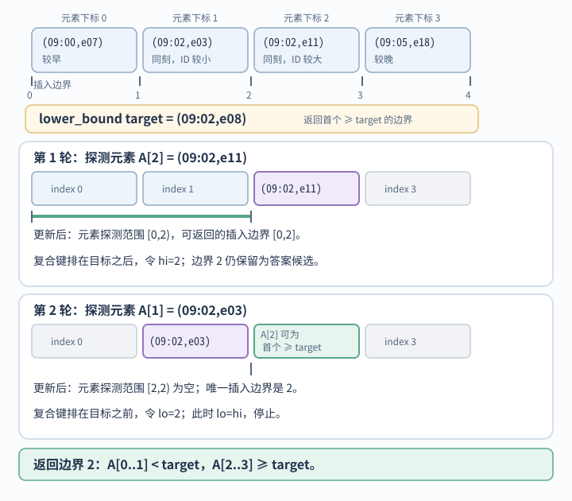

# 有序数据怎样让二分查找和双指针安全排除候选？

本章回答：数组有序时，二分查找和双指针凭什么一次排除一批候选，边界查找怎样写对，翻页游标为什么就是 `upper_bound`。沿用主线一的案例：报表 42 的事件页已经在内存里，1,024 条事件按 `(occurred_at, event_id)` 升序排列。[首章](invariants-and-cost-models.md)算过，最坏情况下线性扫描要比较 1,024 次，`lower_bound` 只要 11 次探测；本章说明这 11 次探测为什么不会漏掉答案。

为了能逐轮手算，页面缩成四条演示记录，时间写成同精度的 UTC ISO 8601 字符串（表中只写时分）：

| 下标 | `occurred_at` | `event_id` |
|---:|---|---|
| 0 | `2026-11-12T09:00:00.000Z` | `e07` |
| 1 | `2026-11-12T09:02:00.000Z` | `e03` |
| 2 | `2026-11-12T09:02:00.000Z` | `e11` |
| 3 | `2026-11-12T09:05:00.000Z` | `e18` |

## 排除候选要靠三件事一致

二分查找每看一个中点，就要断定“中点一侧的元素全都不可能是答案”。这个断定要三件事同时成立：

1. **数据顺序**：数组已按某个比较器升序排好。
2. **比较器**：查找用的比较器与排序时的是同一个。它对同一对值总给出相同的正负号，结果可传递，能定义一致的顺序。
3. **返回约定**：调用方知道函数返回的是“某个相等项”“插入位置”还是“下一条”，并按约定使用。

事件页的比较器先比时间，时间相同再比 ID：

~~~javascript
function compareEvent(a, b) {
  if (a.occurred_at < b.occurred_at) return -1;
  if (a.occurred_at > b.occurred_at) return 1;
  if (a.event_id < b.event_id) return -1;
  if (a.event_id > b.event_id) return 1;
  return 0;
}
~~~

这里直接比较字符串，是因为时间都是 UTC、写法和小数位数相同，字典序就等于时间顺序；ID 都是定宽的 `eNN`，字典序也等于编号顺序。换成时区写法不一、小数位数不同的时间串，字典序就不再可靠。

复合键有序不等于每个字段单独有序。`e03` 的 ID 比 `e07` 小，但它发生得更晚，所以排在 `e07` 后面；按 `event_id` 单独看，这个数组并不升序，不能只拿 `event_id` 在上面二分。

> [!warning] 内存比较器必须与数据库排序一致
> 页面由数据库按 `ORDER BY occurred_at, event_id` 返回时，内存里的比较器必须与数据库的字段类型、空值排在前还是后、字符串排序规则（collation）完全一致。任何一项不同，数据库排好的顺序在比较器眼里就可能不是有序的，二分会悄悄给出错误位置。

## 精确查找：目标若存在，必在当前闭区间里

先用便于手算的数字数组说明最简单的形式。闭区间版本维护 `[left, right]`，不变量是“若目标存在，它一定在这个区间里”。区间变空，就说明目标不存在。

~~~javascript
function binarySearch(values, target, compare) {
  let left = 0;
  let right = values.length - 1;
  while (left <= right) {
    const middle = left + Math.floor((right - left) / 2);
    const order = compare(values[middle], target);
    if (order === 0) return middle;
    if (order < 0) left = middle + 1;
    else right = middle - 1;
  }
  return -1;
}
~~~

在 `[3, 7, 11, 15, 19, 23, 27]` 中查找 19，比较器取 `(a, b) => a - b`：

| 轮次 | 闭区间 | 中点下标 → 值 | 动作 |
|---|---|---|---|
| 1 | `[0,6]` | `3 → 15` | `15 < 19`，下标 0–3 都更小，`left = 4` |
| 2 | `[4,6]` | `5 → 23` | `23 > 19`，下标 5–6 都更大，`right = 4` |
| 3 | `[4,4]` | `4 → 19` | 命中，返回 4 |

查找 20 时前两轮相同；第三轮 `19 < 20`，`left = 5`，区间 `[5,4]` 为空，返回 -1。

每次比较至少舍弃一半候选，所以最多 O(log n) 次比较，额外空间 O(1)。有重复项时，这个版本返回任意一个相等项，不一定是第一个；要第一个，用下一节的 `lower_bound`。中点写成 `left + floor((right - left) / 2)`，是为了在定宽整数语言里避免 `left + right` 溢出；JavaScript 的数组长度到不了溢出范围，这样写只是便于移植。

同一个函数配上 `compareEvent` 就能在事件页上精确查找：`binarySearch(events, events[1], compareEvent)` 返回 1。

## 边界查找：lower_bound 与 upper_bound

翻页和插入需要的往往不是“某条记录在哪”，而是“边界在哪”。本领域统一用两个定义：

- `lower_bound(target)`：第一个键 `>= target` 的下标；所有键都小于目标时返回 `n`。
- `upper_bound(target)`：第一个键 `> target` 的下标；没有更大的键时返回 `n`。

> [!info] 半开区间约定
> `[start, end)` 包含满足 `start <= i < end` 的下标：长度是 `end - start`，`start = end` 时为空，相邻的 `[a, b)` 与 `[b, c)` 没有公共元素，位置 `b` 只属于后一个区间。边界查找、滑动窗口、扫描线和分页都按这个约定写，就不用再为“端点算不算”逐处加 ±1。

边界查找要分清两个区间：待探测的元素下标是半开区间 `[lo, hi)`，而答案可能落在闭区间 `[lo, hi]` 的任何位置，包括 `n`。初值 `lo = 0, hi = n`，不变量是：

- `[0, lo)` 里的键都 `< target`；
- `[hi, n)` 里的键都 `>= target`。

中点小于目标时，答案在 `mid` 右侧，令 `lo = mid + 1`；否则 `mid` 本身仍可能是答案，令 `hi = mid`，把它留作右边界。`lo = hi` 时，唯一可能的边界就是结果。`upper_bound` 只改一处：把“等于”也归到左侧，不变量变成 `[0, lo)` 都 `<= target`、`[hi, n)` 都 `> target`。

~~~javascript
function bound(values, target, compare, afterEquals = false) {
  let lo = 0;
  let hi = values.length;
  while (lo < hi) {
    const mid = lo + Math.floor((hi - lo) / 2);
    const order = compare(values[mid], target);
    if (order < 0 || (afterEquals && order === 0)) lo = mid + 1;
    else hi = mid;
  }
  return lo;
}
~~~

`afterEquals` 为 `false` 时是 `lower_bound`，为 `true` 时是 `upper_bound`。在事件页上求 `lower_bound((09:02, e08))`，数组中没有与目标相等的项：

| 状态 | 探测范围 | 候选边界 | 中点 | 比较与更新 |
|---|---|---|---|---|
| 第 1 轮 | `[0,4)` | `[0,4]` | 2：`(09:02, e11)` | 大于目标，`hi = 2`；下标 2 不再探测，但边界 2 仍保留 |
| 第 2 轮 | `[0,2)` | `[0,2]` | 1：`(09:02, e03)` | 小于目标，`lo = 2` |
| 结束 | `[2,2)` | `[2,2]` | — | 探测范围为空，返回 2 |

结果 2 表示：下标 0、1 的键都小于目标，从下标 2 的 `(09:02, e11)` 起都不小于目标。若比较器只比时间，`e03`、`e08`、`e11` 在它眼里都相等：第 2 轮比较 `e03` 时不再“小于目标”，`hi` 收到 1，最终返回 1，目标被错放到 `e03` 之前。

两个边界版本都从 `[0, n)` 开始，每轮待探测项至多剩一半，所以最多 O(log n) 次键比较、O(1) 额外空间。本例的键是定长字段，一次比较按 O(1) 计；键长随输入增长时，要另计每次比较的成本。

`lower_bound` 本身不表示“找到了”。要找第一条与目标相等的记录，先求 `pos`，再检查 `pos < n && compare(values[pos], target) === 0`；否则 `pos` 指向第一个更大的项，或者等于 `n`。

## 下一页从哪里开始：游标就是 upper_bound

分页时，cursor (游标) 是上一页最后一条记录的完整排序键，下一页应从严格大于游标的第一条开始，这正是 `upper_bound`。以游标 `(09:02, e03)` 为例：

| 调用 | 结果 | 含义 |
|---|---:|---|
| `bound(events, events[1], compareEvent)` | 1 | `lower_bound`：游标自己 |
| `bound(events, events[1], compareEvent, true)` | 2 | `upper_bound`：游标之后的第一条 |

严格边界只依赖排序键，不依赖游标那一行还在不在：即使 `e03` 已被删除，用同一完整排序键比较，仍能定位到第一条更大的记录。

这个结论有一个前提：完整排序键必须能唯一确定每条记录。若两条记录的完整键相同，而游标恰好停在两者之间，严格 `>` 会跳过后一条。所以排序键里要包含唯一的 tie-breaker (平局裁决键)，例子里就是 `event_id`；排序和游标条件都必须用上它。

这里求的只是已加载页内的边界。向数据库取下一页时，查询要用同样的过滤条件、同样的排序和同样严格的游标条件 `(occurred_at, event_id) > (游标时间, 游标 ID)`，否则内存里和数据库里对“下一条”的理解不同。数据库侧怎样用行值比较和索引实现这种翻页、集合在翻页期间变化时怎么办，见[怎样无重复、无遗漏地分页读取一个还在变化的集合？](../data/keyset-pagination-and-snapshots.md)。

无序数组谈不上 lower 或 upper bound。只问某条记录在不在，可以线性扫描；要找有序边界，就得先按同一比较器排序，或改用能维持顺序的数据结构，并把建立有序表示的成本算进去。排序本身的代价见支线[分区怎样改变快速排序的时间和空间代价？](partitioning-and-sorting-costs.md)。

## 双指针：每次移动都要证明跳过的不是答案

二分每步排除一半候选。two pointers (双指针) 用两个只向前或只向内移动的下标，每步至少排除一个候选，把嵌套循环降成一次扫描。它不能替代任意嵌套循环：每移动一次指针，都要说清“被跳过的候选为什么不可能是答案”。

### 有序数组两数之和

问题：在升序数组中找两个不同下标，使对应值之和等于 `target`。本例假设值和两端之和都在 JavaScript 安全整数范围内（数值口径见[首章](invariants-and-cost-models.md)）。

移动理由来自有序：

- 两端和小于 `target`：左端已经和剩余候选中最大的值相加仍然不够，它和其他任何右端配对只会更小，左端可以排除。
- 两端和大于 `target`：右端已经和剩余最小的值相加仍然太大，右端可以排除。

~~~javascript
function twoSumSorted(values, target) {
  let left = 0;
  let right = values.length - 1;
  while (left < right) {
    const sum = values[left] + values[right];
    if (sum === target) return [left, right];
    if (sum < target) left++;
    else right--;
  }
  return null;
}
~~~

输入 `[1, 2, 4, 7, 11]`，`target = 9`：

| 步骤 | `left`：值 | `right`：值 | 和 | 排除理由或结果 |
|---|---|---|---:|---|
| 1 | `0:1` | `4:11` | 12 | 过大；11 配任何剩余左值都过大，`right = 3` |
| 2 | `0:1` | `3:7` | 8 | 不足；1 配任何剩余右值都不足，`left = 1` |
| 3 | `1:2` | `3:7` | 9 | 命中，返回 `[1, 3]` |

不变量是“尚未排除的解，两个下标都在 `[left, right]` 内”。每轮至少移动一端，两指针相遇时候选为空，所以 O(n) 时间、O(1) 额外空间。循环条件 `left < right` 保证两个下标不同；值相同的不同下标也能成解，例如 `[2, 2]` 求 4。

数组无序时，极值论证不成立。未排序的 `[3, 1, 2]` 求 3，下标 `[1, 2]` 是解，但这段代码第一轮 3+2=5 过大、第二轮 3+1=4 仍过大，右指针左移两次后与左指针相遇，返回 `null`。先排序再用双指针也可以，但得到的是排序后数组的下标；需要原下标，就要在排序前记下原位置，并把排序成本算进去。

### 读写指针：不靠排序的原地压缩

另一类双指针不依赖有序，靠的是两个下标划出的分段不变量。问题：把数组中的零移到末尾，保持非零值的相对次序，原地完成。

读指针 `i` 从左到右扫描，写指针 `next` 指向下一个非零值该写入的位置。处理下标 `i` 之前，数组分成三段：`[0, next)` 是已扫描的非零值，顺序与输入相同；`[next, i)` 全是零；`[i, n)` 还没扫描。

- 当前值是零：`next` 不动，这个零并入中间段。
- 当前值非零：与 `next` 处交换后 `next++`。若 `next < i`，非零值写到 `next`，原来那里的零换到 `i`；若 `next === i`，自己和自己交换，数组不变。

~~~javascript
function moveZeros(values) {
  let next = 0;
  for (let i = 0; i < values.length; i++) {
    if (values[i] !== 0) {
      [values[next], values[i]] = [values[i], values[next]];
      next++;
    }
  }
  return values;
}
~~~

以 `[0, 1, 0, 3, 12]` 为例：

| 处理下标 `i` | 处理前 `next` | 操作 | 处理后 | 新 `next` |
|---:|---:|---|---|---:|
| 0 | 0 | 值为 0，跳过 | `[0,1,0,3,12]` | 0 |
| 1 | 0 | 交换下标 0 与 1 | `[1,0,0,3,12]` | 1 |
| 2 | 1 | 值为 0，跳过 | `[1,0,0,3,12]` | 1 |
| 3 | 1 | 交换下标 1 与 3 | `[1,3,0,0,12]` | 2 |
| 4 | 2 | 交换下标 2 与 4 | `[1,3,12,0,0]` | 3 |

时间 O(n)，额外空间 O(1)。判定条件是严格不等于 0（`-0` 也算零）；若 `null`、空字符串也该当作“零”，要改写判定。数组若有空位，读到的 `undefined` 会被当成非零值移动，用之前要先定义这种情况的语义。把“非零”换成“小于基准”，这种读写指针就是排序分区的雏形。

## 有序之后：边界开始向前推进

本章产出三样东西：一个与排序规则一致的复合键比较器；按半开区间约定写出的 `lower_bound` 与 `upper_bound`；以及“游标 = 完整唯一排序键上的 `upper_bound`”这条翻页规则，主线三的键集分页直接用它。两条支线可按需读：排序本身的成本见[分区怎样改变快速排序的时间和空间代价？](partitioning-and-sorting-costs.md)；比较对象换成用户输入的文本时，先要决定按什么单位比较，见[文本算法应按码元、码点还是字素簇处理？](text-units-and-unicode.md)。

双指针的两端在这里都只在一个静态数组里移动。下一章[边界向前推进时，怎样维护一个有效窗口或活动区间？](sliding-windows-and-sweep-lines.md)让两端沿到达顺序一起前进，并在边界移动时增量维护窗口和或活动数。

> [!info]- 来源
> - 二分查找在有序数组中比较中点并缩小区间（精确查找与边界查找）：[NIST Dictionary of Algorithms and Data Structures, “binary search”](https://xlinux.nist.gov/dads/HTML/binarySearch.html)。闭区间精确查找、半开边界查找的不变量、四条记录的两轮探测和数字数组的三轮表均按本页代码手算复核。
> - 双指针只在端点单向移动且每步排除成立时为线性扫描：[Antti Laaksonen, *Competitive Programmer’s Handbook*, “Two pointers method”](https://cses.fi/book/book.pdf)。两数之和的排除论证、无序反例与零值压缩状态表按本页代码复算。
> - 时间字符串字典序与时间顺序一致的条件（时区、`Z`/偏移写法和小数位数相同）：[RFC 3339 §5.1 “Ordering”](https://www.rfc-editor.org/rfc/rfc3339.html#section-5.1)。
