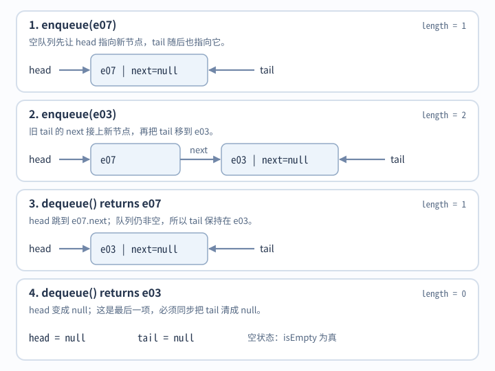
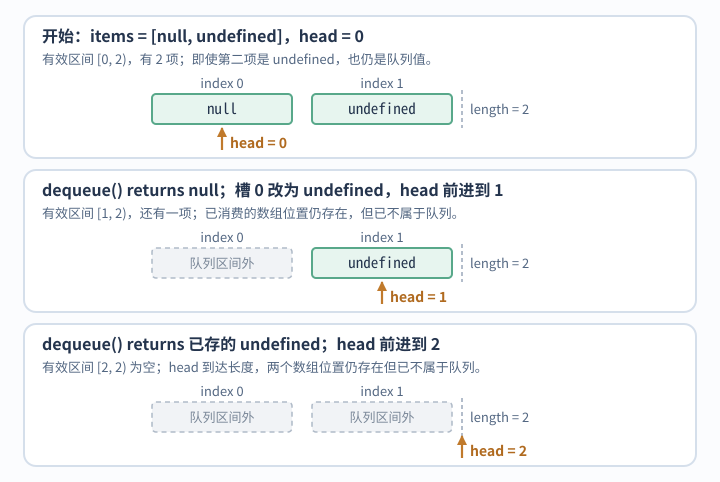
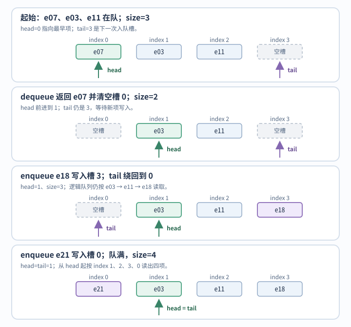
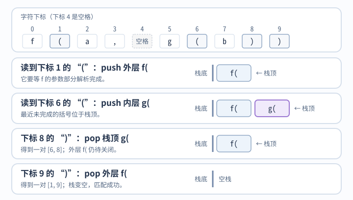

# 待处理的工作该用队列还是栈，各怎样实现？

待处理的工作按什么顺序取出，决定了用队列还是栈；选定之后，实现还要回答两个问题：出队时会不会搬移其余元素，以及“容器为空”怎样表示才不会和存进去的 `null`、`undefined` 混淆。本章依次给出链表队列、head 下标数组队列、环形缓冲区和数组栈，并说明显式栈怎样代替递归。读者手上已有[上一章](data-structures-by-access-pattern.md)对数组与链表定位、改链成本的比较，以及[首章](invariants-and-cost-models.md)的均摊口径。

## 顺序要求决定用队列还是栈

本章用两个小例子，它们对顺序的要求正好相反：

- **通知消费者**要按到达顺序处理报表事件的通知：`e07` 先到就先处理，然后才是 `e03`。这是 first-in, first-out (FIFO，先进先出) 的 queue (队列)：从尾部加入，从头部取出。
- **表达式解析**处理 `f(a, g(b))` 时，每遇到左括号就记下它，遇到右括号就与最近一个尚未配对的左括号配对。这是 last-in, first-out (LIFO，后进先出) 的 stack (栈)：在同一端加入和取出。

两者的接口都很小（加入、取出、查看下一个、判空），难点在表示：队列要在两端操作，栈只用一端。

## 队列：怎样维护头、尾和空状态？

### 链表队列

链表队列维护三个字段：`head` 指向最早入队的节点，`tail` 指向最新的节点，`length` 记项数。它的不变量是：

- 空队列时 `head` 与 `tail` 都是 `null`，`length` 为 0；
- 非空时 `tail.next` 是 `null`；
- 取出最后一项时，`head` 变成 `null`，`tail` 也必须同时清空，否则下一次入队会把新节点接到一个已经出队的节点后面。



图中 `e07`、`e03` 两条通知先后入队、出队；第 4 步是上面第三条不变量。

```javascript
class LinkedQueue {
  constructor() {
    this.head = null;
    this.tail = null;
    this.length = 0;
  }
  get isEmpty() { return this.length === 0; }
  enqueue(value) {
    const node = { value, next: null };
    if (this.tail) this.tail.next = node;
    else this.head = node;
    this.tail = node;
    this.length++;
  }
  dequeue() {
    if (this.isEmpty) throw new RangeError('queue is empty');
    const value = this.head.value;
    this.head = this.head.next;
    if (!this.head) this.tail = null;
    this.length--;
    return value;
  }
  peek() {
    if (this.isEmpty) throw new RangeError('queue is empty');
    return this.head.value;
  }
}
```

`enqueue`、`dequeue`、`peek` 都只读写固定几个字段，单次 O(1)；这个界不计节点分配和垃圾回收的耗时。每项要多占一个节点和一个 `next` 引用。空队列上取值直接抛错，判空看 `length` 而不看值，所以 `null` 和 `undefined` 都能作为正常的队列值存入。

### 用数组做队列：`shift` 为什么是 Θ(n²)，head 下标怎样避免它

JavaScript 里最省事的队列是普通数组，`push` 入队、`shift` 出队。问题在 `shift`：按 ECMAScript 规定的步骤，它要把下标 1 到末尾的每个元素逐个前移一格。对起初有 n 项、之后只出队的普通密集数组，出空整个队列的搬移次数是

(n − 1) + (n − 2) + … + 1 = n(n − 1)/2 = Θ(n²)。

这是规范步骤的抽象计数，引擎不一定真的做这么多次物理复制，但规范也没有承诺更好的界。

更稳妥的做法是不动数组，只让一个 `head` 下标向前走。不变量是：`head` 是 `[0, items.length]` 内的整数，有效队列项恰好是 `items[head..items.length)`；`head === items.length` 时队列为空。

- **出队**：先读 `items[head]`，再把这个槽设为 `undefined` 以释放它对对象的引用，最后 `head++`。一次读、一次写、一次加法，O(1)。
- **判空看下标，不看槽值。** 把槽设为 `undefined` 不会删除这个下标，只说明它已在有效区间之外；存进去的 `undefined` 仍在区间之内，照样能出队。
- **长期运行要压缩。** 只增加 `head` 时，底层数组只增不减。下面的实现在已消费的部分达到数组长度一半时，把剩余的 `items[head..)` 复制到新数组并把 `head` 归零。每次压缩复制的项数不超过自上次压缩以来出队的项数，所以压缩成本摊到每次出队上仍是 O(1)。



图中边界输入是 `[null, undefined]`：`head` 从 0 推到 1、再到 2，两个值都正常出队，最后 `head` 等于长度，队列为空。

```javascript
class ArrayQueue {
  constructor() {
    this.items = [];
    this.head = 0;
  }
  get size() { return this.items.length - this.head; }
  enqueue(value) { this.items.push(value); }
  dequeue() {
    if (this.head === this.items.length) throw new RangeError('queue is empty');
    const value = this.items[this.head];
    this.items[this.head] = undefined;
    this.head++;
    if (this.head * 2 >= this.items.length) {
      this.items = this.items.slice(this.head);
      this.head = 0;
    }
    return value;
  }
}
```

一次性的遍历（例如对一棵树或一张图做 BFS，队列用完即弃）只需要 `head` 下标，不必清槽和压缩：用 `for (let head = 0; head < queue.length; head++)` 读队首，循环里继续 `push` 新项即可。

### 有界队列：环形缓冲区

链表每项分配一个节点，head 下标数组要靠压缩回收空间。如果队列有容量上限，可以改用 ring buffer (环形缓冲区)：一个长度为 `capacity` 的固定数组，槽位循环复用。它只存两个状态：

- `head`：队首所在的槽，取值 `[0, capacity)`；
- `size`：有效项数，取值 `[0, capacity]`。

第 j 项（0 ≤ j < size）在 `items[(head + j) % capacity]`，下一个写入位置 `tail = (head + size) % capacity`。出队读 head 槽、清空它，再令 `head = (head + 1) % capacity`、`size--`；入队写 tail 槽并 `size++`。两者都是常数次操作，O(1)。

关键在空与满的区分：队空和队满时，`tail` 都与 `head` 重合，所以不能用 `head === tail` 判断，只能看 `size`。用通知事件走一遍，状态写作 `(head, size, tail)`，`capacity = 4`（`e21` 是为演示绕回而加的合成事件）：

| 步骤 | 槽 0..3 | `(head, size, tail)` |
|---|---|---|
| `e07`、`e03`、`e11` 已在队 | `e07` `e03` `e11` 空 | (0, 3, 3) |
| 出队 `e07` | 空 `e03` `e11` 空 | (1, 2, 3) |
| 入队 `e18`，写入槽 3 | 空 `e03` `e11` `e18` | (1, 3, 0) |
| 入队 `e21`，绕回槽 0；队满 | `e21` `e03` `e11` `e18` | (1, 4, 1) |
| 依次读完四项 | 全空 | (1, 0, 1) |

最后两行 `head` 与 `tail` 都是 1，一个满、一个空，只有 `size` 能区分。



队满时有两种策略：拒绝新项（下面的实现返回 `false`，让调用方决定等待、丢弃还是报错），或扩容。扩容按几何倍增时，触发的那一次要把全部项按逻辑顺序复制到新数组，O(capacity)，连续入队均摊 O(1)。服务里的等待队列通常选拒绝：队列有界，满了就把“慢下来”的信号还给生产者，而不是让内存无限增长；这条原则在服务层怎样落成 `429`/`503`，见[容量与准入一章](../services/capacity-admission-and-backpressure.md)。

> [!example]- 可运行：固定容量的环形队列
> ```javascript
> class RingQueue {
>   constructor(capacity) {
>     if (!Number.isSafeInteger(capacity) || capacity <= 0) {
>       throw new RangeError('capacity must be a positive integer');
>     }
>     this.items = new Array(capacity);
>     this.head = 0;
>     this.size = 0;
>   }
>   get capacity() { return this.items.length; }
>   get tail() { return (this.head + this.size) % this.capacity; }
>   enqueue(value) {
>     if (this.size === this.capacity) return false;
>     this.items[this.tail] = value;
>     this.size++;
>     return true;
>   }
>   dequeue() {
>     if (this.size === 0) throw new RangeError('queue is empty');
>     const value = this.items[this.head];
>     this.items[this.head] = undefined;
>     this.head = (this.head + 1) % this.capacity;
>     this.size--;
>     return value;
>   }
> }
>
> const ring = new RingQueue(4);
> const state = () => `(${ring.head},${ring.size},${ring.tail})`;
> for (const id of ['e07', 'e03', 'e11']) ring.enqueue(id);
> console.log(state());                       // (0,3,3)
> ring.dequeue();         console.log(state()); // (1,2,3)
> ring.enqueue('e18');    console.log(state()); // (1,3,0)
> ring.enqueue('e21');    console.log(state()); // (1,4,1)
> console.log(ring.enqueue('e30'));           // false：队满
> while (ring.size) ring.dequeue();
> console.log(state());                       // (1,0,1)
> ```

### “空”怎样表示，才不会和存入的值混淆

上面三种队列都在空时抛错，并且判空看计数或下标，而不看取出的值。这是接口设计的一部分：取值操作必须让调用方分清“取到了一个值”和“容器是空的”。常见做法有三种：

| 做法 | 例子 | 能否存 `null`/`undefined` | 调用方要做什么 |
|---|---|---|---|
| 空时抛错 | `dequeue()` 抛 `RangeError` | 能 | 先查 `isEmpty`/`size`，或捕获异常 |
| 返回哨兵值 | 空时 `poll()` 返回 `null` | 存 `null` 后就分不清 | 每次取之前先查 `size` |
| 返回带状态的结果 | `{ ok: true, value }` / `{ ok: false }`；或把值包进记录对象 | 能 | 只看返回值即可判断 |

哨兵值只有在它不可能是合法的存储值时才安全。例如一个只存数字的队列，空时 `poll()` 返回 `null`：如果有人把 `null` 入队，单看返回值就分不清是“取到了 `null`”还是“队列已空”。TypeScript 把参数写成 `number` 能否在编译期挡住 `null`，取决于是否开启 `strictNullChecks`；关闭时 `null` 和 `undefined` 可以赋给任何类型。想让调用方只看返回值就能判断，就返回带状态的结果，或在空时抛错。[堆一章的优先队列](heaps-and-priority-queues.md#实现：一份二叉堆，三种用法)用的是第三种做法的变体：空堆返回 `null`，但每个任务都被包在记录对象里，任务值本身为 `null` 时返回的是一个非空的记录。

> [!example]- 对照：空时返回 `null` 哨兵的数字队列（TypeScript）
> ```typescript
> interface QueueNode { val: number; next: QueueNode | null; }
>
> class NullableNumberQueue {
>   private head: QueueNode | null = null;
>   private tail: QueueNode | null = null;
>   private length = 0;
>   offer(val: number): void {
>     const node: QueueNode = { val, next: null };
>     if (this.tail) this.tail.next = node;
>     else this.head = node;
>     this.tail = node;
>     this.length++;
>   }
>   poll(): number | null {           // 空时返回 null：调用方要先查 size
>     if (!this.head) return null;
>     const value = this.head.val;
>     this.head = this.head.next;
>     if (!this.head) this.tail = null;
>     this.length--;
>     return value;
>   }
>   get size(): number { return this.length; }
> }
> ```
> 开启 `strictNullChecks` 时，`offer(null)` 在编译期被拒绝；关闭时它能通过编译，`poll()` 的 `null` 就有了两种含义。

## 栈：怎样保留最近未完成的工作？

栈只在一端操作，用数组末端的 `push`/`pop` 即可。在几何扩容的动态数组模型下，`push` 偶尔因扩容复制而变慢，均摊 O(1)；末尾 `pop` 不移动其他元素，O(1)。和队列一样，下面的 `Stack` 在空时抛错，所以存进去的 `undefined` 不会被误当成空栈。

### 括号匹配：栈顶就是最近一个未闭合的左括号

扫描文本时，左括号入栈；遇到右括号就看栈顶：栈顶正是最近一个尚未闭合的左括号，类型相符就弹出并记下这一对，否则不匹配。两种失败各有位置：遇到右括号时栈已空或类型不符，错在这个右括号；扫描结束栈里还有项，错在栈顶那个未闭合的左括号。

对 `f(a, g(b))`，各字符下标是 `f`0、`(`1、`a`2、`,`3、空格 4、`g`5、`(`6、`b`7、`)`8、`)`9：



图中栈项按它开启的调用标成 `f(`、`g(`；代码里每项记录括号字符和下标。下标 1 的 `(` 入栈，下标 6 的 `(` 入栈；下标 8 的 `)` 弹出 6，得到一对 `[6, 8]`；下标 9 的 `)` 弹出 1，得到 `[1, 9]`，栈变空，匹配成功。

```javascript
class Stack {
  constructor() { this.items = []; }
  get isEmpty() { return this.items.length === 0; }
  push(value) { this.items.push(value); }
  pop() {
    if (this.isEmpty) throw new RangeError('stack is empty');
    return this.items.pop();
  }
  peek() {
    if (this.isEmpty) throw new RangeError('stack is empty');
    return this.items[this.items.length - 1];
  }
}

const OPEN_FOR = new Map([[')', '('], [']', '['], ['}', '{']]);

function matchBrackets(text) {
  const open = new Stack();
  const pairs = [];
  for (let i = 0; i < text.length; i++) {
    const ch = text[i];
    if (ch === '(' || ch === '[' || ch === '{') {
      open.push({ ch, index: i });
    } else if (OPEN_FOR.has(ch)) {
      if (open.isEmpty || open.peek().ch !== OPEN_FOR.get(ch)) {
        return { ok: false, index: i };
      }
      pairs.push([open.pop().index, i]);
    }
  }
  if (!open.isEmpty) return { ok: false, index: open.peek().index };
  return { ok: true, pairs };
}

console.log(matchBrackets('f(a, g(b))')); // { ok: true, pairs: [ [ 6, 8 ], [ 1, 9 ] ] }
console.log(matchBrackets('f(a, g(b)'));  // { ok: false, index: 1 }：下标 1 的 ( 未闭合
console.log(matchBrackets('f(a])'));      // { ok: false, index: 3 }：] 与栈顶 ( 不符
```

每个字符至多入栈、出栈一次，n 个字符的文本总时间 O(n)，栈空间 O(嵌套深度)。返回的下标是 UTF-16 码元下标；括号都是 ASCII 字符，按码元扫描不会把它们拆错，但若要把位置报告给用户，就要考虑文本单位，见[文本算法应按码元、码点还是字素簇处理？](text-units-and-unicode.md)。

### 显式栈怎样代替递归？

括号匹配也可以写成递归下降：每遇到一个左括号就递归调用一次，处理完内层再返回。这样每层嵌套占一帧调用栈，而调用栈的大小由运行时限制，与可用内存无关。在 Node.js v26.13.1 的默认设置下，本页用一个每层递归一次的函数处理 20 万层嵌套的 `((…))`，抛出 `RangeError: Maximum call stack size exceeded`；上面的 `matchBrackets` 处理同一输入正常返回 20 万对。

把递归改成显式栈，就是把调用栈上隐含保存的东西搬到堆上的数组里：

- **栈项存“回来之后要继续做什么”。** 括号匹配只需记住左括号的类型和位置；树的遍历要记住节点，必要时还要记住下一个该处理的孩子或“子树是否已展开”。
- **压栈顺序决定访问顺序。** 栈后进先出，要按从左到右的顺序访问孩子，就把孩子从右到左压栈。
- **空间不变，限制变了。** 显式栈仍要 O(深度) 或更多空间，但它受堆内存约束，而不是受调用栈大小约束；深度随输入增长（退化成链的树、深嵌套的文档、偏斜的快速排序）时应改用显式栈。

递归 DFS 与显式栈 DFS 的对照代码、用显式栈取二叉搜索树的中序第 k 小，见[怎样遍历一棵树，又怎样把扁平记录安全地还原成树？](trees-traversal-and-reconstruction.md)；图搜索中的回溯也沿用这里的规则，见[搜索状态图时，何时永久标记节点，何时必须回退？](graph-search-and-backtracking.md)。

## 本章产出与下一步

按顺序要求选结构：按到达处理用队列，处理最近未完成的工作用栈。队列在 JavaScript 里不用 `shift` 出队，而是用 head 下标（长期运行时清槽并压缩）或有界的环形缓冲区；判空一律看计数或下标，不看取出的值，空时抛错或返回带状态的结果。嵌套深度随输入增长时，用显式栈代替递归。

队列和栈只按到达先后取出。下一个问题是：任务不断加入、每次要取出优先级最高的一项时，怎样不必每次重新排序？见[不断加入任务时，怎样持续取出最高优先级？](heaps-and-priority-queues.md)。

> [!info]- 来源
> - `Array.prototype.pop`/`push`/`shift` 的规范步骤（“用数组做队列”“栈”）：[ECMAScript 2026, §23.1.3.22–23、§23.1.3.27](https://tc39.es/ecma262/2026/multipage/indexed-collections.html)；`shift` 对普通密集数组逐个前移后续下标。标准描述的是可观察步骤，不规定引擎做同样多次物理搬移。
> - 链表实现的栈与队列每次操作最坏常数时间、resizing array 实现任意 N 次操作总时间与 N 成正比（“链表队列”“有界队列”“栈”）：[Sedgewick & Wayne, *Algorithms*, 4th ed., §1.3 Bags, Queues, and Stacks](https://algs4.cs.princeton.edu/13stacks/)、[§1.4 Analysis of Algorithms](https://algs4.cs.princeton.edu/14analysis/)。
> - `strictNullChecks` 关闭时忽略 `null`/`undefined`、开启后作为独立类型检查（“‘空’怎样表示”）：[TypeScript TSConfig Reference: strictNullChecks](https://www.typescriptlang.org/tsconfig/strictNullChecks.html)。
> - 环形缓冲区状态表、`f(a, g(b))` 配对结果、20 万层嵌套的递归与显式栈对比：本页代码在 Node.js v26.13.1 上运行复算。
