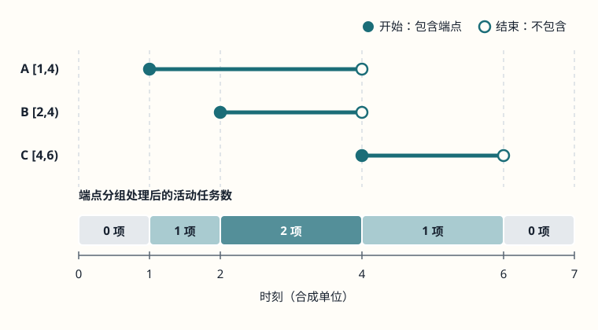

# 边界向前推进时，怎样维护一个有效窗口或活动区间？

[有序查找章](ordered-search-and-two-pointers.md)的双指针在一个静态数组里从两端向内收。本章让边界沿时间或到达顺序向前推进，并在推进时增量维护一份状态：窗口里的和，或者此刻活动的任务数。例子是一条独立的合成事件流和一张预约表，要回答三个问题：

1. 连续 k 条事件中，哪一段的净变化最大？（固定宽度的 sliding window (滑动窗口)）
2. 处理耗时累计达到阈值的连续事件段，最短是哪一段？（可变宽度的滑动窗口）
3. 一批预约区间里，同一时刻最多有几个任务占用资源？（sweep line (扫描线)）

区间一律按半开约定 `[start, end)` 写，含义见有序查找章的[半开区间约定](ordered-search-and-two-pointers.md#边界查找：lower_bound%20与%20upper_bound)。

## 三种方法各依赖什么输入保证

三者都随边界前进维护状态，但对输入的要求不同。先把约束集中写在这里，后文代码只保留会改变结论的检查：

| 方法 | 能否重排输入 | 正确性来自 | 输入前提 |
|---|---|---|---|
| 固定窗口 | 不能，“连续”指到达顺序 | 每步一进一出，窗口宽度不变 | 任意整数，可正可负 |
| 变长窗口 | 不能 | 两种指针移动都可证明不漏解 | **值必须非负**（这是正确性前提，不是输入清洗） |
| 扫描线 | 可以，先排序端点 | 同一时刻的端点按规则整组处理 | 每个区间 `start < end`；同一业务时刻的表示完全相同 |

三段代码都假设输入是稠密数组，数值是 JavaScript 安全整数，中间和也不越界（数值口径见[首章](invariants-and-cost-models.md)）。业务值若是小数，应先换算成整数的最小单位（例如毫秒、分），而不是把带浮点误差的和当成精确值。

## 固定宽度窗口：移出一项，再加入一项

每条事件记录它对待处理任务数的净变化，任务完成时为负。数组 `[4, -2, 3, 5]`，求连续 3 条的最大净变化。第一段 `[0, 3)` 的和是 4 − 2 + 3 = 5。窗口右移一格得到 `[1, 4)`，不必重新求和：减去移出的 4，加上新进的 5，得 5 − 4 + 5 = 6。

| 窗口 | 下标:值 | 本轮计算 | 和 |
|---|---|---|---:|
| `[0, 3)` | 0:4、1:-2、2:3 | 4 − 2 + 3 | 5 |
| `[1, 4)` | 1:-2、2:3、3:5 | 5 − 4 + 5 | 6 |

~~~javascript
function maxFixedWindowSum(values, k) {
  if (!Number.isSafeInteger(k) || k <= 0) throw new RangeError('k must be a positive integer');
  if (values.length < k) return null; // 没有完整窗口
  let sum = 0;
  for (let i = 0; i < k; i++) sum += values[i];
  let best = sum;
  for (let right = k; right < values.length; right++) {
    sum += values[right] - values[right - k]; // 加入 right，移出 right-k
    if (sum > best) best = sum;
  }
  return best;
}

maxFixedWindowSum([4, -2, 3, 5], 3); // 6
maxFixedWindowSum([], 1);            // null
~~~

`right` 是本轮新加入项的下标；更新后 `sum` 等于窗口 `[right − k + 1, right + 1)` 的和，`best` 是已比较过的完整窗口中的最大和。宽度固定，所以这个做法不要求值非负。时间 O(n)，额外空间 O(1)。

## 变长窗口：两种移动都要能证明不漏解

第二个问题：按事件顺序，找耗时总和至少为 5 ms 的最短连续区间。输入 `[2, 1, 3, 2]`，值都非负，`target = 5`。每轮先加入 `values[right]`，当前窗口是 `[left, right + 1)`；只要和达标，就记录候选，再从左边移出一项，直到不再达标。

| 操作 | 窗口 | 和 | 决定 |
|---|---|---:|---|
| 加入下标 0 | `[0, 1)` | 2 | 未达标，继续扩展 |
| 加入下标 1 | `[0, 2)` | 3 | 未达标，继续扩展 |
| 加入下标 2 | `[0, 3)` | 6 | 达标，记录长度 3；移出下标 0 |
| 移出下标 0 | `[1, 3)` | 4 | 不达标，停止收缩 |
| 加入下标 3 | `[1, 4)` | 6 | 达标，长度 3 不短于已有候选，保留先前值；移出下标 1 |
| 移出下标 1 | `[2, 4)` | 5 | 仍达标，记录长度 2；移出下标 2 |
| 移出下标 2 | `[3, 4)` | 2 | 不达标，停止收缩 |

结果是 `[2, 4)`，即耗时 3 和 2，长度 2。

两个指针都只向前，要说明两种移动都不会跳过答案：

- **收缩可以在第一次不达标时停止**。固定 `right`，左端右移检查的是越来越短的后缀。值都非负，移除一项后和只会保持或变小；一旦低于阈值，再往右只会更小，不可能再达标。
- **`left` 不必回退**。`left` 越过某个起点 s，说明“以 s 开头、到当时 `right` 为止”的达标区间已经比较过；以 s 开头、结束得更晚的区间只会更长，不可能更优。

~~~javascript
function shortestWindowAtLeast(values, target) {
  if (!(target > 0)) throw new RangeError('target must be positive'); // 否则空窗口也“达标”
  for (const value of values) {
    if (value < 0) throw new RangeError('values must be non-negative'); // 正确性前提
  }
  let left = 0;
  let sum = 0;
  let best = null;
  for (let right = 0; right < values.length; right++) {
    sum += values[right];
    while (sum >= target) {
      const length = right + 1 - left;
      if (best === null || length < best.length) best = { start: left, end: right + 1, length };
      sum -= values[left];
      left++;
    }
  }
  return best;
}

shortestWindowAtLeast([2, 1, 3, 2], 5); // { start: 2, end: 4, length: 2 }
shortestWindowAtLeast([1, 2], 5);       // null
~~~

每项至多进入窗口一次、离开一次，时间 O(n)，额外空间 O(1)。长度相同的候选保留先找到的。

入口的非负检查不能省。假如绕过它，在 `[1, -1, 5]`、阈值 5 上照搬同样的移动：整段 `[0, 3)` 和为 5，记录长度 3；移出 1 后和变成 4，停止收缩，最终返回长度 3。而 `[2, 3)` 只含 5，长度 1 才是答案。有了负数，扩展可能让和变小，收缩可能让和变大，“收缩可以停止”的理由就不成立了。

## 扫描线：先排序端点，同一时刻整组处理

第三个问题的输入不是有序的事件流，而是一批不按开始时间排列的预约。三个合成任务：A = `[1, 4)`、B = `[2, 4)`、C = `[4, 6)`，传给函数时故意打乱成 C、A、B。区间半开：任务在开始时刻已占用资源，在结束时刻已释放，所以另一个任务可以恰好在这一刻开始，两者不算重叠。

扫描线把每个区间拆成开始、结束两个端点，按时刻排序后从小到大处理。同一时刻有多个端点时，整组处理：先减去在此结束的 `[a, t)`，再加上从此开始的 `[t, b)`，然后才更新峰值。处理完时刻 t 后，`active` 就是从 t 到下一个端点之前占用资源的任务数。

| 时刻 | 结束 | 开始 | 处理后活动数 | 峰值 |
|---:|---|---|---:|---:|
| 1 | — | A | 1 | 1 |
| 2 | — | B | 2 | 2 |
| 4 | A、B | C | 1 | 2 |
| 6 | C | — | 0 | 2 |

峰值是 2。若逐个处理时刻 4 的端点、每处理一个就更新峰值，先处理 C 的开始会让 `active` 暂时变成 3，答案被错误抬高。

~~~javascript
function maxConcurrentHalfOpen(intervals) {
  const events = [];
  for (const { start, end } of intervals) {
    if (!(start < end)) throw new RangeError('each interval must satisfy start < end');
    events.push({ time: start, kind: 1 }, { time: end, kind: -1 });
  }
  events.sort((a, b) => a.time - b.time);

  let active = 0;
  let peak = 0;
  for (let i = 0; i < events.length;) {
    const time = events[i].time;
    let starts = 0;
    let ends = 0;
    for (; i < events.length && events[i].time === time; i++) {
      if (events[i].kind === -1) ends++;
      else starts++;
    }
    active -= ends;   // [start, time) 到此结束
    active += starts; // [time, end) 从此开始
    peak = Math.max(peak, active);
  }
  return peak;
}

maxConcurrentHalfOpen([
  { name: 'C', start: 4, end: 6 },
  { name: 'A', start: 1, end: 4 },
  { name: 'B', start: 2, end: 4 }
]); // 2
~~~

分组依赖 `events[i].time === time` 精确相等。同一业务时刻必须用完全相同的数值表示；若时刻来自不同的浮点运算，先统一换算到同一刻度（如整数毫秒）再扫描。问题只问峰值，所以 `active` 只存数量；要列出此刻是哪些任务，才需要保存任务身份。

## 成本，以及三者和双指针的关系

| 方法 | 时间 | 额外空间 | 主导项 |
|---|---|---|---|
| 固定窗口 | O(n) | O(1) | 一次扫描 |
| 变长窗口 | O(n) | O(1) | 每项进出各一次 |
| 扫描线 | O(n log n) | O(n) | 2n 个端点的排序 |

扫描线生成端点和分组扫描各是 O(n)，总时间由排序决定。这里的 O(n log n) 按[首章](invariants-and-cost-models.md#规范保证与实现模型)约定的比较排序模型计。

两种窗口本质上是有序查找章双指针的延伸：两个下标只向前，每次移动都附带“跳过的不是答案”的论证。差别在于论证的来源。窗口不能改变原序列，正确性来自指针移动的不变量；扫描线先重排端点，正确性来自半开端点的分组规则。

## 从一条序列到一张图

本章产出三种边界推进的写法及各自的前提：固定窗口靠一进一出，变长窗口靠非负值支撑的单调移动，扫描线靠排序后的同刻分组。它们都只沿一条序列前进，每个位置只访问常数次。状态之间一旦有分支和汇合（一个状态能走向多个后继，多条路线又汇到同一点），就得决定哪些状态已经处理过、何时可以永久标记，这是下一章[搜索状态图时，何时永久标记节点，何时必须回退？](graph-search-and-backtracking.md)的问题。

> [!info]- 来源
> - 固定与变长窗口的双指针推进、每个元素有限次进入和离开：[Antti Laaksonen, *Competitive Programmer’s Handbook*, 2018 draft, §8.1 “Two pointers method”、§8.3 “Sliding window minimum”](https://cses.fi/book/book.pdf)。本页的求和窗口按各自前提推导；负值失效例与三张状态表按本页代码复算。
> - 端点排序后维护活动集合的扫描线：[Sedgewick 与 Wayne, *Algorithms*, 4th ed. 配套网站, “Geometric Intersections”](https://algs4.cs.princeton.edu/93intersection/)，作者实现 [IntervalIntersection.java](https://algs4.cs.princeton.edu/93intersection/IntervalIntersection.java.html)。本页据此按半开预约区间分组端点，只统计活动数量。
> - `Array.prototype.sort` 的比较器约定与实现定义的比较序列，规范未规定 O(n log n)：[ECMAScript 2026, §23.1.3.30](https://tc39.es/ecma262/2026/multipage/indexed-collections.html#sec-array.prototype.sort)。
