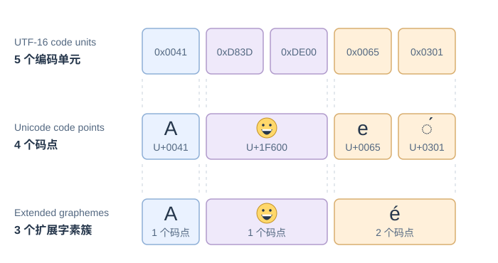

# 文本算法应按码元、码点还是字素簇处理？

[有序查找章](ordered-search-and-two-pointers.md)的比较器面对的是定宽 ASCII 的事件 ID，“一个字符”没有歧义。用户输入的文本不同：同一段描述里可能有 emoji、组合重音和其他文字，JavaScript 的字符串下标、Unicode 码点和用户眼里的“一个字符”是三种不同的单位。本章用一个独立的小输入 `'A😀e\u0301'` 说明：计数、截取、比较和前缀搜索之前，要先定义按哪种单位处理、是否规范化、匹配契约是什么，再写算法。

## 一个“字符”有三种数法

- **UTF-16 code unit (UTF-16 码元)**：一个 16 位值。补充平面上的字符（如大多数 emoji）用一对 surrogate (代理) 编码，占两个码元。
- **Unicode code point (Unicode 码点)**：Unicode 给每个抽象字符的编号。一个代理对表示一个码点；组合重音本身也是一个独立码点。
- **extended grapheme cluster (扩展字素簇)**：用户感知的一个字符。组合重音通常和前面的基字符合成一个字素簇。

下图把 `'A😀e\u0301'` 按三种单位划分。方框的横向边界对齐 UTF-16 位置，不代表屏幕显示宽度；`◌́` 里的虚线圆只是为了让组合重音看得清。

| 部分 | 码元 | 码点 | 字素簇 |
|---|---:|---:|---:|
| `A` | 1 | 1 | 1 |
| `😀`（U+1F600，代理对 `D83D DE00`） | 2 | 1 | 1 |
| `e` + U+0301 | 2 | 2 | 1 |
| 合计 | 5 | 4 | 3 |

三种计数都不等于存储大小。限制请求或字段的字节数，要按明确的编码（如 UTF-8）另算字节。

JavaScript 里三种单位各有对应的 API：

~~~javascript
const sample = 'A😀e\u0301';
sample.length;                                   // 5：UTF-16 码元数
Array.from(sample).length;                       // 4：按码点迭代
const segmenter = new Intl.Segmenter('en', { granularity: 'grapheme' });
Array.from(segmenter.segment(sample), p => p.segment); // ['A', '😀', 'é']
~~~

`Array.from` 和字符串迭代把有效的代理对合成一个元素，孤立的代理单独成为一个元素。`Intl.Segmenter` 的 grapheme 模式按 locale (语言环境) 和运行时实现的规则切字素簇。UAX #29 定义的默认扩展字素簇是可复现的规则，但允许语言或应用 tailor (定制)，所以某个运行时的输出不能等同于当前 UAX #29 每条边界规则。

> [!info] 实例版本
> 本章示例输出在 Node.js v26.13.1（ICU 79.1、Unicode 18.0、CLDR 49.0）上复算；其他运行时的国际化数据版本可能不同。

## 位置也按单位计：跨单位用下标会切坏文本

知道了三种长度，下一个问题是各种 API 返回的位置按哪种单位计：

| 表达式 | 返回值 | 位置单位 |
|---|---:|---|
| `sample.indexOf('e\u0301')` | 3 | 原字符串的码元偏移 |
| `Array.from(sample).indexOf('e')` | 2 | 码点数组下标 |
| Segmenter 分段记录的 `.index`（最后一段） | 3 | 原字符串的码元偏移 |
| 字素簇数组里 `'e\u0301'` 的下标 | 2 | 字素簇数组下标 |

`slice`、`substring` 按码元解释参数，所以码点数组或字素簇数组的下标不能直接传给它们。本例 `sample.slice(2)` 从 😀 的低代理 U+DE00 开始截取，切坏了 emoji；`slice(3)` 才从 `e\u0301` 开始。要在原文里高亮或替换某个元素，应保留原字符串偏移（例如 Segmenter 的 `.index`），或显式建立“数组下标 → 原偏移”的映射。

## 先决定是否规范化，并在明确的边界做

同一个用户可见字符可能有不同的码点序列。预组字符 é（U+00E9）与 `e` 加组合重音看起来相同，逐码点比较却不等：`'é' === 'e\u0301'` 为 false。Unicode 把这种关系叫 canonical equivalence (规范等价)；经 NFC（Normalization Form C）规范化后两者相等。

这是独立于单位的一项决定，按下面几条执行：

1. **决定比较是否按规范等价**。需要时，在明确的处理边界（例如写入键之前、比较之前）调用 `normalize('NFC')`，存入的键和查询走同一条处理链。
2. **不要无意改写原始输入**。要保留用户原文时，规范化的是副本。
3. **偏移只属于产生它的那份字符串**。`'e\u0301'.length` 是 2，`'é'.length` 是 1；规范化副本上的偏移不能直接套回原文。
4. **选对形式**。NFC/NFD 只处理规范等价；NFKC/NFKD 还合并兼容形式（如全角与半角字母），是否适用取决于任务，不能当作显示文本的通用清理。

> [!info] 数字显示：把本地化文本和精确数值分开
> - 显示数值用 `Intl.NumberFormat` 并显式指定 locale：`1234.5` 在 `en-US` 下是 `1,234.5`，在 `de-DE` 下是 `1.234,5`。输出随运行时的国际化数据版本变化，不能当作机器可解析的格式。
> - 精度在进格式化器之前就可能丢掉。`9007199254740993` 超过安全整数上限 2⁵³−1：直接传数字字符串或 BigInt `9007199254740993n`，输出 `9,007,199,254,740,993`；先 `Number('9007199254740993')` 再格式化，输出已是 `…992`。
> - 手写千分位正则 `/\B(?=(\d{3})+(?!\d))/g` 只适用于 ASCII 整数字符串；回溯引擎会在每个位置用前瞻重查后面的数字，不能断言线性。需要明确的线性处理，就从右向左每三位分组再拼接。

> [!info] 大小写：转换、语言规则和折叠是三件事
> - ASCII 大小写互换只适用于 A–Z、a–z，不是跨语言的大小写转换。
> - `toLowerCase()` 用 Unicode 默认小写映射，`toLocaleLowerCase(locale)` 按语言规则映射，两者都可能改变长度：`'İ'.toLowerCase()` 得到 `i` + U+0307 两个码点；`'I'.toLocaleLowerCase('tr')` 得到土耳其语无点 `ı`。
> - case folding (大小写折叠) 专为不区分大小写的比较设计，与转小写不同：`'ß'.toLowerCase()` 仍是 `ß`，Unicode 18 完整默认折叠却把它映射为 `ss`；`ffi` 折叠为 `ffi`，`ſ` 折叠为 `s`。ECMAScript 没有通用的 `caseFold()`。
> - 不区分大小写的匹配要先定用默认折叠还是特定语言规则，存储键与查询走同一条链，并规定折叠与规范化的先后和 Unicode 版本。折叠不保证保持规范化形式，契约要求 NFC 时折叠后还要再规范化一次。NFC 本身既不折叠大小写，也不去重音。

## 同一算法换单位，结论会反过来

回文判断是一种从两端向内收的双指针（排除论证见[有序查找章的双指针](ordered-search-and-two-pointers.md#双指针：每次移动都要证明跳过的不是答案)）。下面两个函数逻辑相同，只是元素单位不同：

~~~javascript
function isPalindrome(units) {
  for (let left = 0, right = units.length - 1; left < right; left++, right--) {
    if (units[left] !== units[right]) return false;
  }
  return true;
}

const byCodePoint = text => isPalindrome(Array.from(text));
const byGrapheme = (text, locale = 'en') => isPalindrome(
  Array.from(new Intl.Segmenter(locale, { granularity: 'grapheme' }).segment(text), p => p.segment)
);

const text = 'e\u0301x\u0301e';
byCodePoint(text); // true：码点序列 e, U+0301, x, U+0301, e 首尾对称
byGrapheme(text);  // false：字素簇 'é', 'x́', 'e' 首尾不同
~~~

是否规范化又是另一项独立决定：`'éxe\u0301'`（首字为预组 é）直接按字素簇比较为 false，因为 U+00E9 与 `e\u0301` 是不同的字符串；先 NFC 变成 `'éxé'` 后再比较为 true。两个函数都不做规范化，也不做大小写折叠。

成本：令 m 为码点数、g 为字素簇数、u 为码元数。码点版生成 m 项数组，至多比较 ⌊m/2⌋ 次，时间和空间 O(m)。字素簇版的分段耗时由 `Intl.Segmenter` 的实现决定，规范没有给出渐近界；分段之后，收集 g 段并按逐码元比较字符串的模型比较，合计 O(u + g)。

## 连续重复：按码点遍历，用结束哨兵结算最后一段

求最长的连续相同字符。按 UTF-16 下标遍历时，`'😀😀A'` 里每个 emoji 会被拆成两个不同的码元，算出的结果是错的；按码点遍历得到 😀、长度 2。

循环多跑一轮到 `i === characters.length`，这个结束哨兵强制结算最后一段；比较用严格大于，长度并列时保留先出现的那段：

~~~javascript
function longestConsecutive(value) {
  const characters = Array.from(value);
  if (characters.length === 0) return { char: '', len: 0 };
  let bestChar = characters[0];
  let bestLength = 1;
  let currentLength = 1;
  for (let i = 1; i <= characters.length; i++) {
    if (i < characters.length && characters[i] === characters[i - 1]) currentLength++;
    else {
      if (currentLength > bestLength) {
        bestLength = currentLength;
        bestChar = characters[i - 1];
      }
      currentLength = 1;
    }
  }
  return { char: bestChar, len: bestLength };
}
~~~

以 `'AABB'` 为例：

| i | 当前项 | 动作 | 当前段 | 最佳段 |
|---:|---|---|---|---|
| 初始 | A | 初始化 | A/1 | A/1 |
| 1 | A | 与前项相同，延长 | A/2 | A/1 |
| 2 | B | 结算 A，从 B 重新开始 | B/1 | A/2 |
| 3 | B | 延长 | B/2 | A/2 |
| 4 | 结束哨兵 | 结算 B；长度相同不覆盖 | — | A/2 |

时间与辅助空间都是 O(m)。

## Trie：按码点共享前缀，匹配契约决定结果

前缀搜索是文本单位与规范化一起起作用的地方：用户键入前缀，系统列出以它开头的标签。Trie (前缀树) 把每个键拆成一串单位，前缀相同的键沿同一条路径向下。本例每条边是一个 Unicode 码点；😀 是一条边，未规范化的组合重音则是另一条独立的边。

先定匹配契约。本例选 NFC：写入的键和查询前缀各自先作 NFC，再判断查询的码点序列是不是某个键的前缀。于是预组 `café` 与 `cafe\u0301` 是同一个键，枚举出的是规范化后的形式。这个选择改变了“前缀”的含义：原键 `'cafe\u0301'` 按原始字符串确实以 `'cafe'` 开头，但它 NFC 后是 `'café'`（末字为 U+00E9），所以用 `'cafe'` 查 Trie 得到 `[]`。NFC 也不折叠大小写，`Report` 不匹配 `report`；要不区分大小写、去重音或合并兼容字符，必须另外定义规则。

每个节点有一张“码点 → 子节点”的 Map 和一个 terminal (键结束) 标记。依次插入下列键后的路径：

| 插入键 | NFC 后的码点路径 | 完整键标记 |
|---|---|---|
| `re` | r → e | e 节点 |
| `report` | 共享 r → e，再接 p → o → r → t | t 节点 |
| `reporter` | 共享 `report`，再接 e → r | 最后的 r |
| `review` | 共享 r → e，再从 v 分支 | w 节点 |
| `café`，再 `cafe\u0301` | NFC 后都走 c → a → f → é | 第二次写入覆盖第一次的值 |
| `😀report` | 😀 → r → e → p → o → r → t | t 节点 |

只有 terminal 为 true 才是完整键；“路径存在”不等于“这段前缀本身是键”。所以 `re` 既是完整键，又有通向 `report` 和 `review` 的分支。

前缀枚举从前缀节点开始做 DFS：先输出当前节点，再访问后代，所以前缀本身若是键会最先出现。子边按 Map 的插入顺序访问，结果不是字典序。DFS 用显式栈（原因见[队列和栈章](queues-stacks-and-empty-states.md)），每一帧只从子边迭代器取下一条边，不先复制整张子边表。按上表顺序，`keysWithPrefix('re', 3)` 先输出 `re`，沿 p 分支输出 `report`、`reporter`，到 3 条就停，还没访问 v 分支的 `review`。

> [!example]- 可运行：码点 Trie
> ~~~javascript
> class TrieNode {
>   constructor() {
>     this.children = new Map();
>     this.terminal = false;
>     this.value = undefined;
>   }
> }
>
> class CodePointTrie {
>   constructor() { this.root = new TrieNode(); }
>
>   normalizeKey(key) {
>     if (typeof key !== 'string') throw new TypeError('key must be a string');
>     return key.normalize('NFC');
>   }
>
>   nodeFor(normalized) {
>     let node = this.root;
>     for (const codePoint of Array.from(normalized)) {
>       node = node.children.get(codePoint);
>       if (!node) return null;
>     }
>     return node;
>   }
>
>   insert(key, value) {
>     let node = this.root;
>     for (const codePoint of Array.from(this.normalizeKey(key))) {
>       if (!node.children.has(codePoint)) node.children.set(codePoint, new TrieNode());
>       node = node.children.get(codePoint);
>     }
>     node.terminal = true;
>     node.value = value;
>   }
>
>   lookup(key) {
>     const node = this.nodeFor(this.normalizeKey(key));
>     return node !== null && node.terminal ? { found: true, value: node.value } : { found: false };
>   }
>
>   keysWithPrefix(prefix, limit = 20) {
>     if (!Number.isSafeInteger(limit) || limit < 0) throw new RangeError('limit must be a non-negative safe integer');
>     const normalizedPrefix = this.normalizeKey(prefix);
>     const start = this.nodeFor(normalizedPrefix);
>     if (start === null || limit === 0) return [];
>
>     const results = [];
>     const path = [];
>     const stack = [{ node: start, entered: false, children: null }];
>     while (stack.length > 0 && results.length < limit) {
>       const frame = stack[stack.length - 1];
>       if (!frame.entered) {
>         frame.entered = true;
>         if (frame.node.terminal) {
>           results.push(normalizedPrefix + path.join(''));
>           if (results.length === limit) break;
>         }
>         frame.children = frame.node.children.entries();
>       }
>       const next = frame.children.next();
>       if (next.done) {
>         stack.pop();
>         if (stack.length > 0) path.pop();
>       } else {
>         const [codePoint, child] = next.value;
>         path.push(codePoint);
>         stack.push({ node: child, entered: false, children: null });
>       }
>     }
>     return results;
>   }
> }
>
> const trie = new CodePointTrie();
> trie.insert('re', 'prefix is also a complete key');
> trie.insert('report', 'report label');
> trie.insert('reporter', 'reporter label');
> trie.insert('review', 'review label');
> trie.insert('café', 'precomposed spelling');
> trie.insert('cafe\u0301', 'decomposed spelling replaces the same normalized key');
> trie.insert('😀report', 'emoji-prefixed key');
>
> console.log(trie.lookup('café'));             // { found: true, value: 'decomposed spelling replaces the same normalized key' }
> console.log('cafe\u0301'.startsWith('cafe')); // true：原始字符串前缀
> console.log(trie.keysWithPrefix('cafe'));     // []：NFC 后的码点前缀不匹配
> console.log(trie.keysWithPrefix('re', 3));    // ['re', 'report', 'reporter']
> console.log(trie.keysWithPrefix('rep', 10));  // ['report', 'reporter']
> console.log(trie.keysWithPrefix('', 2));      // ['re', 'report']：遍历顺序，不是字典序
> ~~~

## Trie 的成本：规范化单列，limit 不限制访问量

设 NFC 后的键有 m 个码点。插入和精确查找沿 m 条边各做一次 Map 操作，按哈希表期望 O(1) 的模型是期望 O(m)（Map 的规范保证与这个模型的差别见[首章](invariants-and-cost-models.md)）；插入最多新建 m 个节点。

规范化成本单列为 `T_NFC`，不默认算进 O(m)：ECMAScript 只规定 `normalize` 的结果，不保证线性时间。

前缀枚举：设前缀有 p 个码点，DFS 实际访问 S 个节点，返回的键字符串共 U 个码元。不计规范化，期望时间 O(p + S + U)。`limit` 只限制返回条数，不限制访问的节点数：前缀下可能挂着很长的非完整键链，DFS 要走完它才遇到下一个 terminal。

## 前缀查询：哈希表、有序数组还是 Trie

| 方案 | 能做什么 | 代价 |
|---|---|---|
| 哈希表 | 完整键的精确查找 | 无法直接定位一组前缀候选 |
| 按与匹配契约一致的字典序排序的数组 | 同前缀的键连续：用 `lower_bound(前缀)` 找起点，顺序输出到不再匹配为止 | 插入要维持有序；排序规则必须与匹配契约一致 |
| Trie | 沿前缀直接定位，共享前缀只存一次 | 每个节点和子边 Map 都占内存；只有前缀查询足够频繁才值得 |

无论哪种方案，候选若要按语言习惯排序，还要另定 collation；Trie 的 Map 插入顺序不等于语言排序。

## 单位定下来之后

本章产出一份文本处理契约：按码元、码点还是字素簇计数与切分；位置用哪种偏移保存；在哪个边界作哪种规范化；大小写怎样折叠；前缀匹配比较的是哪种形式。有了它，文本也能像事件键一样交给有序查找、双指针和 Trie。主线接着读[边界向前推进时，怎样维护一个有效窗口或活动区间？](sliding-windows-and-sweep-lines.md)。

> [!info]- 来源
> - String 的 `length` 是 UTF-16 码元数，字符串迭代按码点，`indexOf`/`slice` 使用码元偏移：[ECMAScript 2026, §22.1.3.9、§22.1.3.22、§22.1.3.36、§22.1.4.1](https://tc39.es/ecma262/2026/multipage/text-processing.html)。
> - Segmenter 的位置是原字符串码元下标，分段记录 `.index` 返回 `startIndex`：[ECMA-402 2026, §§19.6–19.7](https://tc39.es/ecma402/2026/#segmenter-objects)，特别是 §19.7.1 `CreateSegmentDataObject`。字素簇默认边界与可定制性：[UAX #29, Unicode 18.0.0, Revision 49](https://www.unicode.org/reports/tr29/tr29-49.html)，2026-09-01。
> - NFC 规范化 API：[ECMAScript 2026, §22.1.3.15 `String.prototype.normalize`](https://tc39.es/ecma262/2026/multipage/text-processing.html#sec-string.prototype.normalize)；规范等价、NFC/NFD 与 NFKC/NFKD：[UAX #15, Unicode 18.0.0, Revision 58, §§1.1–1.2](https://www.unicode.org/reports/tr15/tr15-58.html)，2026-08-12。
> - 大小写：`toLowerCase` 的默认映射与码点数可能变化：[ECMAScript 2026, §22.1.3.28](https://tc39.es/ecma262/2026/multipage/text-processing.html#sec-string.prototype.tolowercase)；`toLocaleLowerCase` 依语言环境：[ECMA-402 2026, §20.1.2](https://tc39.es/ecma402/2026/#sec-string.prototype.tolocalelowercase)；完整默认折叠（C+F 映射，U+00DF→`ss`、U+FB03→`ffi`、U+017F→`s`），以及折叠不保留规范化形式：[CaseFolding-18.0.0.txt](https://www.unicode.org/Public/18.0.0/ucd/CaseFolding.txt)、[UAX #44, Unicode 18.0.0, Revision 38](https://www.unicode.org/reports/tr44/tr44-38.html)。
> - 数字格式化：[ECMA-402 2026 §16 NumberFormat Objects](https://tc39.es/ecma402/2026/#numberformat-objects)，§16.5.16 `ToIntlMathematicalValue` 说明数值字符串与 BigInt 不先转成 Number；安全整数上限：[ECMAScript 2026 `Number.MAX_SAFE_INTEGER`](https://tc39.es/ecma262/2026/multipage/numbers-and-dates.html#sec-number.max_safe_integer)。
> - 运行复算环境：Node.js v26.13.1，ICU 79.1，Unicode 18.0，CLDR 49.0；只代表该运行时的输出。
> - Trie 的前缀路径、完整键标记和前缀枚举：[Sedgewick 与 Wayne, *Algorithms*, 4th ed., §5.2 “Tries”](https://algs4.cs.princeton.edu/52trie/)；作者的 `TrieST.java` 用 256 路扩展 ASCII，本页改用 Map 子边与码点。Map 迭代按插入顺序、访问只要求平均次线性：[ECMAScript 2026, §24.1 Map Objects](https://tc39.es/ecma262/2026/multipage/keyed-collections.html#sec-map-objects)。
