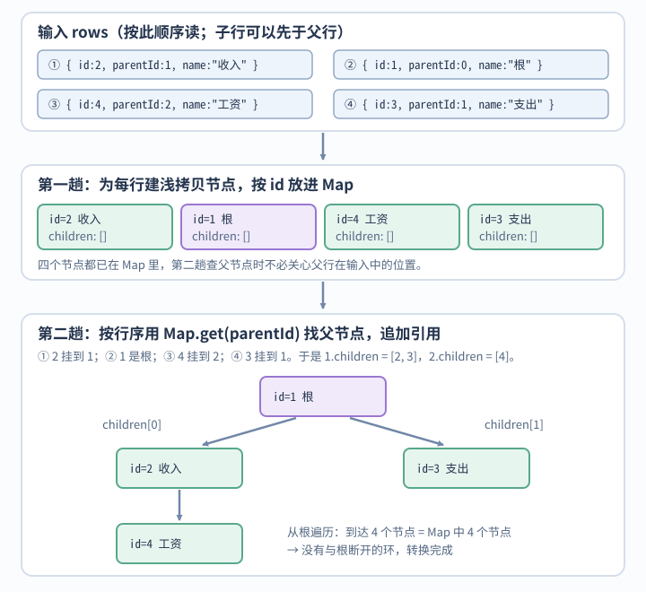

# 怎样遍历一棵树，又怎样把扁平记录安全地还原成树？

树的算法有两类常见问题：按什么顺序访问节点，以及拿到一张扁平的父子记录表时，怎样确认它真的构成一棵树（或一片森林）再还原出来。本章先讲深度优先的三种访问时机和用显式栈取二叉搜索树的第 k 小，再讲一般树的 DFS 与 BFS，最后讲扁平记录的两趟还原与森林不变量校验。读者手上已有[上一章](data-structures-by-access-pattern.md)的二叉搜索树定义与“成本按树高计”。遍历要用到队列和栈，本章只用两条结论：数组队列用递增的 head 下标出队，不用 `shift`；深度随输入增长时用显式栈代替递归。它们的实现和推导在主线的下一章[待处理的工作该用队列还是栈，各怎样实现？](queues-stacks-and-empty-states.md)。

本章用一棵四个节点的分类树作独立的小例子，因为主线一的事件页是一维有序数组，没有层级：根 `1`（根）下有 `2`（收入）和 `3`（支出），`2` 下有 `4`（工资）。复杂度按[首章的成本口径](invariants-and-cost-models.md#规范保证与实现模型)计，`Map`/`Set` 操作记为期望 O(1)。

## 深度优先的三种访问时机

depth-first search (DFS，深度优先搜索) 沿一个分支走到底再回头。对二叉树，按“什么时候处理当前节点”分三种：

| 顺序 | 访问次序 | 典型用途 |
|---|---|---|
| 前序 | 节点、左、右 | 先输出父再输出子；配合空子树标记可以序列化一棵树 |
| 中序 | 左、节点、右 | 对 binary search tree (BST，二叉搜索树) 按键的非降序输出 |
| 后序 | 左、右、节点 | 先处理完子树再处理父：汇总子树大小、先释放子节点 |

一般树没有“中间”位置，只有前序和后序。分类树的前序是 1、2、4、3，后序是 4、2、3、1。

中序非降序是 BST 次序的必要条件，但不能证明实现自己的重复键约定成立。例如约定“相等的键只放右侧”时，根 2、左子 2、右子 3 的中序是 2、2、3，确实非降序，却把相等的键放在了左侧。要校验这种约定，得在递归时传下每个子树允许的键范围（含开闭），而不是只看中序结果。

## 用显式栈取 BST 中第 k 小

BST 的中序就是从小到大，所以第 k 小就是中序第 k 个节点。用显式栈做中序：先把从当前节点出发的整条左链压栈，弹出栈顶即下一个最小值，再转到它的右子树重复。

```javascript
function kthSmallest(root, k) {
  if (!Number.isInteger(k) || k <= 0) return null;
  const stack = [];
  let node = root;
  while (node || stack.length) {
    while (node) {            // 压入整条左链
      stack.push(node);
      node = node.left;
    }
    node = stack.pop();       // 中序的下一个节点
    if (--k === 0) return node.val;
    node = node.right;
  }
  return null;                // 节点不足 k 个
}
```

前提：节点值是有限数字、比较规则一致，树满足 BST 次序。重复值按节点分别计数；若实现把同值合并成一个节点并记录次数，选第 k 项时要把次数算进去。

> [!example] 栈怎样找出中序第 3 项
> 这里换成一棵合成的数值树，便于看序号：根 3，左子 1（1 的右子为 2），右子 4；取 k = 3。
>
> | 步骤 | 动作 | 栈（底 → 顶） | k |
> |---|---|---|---|
> | 1 | 压入左链 3、1 | 3, 1 | 3 |
> | 2 | 弹出 1，转到右子 2 | 3 | 2 |
> | 3 | 压入 2 后弹出，右子为空 | 3 | 1 |
> | 4 | 弹出 3，k 归零，返回 3 | — | 0 |
>
> 中序是 1、2、3、4，第三项确实是 3；k = 5 时遍历完全部节点仍未归零，返回 `null`。

成本：至多弹出 k 个节点；结束时栈里最多还有 h 个祖先（h 为树高），所以 push 至多 k + h 次，总时间 O(h + k)，最坏 O(n)；栈空间 O(h)。平衡树 h = O(log n)，退化成链时 h = O(n)。

## 遍历一般树：递归、显式栈与 head 下标 BFS

DOM (Document Object Model，文档对象模型) 这类一般树每个节点有任意多个孩子。下面三个函数都接收一个 `childrenOf(node)`，它返回该节点孩子的**一份数组快照**：对分类树是 `n => [...n.children]`，对 DOM 是 `n => Array.from(n.childNodes)`。

```javascript
function dfs(root, visit, childrenOf) {
  if (!root) return;
  visit(root);
  for (const child of childrenOf(root)) dfs(child, visit, childrenOf);
}

function dfsIterative(root, visit, childrenOf) {
  if (!root) return;
  const stack = [root];
  while (stack.length) {
    const node = stack.pop();
    visit(node);
    const children = childrenOf(node);
    for (let i = children.length - 1; i >= 0; i--) stack.push(children[i]); // 逆序压栈，保持前序
  }
}

function bfs(root, visit, childrenOf) {
  if (!root) return;
  const queue = [root];
  for (let head = 0; head < queue.length; head++) { // head 下标出队，不用 shift
    const node = queue[head];
    visit(node);
    for (const child of childrenOf(node)) queue.push(child);
  }
}
```

对分类树，两种 DFS 都输出 1、2、4、3；breadth-first search (BFS，广度优先搜索) 一层一层访问，输出 1、2、3、4。显式栈版要把孩子从右到左压栈，才能按从左到右的顺序弹出，这条规则和“栈项存什么”见[显式栈怎样代替递归？](queues-stacks-and-empty-states.md#显式栈怎样代替递归？)。BFS 用递增的 `head` 下标读队首，而不是反复 `shift`：后者对普通数组要前移全部后续元素，整次遍历可达 Θ(n²)，推导见[队列与栈一章](queues-stacks-and-empty-states.md)。树中每个节点从根出发只有一条路径，BFS 在这里只决定访问次序；在一般图上按边数求最短路，还要决定何时标记已访问，见[搜索状态图时，何时永久标记节点，何时必须回退？](graph-search-and-backtracking.md)。

**快照在 `visit` 之后取。** 三个函数都先调用 `visit(node)`，再读取 `node` 的孩子。所以回调对当前节点孩子的增删会反映在随后的快照里；已经取过快照的节点，之后再改它的孩子就看不到了。DOM 的 `childNodes` 是 live `NodeList`，会随文档变化；`Array.from` 把调用时刻的结果放进新数组，迭代的就是这份快照，而不是一边改一边读的活集合。

**成本。** 树在遍历中不变、每次 `visit` 和每次取快照都与孩子数成正比时，访问 n 个节点总时间 O(n)。空间要分开看：

- 递归 DFS 的调用栈深度是 O(h)，但每个尚未返回的帧还持有一份孩子数组，合计最坏 O(n)，例如根有 n − 1 个孩子时。
- 显式栈 DFS 的栈、BFS 的队列最坏也是 O(n)：前者在宽节点处一次压入全部孩子，后者的数组保留全部已入队节点。
- 递归深度受运行时调用栈限制，不受堆内存限制。来自外部的树可能很深，这时用显式栈版。

回调会改树时，按实际访问的节点数和回调成本另算。

## 扁平 parentId 记录：两趟还原成树

后端返回的分类通常是扁平的行，每行用 `parentId` 指向父分类，根的 `parentId` 是约定的标记值 0。行的顺序没有保证，子行可能先于父行出现。

本例的输入契约：每行是普通数据记录；`id` 是互不重复的正安全整数（0 留作根标记）；恰好一行 `parentId = 0`；其余行的父 ID 都必须存在。

转换分两趟，因为读到子行时父行可能还没出现：

1. **建索引。** 为每行建一个浅拷贝节点，带空的 `children`，按 `id` 放进 `Map`；遇到重复 ID 就报错。
2. **接父子。** 再按行序读一遍：`parentId = 0` 的是根；其余用 `Map.get(parentId)` 找到父节点，把节点引用追加到父的 `children`。找不到父节点、出现第二个根都报错。



图中的输入故意打乱：`收入` 在根之前，`工资` 在 `支出` 之前。第二趟读到 ①时，根还没轮到，但它的节点已在 `Map` 里，所以 2 照样接到 1 下。

**顺序保留到哪一步。** 每个父节点的 `children` 按输入行序追加，所以同一父节点下的子项保持输入中的相对顺序：1 的孩子是 [2, 3]。不同父节点的行原先怎样交错，转换后不再记录。

**最后还要从根遍历一次。** 每行只有一个 `parentId` 字段，“单父”由表示本身保证；但父指针可能绕成环，例如 6 的父是 7、7 的父是 6。这两行各自的父都存在，前两趟查不出来。从根做一次 DFS 并比较到达的节点数即可：在单父、父都存在、根唯一的前提下，一个节点到不了根，当且仅当它在环上或挂在环下面。原因是沿父指针从任一节点往上走，要么到达根，要么永远走不出某个环；若环上某节点能从根到达，进入环的那一步会给它第二个父节点，与单父矛盾。

```javascript
function arrayToTree(rows) {
  if (!Array.isArray(rows)) throw new TypeError('rows must be an array');
  const nodes = new Map();
  for (const row of rows) {
    if (!row || !Number.isSafeInteger(row.id) || row.id <= 0) {
      throw new RangeError('id must be a positive safe integer');
    }
    if (nodes.has(row.id)) throw new RangeError(`duplicate id ${row.id}`);
    nodes.set(row.id, { ...row, id: row.id, parentId: row.parentId, children: [] });
  }

  let root = null;
  for (const row of rows) {
    const node = nodes.get(row.id);
    if (row.parentId === 0) {
      if (root) throw new RangeError(`second root ${row.id}`);
      root = node;
    } else {
      const parent = nodes.get(row.parentId);
      if (!parent) throw new RangeError(`parent ${row.parentId} of ${row.id} does not exist`);
      parent.children.push(node);
    }
  }
  if (!root) throw new RangeError('no root');

  const seen = new Set();
  const stack = [root];
  while (stack.length) {
    const node = stack.pop();
    seen.add(node.id);
    for (const child of node.children) stack.push(child);
  }
  for (const id of nodes.keys()) {
    if (!seen.has(id)) throw new RangeError(`node ${id} is on or under a cycle`);
  }
  return root;
}
```

对图中的四行，`arrayToTree` 返回以 1 为根的树，`seen` 与 `Map` 都是 4 项。追加 `{id:6,parentId:7}`、`{id:7,parentId:6}` 后，前两趟都通过，可达性检查报告 `node 6 is on or under a cycle`。

**复制了什么。** 代码显式写回 `id` 和 `parentId`，即使这两个属性在原行里不可枚举，建索引和接父子用到的字段也不会丢；其他业务字段（如 `name`）要是自有可枚举属性，否则需显式复制。对象展开 `{ ...row }` 按规范的 CopyDataProperties 先取出每行的全部自有键、逐个检查描述符，再只复制可枚举属性，不递归复制属性值。

**成本。** 设 Q 为所有行的自有键总数（含不可枚举的），P 为其中可枚举的总数。建索引、接父子和可达性检查各是 O(n) 次 `Map`/`Set` 操作；浅拷贝扫描 O(Q)，复制出的属性占 O(P)。总时间期望 O(n + Q)，输出空间 O(n + P)。字段值的复制成本随内容长度增长时，另计字节数。

**反向转换按前序输出。** 把树写回扁平行时，用显式栈按前序输出，先父后子：

```javascript
function treeToArray(root) {
  if (!root) return [];
  const rows = [];
  const stack = [{ node: root, parentId: 0 }];
  while (stack.length) {
    const { node, parentId } = stack.pop();
    rows.push({ id: node.id, parentId, name: node.name });
    for (let i = node.children.length - 1; i >= 0; i--) {
      stack.push({ node: node.children[i], parentId: node.id });
    }
  }
  return rows;
}
```

对分类树输出 1、2、4、3 四行，而原始输入的行序是 2、1、4、3：父子关系和同父兄弟的次序都恢复了，原始的跨父交错顺序恢复不了。示例只输出 `id`、`parentId`、`name`，其他字段要显式复制；协议的根标记若不是 0，换成协议规定的值。

## 森林不变量：子节点列表表示要多查什么

另一种常见表示把父子关系记在父节点上：`rootIds` 列出顶层节点及其顺序，`nodes` 按 ID 索引，每个节点的 `children` 只存孩子的 ID。页面编辑器的文档就是这样建模的，见[页面编辑器怎样建模文档、编辑会话和发布快照？](../practice/page-editor-data-model.md)。分类树写成这种形式是：

```javascript
const doc = {
  rootIds: ['1'],
  nodes: {
    '1': { id: '1', name: '根',   children: ['2', '3'] },
    '2': { id: '2', name: '收入', children: ['4'] },
    '3': { id: '3', name: '支出', children: [] },
    '4': { id: '4', name: '工资', children: [] },
  },
};
```

它的好处是重排兄弟只改一个数组，按 ID 能直接定位节点；代价是“单父”不再由表示保证：任何节点的 `children` 都可以列出任何 ID。一份合法的 forest (森林)，即若干棵互不相交的树，要同时满足：

1. **引用有效。** 节点的键与它的 `id` 一致；`rootIds` 和 `children` 里只有字符串 ID，且都指向 `nodes` 的自有键。
2. **根不重复，且不作别人的孩子。**
3. **每条父子边只出现一次，每个非根节点恰有一个父节点。**
4. **全部节点都能从某个根到达。**
5. **没有环。**

只查“ID 唯一、引用存在、无环”不够：`3` 也列出 `4` 时，图里没有环，但 `4` 有两个父节点，编辑或渲染时会被处理两次；多出一个谁也不引用的 `5`，它也不在环上，却是从根到不了的孤儿。

### 三步检查

- **父计数。** 对每条边给孩子的父计数加一（同一父节点重复列出的边只记一次，另报重复边），然后逐个节点判断：计数大于 1 是多父；根的计数大于 0 是“根也是孩子”；非根计数为 0 是“既不是根也不是孩子”。
- **三色 DFS 判环。** 所有节点起初为白色；进入一个节点时染灰，它的全部孩子处理完后染黑。灰色表示“在当前搜索路径上”，所以沿边遇到灰色节点，就是回到了路径上的祖先，构成环；遇到黑色节点只说明它已从别处探查过，比如共享的孩子，不是环。灰色是路径内的标记，黑色是全局标记，两种标记时机的一般规则见[搜索状态图时，何时永久标记节点，何时必须回退？](graph-search-and-backtracking.md#标记什么、何时标记：四类搜索对照)。
- **从根可达。** 从全部根出发遍历，最后没到达的节点逐个报告。

其实父计数和可达性已经足以拒绝每一个环：环若经过某个根，这个根就有了父节点；环若不经过根，从外面进入环的那一步会给某个环上节点第二个父节点，没有这一步则整个环从根到达不了。三色 DFS 的作用是诊断：它把错误报告成“环”，并指出环上的一个节点，而不是只留下“多父”或“不可达”让人自己推断原因。

每条错误都带上出错的节点 ID，调用方才能定位到具体节点，而不是只得到一个“文档无效”。

```javascript
const GRAY = 1, BLACK = 2;

function validateForest(doc) {
  const errors = [];
  const report = (code, nodeId) => errors.push({ code, nodeId });
  const nodes = doc?.nodes;
  if (!Array.isArray(doc?.rootIds) || !nodes || typeof nodes !== 'object' || Array.isArray(nodes)) {
    return [{ code: 'bad-shape', nodeId: null }];
  }
  const ids = Object.keys(nodes);
  const isNode = id => typeof id === 'string' && Object.hasOwn(nodes, id); // 挡住非字符串和 'constructor' 等原型键

  const roots = new Set();
  for (const id of doc.rootIds) {
    if (!isNode(id)) { report('unknown-root', String(id)); continue; }
    if (roots.has(id)) report('duplicate-root', id);
    roots.add(id);
  }

  const parentCount = new Map(ids.map(id => [id, 0]));
  const childrenOf = new Map();
  for (const id of ids) {
    const node = nodes[id];
    if (!node || node.id !== id || !Array.isArray(node.children)) {
      report('bad-node', id);
      childrenOf.set(id, []);
      continue;
    }
    const listed = new Set();
    for (const child of node.children) {
      if (!isNode(child)) { report('unknown-child', id); continue; }
      if (listed.has(child)) { report('duplicate-edge', id); continue; }
      listed.add(child);
      parentCount.set(child, parentCount.get(child) + 1);
    }
    childrenOf.set(id, [...listed]);
  }

  for (const id of ids) {                       // 父计数
    const count = parentCount.get(id);
    if (count > 1) report('multiple-parents', id);
    if (roots.has(id) && count > 0) report('root-is-child', id);
    if (!roots.has(id) && count === 0) report('neither-root-nor-child', id);
  }

  const color = new Map();                      // 三色 DFS，显式栈：栈帧记住下一个要看的孩子
  for (const start of ids) {
    if (color.has(start)) continue;
    color.set(start, GRAY);
    const stack = [{ id: start, next: 0 }];
    while (stack.length) {
      const frame = stack[stack.length - 1];
      const kids = childrenOf.get(frame.id);
      if (frame.next < kids.length) {
        const child = kids[frame.next++];
        if (color.get(child) === GRAY) report('cycle', child);
        else if (!color.has(child)) { color.set(child, GRAY); stack.push({ id: child, next: 0 }); }
      } else {
        color.set(frame.id, BLACK);
        stack.pop();
      }
    }
  }

  const reached = new Set(roots);               // 从根可达
  const pending = [...roots];
  while (pending.length) {
    for (const child of childrenOf.get(pending.pop())) {
      if (!reached.has(child)) { reached.add(child); pending.push(child); }
    }
  }
  for (const id of ids) if (!reached.has(id)) report('unreachable', id);
  return errors;
}
```

两处 DFS 都用显式栈，因为待校验的文档来自外部，嵌套深度不受控；三色 DFS 的栈帧除了节点，还要记住“下一个该看第几个孩子”，节点只有在全部孩子处理完、出栈时才染黑。节点数为 n、边数为 e 时，每个节点和每条边都只处理常数次，总时间期望 O(n + e)，额外空间 O(n + e)。

> [!example] 对分类树逐一改坏，各得到什么错误
> 每行都从上面合法的 `doc` 出发，只做一处改动（本页用 Node.js v26.13.1 运行上面的代码得到）：
>
> | 改动 | 返回的错误 |
> |---|---|
> | 不改 | `[]` |
> | `3.children` 加 `'4'`（共享孩子） | `multiple-parents 4` |
> | 新增 `5`，无人引用（孤儿） | `neither-root-nor-child 5`、`unreachable 5` |
> | `4.children` 加 `'2'`（回边） | `multiple-parents 2`、`cycle 2` |
> | `4.children` 加 `'1'`（环经过根） | `root-is-child 1`、`cycle 1` |
> | 新增 `6 → 7 → 6`（与根断开的环） | `cycle 6`、`unreachable 6`、`unreachable 7` |
> | `rootIds` 再加 `'1'` | `duplicate-root 1` |
> | `1.children` 再加 `'3'` | `duplicate-edge 1` |
> | `1.children` 加 `'9'`、`'constructor'` 或对象 | `unknown-child 1` |
>
> 每个带环的改动都同时触发了多父、根也是孩子或不可达中的一种，印证了上面“三色 DFS 用于诊断”的论证。

两种表示的分工可以对照着看：

| 不变量 | parentId 行 | 子节点列表 |
|---|---|---|
| 单父 | 表示保证（每行一个字段） | 要父计数 |
| 根不作孩子 | 表示保证（根的字段就是 0） | 要父计数 |
| 重复边 | 不可能出现 | 要查 |
| 引用存在 | 查父 ID | 查每个孩子 ID 与每个根 ID |
| 无环、全部可达 | 一次根遍历同时查出 | 父计数 + 根遍历拒绝，三色 DFS 诊断 |
| 兄弟顺序 | 只能取输入行序，或另存排序字段 | 由 `children` 数组显式记录 |

这些都是跨节点的整图约束，JSON Schema 这类逐节点的结构描述表达不了，需要应用代码检查；页面编辑器在每次提交命令和发布前调用的正是这组检查。

> [!info] 实例：React Fiber 为什么把树节点链接起来（2026-11-11 核对）
> React 内部的工作树不用 `children` 数组，而是每个 Fiber 节点用 `child` 指向第一个孩子、`sibling` 指向下一个兄弟、`return` 指向父节点。结构上仍是一棵树，只是同级孩子串成了链表。这样 reconciler (协调器) 处理完一个节点后，只要记住“下一个工作单元”是谁，就能暂停后再从这里继续，不必像递归 DFS 那样把进度留在调用栈里。
>
> 能暂停的只有 render 阶段，而且自 React 18 起只在使用 transition 等并发特性时才会让位给更紧急的更新；DOM 变更在 render 完成后的 commit 阶段一次性应用。Fiber 的字段布局是 React 的内部实现，应用代码应依赖公共 API。一次更新怎样走过 render 与 commit，见[React 怎样把一次用户操作变成界面更新？](../../frontend/ui-state/react-update-model.md)。

## 本章产出与回到主线

现在可以为树选遍历方式并估算成本：前序、中序、后序由“何时处理当前节点”决定，BST 中第 k 小用显式栈 O(h + k)；一般树的 DFS 逆序压栈、BFS 用 head 下标，空间最坏 O(n)，深树改用显式栈。拿到扁平记录时，先确定表示替你保证了哪些不变量，再把其余的查掉：parentId 行要查 ID 唯一、父存在、根唯一和从根可达；子节点列表还要查父计数和重复边，并用三色 DFS 把环报告出来。每条错误都定位到节点。

回到主线：树的遍历用到了队列和栈，下一个问题是它们本身怎样实现才不在出队时搬移元素、不把“空”和存入的 `null` 混淆，见[待处理的工作该用队列还是栈，各怎样实现？](queues-stacks-and-empty-states.md)。

> [!info]- 来源
> - DOM 子节点快照（“遍历一般树”）：[WHATWG DOM Standard, Interface NodeList](https://dom.spec.whatwg.org/#old-style-collections-nodelist)，`childNodes` 返回 live `NodeList`；[ECMAScript 2026, §23.1.2.1 `Array.from`](https://tc39.es/ecma262/2026/multipage/indexed-collections.html#sec-array.from) 把调用时的迭代结果放进新数组。
> - 对象展开的复制范围（“扁平 parentId 记录”）：[ECMAScript 2026, §7.3.25 CopyDataProperties](https://tc39.es/ecma262/2026/multipage/abstract-operations.html#sec-copydataproperties)，先取全部自有键并检查描述符，只复制可枚举属性，不递归复制值。
> - `Map`/`Set` 只要求平均次线性访问（各节成本）：[ECMAScript 2026, §24.1、§24.2](https://tc39.es/ecma262/2026/multipage/keyed-collections.html)；本章按首章的期望 O(1) 模型计。
> - 防原型键（“三步检查”）：[ECMAScript 2026, `Object.hasOwn`](https://tc39.es/ecma262/2026/multipage/fundamental-objects.html#sec-object.hasown) 只判断自有属性。
> - JSON Schema 的关键字作用于单个实例的结构（“两种表示的分工”）：[JSON Schema Draft 2020-12 Validation, §6](https://json-schema.org/draft/2020-12/json-schema-validation)，2026-11-12 核对。
> - React 阶段与并发（“实例：React Fiber”）：[Render and Commit](https://react.dev/learn/render-and-commit)；[React v18.0](https://react.dev/blog/2022/03/29/react-v18)，2022-03-29，并发渲染只在使用并发特性时启用；Fiber 字段见 [ReactInternalTypes.js](https://github.com/facebook/react/blob/main/packages/react-reconciler/src/ReactInternalTypes.js)，2026-11-11 核对。
> - kth 栈表、分类树的三种遍历次序、四行还原与反向输出、断开环的报错、森林改坏表：本页代码在 Node.js v26.13.1 上运行复算。
