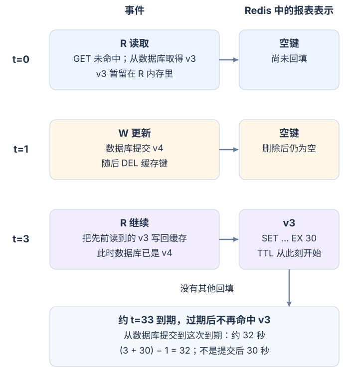

# 加了缓存之后，读到的数据最多会旧多久？

上一章把数据库读取做对了；常被重复读取的展示数据还会放进 Redis 这类缓存，以减少数据库查询。缓存命中的值可能落后于数据库，所以这一章要回答：缓存键要包含什么，写入后怎样让缓存失效，为什么设了 TTL 仍可能旧得更久，在什么条件下才能写出“最多旧多久”的上界，以及热门键过期、Redis 故障时怎样不把数据库压垮。

## cache-aside：应用怎样读写缓存

cache-aside (旁路缓存) 由应用自己协调缓存和数据库：

- **读：** 先 `GET` 缓存；命中就用缓存值。未命中就读数据库，再用 `SET key value EX 秒数` 回填，给条目一个 TTL (time to live，存活时间)。
- **写：** 在数据库事务里更新并提交，然后 `DEL` 受影响的缓存键，让下一次读取回源。

数据库始终是权威来源，缓存只是一份可能落后的副本。这决定了哪些读取能走缓存：允许短暂陈旧的展示读取可以；后台任务的状态和结果引用、授权决定、余额这类必须反映当前事实的读取，直接读权威库。

错误也不能混进“未命中”或“不存在”：数据库报错、缓存报错都不能伪装成 `not-found` 返回；缓存回填失败时，已经从数据库读到的结果照常返回，只记录这次回填失败。

## 案例：报表 42 的语言变体

报表 42 属于账户 `acct-17`，展示内容按语言生成，同一种语言的表示可以由多个获准的主体共享。中文表示的缓存键是：

~~~text
report:v1:acct-17:42:zh-CN
~~~

`v1` 是缓存表示格式的版本，之后依次是账户、报表和语言。数据库里报表的版本号会从 v3 更新到 v4。下文的 TTL 取 30 秒；它和各时刻都是教学设定，不是线上推荐值或测量结果。

## 缓存键要覆盖哪些维度？

**规则：缓存键必须覆盖所有会改变这份表示的输入。** 本例的表示随账户、报表、语言和格式版本变化，所以四者都进键。漏掉任一维度，一份表示就会被交给不该拿到它的请求，例如把 `en-US` 的内容返回给要 `zh-CN` 的读者，或把 `acct-17` 的内容返回给别的账户。

缓存键不是授权凭据。每次请求都先验证当前主体能否读取 `acct-17` 的报表 42，再查缓存；命中只省掉数据库读取，不省掉授权检查。为什么每次都要重新授权，见[服务怎样逐次确认这个主体能对这份资源做这个动作？](../services/per-request-authorization.md)。

共享表示与按主体过滤的表示要区别对待：

- **缓存共享表示（本例）：** 缓存值不含主体专属字段。若有字段要按当前权限隐藏，命中路径与回源路径在返回前应用**同一个**权限投影。
- **缓存已按主体过滤的最终响应：** 键还必须包含主体和权限版本；权限变化时，旧表示要随之失效。

## 能不能缓存“不存在”？

可以，但有前提。只有数据库**明确确认**报表不存在时，才短时缓存一个 `not-found`，这叫 negative caching (负缓存)。查询出错、超时都不是“不存在”。

创建报表时，要删除它所有语言的负缓存键。即使这样，创建之前就已开始的一次未命中读取，仍可能在创建之后才把“不存在”回填进缓存。这和后文“TTL 为什么不是一致性保证”一节的旧值回填是同一种竞态，同样受后文的 D + T 条件约束。

## 写入后先提交还是先删缓存？

**规则：先提交数据库事务，再删除该资源的所有表示键。**

先删后提交会制造确定的旧值：键被删后、事务提交前，并发读者未命中，从数据库读到的仍是 v3（v4 尚未提交，对它不可见），于是把 v3 回填进缓存；事务随后提交 v4，缓存里却留着 v3，直到 TTL 到期。

先提交再删避免了这个顺序，但还要做到两点：

- **删全所有变体。** 删除该账户、该报表的所有语言表示和负缓存键，而不只是当前请求的 `zh-CN`。语言集合有界时可以逐一生成键；存在按主体过滤的表示时，还要覆盖它们。
- **补上两系统之间的缺口。** 数据库提交和 Redis `DEL` 属于两个系统，没有一个事务能让它们原子地一起成功。提交后进程崩溃或 `DEL` 失败，旧条目会一直留到被删除、被淘汰或到期。解决办法是 transactional outbox (事务发件箱，之后简称 outbox)：把“报表 42 已变更”的失效意图和业务更新写在同一个数据库事务里，再由 relay (中继) 反复尝试删除，直到成功。这样失效一定会发生，但 relay 成功之前旧值仍可命中。outbox 的完整机制见[耗时任务怎样被持久受理，并保证一定会被唤醒？](../services/durable-job-acceptance-and-outbox.md)。

先提交再删仍挡不住一种情况：删除之前就已读到旧值、删除之后才回填的读取。下一节专门看它。

## TTL 为什么不是一致性保证？

`SET ... EX 30` 每次都会给键设置一个新的 30 秒期限，计时从这次 `SET` 开始，而不是从数据库提交开始。所以 TTL 限制的是“这一条缓存条目从写入起保留多久”，不能单独证明缓存值距数据库最新提交不超过 30 秒。

一条具体的时序（相对秒数）：

1. `t=0`：读者 R 缓存未命中，从数据库读到 v3，还没来得及回填。
2. `t=1`：写者 W 提交 v4，随后 `DEL` 缓存键。键此时为空，但 R 内存里的 v3 收不回来。
3. `t=3`：R 把 v3 写进空键，`EX 30` 从此刻开始计时。
4. 若没有其他写入，键约在 `t=33` 到期。从 `t=1` 提交 v4 算起，旧值 v3 可被命中将近 `(3 + 30) − 1 = 32` 秒。

把 TTL 改短，只是缩短第 4 步的长度，不改变第 2、3 步的顺序。

## 陈旧上界 D + T 在什么条件下成立？

要把上面这一条时序推广成“任意时序下最多旧多久”，需要两个上限。

**D：提交之后，旧表示仍可能被成功写入缓存的最长时间。** D 必须覆盖所有可能读到旧值并回填的路径：

- 读到旧值的来源，例如提交前开始的事务快照、尚未同步的只读副本；
- 应用里的排队、重试，以及 Redis 接受写入前的延迟；
- 截止时间之后才到达的旧写入：只给请求设截止时间不够，迟到的回填必须被丢弃或被拒绝。

**T：所有可能含旧值的键的期限上限。** 需要同时满足：

- 每次成功写入都设置不超过 T 的 TTL；
- 提交时已经存在的旧条目，剩余 TTL 也不超过 T；
- 命中不续期，不用滑动过期，也不用保留旧期限的写法把某个条目的期限延长到超过 T。

满足这两个条件时：提交后的任何旧回填不晚于提交后 D 发生，再存活至多 T；提交时已有的旧条目至多再存活 T。所以**最后一次旧值命中不晚于提交后 D + T**。这个上界是在同一个正常推进的时钟下、按过期检查的粒度说的，不是计入时钟误差的墙钟承诺。

本例只看 `zh-CN` 一个表示：D = 3 − 1 = 2 秒，T = 30 秒，D + T = 32 秒，与上一节的时序一致。多种语言时，D 与 T 要覆盖所有变体及其回填路径。

反过来，**若无法证明 D 有上限，TTL 不提供任何全程的陈旧上界。** 例如回填可能被无限重试，或者回填来源是延迟没有上限的副本。

## 版本号和 read-your-writes 能保证什么？

给缓存值带上版本号，并拒绝用低版本覆盖高版本，能防止缓存被一次迟到的旧写入**降级**，但不能证明缓存值就是数据库当前版本：

- v4 已提交、失效尚未执行时，缓存里仍是 v3，读者直接命中 v3，版本比较根本没有发生；
- `DEL` 之后键为空，没有 v4 可供比较，迟到的 v3 回填照样成功；
- 版本标记若也放在可淘汰的缓存里，它可能和值一起被淘汰。

read-your-writes (读己之写) 只保证一个请求方看得到**自己**刚提交的写入：请求带上自己刚提交的版本号 v4，读取时绕过缓存，或只接受不低于 v4 的缓存值。它不保证读到别人更新的写入。

要让每个请求都读到当前版本，只有两条路：走一条能看到该提交的权威读取；或在读取时取得一个与数据库提交一致的持久版本门槛，只接受不低于门槛的缓存值。这个门槛必须覆盖空键、淘汰和所有表示变体；门槛若是异步更新的，从提交到门槛更新之间仍有旧值窗口。单靠 Redis 的 TTL 与版本比较做不到这一点。前端查询缓存在保存成功后仍可能读到旧数据，是同一问题的应用，见[服务端数据怎样缓存、刷新和乐观更新，迟到的响应又归谁？](../../frontend/ui-state/server-state-and-optimistic-updates.md)。

## 怎样测量缓存实际有多旧？

缓存条目的写入时刻（fill time）只能量出条目已驻留多久，不是数据年龄：上面的 v3 在 `t=3` 才写入，但它从 `t=1` 起就已过时。Redis 的 `TTL` 命令报告的是剩余寿命，同样不是数据年龄。

要量陈旧度，就抽样比较缓存表示里的版本或 `updated_at` 与权威库的当前值，记录出现差异的时刻和差异持续的时间。只记录 fill time 时，不要把它标成“数据年龄”或“陈旧窗口”。同时监控每个表示变体的失效结果：`DEL` 失败的键会留到被删除、淘汰或到期。

## 热门键过期时，怎样避免回源放大？

一个热门键过期的瞬间，100 个并发请求可能同时未命中、各自查一次数据库，一次正常读取被放大成 100 次。

- **TTL 加随机抖动**能把许多不同键的到期时间错开，但拆不散同一个热门键在同一刻到期的请求。
- **single-flight (单飞请求合并)**：同一进程内的同键请求只让一个调用者回源，其他调用者等它的结果。它不协调其他进程。
- **跨进程的租约锁**：尽力让所有进程只有一个回源者。步骤如下：
  1. `GET` 未命中后，用 `SET lock-key unique-token NX PX lease-ms` 领锁。`NX` 表示只在锁键不存在时写入，`PX` 以毫秒设期限；`unique-token` 每次领取都重新生成。
  2. 领到锁后**再 `GET` 一次缓存**：前一位持有者可能刚回填完并释放了锁。复查命中就直接用（照样按当前权限生成响应），释放自己的锁，不再查库。只有复查仍未命中才回源并回填。
  3. 没领到锁的调用者在请求截止时间内重查缓存；拿不到值就按回源预算等待、失败或回退。
  4. 释放锁必须**原子地**比较 token 并只删除自己的锁。不能先 `GET` 比对、再单独 `DEL`：两步之间租约可能到期、被别人领走，旧持有者会删掉新锁。

这把锁只减少重复工作，不保证正确性：一次加载若超过租约期限，第二个加载者就会开始。需要保证“同一时刻只有一个执行者生效”时，要靠在提交处检查单调递增代次的 fencing (栅栏)，见[怎样保证一个任务同一时刻只由一个 worker 推进？](../services/job-claims-leases-and-fencing.md)。

## 内存满或 Redis 不可达时怎么办？

**淘汰只是未命中。** Redis 达到内存上限后，按所选 eviction (淘汰) 策略在 TTL 到期前移除键，读者照常未命中、回源。淘汰策略背后的数据结构见[怎样同时按键查找并维护最近使用顺序？](../computation/lru-cache.md)。若配置为 `noeviction`，新写入可能直接报错；这时已从数据库读到的结果照常返回，只记录回填失败。

**不可达不是未命中。** Redis 连接失败时，`GET` 报的是错误。可以回源，但要有上限：在请求截止时间、回源并发上限和数据库连接预算之内；超出就返回暂时不可用。所有进程同时回源会迅速吃满连接池，回源流量要按[ORM 会话怎样借用连接，连接池为什么会耗尽？](orm-sessions-and-connection-pools.md)里的连接预算核算。只有确实另存了本地快照、端点允许返回陈旧数据、并且能核对快照年龄时，才考虑在 Redis 故障期间返回快照。

要分辨“缓存缺失”和“数据库变慢”，分开观测命中、未命中、Redis 命令失败、淘汰次数、回源量和连接池等待时间。

> [!info] 实例：本章用到的 Redis 命令（Redis 8.4，核对于 2026-11-12）
> - `SET key value EX 秒数` / `PX 毫秒数` 设期限；成功的 `SET` 默认丢弃旧 TTL。Redis 6.0 起的 `KEEPTTL` 选项保留旧期限——这正是 T 的条件要防的“保留超过 T 的旧期限”。
> - `NX` 只在键不存在时写入；`TTL` 返回剩余寿命。
> - 比较 token 后删除：Redis 8.4 新增 `DELEX lock-key IFEQ unique-token`；更早的版本用 Lua 脚本在服务端原子完成比较与删除。
> - Redis 8.4 源码在 `now > when` 时才判定键过期，所以恰好在到期毫秒仍可能读到值；上文因此写“约 `t=33` 到期”。

## 缓存挡不住写入与数据总量

本章给出缓存的四条规则：键覆盖表示的全部影响因素，且命中不替代授权；先提交再删全所有变体，用 outbox 让失效可重试；陈旧上界是 D + T，并且只有 D 有界时才成立；版本比较只防降级，read-your-writes 只保证自己的写。缓存挡掉了重复读取，但写入和数据总量仍落在一个数据库上。下一章[单库接近上限时，怎样选分片键并区分总容量不足与热点？](sharding-and-hot-keys.md)回答单库到顶时怎样切分。

> [!info]- 来源
> - cache-aside 的未命中回源、回填、写后失效、TTL 与热门键并发回源：[Redis, Cache-aside](https://redis.io/docs/latest/develop/use-cases/cache-aside/)，`Why the problem is hard`、`How Redis supports the solution`，核对于 2026-11-12。在途旧值回填竞态与 D + T 推导是本章按明确事件顺序推出的应用条件，不是 Redis 的承诺。
> - `SET` 的 `EX`、`PX`、`NX`、`KEEPTTL`（6.0 起）与默认丢弃旧 TTL：[Redis, SET](https://redis.io/docs/latest/commands/set/)；删除与剩余寿命：[DEL](https://redis.io/docs/latest/commands/del/)、[TTL](https://redis.io/docs/latest/commands/ttl/)。核对于 2026-11-12。
> - 内存上限、淘汰策略、`noeviction` 下拒绝写入、用 `INFO` 查看淘汰与拒绝计数：[Redis, Key eviction](https://redis.io/docs/latest/develop/reference/eviction/)，`Using maxmemory`、`Eviction policies`、`Using the INFO command`，核对于 2026-11-12。
> - 单实例 `SET ... NX PX` 锁、唯一 token、比较 token 后释放、Redis 8.4 的 `DELEX ... IFEQ` 与更早版本的 Lua 做法：[Redis, Distributed Locks](https://redis.io/docs/latest/develop/clients/patterns/distributed-locks/)，`Correct Implementation with a Single Instance`，核对于 2026-11-12。“领锁后复查缓存”是本章增加的应用步骤，不是锁命令语义。
> - 过期判定 `now > when`：[Redis 8.4.0 `keyIsExpired`](https://github.com/redis/redis/blob/8.4.0/src/db.c#L2475-L2483)。
> - D 要覆盖的旧值来源：旧事务快照在 Repeatable Read 下继续看见事务开始前的版本，[PostgreSQL 18, Transaction Isolation](https://www.postgresql.org/docs/18/transaction-iso.html)，§13.2；副本未同步时回源可能填入旧值，[Microsoft, Caching guidance](https://learn.microsoft.com/en-us/azure/architecture/best-practices/caching#caching-and-eventual-consistency)，`Caching and eventual consistency`。核对于 2026-11-12。
> - 在途旧回填覆盖新值、版本记录随键淘汰而丢失：[Meta, Cache made consistent](https://engineering.fb.com/2022/06/08/core-infra/cache-made-consistent/)，开头的失效竞态与 version field 反例，2022-06-08。它支持“版本比较不等于最新读取”，不提供本例的强一致协议。
> - 缓存失效与数据库更新的双写缺口、outbox 把两者写进同一事务并处理重复：[AWS, Transactional outbox pattern](https://docs.aws.amazon.com/prescriptive-guidance/latest/cloud-design-patterns/transactional-outbox.html)，`Intent`、`Motivation`、`Issues and considerations`，核对于 2026-11-12。
> - 缓存键、TTL 30 秒、v3/v4 与时间线数值为本章合成设定，32 秒为手算，未连接 Redis 实测。
