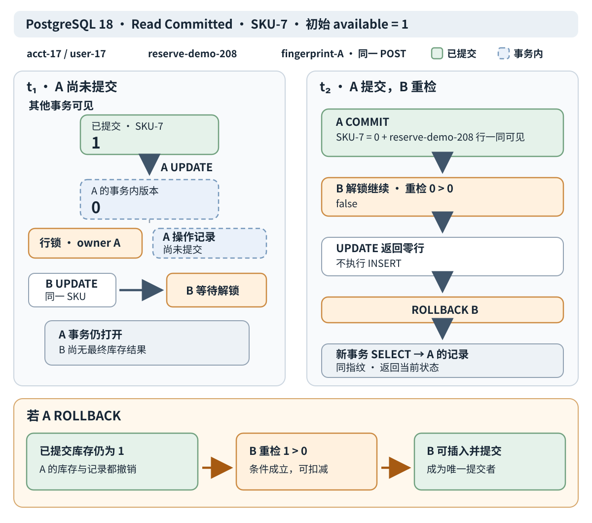
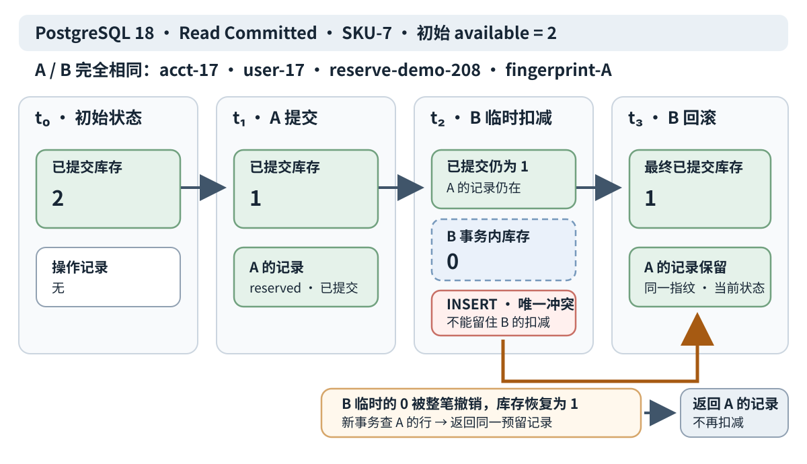
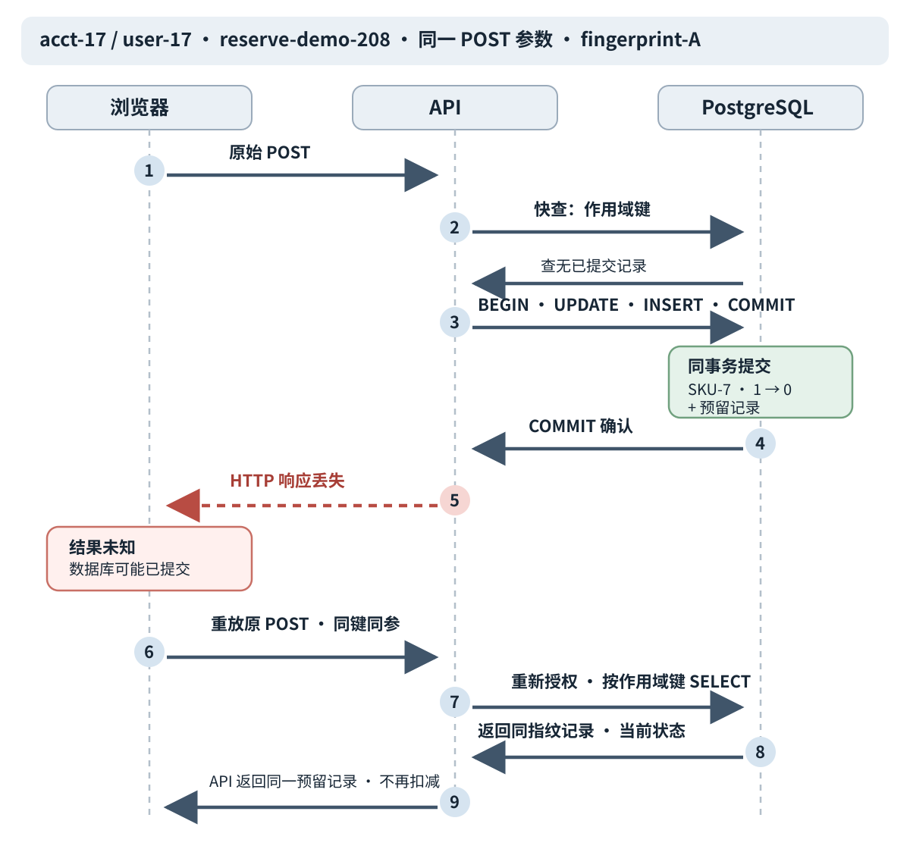

# 两个请求争夺最后一件库存时，怎样保证只预留一次？

进程内的锁只管得到一个进程；多个服务副本共同读写的数据，要交给数据库裁决，这是[主线二结尾](../runtime/graceful-shutdown.md)留下的问题。两个请求同时想拿走最后一件库存，其中一个还可能是另一个的重试。本章回答两件事：怎样让数据库替我们裁决“谁拿到”，以及怎样让同一操作的重试取回原结果，而不是再扣一次。读者需要知道 `SELECT`、`UPDATE`、`INSERT` 和事务的基本写法；隔离级别的完整规则在[事务与隔离一章](transactions-and-isolation.md)，这里只用到其中一条。

## 案例：最后一件 SKU-7

本主线用一个合成的库存案例贯穿，数据与标识都是教学选择：

| 标识 | 含义 |
|---|---|
| `acct-17`、`user-17` | 发起预留的账户与 principal (主体，即已认证的调用者) |
| `SKU-7`，`available = 1` | 要预留的商品，只剩一件；后文有一个变体把初值改成 2 |
| `reserve-demo-208` | 客户端为这次预留生成的 idempotency key (幂等键)，重试时保持不变 |
| 请求 A、B | A 是首次尝试；B 可能是同一请求的并发重放，也可能是别的操作 |

数据库要同时守住两条规则：

1. 不同的操作不能把库存扣成负数。
2. 同一账户、同一主体、同一幂等键（合起来称作用域键）最多提交一条预留记录。

本主线的 SQL 和并发时序都以 **PostgreSQL 18、Read Committed (读已提交)** 为准；换数据库时哪些结论会变，见文末的方言说明和 [InnoDB 支线](mysql-innodb-locks-and-logs.md)。

## 先读后写为什么会超卖？

设想两个不同的操作各自先执行 `SELECT available`，都读到 1，再各自把库存写成 0 并插入自己的预留记录。最终库存是 0，看上去没错，却有两个调用方都收到了“预留成功”。

问题在于读取只观察了当时的值。“库存仍大于零”这个条件没有附着到之后的写入上，第二个写入者写的时候，条件早已不成立。修法是把条件放进写语句本身：`UPDATE ... WHERE available > 0`。数据库在执行这条写入时检查条件，检查与修改不可分割。

## 两张表各守住什么？

~~~sql
CREATE TABLE inventory (
    sku TEXT PRIMARY KEY,
    available INTEGER NOT NULL CHECK (available >= 0)
);

CREATE TABLE reservations (
    account_id TEXT NOT NULL,
    principal_id TEXT NOT NULL,
    idempotency_key TEXT NOT NULL,
    request_fingerprint TEXT NOT NULL,
    sku TEXT NOT NULL REFERENCES inventory(sku),
    status TEXT NOT NULL CHECK (status IN ('reserved', 'cancelled')),
    PRIMARY KEY (account_id, principal_id, idempotency_key)
);

INSERT INTO inventory VALUES ('SKU-7', 1);
~~~

- `inventory.sku` 是主键，每个 SKU 只有一行，所以下文的条件 `UPDATE` 最多命中一行。
- `available` 同时声明 `NOT NULL` 和 `CHECK (available >= 0)`。只写 `CHECK` 不够：表达式结果为 NULL 时 CHECK 也算通过，未知库存会被放进来。
- `reservations` 的复合主键就是作用域键，同一作用域键最多一行。
- 外键让预留只能指向存在的 SKU。

这些约束对所有写入方生效，不依赖每段应用代码都记得检查。每类约束的盲区、检查时机和它们自动建立的索引，见[约束守住哪些规则，索引又怎样服务读取？](constraints-and-indexes.md)。

## 同一操作怎样被认出来？

幂等键让服务把“同一操作的重试”与“一次新的操作”区分开。本章给出的幂等记录契约是全领域的权威定义，主线四的导出任务和 webhook 收件箱都沿用它：

1. **作用域键是 `(账户, 主体, 幂等键)`。** 键只在这个范围内唯一。别的主体即使猜到同一个键字符串，也落在另一个作用域里，读不到这里的结果。
2. **请求指纹识别意图。** request fingerprint (请求指纹) 是规范化后业务参数（这里是 SKU 与数量等）的稳定摘要。同一个键配上不同参数，说明调用方复用了键却换了意图。
3. **只有成功提交才占用键。** 预留记录与库存扣减一起提交；库存不足时整笔回滚，不留下记录，也就不占键。
4. **同键同指纹返回该记录的当前状态。** 记录之后被取消，重放就返回 `cancelled`，不会重新扣库存，也不会把它“复活”。取消不释放这个作用域键。
5. **同键异指纹返回冲突。** 不能把旧结果解释成新意图。
6. **不逐字节重放首个响应。** 服务承诺恢复的是同一条业务记录和它的效果；状态码、时间戳或响应字节可以与第一次不同。

第 3 条是一个取舍。它让契约最小：失败不留痕，补货后同一个 POST 可以成功。代价是失败没有一条可供永久重放的“失败结果”，后文[同一个键换了 SKU，为什么没有冲突？](#同一个键换了%20SKU，为什么没有冲突？)会看到它留下的边界。

记录还必须在服务承诺的重放窗口内保留，窗口过后旧键怎样处理（墓碑），属于请求协议的一部分，见[写请求超时后，怎样查清结果并安全重试？](../services/deadlines-retries-and-unknown-outcomes.md)。HTTP 方法本身的幂等语义是另一回事：`POST` 不是幂等方法，给它加幂等键是应用层的去重约定，二者不能互相代替，见[一次 HTTP 请求怎样从浏览器到达服务，又带回什么？](../services/http-semantics-and-transport.md)。

> [!info] 应用实例
> AI 运行受理时把调用者、资源范围、键与请求摘要绑定成唯一的 `runId`，用的就是这套契约，见[请求受理后，怎样保证任务最终被执行且不被两个 worker 同时推进？](../../ai-engineering/runs/accepting-queuing-and-claiming-runs.md)。

## 一次预留怎样执行？

API 先按当前认证结果确认 `user-17` 有权为 `acct-17` 预留，再规范化参数、计算指纹，然后可以先查一次已有记录：

~~~sql
SELECT request_fingerprint, sku, status
FROM reservations
WHERE account_id = $1 AND principal_id = $2 AND idempotency_key = $3;
-- $1 = acct-17，$2 = user-17，$3 = reserve-demo-208
~~~

`$1`、`$2` 是 PostgreSQL 的位置参数，由驱动**按每条语句分别绑定**，编号不跨语句共享；下文每条 SQL 的注释只写它自己的绑定。

这次预查只是快路径。命中同指纹记录就直接返回当前状态，命中异指纹记录就返回冲突。没命中只说明这条语句的快照里没有**已提交且可见**的记录：原事务可能还在执行，还没提交。所以预查不能代替后面的裁决。

预查未命中时，服务在一个事务里条件扣减并写入记录：

~~~sql
BEGIN ISOLATION LEVEL READ COMMITTED;

UPDATE inventory
SET available = available - 1
WHERE sku = $1 AND available > 0
RETURNING available;
-- $1 = SKU-7。恰好返回一行才继续；返回零行则 ROLLBACK，不执行 INSERT。

INSERT INTO reservations
    (account_id, principal_id, idempotency_key, request_fingerprint, sku, status)
VALUES ($1, $2, $3, $4, $5, 'reserved');
-- $1 = acct-17，$2 = user-17，$3 = reserve-demo-208，$4 = fingerprint-A，$5 = SKU-7

COMMIT;
~~~

`RETURNING` 只返回实际被更新的行，值是更新后的新值。库存从 1 扣到 0 时，它返回**一行，值为 0**；“返回零行”才表示没有可扣的库存。

## 条件 UPDATE 怎样让并发请求排队？

条件 `UPDATE` 的返回行数就是业务判断，这是本领域条件写的 SQL 层权威规则：

| 返回行数 | 含义 | 下一步 |
|---|---|---|
| 恰好 1 行 | 条件成立，扣减已在本事务内生效 | 继续写预留记录 |
| 0 行 | SKU 不存在，或库存已为 0 | 整笔回滚，新事务回查（下一节） |
| 多于 1 行 | 实际 schema 没有维持“每个 SKU 一行” | 当作缺陷处理，不能当成功 |

两个请求并发时，排队靠的是行锁。下图是 A 先拿到 `SKU-7` 行锁的情形：

*A 未提交的 0 和预留记录对别人不可见；B 在行锁上等待，A 结束后按结果重检条件。*

1. A 的 `UPDATE` 把库存改成 0，并持有这一行的锁。这个 0 只在 A 的事务内可见，A 插入的预留记录也一样。
2. B 的 `UPDATE` 找到同一行，发现它正被 A 修改，于是等待。
3. A 提交，库存 0 与 `reserve-demo-208` 记录同时对外可见。
4. B 醒来后，PostgreSQL 在 Read Committed 下对**最新提交的行版本**重新求值 `WHERE available > 0`。条件为假，B 的 `UPDATE` 返回零行，B 不执行 `INSERT`。

如果 A 不是提交而是回滚，它的扣减和记录一起撤销。B 重检的是原值 1，条件成立，B 扣减、写记录并成为唯一的提交者。所以行锁释放本身不说明前一个请求成功了，结果取决于它最终提交还是回滚。

Read Committed 的这一行为（等锁后在新版本上重检条件）让一条条件 `UPDATE` 就能表达“库存不低于零”。在 Repeatable Read 下，同样的时序里 B 会以序列化失败中止，处理方式不同，见[一笔事务失败后，该回滚、重试还是回查？](transactions-and-isolation.md#一笔事务失败后，该回滚、重试还是回查？)。

## 零行或唯一冲突之后怎样下结论？

预留事务有两条失败路径：条件 `UPDATE` 返回零行；或 `INSERT` 撞上复合主键。两条路径的处理相同，这是本领域唯一裁决的权威规则：

1. **整笔回滚。** 不能留下已执行的库存扣减。PostgreSQL 中，唯一约束报错还会使当前事务进入失败状态，之后的语句都会被拒绝，只能 `ROLLBACK`（或回到报错前建立的 savepoint）。
2. **开新事务按作用域键回查。** 新事务拿到新的语句快照，能看到在此期间提交的记录。

~~~sql
ROLLBACK;

BEGIN ISOLATION LEVEL READ COMMITTED;
SELECT request_fingerprint, sku, status
FROM reservations
WHERE account_id = $1 AND principal_id = $2 AND idempotency_key = $3;
-- $1 = acct-17，$2 = user-17，$3 = reserve-demo-208
COMMIT;
~~~

API 在已重新授权的作用域内比较指纹：

| 回查结果 | 返回 |
|---|---|
| 同键同指纹的记录 | 该记录的当前状态（`reserved` 或 `cancelled`） |
| 同键异指纹的记录 | 幂等键冲突 |
| 没有已提交记录 | 本次库存失败（不存在或售罄） |

最后一行只说明“这条回查语句的快照里没有已提交记录”，不保证另一个事务稍后不会提交同键记录。失败不占键，所以同一个 POST 在补货后可以成功。若要区分“SKU 不存在”和“售罄”，可以再读一次库存，但那次读取只反映当时的状态。

> [!warning] `ON CONFLICT DO NOTHING` 插入零行，也要用新快照去读胜者
> 有些写法用 `INSERT ... ON CONFLICT DO NOTHING RETURNING ...` 代替捕获唯一冲突异常。PostgreSQL 文档明确指出：Read Committed 下，这条语句可能因为另一个事务的结果而放弃插入，而那个结果对本语句的快照并不可见。所以“插入了零行”不等于“本语句已经看见了胜者”，胜者要用后续语句的新快照去读。在本例里，`INSERT` 之前已经扣过库存，插入零行时仍要整笔回滚，再按上面的步骤回查。

## 库存还有余量时，谁挡住重复的同一操作？

上面的时序里，B 在库存这一关就失败了，唯一约束没有出场。为了单独观察唯一约束，把 `SKU-7` 的初始库存**只改成 2**，A、B 仍是完全相同的请求：同账户、主体、SKU、幂等键和 `fingerprint-A`。

*B 在事务内把库存扣到 0，插入时撞上复合主键；整笔回滚后库存回到 1，A 的记录不变。*

1. A 把库存从 2 扣到 1，写入预留记录并提交。
2. B 等到行锁后在新值 1 上重检，条件仍成立，于是在自己的事务里把库存从 1 扣到 0。
3. B 插入同一作用域键，复合主键拒绝第二条记录。
4. B 整笔回滚：库存恢复为已提交的 1，A 的记录还在。新事务回查读到同键同指纹的 A 记录，API 返回它的当前状态。

**不能只撤销 `INSERT`。** 例如用 savepoint 只回滚插入、再照常 `COMMIT`，B 的临时扣减就会留在库里：一次重放凭空多扣了一件库存。

这个单 SKU 时序里，两个 `UPDATE` 先在库存行锁上串行化；B 走到 `INSERT` 时 A 已经提交，所以唯一冲突立刻判定。换一种写法，比如先插记录再扣库存，B 的唯一性检查可能遇到 A 尚未提交的同键行；这时 B 会等 A 结束，A 提交则报冲突，A 回滚则 B 插入成功。两种顺序下，安全性都来自原子事务、复合主键和整笔回滚，而不是“预查时没有记录”。

## 同一个键换了 SKU，为什么没有冲突？

前面的 A、B 请求同一个 SKU，所以总会先在同一行库存锁上排队。如果复用同一个键却请求不同的 SKU，就没有共同的锁。假设 A 正在事务里预留有货的 `SKU-7`，尚未提交；B 复用 `reserve-demo-208`，却改成请求无货的 `SKU-8`。SKU 是业务参数，B 的指纹与 A 不同。

| 时点 | A：`SKU-7` | B：`SKU-8`，复用同一键 | 结果 |
|---|---|---|---|
| A 尚未提交 | 事务内 1 → 0，记录未提交 | 预查看不到任何记录 | 预查无法判断 A 的状态 |
| B 扣减 | 仍持有 `SKU-7` 行锁 | `SKU-8` 库存为 0，`UPDATE` 返回零行 | B 没碰 `SKU-7`，也没执行 `INSERT` |
| B 回查 | 记录仍未提交 | 新事务仍看不到记录 | B 返回“无库存”；A 随后照常提交 |

B 没有走到 `INSERT`，从未占用这个键，所以既不会等 A，也不会被判为参数冲突。之后 B 若用同一个键再提交一次 `SKU-8` 的请求，预查就会看到 A 的 `SKU-7` 记录，因指纹不同返回冲突。反过来，如果 `SKU-8` 有货，B 会走到 `INSERT`，在唯一性检查处等待 A：A 提交则 B 撞键，A 回滚则 B 成功。

复合主键只在真正写入 `reservations` 时裁决，不会预先锁住所有使用这个键的请求。如果产品要求“同一个键第一次到达就固定结果，包括失败”，最小的成功记录模式做不到，需要另设前置占键协议：请求一到就以作用域键插入一条“处理中”记录并提交，后续请求在这条记录上裁决。这是另一套契约，不能从本章的事务推出来。

## 响应丢失时，记录怎样认出原操作？

一次 POST 超时只说明客户端没收到响应。它分不清请求没到、事务回滚、事务仍在执行，还是已经提交但响应丢在了路上。设想最后一种：数据库已同时保存 `SKU-7.available = 0` 和作用域键为 `(acct-17, user-17, reserve-demo-208)`、指纹为 `fingerprint-A` 的预留记录，客户端却处在 unknown outcome (未知结果)。

*提交后响应丢失；客户端用同一键、同一参数重放原 POST，API 读出已有记录而不再扣减。*

客户端重放原 POST，带同一个键和原参数。API 重新授权，按作用域键读记录并核对指纹，返回这条预留的当前状态。能做到这一点有一个前提：**库存扣减和预留记录在同一个事务里提交。** 如果扣减先提交、记录随后另写，进程可能恰好在两步之间崩溃。这时重试找不到记录，库存却已被扣走：没补货时会误报“无库存”，补了货还会再扣一次。

客户端何时重放、查不到记录时为什么不能判定失败、只读查询为什么不能悄悄启动原操作、重放窗口怎样定，属于请求协议，权威在[写请求超时后，怎样查清结果并安全重试？](../services/deadlines-retries-and-unknown-outcomes.md)。

这个事务只覆盖本数据库。远端支付或发消息不能放进同一笔提交；常见做法是把待发指令作为 outbox 记录与本地效果一起提交，由后台进程投递，远端仍要按自己的业务键去重。为什么事务管不到远端，见[事务能保证什么，并发事务各能看见什么？](transactions-and-isolation.md)；outbox 的完整机制见[耗时任务怎样被持久受理，并保证一定会被唤醒？](../services/durable-job-acceptance-and-outbox.md)。而数据库确认了 `COMMIT` 之后崩溃，这条记录靠什么留下来，见[数据库确认提交后崩溃，靠什么恢复？](write-ahead-logging-and-recovery.md)。

## 换到抽奖：两条唯一约束怎样分别裁决？

抽奖也是“名额有限、每人只能参与一次”。同一套做法可以照搬：条件写守住数量，成功结果与操作键同事务提交，唯一约束裁决重复写入。新问题是：一张表上有两条唯一约束，各自的冲突含义不同。

公开只读的 `GET /draws/{campaignId}` 返回活动规则、时间和状态；已认证的参与者用 `POST /draws/{campaignId}/entries` 报名。参与表这样建：

~~~sql
CREATE TABLE draw_entries (
    entry_id TEXT PRIMARY KEY,
    campaign_id TEXT NOT NULL,
    principal_id TEXT NOT NULL,
    idempotency_key TEXT NOT NULL,
    request_fingerprint TEXT NOT NULL,
    outcome TEXT NOT NULL CHECK (outcome IN ('won', 'no-prize')),
    CONSTRAINT draw_entries_one_per_principal UNIQUE (campaign_id, principal_id)
);
~~~

`UNIQUE (campaign_id, principal_id)` 让同一个人换了键并发报名，也只能留下一条参与记录。作用域键是 `(campaign_id, principal_id, idempotency_key)`，由于前两列已唯一，按作用域键回查就是在这一行上核对键和指纹。

处理顺序：

1. 先验证当前主体的权限，再按作用域键查已有操作。同键同指纹返回已保存的抽取结果和领奖状态，即使活动已关闭；同键异指纹返回键冲突。
2. 查不到时，才检查活动是否开放（关闭则返回明确的 `campaign-closed`）和参与资格，再在事务里写参与记录。
3. 插入遇到唯一冲突时，先整笔回滚。

两种冲突在 PostgreSQL 里都是 SQLSTATE `23505`，错误码分不出它们，**要读错误诊断里的约束名**：

| 冲突的约束 | 含义 | 处理 |
|---|---|---|
| `draw_entries_one_per_principal` | 这个人已有参与记录 | 新事务按作用域键回查：同键同指纹 → 同一 POST 的并发重放，返回该结果；同键异指纹 → 键冲突；键不匹配 → “已经参与” |
| `draw_entries_pkey`（`entry_id`） | 生成的参与 ID 撞了，例如 ID 生成器出错 | 与重放无关，不走回查；按内部错误处理或换新 ID 重试 |

这样换键重试不会被当成同一次抽奖，并发的同键重放又能取回已提交的结果。库存例里 `reservations` 只有一条唯一约束（主键即作用域键），同样应确认冲突来自 `reservations_pkey` 再进入回查。

抽奖还要事先定义“报名已接受但奖品已发完”算什么。本例把它定义为已完成的未中奖结果：同一事务保存参与记录和权威的 `no-prize`，之后同键重放仍取回它，不会重抽。若活动改为“奖品不足就拒绝报名”，那次尝试就不保存结果、不占键，两种语义只能选一种。有限奖品的扣减、参与记录、中奖结果和待领取状态必须同事务提交；随机性与审计要符合活动承诺；统计事件不能决定资格或中奖结果。操作记录同样要在重放窗口内保留。

结果读取与领奖是独立的受权接口：`GET /draws/{campaignId}/entries/{entryId}` 只向结果所有者返回本人结果与领取状态；`POST /prizes/{prizeId}/claims` 再验证中奖记录的所有者，只收集履约需要的资料。活动管理接口的权限要比公开读取和本人参与更严。

> [!info] SQL 方言边界（核对于 2026-11-11）
> - 参数语法：PostgreSQL 用 `$1`、`$2`；SQLite 另有 `?`、`?NNN` 和命名参数，需按方言转换。
> - 失败后的事务范围：PostgreSQL 报错使整个事务进入失败状态；SQLite 默认的 ABORT 策略和 InnoDB 的重复键错误都只撤销失败语句，之前的扣减仍在事务里，所以“整笔回滚”必须由应用显式执行，见[约束何时检查](constraints-and-indexes.md#约束何时检查，失败后事务里还剩什么？)。
> - SQLite 对照表：外键默认关闭，每条连接都要启用；普通表的类型声明不等同 PostgreSQL 的强类型，可用 SQLite 3.37 起的 `STRICT` 表或额外检查。

## 条件写与唯一裁决之后，还缺什么？

本章产出三件可复用的东西：附着在写语句上的条件 `UPDATE`，以返回行数作业务判断；按作用域键和指纹识别同一操作的幂等记录契约；零行或唯一冲突后整笔回滚、新事务回查的裁决流程。主线四用它们实现导出任务的幂等受理、worker 的条件领取和以 attempt 为代次的栅栏。

还有三个问题留给后面。约束到底能守哪些规则、索引怎样让回查和列表读得快，是[下一章](constraints-and-indexes.md)；事务在 Read Committed 之外的隔离级别下会看到什么、跨多行的规则为什么条件写也守不住，是[事务与隔离](transactions-and-isolation.md)；`COMMIT` 确认后数据库崩溃，记录靠什么留下，是[预写日志与恢复](write-ahead-logging-and-recovery.md)。

> [!info]- 来源
> - **Read Committed 的语句快照；并发 `UPDATE` 等待前一个更新者，提交后在新行版本上重检 `WHERE`，回滚则基于原行继续；`ON CONFLICT DO NOTHING` 在 Read Committed 下可能因快照不可见的结果而不插入**（“条件 UPDATE 怎样让并发请求排队？”“零行或唯一冲突之后怎样下结论？”）：[PostgreSQL 18, Transaction Isolation](https://www.postgresql.org/docs/18/transaction-iso.html)，§13.2.1，核对于 2026-11-11。
> - **`UPDATE ... RETURNING` 只返回实际更新的行；位置参数在各自的语句内绑定**（“一次预留怎样执行？”）：[PostgreSQL 18, UPDATE](https://www.postgresql.org/docs/18/sql-update.html)；[PREPARE](https://www.postgresql.org/docs/18/sql-prepare.html)，核对于 2026-11-11。
> - **主键、唯一、外键、CHECK 与 NOT NULL 的行为，CHECK 对 NULL 放行**（“两张表各守住什么？”）：[PostgreSQL 18, Constraints](https://www.postgresql.org/docs/18/ddl-constraints.html)，§5.5.1–5.5.5，核对于 2026-11-11。
> - **事务全有或全无、提交时一同可见；报错后须回滚或回到 savepoint**（“零行或唯一冲突之后怎样下结论？”“库存还有余量时……”）：[PostgreSQL 18, Transactions](https://www.postgresql.org/docs/18/tutorial-transactions.html)，§3.4；[ROLLBACK](https://www.postgresql.org/docs/18/sql-rollback.html)，核对于 2026-11-11。
> - **竞争插入同一唯一键时等待对方提交或回滚再裁决**（“库存还有余量时……”“同一个键换了 SKU……”）：[PostgreSQL 18, INSERT](https://www.postgresql.org/docs/18/sql-insert.html)；[Index Uniqueness Checks](https://www.postgresql.org/docs/18/index-unique-checks.html)，§63.5，核对于 2026-11-11。本章单 SKU 时序是“行锁先串行化、插入时胜者已提交”这一具体路径。
> - **主键与唯一冲突同为 SQLSTATE `23505`，错误诊断带约束名**（“换到抽奖……”）：[PostgreSQL 18, Error Codes](https://www.postgresql.org/docs/18/errcodes-appendix.html)，Appendix A；约束名字段见 [libpq, PQresultErrorField](https://www.postgresql.org/docs/18/libpq-exec.html) 的 `PG_DIAG_CONSTRAINT_NAME`，核对于 2026-11-11。
> - **幂等方法的定义：重复请求的预期效果等同于一次**（“同一操作怎样被认出来？”）：[RFC 9110, §9.2.2](https://www.rfc-editor.org/rfc/rfc9110.html#section-9.2.2)，核对于 2026-11-11。RFC 不规定本例的记录、指纹或取消后的当前状态，这些是本章声明的 API 契约。
> - **SQLite 外键默认关闭、`STRICT` 表、参数语法、ABORT 冲突策略的语句级回滚**（“SQL 方言边界”）：[Foreign Key Support](https://www.sqlite.org/foreignkeys.html)，§1–2；[STRICT Tables](https://www.sqlite.org/stricttables.html)；[SQL Language Expressions](https://www.sqlite.org/lang_expr.html)，§Parameters；[The ON CONFLICT Clause](https://www.sqlite.org/lang_conflict.html)，核对于 2026-11-11。
