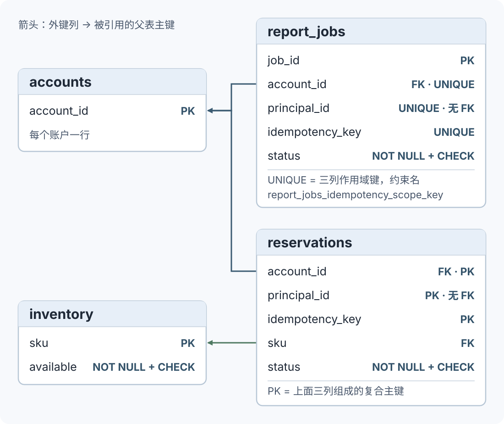

# 约束守住哪些规则，索引又怎样服务读取？

上一章靠主键、`CHECK` 和复合主键守住了库存与预留记录。本章把这两类数据库对象分开讲清：constraint (约束) 是所有写入方都必须遵守的数据规则，违反就拒绝写入；index (索引) 是需要额外维护的访问结构，查询用不用它由计划器按成本决定。前者关乎正确性，后者关乎成本，二者常被一起建立，却回答不同的问题。

## 教学 schema 里有哪些表？

本章沿用主线三的库存案例，并补两张表：父表 `accounts`，让账户也能被外键引用；以及一张 `report_jobs` 任务表，因为讲索引需要一个“按账户列出最近记录”的读取，而库存表没有这种查询。这是一套独立的教学 schema，不要在已经建过同名表的库里原样重跑。SQL 以 PostgreSQL 18 为准。

~~~sql
CREATE TABLE accounts (
    account_id TEXT PRIMARY KEY
);

CREATE TABLE inventory (
    sku TEXT PRIMARY KEY,
    available INTEGER NOT NULL CHECK (available >= 0)
);

CREATE TABLE reservations (
    account_id TEXT NOT NULL REFERENCES accounts(account_id),
    principal_id TEXT NOT NULL,
    idempotency_key TEXT NOT NULL,
    request_fingerprint TEXT NOT NULL,
    sku TEXT NOT NULL REFERENCES inventory(sku),
    status TEXT NOT NULL CHECK (status IN ('reserved', 'cancelled')),
    PRIMARY KEY (account_id, principal_id, idempotency_key)
);

CREATE TABLE report_jobs (
    job_id TEXT PRIMARY KEY,
    account_id TEXT NOT NULL REFERENCES accounts(account_id),
    principal_id TEXT NOT NULL,
    idempotency_key TEXT NOT NULL,
    request_fingerprint TEXT NOT NULL,
    status TEXT NOT NULL CHECK (
        status IN ('queued', 'running', 'succeeded', 'failed', 'cancelled')
    ),
    created_at TIMESTAMPTZ NOT NULL,
    CONSTRAINT report_jobs_idempotency_scope_key
        UNIQUE (account_id, principal_id, idempotency_key)
);
~~~

*`reservations` 以作用域键为主键；`report_jobs` 另有任务 ID 主键，作用域键是单独的唯一约束；两张表的 `principal_id` 都没有外键。*

`principal_id` 只是存下来的作用域值，没有主体表外键。认证和授权不会因为这一列或某个外键而自动完成。

## 每类约束守住什么，守不住什么？

| 要保护的事实 | 约束 | 能保证 | 守不住 |
|---|---|---|---|
| 每个账户、SKU、任务只对应一行 | `PRIMARY KEY` | 唯一且非空的行标识；即使没写 `NOT NULL`，PostgreSQL 主键列也拒绝 NULL | — |
| 库存是已知的非负数 | `NOT NULL` + `CHECK (available >= 0)` | 两者并用才拒绝负数和未知值 | 单独的 `CHECK` 放行 NULL |
| 子记录引用存在的父行 | `REFERENCES` | 引用的账户或 SKU 必须存在；默认删除动作是 `NO ACTION`，级联要显式声明 | — |
| 一个作用域键最多一条记录 | 复合主键或 `UNIQUE` | 第二条同键记录被拒绝 | 不规定重放该返回什么，那是上一章的契约 |
| 状态取自允许的集合 | `CHECK (status IN (...))` | 当前值合法 | 不验证 `queued → running → succeeded` 这类转移顺序 |

两条盲区最常导致错误结论：

- **CHECK 对 NULL 放行。** CHECK 的结果为真或为 NULL 都算通过，所以 `CHECK (available >= 0)` 遇到 `available = NULL` 时求值为 NULL，写入成功。要拒绝未知值，必须同时声明 `NOT NULL`。这是本领域这条规则的权威位置。
- **CHECK 只看当前这一行。** 它不能可靠表达跨行或跨表的规则，例如“同一班次至少一人值班”。这类规则要靠唯一约束、外键，或把需要协调的写入放进合适的事务协议，见[写偏差与三种修法](transactions-and-isolation.md#为什么稳定快照仍会破坏跨行规则？)。

## 键约束会自动建哪些索引？

- **主键和唯一约束自动建立唯一 B-tree 索引。** 不要再为同样的列重复建一个。`reservations` 的主键和 `report_jobs_idempotency_scope_key` 都以 `account_id` 开头，按账户前缀查找可以直接用它们。
- **外键不会为子表的外键列自动建索引。** 外键检查用的是父表主键或唯一键上的索引。反方向，删除或更新父行时，数据库要在子表里找引用它的行：`reservations` 的主键以 `account_id` 开头，删账户时的子行检查能用上它；`reservations.sku` 却不在任何索引的前导位置。如果要按 SKU 查预留，或常删改库存 SKU 而子行很多，就要按负载评估单独的 `reservations(sku)` 索引。
- **`UNIQUE` 默认把 NULL 看作互不相同。** 两行 `(acct-17, NULL)` 不算重复。要把 NULL 当成相同值，可以用 `UNIQUE NULLS NOT DISTINCT`。本例的唯一键每列都是 `NOT NULL`，没有这个歧义。

## 约束何时检查，失败后事务里还剩什么？

本例的约束都没有声明 `DEFERRABLE`，所以是立即检查：每行插入或更新时就检查，而不是等到 `COMMIT`。`CHECK` 和 `NOT NULL` 总是立即检查。

检查失败后，事务里还剩什么，不同数据库不一样：

| 数据库 | 一条语句违反约束后 | 应用要做什么 |
|---|---|---|
| PostgreSQL | 整个事务进入失败状态，后续语句都被拒绝 | `ROLLBACK`，或回到报错前建立的 savepoint |
| SQLite（默认 ABORT 策略） | 只撤销失败语句的更改，之前语句的更改还在事务里 | 需要全有或全无时，显式回滚整笔 |
| MySQL InnoDB（重复键） | 通常只回滚失败语句 | 同上，见 [InnoDB 支线](mysql-innodb-locks-and-logs.md#重复键错误后，事务里还剩什么？) |

上一章要求“零行或唯一冲突后整笔回滚”，原因就在这里：在后两种数据库里，失败语句之前的库存扣减仍在事务中，不显式回滚就可能被提交。唯一冲突怎样按约束名翻译成“重放、冲突或内部错误”，见[换到抽奖：两条唯一约束怎样分别裁决？](conditional-writes-and-idempotent-records.md#换到抽奖：两条唯一约束怎样分别裁决？)。

## 复合索引的列序怎样定？

调用方已获准查看 `acct-17` 的全部任务，现在要读这个账户最近的 20 个任务；创建时间相同时用任务 ID 定一个稳定顺序：

~~~sql
CREATE INDEX report_jobs_by_account_recent
    ON report_jobs (account_id, created_at DESC, job_id DESC);

SELECT job_id, status, created_at
FROM report_jobs
WHERE account_id = $1          -- $1 = acct-17
ORDER BY created_at DESC, job_id DESC
LIMIT 20;
~~~

B-tree 按复合键的字典序排列：先比 `account_id`，相同再比 `created_at`，再比 `job_id`。所以列序从查询的过滤和排序推导，这是本领域复合索引列序的权威规则：

| 索引列 | 在查询里的作用 | 边界 |
|---|---|---|
| `account_id` | 等值条件直接定位这个账户的一段连续键区间 | 前导列等值条件最直接；PostgreSQL 18 的多列 B-tree 也能利用非前导列条件或 skip scan，只是通常不如前导列有效 |
| `created_at DESC` | 在账户区间内按时间从新到旧读出 | 匹配的索引可以省掉排序，但计划器仍会和“顺序扫描加排序”比成本 |
| `job_id DESC` | 同一时刻的任务有确定顺序 | 排序方向须与索引整体一致或整体相反；B-tree 可以反向扫描，`(account_id, created_at, job_id)` 升序索引同样能服务这个查询，但服务不了 `created_at DESC, job_id ASC` |
| `status` | 只在输出里 | 索引不含它，要回表取值，这不是覆盖该查询的索引 |

`created_at` 用 `TIMESTAMPTZ` 才能按时间点正确排序：带时区的输入被换算后按 UTC 存储，原时区标签不保留，输出按会话时区显示。把混合格式的本地时间文本存进字符串列，字典序就不等于时间顺序。

同一套“完整排序键必须唯一”的要求，后面会用在键集分页的游标上，见[怎样无重复、无遗漏地分页读取一个还在变化的集合？](keyset-pagination-and-snapshots.md)。B-tree 为什么适合按页读取，见[数组、链表、树和哈希表各靠什么找到目标、维护顺序？](../computation/data-structures-by-access-pattern.md)。

## 索引什么时候值得？

- **`LIMIT` 让匹配的索引可以提前停。** 计划器选了上面的索引时，执行器收集到 20 条可见结果就可以停止取行。它不保证只读前 20 个物理索引项：MVCC 可见性等条件可能让它检查更多项。
- **读取比例大时，顺序扫描可能更便宜。** 如果查询要读整表的很大一部分，顺序读表再排序常比沿索引逐条跳回表便宜。
- **每个索引都有持续成本。** 它占磁盘和缓存，每次写入都要维护它，之后还要清理。字段越多不等于越快。
- **用真实数据验证。** 在目标数据库上，用真实数据量和统计信息看 `EXPLAIN`。`EXPLAIN ANALYZE` 会真的执行语句，评估带写入的语句时它真会改数据。

## 计划器为什么有时不用已建的索引？

计划器比较各条访问路径的估算成本，索引存在不等于一定被选中。下面两个实例是本地运行的计划输出（版本见标题，与本章依据的 PostgreSQL 18 文档不同），只用来说明计划会随数据量和统计信息变化；没有测量耗时。

> [!example]- 实例：两行表上已有匹配索引，仍选顺序扫描（本地 PostgreSQL 14.24）
> 在上面的 `report_jobs` 中只插入两行，并收集统计：
>
> ~~~sql
> INSERT INTO accounts VALUES ('acct-17');
> INSERT INTO report_jobs VALUES
>     ('job-a1', 'acct-17', 'user-17', 'key-1',
>      'fingerprint-1', 'queued', '2026-11-10 12:00:00+00'),
>     ('job-a2', 'acct-17', 'user-17', 'key-2',
>      'fingerprint-2', 'running', '2026-11-11 12:00:00+00');
> ANALYZE report_jobs;
>
> EXPLAIN (COSTS OFF)
> SELECT job_id, status, created_at
> FROM report_jobs
> WHERE account_id = 'acct-17'
> ORDER BY created_at DESC, job_id DESC
> LIMIT 20;
> ~~~
>
> 实际计划：
>
> ~~~text
> Limit
>   ->  Sort
>         Sort Key: created_at DESC, job_id DESC
>         ->  Seq Scan on report_jobs
>               Filter: (account_id = 'acct-17'::text)
> ~~~
>
> 匹配过滤和排序的索引已经存在，计划器估算后仍选了 `Seq Scan → Sort`。

> [!example]- 实例：1,000 个合成订单上建索引前后的计划（本地 SQLite 3.51.0）
> 这是一张独立的教学表，与 [SQL 空值章](sql-nulls-joins-and-aggregates.md)里的同名表结构不同。`customer_id = n % 100`，所以 `customer_id = 17` 恰好对应 10 行（`order_id` 为 17、117、……、917）。
>
> ~~~sql
> PRAGMA automatic_index = OFF;
> CREATE TABLE orders (
>     order_id INTEGER PRIMARY KEY,
>     customer_id INTEGER NOT NULL,
>     amount_cents INTEGER NOT NULL,
>     placed_at INTEGER NOT NULL
> );
> WITH RECURSIVE seq(n) AS (
>     VALUES(1)
>     UNION ALL
>     SELECT n + 1 FROM seq WHERE n < 1000
> )
> INSERT INTO orders SELECT n, n % 100, n * 25, n FROM seq;
>
> EXPLAIN QUERY PLAN
> SELECT order_id, amount_cents, placed_at
> FROM orders WHERE customer_id = 17 ORDER BY placed_at DESC;
> -- SCAN orders；USE TEMP B-TREE FOR ORDER BY
>
> CREATE INDEX orders_by_customer_and_time ON orders(customer_id, placed_at);
>
> EXPLAIN QUERY PLAN
> SELECT order_id, amount_cents, placed_at
> FROM orders WHERE customer_id = 17 ORDER BY placed_at DESC;
> -- SEARCH orders USING INDEX orders_by_customer_and_time (customer_id=?)
> ~~~
>
> 无索引时全表 `SCAN`，再用临时 B-tree 排序；建了 `(customer_id, placed_at)` 后，改为在 `customer_id = 17` 的区间里按索引 `SEARCH`，并反向读取以满足 `placed_at DESC`，临时排序消失。查询要取 `amount_cents`，索引不含该列，所以仍不是覆盖索引。`EXPLAIN QUERY PLAN` 的输出面向调试，格式可能随版本变化。

## 约束和索引之后，下一个问题

本章产出两条可复用的规则：约束按“能保证什么、守不住什么”选用，其中 `CHECK` 必须配 `NOT NULL`，跨行规则不能交给 `CHECK`；复合索引的列序从过滤和排序推导，再用真实计划验证。约束只裁决单条写入能否成立；多条语句放进一个事务后，各个事务能看到别人的哪些写入、失败后该回滚还是重试，是[事务能保证什么，并发事务各能看见什么？](transactions-and-isolation.md)的问题。

> [!info]- 来源
> - **主键、唯一、外键与删除动作、CHECK 对 NULL 放行、CHECK 只看当前行、`NULLS NOT DISTINCT`、外键列不自动建索引**（“每类约束守住什么……”“键约束会自动建哪些索引？”）：[PostgreSQL 18, Constraints](https://www.postgresql.org/docs/18/ddl-constraints.html)，§5.5，核对于 2026-11-11。
> - **`TIMESTAMPTZ` 的输入换算、UTC 存储与按会话时区显示**（“复合索引的列序怎样定？”）：[PostgreSQL 18, Date/Time Types](https://www.postgresql.org/docs/18/datatype-datetime.html)，§8.5，核对于 2026-11-11。
> - **可延迟约束与立即检查**（“约束何时检查……”）：[PostgreSQL 18, SET CONSTRAINTS](https://www.postgresql.org/docs/18/sql-set-constraints.html)；**报错后的失败事务与 `ROLLBACK`/savepoint**：[Transactions](https://www.postgresql.org/docs/18/tutorial-transactions.html)，§3.4；[ROLLBACK](https://www.postgresql.org/docs/18/sql-rollback.html)，核对于 2026-11-11。
> - **SQLite 默认 ABORT 只撤销失败语句**（“约束何时检查……”）：[SQLite, The ON CONFLICT Clause](https://www.sqlite.org/lang_conflict.html)，核对于 2026-11-11。
> - **多列 B-tree 的前导列、非前导列条件与 skip scan**（“复合索引的列序怎样定？”）：[PostgreSQL 18, Multicolumn Indexes](https://www.postgresql.org/docs/18/indexes-multicolumn.html)，§11.3；**索引顺序、反向扫描与 `ORDER BY`/`LIMIT`**：[Indexes and ORDER BY](https://www.postgresql.org/docs/18/indexes-ordering.html)，§11.4，核对于 2026-11-11。
> - **索引维护成本、计划器取舍、`EXPLAIN` 与 `EXPLAIN ANALYZE` 会实际执行**（“索引什么时候值得？”）：[PostgreSQL 18, Indexes Introduction](https://www.postgresql.org/docs/18/indexes-intro.html)，§11.1；[EXPLAIN](https://www.postgresql.org/docs/18/sql-explain.html)，核对于 2026-11-11。
> - **SQLite 的 `SCAN`/`SEARCH` 输出与格式边界、多列索引同时筛选与排序**（SQLite 实例）：[EXPLAIN QUERY PLAN](https://www.sqlite.org/eqp.html)；[Query Planning](https://www.sqlite.org/queryplanner.html)，§§2.2、3.1，核对于 2026-11-11。
