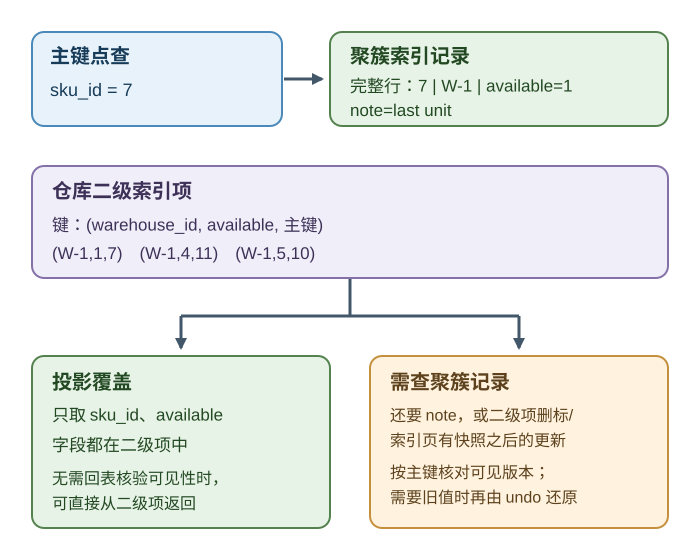
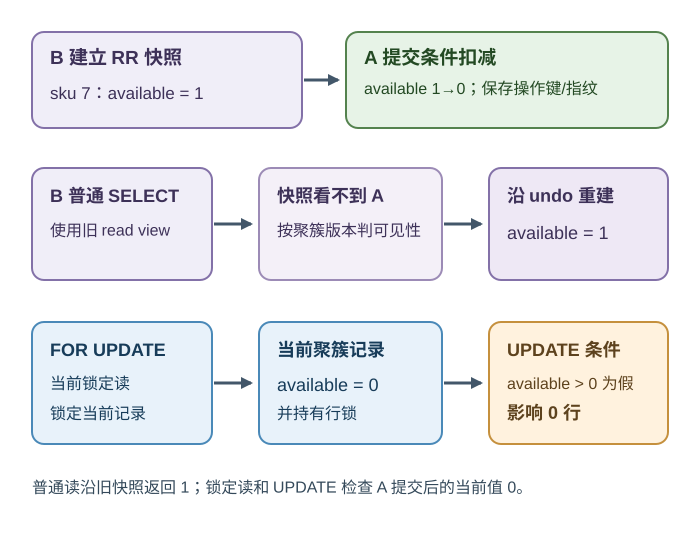
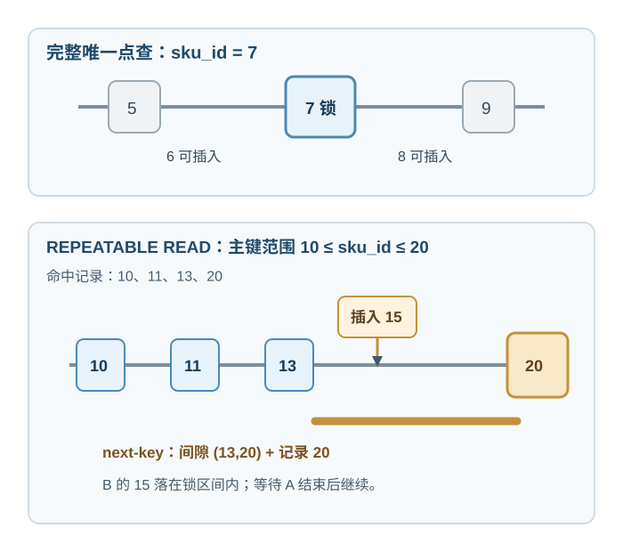
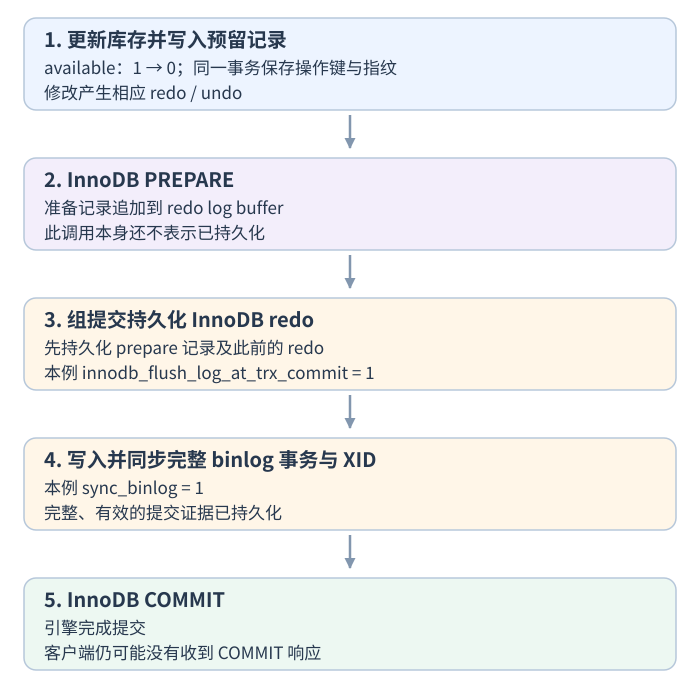
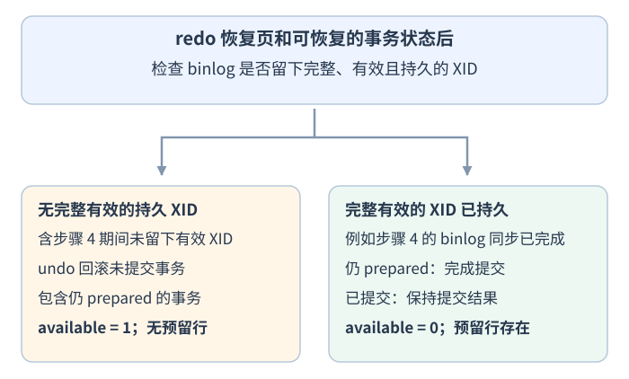

# InnoDB 怎样用索引记录、旧版本和日志处理同一笔库存事务？

本支线把主线三的库存事务搬到 MySQL 的 InnoDB 存储引擎上。前几章用 PostgreSQL 讲清了条件写、隔离级别和 WAL；同样的名字在 InnoDB 里由不同的部件实现：读取走聚簇索引或二级索引，旧版本靠 undo log 重建，锁落在索引记录上，崩溃恢复要协调 redo log 与 binlog 两套日志。读完本章，读者能判断一次 InnoDB 读写会看到哪个版本、锁住哪段索引，以及崩溃后一笔提交是保留还是回滚。

> [!info] 版本基线（核对于 2026-11-12，版本状态核对于 2026-11-16）
> 本章以 MySQL 8.4 LTS 的 InnoDB 为准，并与 2026-04-21 发布的 9.7 LTS 手册交叉核对过快照、锁和 binlog 恢复机制。Innovation 系列已改用日历版本号（例如 2026-10-20 发布的 26.10.0），本章不涉及。8.4 中普通事务的默认隔离级别是 `REPEATABLE READ`，示例仍显式设定；单条独立语句以 `autocommit=1` 执行，需要跨语句持锁的片段显式开启事务。

## 案例：同一笔预留搬到 InnoDB

沿用主线三的案例：`SKU-7`（这里用 `sku_id = 7` 表示）只剩一件，没有 `reserve-demo-208` 的记录；账户 `acct-17`、主体 `user-17` 只是预留的作用域，不划分库存。请求 A 是首次尝试，B 是同一请求的并发重放，二者的幂等键都是 `reserve-demo-208`，指纹都是 `fingerprint-A`，顺序与第一章相同：A 先扣减并提交。

为了看清“旧快照”和“当前值”的区别，这里让 B 多做一步：B 先开一个 `REPEATABLE READ` 事务，用普通 `SELECT` 读了一次库存（看到 1，相当于一次预查），然后 A 才扣减提交。B 之后还能读到 1，但它还能扣吗？

> [!example]- 示例表结构和初始数据
> ~~~sql
> CREATE TABLE inventory (
>     sku_id INT NOT NULL PRIMARY KEY,
>     warehouse_id VARCHAR(16) NOT NULL,
>     available INT NOT NULL CHECK (available >= 0),
>     note VARCHAR(64) NOT NULL
> ) ENGINE = InnoDB;
>
> CREATE INDEX inventory_by_warehouse_stock
>     ON inventory (warehouse_id, available);
>
> CREATE TABLE reservations (
>     account_id VARCHAR(32) NOT NULL,
>     principal_id VARCHAR(32) NOT NULL,
>     idempotency_key VARCHAR(64) NOT NULL,
>     request_fingerprint CHAR(64) NOT NULL,
>     sku_id INT NOT NULL,
>     status VARCHAR(16) NOT NULL,
>     PRIMARY KEY (account_id, principal_id, idempotency_key),
>     FOREIGN KEY (sku_id) REFERENCES inventory(sku_id)
> ) ENGINE = InnoDB;
>
> INSERT INTO inventory VALUES
>     (5,  'W-2', 2, 'point-query neighbor'),
>     (7,  'W-1', 1, 'last unit'),
>     (9,  'W-2', 2, 'point-query neighbor'),
>     (10, 'W-1', 5, 'range example'),
>     (11, 'W-1', 4, 'range example'),
>     (13, 'W-2', 2, 'range example'),
>     (20, 'W-2', 1, 'range example');
> ~~~
>
> `fingerprint-A` 只是符号标签；实际指纹应是规范化业务参数的稳定摘要。

## 一次读取先走哪棵索引？

一次读写会看到什么、锁住什么，先取决于它走哪棵索引。

- InnoDB 的主键组织为 clustered index (聚簇索引)：叶记录保存整行。
- 每个 secondary index (二级索引) 的叶项保存二级键列和该行的主键。查询若还要非索引列，就拿叶项里的主键回聚簇索引取行。

*主键点查直接得到整行；二级索引可以在字段层面覆盖查询，但可见性检查仍可能回聚簇记录。*

`WHERE sku_id = 7` 是完整主键点查，直接找到聚簇索引里的整行。按仓库筛库存时，`WHERE warehouse_id = 'W-1' AND available >= 1` 可能走 `(warehouse_id, available)` 二级索引；若只取 `sku_id, available`，这些列都在二级项里，字段层面可以覆盖。

字段齐全并不保证不回表。二级项已被标记删除，或二级索引页含有快照之后的更新时，InnoDB 要回到聚簇记录核对 MVCC 可见性，需要旧值时再由 undo 重建。本例中，A 把 `SKU-7` 的 `available` 从 1 改成 0 后，二级项 `(W-1, 1, 7)` 被标记删除；B 的旧快照即使只取 `sku_id, available`，也可能按主键回聚簇索引取回旧值。若还要 `note`，无论如何都要回表。索引是否真被使用取决于谓词、统计信息、数据分布和投影列，排查时看 `EXPLAIN`，不要从 `WHERE` 子句猜计划。

## 普通读为什么还能看见已被扣走的库存？

InnoDB 的 consistent read (一致性读) 用 read view (读视图) 决定能看见哪些版本：

- `REPEATABLE READ` 下，同一事务的普通 `SELECT` 都使用**第一次一致性读**建立的快照；`READ COMMITTED` 下每次一致性读都取新快照。
- 别的事务之后改了行，undo log (回滚日志) 保留着重建旧版本所需的信息，普通读据此仍返回旧值。普通读也看得见本事务自己之前的修改。
- 普通 `SELECT` 不锁被读的行，别的事务照样可以更新。

锁定读和写语句不服从这个快照。`SELECT ... FOR UPDATE` 是 current read (当前读)：读最新的已提交版本，并取得排他锁；`UPDATE` 同样按当前版本加锁和判断条件。按固定顺序推演：

~~~sql
-- 会话 B（同一请求的重放）：先建立一致性读视图
SET SESSION TRANSACTION ISOLATION LEVEL REPEATABLE READ;
START TRANSACTION;
SELECT available FROM inventory WHERE sku_id = 7;
-- 1；这是 B 之后所有普通 SELECT 的快照时点

-- 会话 A（首次尝试）：条件扣减并保存操作记录
SET SESSION TRANSACTION ISOLATION LEVEL REPEATABLE READ;
START TRANSACTION;
UPDATE inventory SET available = available - 1
WHERE sku_id = 7 AND available > 0;
-- 影响 1 行，应用才继续 INSERT；影响 0 行则 ROLLBACK
INSERT INTO reservations
    (account_id, principal_id, idempotency_key, request_fingerprint, sku_id, status)
VALUES ('acct-17', 'user-17', 'reserve-demo-208', 'fingerprint-A', 7, 'reserved');
COMMIT;

-- 会话 B 继续原事务
SELECT available FROM inventory WHERE sku_id = 7;
-- 普通一致性读：沿旧读视图，仍是 1
SELECT available FROM inventory WHERE sku_id = 7 FOR UPDATE;
-- 当前读：最新值是 0，并锁住这条索引记录
UPDATE inventory SET available = available - 1
WHERE sku_id = 7 AND available > 0;
-- 影响 0 行：不能按快照里的 1 再扣一次，也不插入记录
ROLLBACK;

-- B 回滚后，用新事务按作用域键回查
START TRANSACTION;
SELECT request_fingerprint, sku_id, status
FROM reservations
WHERE account_id = 'acct-17' AND principal_id = 'user-17'
  AND idempotency_key = 'reserve-demo-208';
COMMIT;
-- 读到 A 的同指纹记录，返回它的当前状态
~~~

*普通读沿旧快照返回 1；`FOR UPDATE` 和 `UPDATE` 检查 A 提交后的当前值 0。*

快照里的 1 只是“普通读仍可见的版本”，不是可以再扣的库存。只要 B 的快照还可能需要这个旧值，对应的 update undo 就不能被清理。B 的 `UPDATE` 影响 0 行，于是回滚并回查，按第一章的契约下结论：同键同指纹返回 A 的结果，同键异指纹返回冲突；回查为空时，同键的竞争事务可能尚未结束，不能据此断定对方失败。若 B 与 A 本是不同的键，B 查不到自己的键，报告本次库存不足。

若 A 尚未提交时 B 就执行 `FOR UPDATE`，B 会等 A 结束：在本例没有其他写入的前提下，A 提交则 B 看到 0，A 回滚则看到 1。

与 PostgreSQL 对照：同样叫 Repeatable Read，PostgreSQL 里 B 的 `UPDATE` 会因为这行在它的快照之后被并发修改而以 `40001` 失败，要整笔重试；InnoDB 的 `UPDATE` 直接读当前版本，结果是影响 0 行。两条路径最后都走到回查，但应用要处理的信号不同，见[快照从什么时候开始？](transactions-and-isolation.md#快照从什么时候开始？)。另外，通常不要在 `REPEATABLE READ` 的同一事务里随意混用快照读和锁定读；这里混用只是为了展示两条读取路径为什么得出不同的值。

## 重复键错误后，事务里还剩什么？

换成第一章“库存还有余量”的变体：B 已在事务里把库存扣了一件，`INSERT` 却撞上复合主键。InnoDB 遇到重复键错误时**通常只回滚这条失败语句**，前面成功的库存 `UPDATE` 仍留在事务里。这与 PostgreSQL 不同，后者报错后整个事务进入失败状态。

所以在 InnoDB 上，应用必须先显式 `ROLLBACK` 整笔尝试，撤销那次扣减，再用新事务按作用域键回查、比较指纹。其他约束或写入错误也一样：整笔回滚，按具体错误返回，不能沿失败路径照常 `COMMIT`。

## 唯一命中和范围扫描为什么锁的范围不同？

上面的 `FOR UPDATE` 和 `UPDATE` 都要加锁。InnoDB 的行锁实际落在**索引记录**上，所以锁住多大范围，取决于语句走哪棵索引、是点查还是范围扫描：

- 完整唯一索引的等值条件只命中一条已存在的记录时，通常只锁这条索引记录，不锁它前面的间隙。
- 排他搜索经由二级索引完成时，InnoDB 还会锁对应的聚簇索引记录。
- 复合唯一索引只给了部分键列，就不是完整唯一命中，可能要扫描并锁住一段索引范围。

下面两个独立示例与库存时序无关，会话 A 先持锁，B 后到：

~~~sql
-- 示例一：完整主键点查，只锁 sku_id = 7 这条记录
SET SESSION TRANSACTION ISOLATION LEVEL REPEATABLE READ;
START TRANSACTION;
SELECT available FROM inventory WHERE sku_id = 7 FOR UPDATE;
ROLLBACK;

-- 示例二：主键范围扫描
-- 会话 A
SET SESSION TRANSACTION ISOLATION LEVEL REPEATABLE READ;
START TRANSACTION;
SELECT sku_id FROM inventory FORCE INDEX (PRIMARY)
WHERE sku_id BETWEEN 10 AND 20
FOR UPDATE;
-- 命中 10、11、13、20；A 暂不结束事务

-- 会话 B（autocommit=1 的单条 INSERT）
INSERT INTO inventory VALUES (15, 'W-1', 2, 'insert in protected gap');
-- 等待：15 落在被锁住的间隙里

-- 会话 A
COMMIT;
-- A 释放范围锁后，B 的 INSERT 才继续并提交
~~~

*点查只锁记录 7，6 和 8 仍可插入；范围扫描在记录 20 上的 next-key 锁覆盖 (13, 20]，插入 15 要等待。*

在这个 `REPEATABLE READ` 主键范围里，记录 20 上的 next-key lock (临键锁) 由记录锁加上它前面的 gap lock (间隙锁) 组成，保护 `(13, 20]`。15 落在这个区间，所以 B 要等 A 提交或回滚。间隙锁只阻止冲突的插入，不等于锁了整张表。

`READ COMMITTED` 下的搜索和扫描通常不用间隙锁，但外键检查和重复键检查仍可能用。具体锁范围取决于实际扫描的索引、谓词和计划；遇到锁等待，先用 `EXPLAIN` 确认访问路径，再看 InnoDB 的锁信息。

## 崩溃时 redo 和 undo 各做什么？

前面讲的是运行中的并发；下面看提交途中崩溃后，重启恢复怎样决定事务的去留。两种日志分工不同：

- **redo log (重做日志)** 记录页面修改，用于把尚未写回表空间的变更前滚。它也可能记录了后来被判为未提交的事务的修改。
- **undo log** 一方面供一致性读重建旧版本，另一方面用于撤销未完成的事务。

因此，“redo 重放过页面变化”不等于“这笔业务事务已经提交”。这与[主线 WAL 章](write-ahead-logging-and-recovery.md)的结论相同；不同的是，PostgreSQL 靠提交状态让未提交版本不可见，InnoDB 则用 undo 把未完成事务撤回去。

## binlog 与 InnoDB 怎样对同一笔提交达成一致？

开启 binary log (二进制日志，binlog) 后，一笔提交要同时落在两套日志里：InnoDB 的 redo 和服务器层的 binlog。若只落了一边，复制与时间点恢复看到的历史就会与本库不一致。MySQL 用内部的 XA two-phase commit (两阶段提交) 协调二者。这是服务器内部使用的协议，不是应用发出的 `XA` SQL 语句。

本节的前提：binlog 已启用，`innodb_flush_log_at_trx_commit = 1`，`sync_binlog = 1`，且文件系统、控制器和设备如实兑现刷盘。A 这笔事务的提交顺序：

*prepare 只进日志缓冲；组提交先持久化 redo，再写并同步 binlog 与 XID，最后引擎提交。*

1. 更新库存、插入预留记录，产生相应的 redo 与 undo。
2. InnoDB `PREPARE`：准备记录追加到 redo 日志缓冲。这一步本身还不表示已持久化。
3. 组提交的刷新阶段先持久化 prepare 记录及此前的 redo。
4. 把完整的事务和 transaction identifier (事务标识，XID) 写入 binlog 并同步到磁盘。到这里，完整有效的提交证据已经持久。
5. InnoDB 完成提交。

图中只追踪 A 这一笔事务；同组的多笔事务可以共用日志刷盘。客户端可能在第 4 步之后、收到响应之前断线，所以客户端是否收到 `COMMIT` 响应不是恢复的依据。

恢复时，redo 先恢复页面和可恢复的事务状态，再以 binlog 里是否有完整、有效、持久的 XID 作决定。从独立初态 `available = 1`、无 `reserve-demo-208` 记录出发，并假定只有 A 修改这件库存：

*有完整有效的持久 XID 就完成提交；没有就用 undo 回滚，库存与预留记录始终一起保留或一起消失。*

| 崩溃时可恢复的提交证据 | 恢复路径 | 恢复后的业务状态 |
|---|---|---|
| binlog 里已有完整、持久、可恢复的事务和 XID（客户端可能没收到响应） | redo 恢复页面修改；事务仍处于 prepared 时，MySQL 通知 InnoDB 完成提交；已完成的提交保持不变 | `available = 0`，预留记录存在；重放查询可确认结果 |
| 没有完整有效的持久 XID，包括第 4 步途中崩溃、未留下有效 XID 的情形 | redo 可先重放页面修改；未提交事务用 undo 回滚；不在有效 XID 集合中的 prepared 事务也回滚 | `available = 1`，没有该预留记录 |

## 恢复结论在什么配置下可信？

上表两条分支都依赖本节开头的刷盘条件：

- `innodb_flush_log_at_trx_commit = 1`：事务提交时写入并刷新 redo。
- `sync_binlog = 1`：binlog 同步到磁盘。
- 设备如实刷盘。设备谎报刷盘、整盘损坏或整个故障域丢失，都要靠备份与复制策略处理。

恢复后的几个运行细节：

- MySQL 可以在 redo 应用完后就接受新连接，未完成事务的回滚可能在后台继续，期间新事务仍可能在这些行上遇到锁等待。
- 时间点恢复仍需要一份合适的备份和其后连续的 binlog；redo 和 undo 不能代替备份。
- 这套 XID 协调是 MySQL 的具体实现，不能因为同样使用预写日志，就把它当成 PostgreSQL 或课程里 ARIES 的同一算法。

## 哪些结论在 InnoDB 上变了，哪些没变？

本支线把主线三的几条结论落到 InnoDB 上：快照里的旧值不能用来扣减，扣减要靠当前读和条件 `UPDATE` 的影响行数；重复键错误只撤销失败语句，整笔回滚必须由应用显式执行；锁范围由访问路径决定；崩溃恢复以 binlog 中完整有效的 XID 决定提交去留。主线接下来转向读取：[空值、外连接和分组会怎样改变一张汇总表的结果？](sql-nulls-joins-and-aggregates.md)

> [!info]- 来源
> - **版本基线**（版本说明）：MySQL 8.4 LTS 手册与 9.7 手册交叉核对；[Changes in MySQL 9.7.0 (2026-04-21)](https://dev.mysql.com/doc/relnotes/mysql/9.7/en/news-9-7-0.html)；[MySQL 26.10.0 Release Notes](https://dev.mysql.com/doc/relnotes/mysql/26.10/en/news-26-10-0.html)，版本状态核对于 2026-11-16。
> - **聚簇索引存整行、二级索引叶项含二级键与主键**（“一次读取先走哪棵索引？”）：[MySQL 8.4, Clustered and Secondary Indexes](https://dev.mysql.com/doc/refman/8.4/en/innodb-index-types.html)，§17.6.2.1；**二级项删除标记或页内较新更新时回聚簇核对可见性，覆盖索引只说明字段齐全**：[InnoDB Multi-Versioning](https://dev.mysql.com/doc/refman/8.4/en/innodb-multi-versioning.html)，§17.3，核对于 2026-11-12。
> - **`CHECK (available >= 0)` 的约束语义**（示例表）：[MySQL 8.4, CHECK Constraints](https://dev.mysql.com/doc/refman/8.4/en/create-table-check-constraints.html)，§15.1.20.6。
> - **REPEATABLE READ 用首次一致性读的快照、READ COMMITTED 每次新快照、普通读与 DML/锁定读看到不同状态**（“普通读为什么还能看见……”）：[MySQL 8.4, Consistent Nonlocking Reads](https://dev.mysql.com/doc/refman/8.4/en/innodb-consistent-read.html)，§17.7.2.3；[Transaction Isolation Levels](https://dev.mysql.com/doc/refman/8.4/en/innodb-transaction-isolation-levels.html)，§17.7.2.1（9.7 同节交叉核对）；**`FOR UPDATE` 读最新可用记录并持锁到事务结束**：[Locking Reads](https://dev.mysql.com/doc/refman/8.4/en/innodb-locking-reads.html)，§17.7.2.4；**undo 支持旧版本重建**：[Undo Logs](https://dev.mysql.com/doc/refman/8.4/en/innodb-undo-logs.html)，§17.6.6，核对于 2026-11-12。
> - **PostgreSQL 同名级别的不同行为**（对照）：[PostgreSQL 18, Transaction Isolation](https://www.postgresql.org/docs/18/transaction-iso.html)，§13.2.2。
> - **重复键错误通常只回滚失败语句**（“重复键错误后……”）：[MySQL 8.4, InnoDB Error Handling](https://dev.mysql.com/doc/refman/8.4/en/innodb-error-handling.html)，§17.20.5，核对于 2026-11-12。
> - **记录锁、间隙锁、next-key 锁，完整唯一命中与范围扫描，READ COMMITTED 的例外**（“唯一命中和范围扫描……”）：[MySQL 8.4, InnoDB Locking](https://dev.mysql.com/doc/refman/8.4/en/innodb-locking.html)，§17.7.1；**各语句的锁范围、经二级索引的排他搜索锁对应聚簇记录**：[Locks Set by Different SQL Statements](https://dev.mysql.com/doc/refman/8.4/en/innodb-locks-set.html)，§17.7.3，核对于 2026-11-12。
> - **redo 前滚、不完整事务后台回滚、恢复后提前接受连接**（“崩溃时 redo 和 undo……”“恢复结论……”）：[MySQL 8.4, InnoDB Recovery](https://dev.mysql.com/doc/refman/8.4/en/innodb-recovery.html)，§17.18.2；[Redo Log](https://dev.mysql.com/doc/refman/8.4/en/innodb-redo-log.html)，§17.6.5；**用完整备份后的 binlog 做时间点恢复**：[Point-in-Time Recovery Using Binary Log](https://dev.mysql.com/doc/refman/8.4/en/point-in-time-recovery-binlog.html)，§9.5.1。
> - **binlog 与 InnoDB 的内部 XA 两阶段提交、恢复时扫描完整 XID 并完成 prepared 事务**（“binlog 与 InnoDB 怎样……”）：[MySQL 8.4, The Binary Log](https://dev.mysql.com/doc/refman/8.4/en/binary-log.html)，§7.4.4（9.7 同节交叉核对）。`prepare()` 先写日志缓冲、组提交刷新阶段先刷引擎日志，依据 MySQL 8.4.13 源码 [sql/binlog.cc](https://github.com/mysql/mysql-server/blob/mysql-8.4.13/sql/binlog.cc) 与 [storage/innobase/handler/ha_innodb.cc](https://github.com/mysql/mysql-server/blob/mysql-8.4.13/storage/innobase/handler/ha_innodb.cc)。**两个刷盘参数与设备假设**：[InnoDB System Variables](https://dev.mysql.com/doc/refman/8.4/en/innodb-parameters.html) 的 `innodb_flush_log_at_trx_commit`；**同组事务共用 binlog 同步**：[Binary Logging Options and Variables](https://dev.mysql.com/doc/refman/8.4/en/replication-options-binary-log.html) 的 `binlog_group_commit_sync_delay` 与 `sync_binlog`，核对于 2026-11-12。
