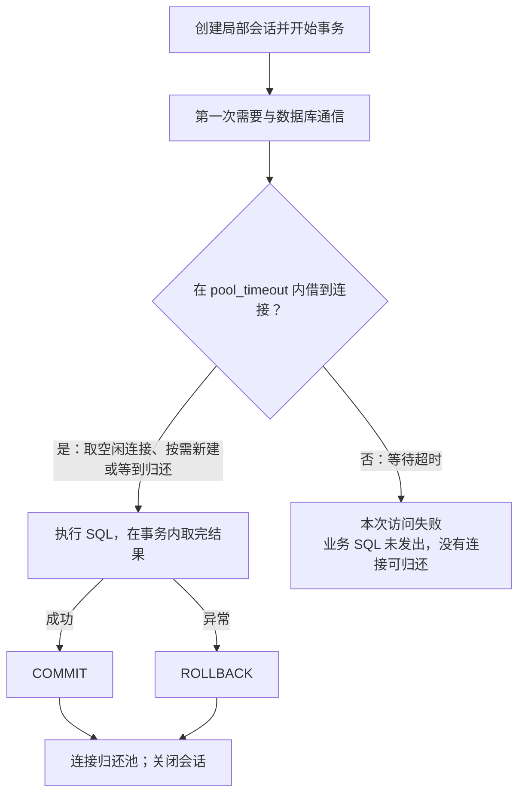

# ORM 会话怎样借用连接，连接池为什么会耗尽？

上一章把查询写对了；查询要真正执行，还得在应用里借到一条数据库连接。本章回答三件事：ORM 会话、事务、连接和连接池各管什么；一条连接在什么时刻借出、什么时刻归还；连接被占得太久时池怎样耗尽，事后怎样找到占着连接的人，以及整套部署最多会开多少连接。

本章用 SQLAlchemy 2.0 与 PostgreSQL 18 作实例（文档核对于 2026-11-12）。四种边界在任何 ORM 里都存在，换框架时要重新找到它们各自的结束点；某个框架默认的 Web 请求作用域不是数据库本身的规则。

## 案例：一次报表读取与一个分页导出 worker

同一个服务里有两条访问数据库的路径，都属于账户 `acct-17`：

- **请求读取** `load_report`：HTTP 请求读取报表 42 的少数字段，返回给调用方。
- **分页导出**：后台 worker 按页读取该账户一个季度的活动记录，每页 100 行、最多 12 页。怎样翻页不重不漏留给下一章，本章只看它怎样借还连接。

池配置是教学设定：每个服务进程一个池，`pool_size=8`、`max_overflow=2`、`pool_timeout=2`（秒）。

## 会话、事务、连接与连接池各管什么？

“数据库慢”可能指这四层中任何一层在等。先把它们分开：

| 边界 | 保存什么 | 生命周期 |
| --- | --- | --- |
| ORM 会话（SQLAlchemy `Session`） | 本次工作加载或新增的对象、identity map (身份映射)、待写入的变更 | 一次请求或一页工作；不跨请求共享 |
| 事务 | 一组 SQL 的原子边界：一起提交或一起回滚 | 从开始到 COMMIT 或 ROLLBACK |
| 连接 | 与数据库服务器的一条通信通道，承载事务 | 由池借出给一个事务，事务结束后归还 |
| 连接池（SQLAlchemy `Engine` 内的池） | 可复用的空闲连接，以及同时借出数量的上限 | 每个进程一个，长期存在 |

身份映射保证同一会话里同一主键对应同一个 Python 对象。它不是查询缓存：不会缓存任意查询结果，也不该跨请求共享。

ORM 会话是可变的事务状态，不能被并发的执行者共用：并发线程各用自己的 `Session`，并发的 asyncio Task 各用自己的 `AsyncSession`。不要把某个线程里的会话留给之后的请求。

## 连接在什么时候借出，什么时候归还？

`Engine` 在每个进程里创建一次，长期保存方言、建连方式和这个进程的连接池。会话创建时并不占连接；它第一次真正需要和数据库通信时才向池借一条——通常是执行第一条 SELECT，调用 `Session.connection()` 也会在业务 SQL 之前借出。事务结束时连接归还池。

几个时点容易混淆：

- **flush 不是提交。** `flush()` 把会话里待写入的变更发成 SQL，但仍在当前事务内。数据库在 INSERT 时生成的主键，flush 后通常已能在对象上读到；事务若随后回滚，这一行仍不存在。
- **flush 出错后，会话要先清理。** 异常从 `session.begin()` 上下文传播出去时，事务自动回滚。若代码捕获异常后还想复用同一个会话，必须先显式回滚，或关闭并丢弃它。
- **close 不是关库。** `Session.close()` 结束未完成的事务并归还连接，数据库服务器不受影响。
- **一个会话可以先后跑多笔事务，**但每笔都有自己的结束点，连接在每笔结束时归还。

## 一次请求怎样有界地读数据库？

下面是 `load_report` 的同步写法。`Report` 已映射；`require_account_permission` 是示意的授权函数，不是 SQLAlchemy API。

~~~python
from sqlalchemy import create_engine, select
from sqlalchemy.orm import Session
from sqlalchemy.pool import QueuePool

engine = create_engine(
    database_url,
    poolclass=QueuePool,
    pool_size=8,
    max_overflow=2,
    pool_timeout=2,
)

def load_report(principal_id: str, requested_account_id: str, report_id: int):
    account_id = require_account_permission(
        principal_id, requested_account_id, action="report:read"
    )
    with Session(engine) as session, session.begin():
        report = session.scalar(
            select(Report).where(
                Report.account_id == account_id,
                Report.id == report_id,
            )
        )
        if report is None:
            return None
        return {"id": report.id, "status": report.status, "version": report.version}
~~~

这段代码有四个有意的选择：

1. **先授权，再按可信的账户范围和报表 ID 一起查。** 只按报表 ID 取数会越过账户边界；为什么每次请求都要重新授权，见[服务怎样逐次确认这个主体能对这份资源做这个动作？](../services/per-request-authorization.md)。
2. **`session.begin()` 给事务一个明确的结束点。** 正常离开时提交，异常离开时回滚，外层 `with Session(...)` 随后关闭会话。只读请求虽然没有写入要提交，显式结束事务仍能让连接在响应发回之前就归还，而不是等到对象被回收。
3. **在提交前复制出响应字段。** SQLAlchemy 默认在提交时让已加载对象的属性过期（`expire_on_commit`）。提交后会话仍打开时读 `report.status`，会再发一次查询、再借一次连接；会话关闭后再读，则可能抛 `DetachedInstanceError`。返回普通字典，就不会把懒加载带出事务边界。
4. **检查 ORM 实际发出的 SQL。** ORM 适合表达实体关系和变更跟踪；批量操作或数据库特有的查询可以直接用参数化 SQL。无论哪种写法，查询计划、唯一约束和隔离语义都由数据库针对实际语句决定。

分页导出 worker 用同样的形状：**每读一页就开一个新会话和一笔短事务**，取完这一页立刻提交并归还连接，再去格式化、压缩和写出。这样连接只在查询期间被占用。代价是各页可能看到不同时间点的数据，下一章讨论这是否可以接受。

## 长时间持有连接怎样让池耗尽？

申请连接的路径是：池里有空闲连接就直接借；没有空闲但借出数仍低于上限，就新建一条；已到上限，调用者就排队等待，最多等 `pool_timeout`。等待超时发生在**借出之前**——业务 SQL 还没发出，也没有连接可归还。

借出之后，到事务结束归还之前，这条连接一直被占着。占用它的不只是 SQL：事务内等待远端 HTTP、边持有事务边发送长响应、排队等别的资源、做与数据库无关的 CPU 工作，都算。

> [!example] 一条连接怎样让 10 ms 的查询在发出之前超时
> 合成配置：`pool_size=1`、`max_overflow=0`、`pool_timeout=2` 秒。
>
> - `t=0`：请求 A 借到唯一的连接，查完报表后，仍在事务内等一个远端服务，远端要 3 秒。
> - `t=0.1`：请求 B 到达并申请连接。它的 SQL 只需 10 ms，但连接被 A 占着，B 开始排队。
> - `t≈2.1`：B 等满 2 秒，池等待超时。B 的 SQL 一次也没执行。
> - `t=3`：A 结束事务并归还连接，B 已经失败。
>
> 修复方法是缩短持有：在发起远端调用之前结束数据库事务，或把远端等待移出事务。调大 `pool_timeout` 只是让 B 等得更久。

## 池超时之后，怎样找到占着连接的人？

超时的请求 B 本身没有借到连接，它的日志里找不到“是谁占着”。要事后定位，需要事先记录借还事件，再按下面的步骤查。

**事先要记录的数据：**

- 每次申请连接：request 或 job attempt 的 ID、进程标识、池标识、申请时刻。计时从可能借出连接的那个调用之前开始。
- 每次成功借出（checkout）与归还（checkin）：连接标识、时刻、借出时的持有者 attempt ID。若要和数据库侧对照，再记下连接对应的 PostgreSQL backend PID。
- 三种失败分开计数：物理建连失败、池等待超时、SQL 执行超时。

**事后定位的步骤：**

1. 在 B 所在的**同一进程、同一个池**里，找出 B 等待期间处于借出状态、尚未归还的所有连接，包括 B 开始等待之前就已借出的连接。
2. 按这些连接的持有者 attempt ID 查应用 trace，看它们借出后在做什么。
3. 需要数据库侧证据时，用 backend PID 关联 `pg_stat_activity`，按下表判断。

| 观察 | 判断 | 下一步 |
| --- | --- | --- |
| 申请到超时很久、借出数达到上限、B 没有任何 SQL 事件 | B 排在池里，没有发出 SQL | 按上面的步骤找持有者 |
| 持有者借出到归还很久；`pg_stat_activity` 显示 `idle in transaction`、`wait_event_type = 'Client'`，且 `xact_start` 很早 | 事务开着，数据库在等客户端发下一条命令；应用可能在事务里等远端或在发送响应 | 对照同一 trace 的远端等待区间，收窄事务 |
| SQL 已开始，执行期间 `wait_event_type = 'Lock'` | SQL 在等数据库锁 | 先找阻塞事务和被锁的资源，不要先扩大池 |
| 等待普遍偏高，但多数连接的借出时长很短，且同时借出已到上限 | 每次占用都短，只是同时到达的请求超过了池的并发 | 限制 API 或 worker 的并发，或在数据库总连接预算内调整池 |

查询慢、N+1 查询、锁等待、事务里调用远端、遗漏结束事务，都会拉长上表中的某一段。两条处理原则：

- **重试会再申请连接。** 池已饱和时不设截止时间地重试只会加长队列；应按请求或 job 的总预算拒绝、延后或失败。
- **池超时不是空结果。** 它是一次失败，不能改写成“没有数据”返回给调用方。

> [!info] 实例：SQLAlchemy 2.0 的池事件
> `PoolEvents.checkout` 只在连接**成功**借出时触发，所以超时的 B 没有 checkout 事件，不能拿 B 的 attempt ID 直接找到 A，只能按上面第 1 步按时间区间找。`PoolEvents.checkin` 标记归还；`PoolEvents.connect` 标记一条物理连接建成，能说明某次 checkout 伴随了新建连接，但单个事件量不出建连耗时——需要时在驱动的物理 connect 调用前后各计一次时。

## 整套部署最多会开多少数据库连接？

每个服务进程通常有自己的 `Engine` 和池，所以连接数要按进程和副本求和：

**连接预算 = 副本数 × 每副本进程数 × (pool_size + max_overflow)**

本例 4 个副本、每副本 3 个服务进程，每个池 `pool_size=8`、`max_overflow=2`：`4 × 3 × (8 + 2) = 120`。这是所有池同时借满时的配置上限，不是当前已打开的物理连接数。API、worker、迁移任务以及其他服务连的是同一个数据库，它们的预算要加在一起，再给管理连接和故障恢复留出余量。缓存故障导致的回源、以及异步管线的执行槽，都要放进这同一份预算。

两个参数的含义要准确：

- `pool_size` 是池可以**保留的空闲连接数**；`max_overflow` 是超过它之后还允许**同时多借出**的连接数。两者之和限制同时借出的峰值。
- 连接池按需建连，创建 `Engine` 时不会预先打开所有连接。
- 连接没有永久的“基数”或“overflow”身份。归还时若空闲队列还有位置，这条连接就被保留，不论它当初是不是额外借出的；队列满了，这次归还的连接才被关闭。

不要跨 `fork` 共享父进程已经打开的连接，两个进程会在同一条套接字上交错收发。做法二选一：在每个子进程里创建 `Engine`；或在子进程初始化时对继承来的 `Engine` 调用 `engine.dispose(close=False)`，丢弃继承的池而不关闭父进程的连接，让子进程建自己的池。

## 连接预算交给容量规划，翻页交给下一章

本章给出连接的借还时点、池耗尽的诊断步骤，以及**连接预算 = 副本 × 进程 × (pool_size + max_overflow)**；主线四的容量规划直接用这个公式，见[一条异步管线能接多少工作，超出时在哪里拒绝？](../services/capacity-admission-and-backpressure.md)。分页导出 worker 每页一笔短事务、读完即还连接；下一章[怎样无重复、无遗漏地分页读取一个还在变化的集合？](keyset-pagination-and-snapshots.md)回答它怎样翻页才不重不漏、什么时候值得为同一快照长期占住一条连接。

> [!info]- 来源
> - 会话的身份映射、工作单元、flush/commit/rollback、close 归还连接，`Session` 不是查询缓存，`Session`/`AsyncSession` 不能被并发线程或 Task 共享：[SQLAlchemy 2.0, Session Basics](https://docs.sqlalchemy.org/en/20/orm/session_basics.html)，`What does the Session do?`、`Flushing`、`Closing`、`Is the Session a cache?`、`Is the Session thread-safe?`，核对于 2026-11-12。
> - 提交时属性过期与事务边界：[Transactions and Connection Management](https://docs.sqlalchemy.org/en/20/orm/session_transaction.html#managing-transactions)；`Session.connection()` 借出连接的时点：[Session API](https://docs.sqlalchemy.org/en/20/orm/session_api.html#sqlalchemy.orm.Session.connection)。核对于 2026-11-12。
> - `QueuePool` 参数、按需建连、`pool_size + max_overflow` 并发上限、fork 后不共享连接与 `dispose(close=False)`：[SQLAlchemy 2.0, Connection Pooling](https://docs.sqlalchemy.org/en/20/core/pooling.html)，`Connection Pool Configuration`、`QueuePool`、`Using Connection Pools with Multiprocessing or os.fork()`，核对于 2026-11-12。归还时按空闲队列容量决定保留或关闭，对照 [SQLAlchemy 2.0.44 QueuePool 实现](https://github.com/sqlalchemy/sqlalchemy/blob/rel_2_0_44/lib/sqlalchemy/pool/impl.py#L129-L166)。异步 Engine 使用兼容 asyncio 的池实现，本章代码是同步路径。
> - 池事件：[PoolEvents.checkout](https://docs.sqlalchemy.org/en/20/core/events.html#sqlalchemy.events.PoolEvents.checkout)、[PoolEvents.checkin](https://docs.sqlalchemy.org/en/20/core/events.html#sqlalchemy.events.PoolEvents.checkin)、[PoolEvents.connect](https://docs.sqlalchemy.org/en/20/core/events.html#sqlalchemy.events.PoolEvents.connect)；池达到上限后的等待超时：[SQLAlchemy 2.0 Error Messages, QueuePool limit … reached](https://docs.sqlalchemy.org/en/20/errors.html#queuepool-limit-of-size-x-overflow-y-reached-connection-timed-out-timeout-z)。核对于 2026-11-12。
> - `pg_stat_activity` 的 `state`、`xact_start`、`wait_event_type` 字段与 `idle in transaction`、`Client`、`Lock` 等取值：[PostgreSQL 18, The Cumulative Statistics System](https://www.postgresql.org/docs/18/monitoring-stats.html#MONITORING-PG-STAT-ACTIVITY-VIEW)，§27.2.3，核对于 2026-11-12。
> - 池配置、副本与进程数、一槽连接时间线为本章合成设定，数值为手算。
