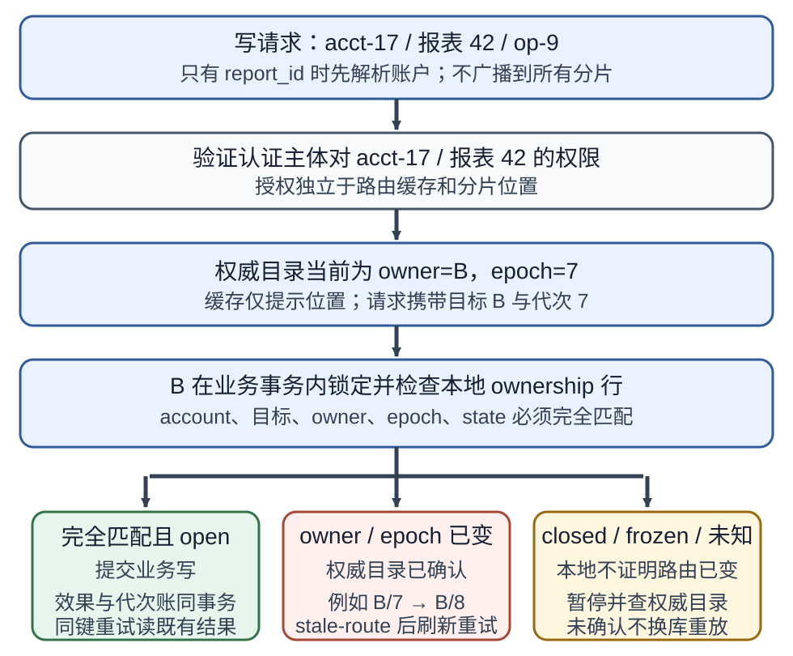
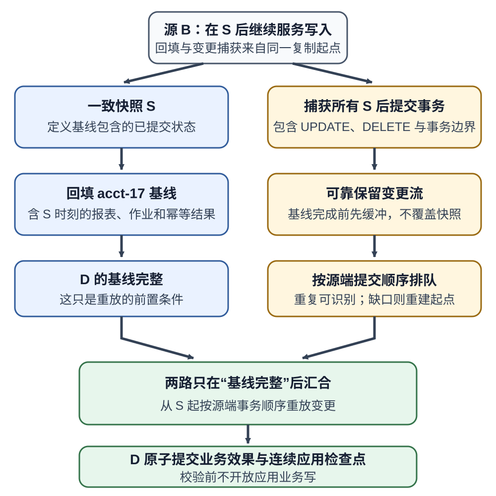
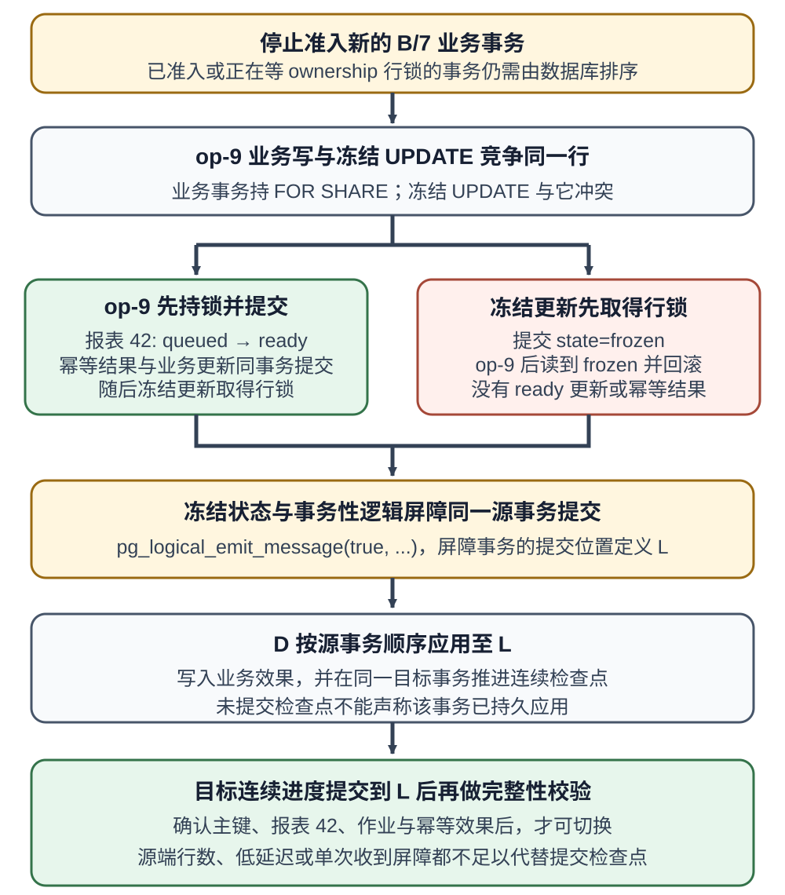
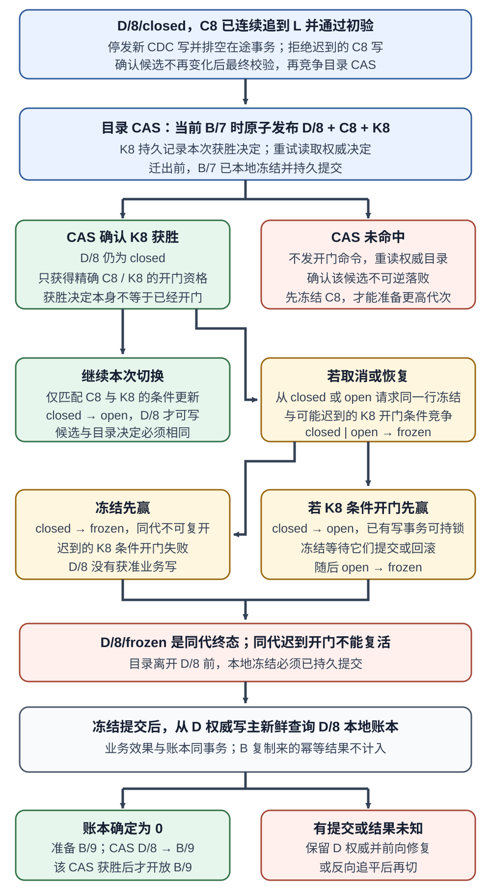

# 把一个账户搬到新分片时，怎样保证任一时刻只有一个写入者？

上一章的容量算例决定把 `acct-17` 从节点 B 搬到新节点 D。搬迁期间 B 和 D 都存着这个账户的数据，难点是任何时刻都只能有一个库接受它的业务写入：两个库同时开放，同一个幂等键可能在两边各生效一次，两边的数据从此分叉。本章给出一套教学用的搬迁协议，说明每一步保证什么、出错时能不能退回旧库。

它用的是[栅栏原理](../services/job-claims-leases-and-fencing.md)：给写权限一个只增不减的代次，并在**提交处**检查代次，旧代次的写入就无法生效。原理的权威说明在主线四的任务领取章；这里只讲分片搬迁特有的部分——数据怎样无缝追平、源端怎样冻结、目录怎样切换、何时可以回退。

## 搬迁的四步与两个要分开的问题

协议把两个问题分开管理：**数据副本什么时候完整**，与**谁获准写入**。前者靠快照加变更流追平并验证，后者靠所有权记录与代次。四步如下：

1. 以一致快照 S 为起点，把 `acct-17` 的数据回填到 D。
2. 捕获 S 之后 B 上提交的所有变更，按顺序应用到 D，让 D 追平。
3. 在 B 的所有权记录上冻结写入口，并在日志里留下屏障位置 L。
4. D 应用到 L 并通过校验后，用条件更新把路由目录切到新代次，再开放 D。

整个过程没有让应用同时向 B 和 D 双写。真正的互斥来自每个写入口都在事务里检查所有权，而不是路由缓存更新得够快。

## 所有权记录：owner、epoch 与本地状态

**路由目录**为每个账户记录权威的 owner (写所有者) 和单调递增的 epoch (路由代次)，写作 `owner/epoch`：`B/7` 表示 owner 为 B、代次为 7。请求携带目标分片和代次；路由缓存只是位置提示，不能自行授权。

**每个分片**还有一张可在事务里加锁的本地所有权表：

~~~text
account_ownership(account_id, owner_shard, epoch, candidate_id, state)
~~~

本章用到的名词：

- **prepare (准备候选)**：在目标分片插入一行 `closed` 状态的所有权记录，为某个 owner/epoch 预留位置，但还不接受业务写。
- **`candidate_id`**：每次 prepare 生成的不可变标识，用来区分同一 owner/epoch 下的不同候选，例如 `C8`。
- **目录 CAS**：compare-and-swap (比较并交换)。只有目录当前值仍等于预期旧值（如 `B/7`）时才写入新值，否则失败；并发的几次切换因此只有一个成功。
- **`decision_id`**：CAS 成功时一并写入目录的决策标识，例如 `K8`。目标分片只有拿到与之匹配的决策才能开门。

本地状态只有三种：`open` 接受业务写，`closed` 是已准备、未开放的候选，`frozen` 是这一代的终态。允许的转换只有下表四种：

| 转换 | 必须满足的条件 |
| --- | --- |
| 首次初始化 → `open` | 该账户在此分片从未有过所有权行，且权威目录已唯一指定初始 owner。后续迁移不能伪装成首次初始化 |
| 较低代次 `frozen`（或此分片尚无该账户的行）→ 更高代次 `closed`（prepare） | 新代次高于已持久记录的下限；此分片第一次建行时，须由当前权威代次授权；完全相同的 prepare 重试只能读回仍为 `closed` 的同一候选 |
| `closed` → `open`（开门） | 目录 CAS 已成功并持久记录了确切的 `decision_id`；命令必须同时匹配账户、owner、epoch、`candidate_id` 和该决策。只看到 owner/epoch 相同不构成授权 |
| `closed` 或 `open` → `frozen` | 同一行上的条件更新；原为 `open` 时，要等已持锁的业务事务结束才完成 |

三条不变量让旧代次永远无法复活：

- **同代 `frozen` 是终态**，不能改回 `closed` 或 `open`。
- **行不可删，epoch 不复用。** 曾经建过的行（或等价的代次下限）要保留；任何可能被提升为写主的副本都必须带着它，或在提升后、对外开放前重新从权威端核对。
- **未发布的 `closed` 候选不能被新 prepare 随意覆盖。** 先从权威目录确认它已在 CAS 竞争中不可逆地落败，再把该行冻结，才能准备更高代次。目录离开任何已发布的 owner/epoch 之前，该 owner 必须已在本地冻结且冻结已持久。

### 每笔业务写怎样检查所有权

每笔业务事务先在本地所有权行上取得一个**与其他业务写兼容、但与冻结更新冲突**的锁，检查状态，再在**同一个事务里**写业务数据。检查和写入若分在两个事务里，冻结就可能插进两者之间。以 PostgreSQL 18 为例（应用伪码，查询与更新必须在同一连接、同一事务）：

```text
BEGIN ISOLATION LEVEL READ COMMITTED
row = SELECT owner_shard, epoch, state
      FROM account_ownership
      WHERE account_id = $1
      FOR SHARE
if row_count != 1 or row != (B, 7, open):
    ROLLBACK
    reject, or refresh the authoritative route
else:
    UPDATE reports SET status = $2
     WHERE account_id = $1 AND report_id = $3
    if this transaction creates a new business effect:
        INSERT local_business_commits(account_id, owner, epoch, operation_key)
        VALUES ($1, 'B', 7, $4)
    COMMIT
```

`FOR SHARE` 让多笔业务事务可以同时持锁，而冻结用的 `UPDATE` 要等它们全部结束。在 Read Committed 下，等到并发更新提交后，加锁语句返回的是更新后的行版本，所以应用必须在拿到锁之后再检查状态。若改用互斥锁，账户内所有写入都会被串行化，本协议不需要付这个代价。

`local_business_commits` 是本协议的**本地提交账本**：每产生一个新的业务效果，就在同一个事务里记一行 `(账户, 本地 owner, epoch, 操作键)`。重复请求若只是读到已有的幂等结果，不算新提交。账本不随业务数据复制到目标；它只记本地产生的效果，回退时用来判断目标是否已经被写过。



## 快照 S 与变更流：怎样无缝追平

consistent snapshot (一致快照) S 包含源端截至 S 的一致数据；从同一个 S 开始，源端之后提交的所有变更都被保留下来。D 在验收前是候选副本，不接受应用的业务写。



要做到无缝，需要满足三条：

1. **没有复制缺口。** 快照 S 和 change data capture (变更数据捕获，CDC) 的起点必须属于同一份复制约定。源端在快照期间继续服务时，S 之后的变更要可靠保留到目标追上；复制槽、日志保留空间或 CDC 缓冲一旦丢了必要的区间，“后来重新连上”不等于没有缺口，必须重建快照或重新建立起点。还要监控消费积压和源端剩余空间：复制槽会阻止尚需的日志被清理，长期不推进会占满磁盘。
2. **旧快照不能覆盖较新的变更。** 本例先完成 `acct-17` 在 S 中的基线回填，再从 S 按源端事务顺序应用变更。若为缩短时间而并行回填和重放，就必须用行版本或日志位置证明旧快照行不会晚于新变更写入目标；两个任务同时跑本身不构成顺序保证。
3. **复制完整的业务效果。** CDC 要包含该账户的插入、更新和删除，保留稳定主键和事务顺序，每条变更都带有能定位到账户的键列。重复投递按源位置或等价的变更标识去重。所有权行属于迁移控制，不当成普通业务表复制；D 的候选所有权由切换流程单独准备。

追平的日志位置里可能夹着别的账户的事件，但这次只应用 `acct-17` 的数据。这要求应用的事务以账户为边界：若一笔源事务原子地改了多个账户，协议把它拆开应用后，那笔事务的原子性就丢了，需要重新设计事务边界或改用能保留原子性的协调方案。

> [!info] 实例：PostgreSQL 18 的逻辑解码（核对于 2026-11-13）
> logical decoding (逻辑解码) 的复制槽可以导出一个与变更流衔接的一致快照；日志位置用 LSN (log sequence number，日志序列号) 表示，是 WAL 中的位置。槽会保留后续所需的 WAL，但崩溃重启后可能重发变更，消费者要自己去重。UPDATE 与 DELETE 能否带出旧行的列，取决于表的 replica identity (复制标识) 设置。这些只是快照与日志衔接的一种实现；账户目录、租户过滤和代次栅栏不是 PostgreSQL 自带的迁移功能。

## 冻结源端：同一行上的兼容锁与冲突锁

D 接近追平时，先让 B 的入口停止接收**新的**业务事务，免得队列继续变长。但入口关闭并不会让已经准入、正在执行或正在等所有权行锁的事务消失；它们必须由数据库来排序。

冻结事务更新同一行所有权记录：

```text
BEGIN
changed = UPDATE account_ownership
          SET state = 'frozen'
          WHERE account_id = $1
            AND owner_shard = 'B' AND epoch = 7 AND state = 'open'
          RETURNING account_id
if changed != exactly one account_id:
    ROLLBACK
    reread the authoritative state; do not claim B/7 was frozen
else:
    emit the barrier message (next section) in this same transaction
    COMMIT
```

这条 `UPDATE` 要等所有已持 `FOR SHARE` 锁的业务事务提交或回滚。它提交之后，排在后面的业务事务读到 `frozen` 并回滚。于是数据库给出一个确定的先后：每笔业务写要么在冻结之前提交，要么根本不提交。请求更早到达 API 不等于更早获得数据库写权。



## 屏障位置 L：怎样证明目标已包含所有已提交写

冻结只说明 B 之后不会再有新提交；还要证明 D 已经拿到冻结之前的所有提交。做法是在冻结事务里同时写一条**事务性逻辑消息**，它与冻结状态一起提交。这条消息所在源事务的**提交位置**定义为 L。由于冻结排在所有已提交的 B/7 业务写之后，日志流里的 L 也排在它们之后。

判断依据只有一个：**D 连续应用的源端位置到达 L**。低复制延迟、估算的复制百分比、某台服务器当前的 LSN、源端行数都不够。即使 D 过滤掉了其他账户的变更，也要推进它已连续消费到的源端位置；D 从 S 之后尚未应用的部分继续追到 L，不重新全量重放。

D 应用每笔源事务时，把业务效果、复制来的幂等结果和“已连续应用到哪里”的检查点放在**同一个目标事务**里提交。检查点只有随事务提交后，才代表这些效果已持久可见。

> [!example] op-9 与冻结的两种先后
> 快照 S 中报表 42 仍是 `queued`。之后请求 `op-9` 在 B/7 的一笔业务事务里把它改为 `ready`，并在同一事务写入该操作的幂等结果。
>
> - **op-9 先拿到共享锁并提交：** 冻结要等它结束，L 在它之后。D 追到 L 时，已在同一目标事务里应用了 `ready`、复制了幂等结果并推进了检查点。D/8 开放后，`op-9` 的超时重试读到已复制的幂等结果，不会再生成一份业务效果。
> - **冻结先拿到锁：** `op-9` 读到 `frozen` 并回滚，B 上没有 `ready` 更新，也没有幂等结果；它的重试最终到 D 上正常执行。

L 是日志位置，不是时钟时刻，到达 L 也不单独证明数据正确。之后还要核对业务不变量：迁移范围的主键覆盖无缺口；报表 42 及其作业、幂等记录在 D 上可查；账户内唯一约束成立；按大小和风险核对行数、按稳定主键范围计算的摘要或校验和、关键聚合值。只比总行数，“缺一行、多一行”会互相抵消。任何一项不符，B 保持冻结（或在安全条件下恢复为唯一写者），绝不开放 D 让它边写边追。

## 切换目录并开放目标

D 追到 L 后，按以下顺序切换：

1. **准备候选。** 在 D 上 prepare `D/8/closed`，候选标识 `C8`。D 仍不接受业务写。
2. **封住复制写入并终验。** 关闭 C8 的回填与 CDC 写入口，排空已开始的复制事务；之后到达或重放的 C8 复制事务要被 D 的写资格检查拒绝。确认数据不再变化后，做最终完整性校验。
3. **目录 CAS。** 以完整当前值 `B/7` 为预期值，原子写入 `D/8 + C8 + decision_id=K8`。CAS 未命中时不发开门命令，而是重读权威目录；确认这个候选已不可逆地落败后，在 D 上冻结这一行，再准备更高代次。
4. **开放目标。** CAS 成功，或应答丢失但从权威目录确认 K8 已生效后，才执行条件更新 `D/8/closed/C8 → D/8/open/C8` 并记录 K8。这次更新必须同时匹配账户、owner、epoch、candidate 和 K8。

B/7 在第 3 步之前已经冻结，所以切换前后会有一小段时间**没有写者**。这是有意的：拿不到确切的开门决策就保持 `closed`，宁可短暂不可写，也不让两个库同时开放。

切换后，请求可能拿着旧路由到达 B：

- B 本地已是 `frozen`，拒绝写入。
- 入口能查到权威目录、确认 owner/epoch 已变时，返回 stale-route (路由过期)，客户端刷新路由后重试。
- B 只知道自己被冻结、查不到目录时，返回可重试的暂时不可用；目标与代次匹配但本地仍为 `closed` 时也一样。这两种情况都不能报 stale-route。
- 超时的非幂等请求不能因为刷新了路由就换个库重放，仍要沿用原来的稳定操作键查询结果或安全重试，每次重试照常授权。原因见[写请求超时后，怎样查清结果并安全重试？](../services/deadlines-retries-and-unknown-outcomes.md)：超时意味着原请求可能已经提交。

这套栅栏只管写。按旧缓存仍读 B 的请求不会被拦截，也没有新鲜度保证；副本读的延迟、旧路由读的处理、read-your-writes 要由单独的读取契约规定。一次陈旧读的结果也不能用来证明旧库没有提交。

## 出错时能不能退回旧库？

能否安全回到 B，只取决于一件事：**D 是否已经产生过业务提交**。按失败发生的阶段：

| 失败时的状态 | 能否回 B | 做法 |
| --- | --- | --- |
| B/7 冻结之前（快照、捕获或回填失败） | B 本来就是唯一写者 | 停止并重建候选 D。只有能证明 CDC 区间没丢时才从原位置续跑，否则重建快照与起点 |
| B/7 已冻结，目录仍是 `B/7` | 可以，但只认 CAS 的赢家 | D/8 与 B/8 都只能是 `closed` 候选，各自的 CAS 都要求目录当前为 B/7。谁的 CAS 先成功，就只用那个决策开放谁；输家先确认落败，再冻结自己那一行，才能准备更高代次 |
| 目录已是 `D/8`，D/8 账本确认为零 | 可以 | 先在 D 上执行 `closed\|open → frozen`（若为 open，冻结会等持锁的业务事务结束）。冻结提交后，从 D 的权威写主新鲜读取 epoch 8 的本地账本，确认为零。B 上若还有 `closed` 候选，先确认它已落败并冻结；再在 B 上 prepare `B/9/closed`，目录 CAS `D/8 → B/9` 成功后用这个决策开放 B/9 |
| 目录已是 `D/8`，账本有提交或无法确认 | 不能直接回 B | B 已经陈旧。保持 D 为权威并向前修复；或先把 D 的新提交反向追平到 B、核验后再切。只需在 D 上恢复服务时，也经目录决定开放 `D/9`，不重新打开已冻结的 D/8 |

第三、四行的关键是“未知不按零处理”。账本缺失，或无法确认写主保留了所有可能已提交的效果（包括数据库已提交、客户端却没收到回执的事务），结论就是“未知”，按有提交对待。D/8 一旦冻结就是同代终态，迟到的开门命令（还拿着 K8）与冻结在同一行竞争：冻结先赢，开门条件失败；开门先赢，冻结会等它放进来的业务事务排空，再成为终态。



> [!info] 实例：Vitess 24.0 的重分片流程（核对于 2026-11-13）
> Vitess 的稳定文档把重分片拆成创建工作流、监控、用 VDiff 核对数据、`SwitchTraffic` 切流和完成清理，也支持反向切流。产品可能接管复制、路由、写缓冲或验证中的不同部分；本章的所有权行、CAS 条件和零提交回退规则是教学协议，不是 Vitess 的同名 API。采用产品流程时，仍要按版本确认每一步实际保证的状态。

## 单写者搬迁是栅栏原理的一个实例

本章产出一套单写者搬迁协议：所有权行与单调 epoch 决定谁能写，同一行上的兼容锁与冲突锁把冻结变成事务屏障，屏障位置 L 加业务校验证明目标完整，目录 CAS 加精确决策开门，回退只在目标零提交时才可行。它是栅栏原理的一个实例；同一原理在任务领取中的权威说明见[怎样保证一个任务同一时刻只由一个 worker 推进？](../services/job-claims-leases-and-fencing.md)。主线四从[一次 HTTP 请求怎样从浏览器到达服务，又带回什么？](../services/http-semantics-and-transport.md)开始。

> [!info]- 来源
> - 快照与逻辑复制流衔接、复制槽保留 WAL 并可能在崩溃后重发、消费者去重：[PostgreSQL 18, Logical Decoding Concepts](https://www.postgresql.org/docs/18/logicaldecoding-explanation.html)，§47.2；UPDATE/DELETE 旧行列取决于 replica identity：[Logical Decoding](https://www.postgresql.org/docs/18/logicaldecoding.html)，§47 开篇；LSN 与 WAL 位置：[WAL Internals](https://www.postgresql.org/docs/18/wal-internals.html)，§28.6；复制进度跟踪：[Replication Progress Tracking](https://www.postgresql.org/docs/18/replication-origins.html)，§48。核对于 2026-11-13。
> - 事务性逻辑消息 `pg_logical_emit_message(true, …)`：[System Administration Functions](https://www.postgresql.org/docs/18/functions-admin.html#FUNCTIONS-REPLICATION)，§9.28.6；`pgoutput` 需启用 `messages` 选项才输出这类消息：[Logical Streaming Replication Protocol](https://www.postgresql.org/docs/18/protocol-logical-replication.html)，§54.5。核对于 2026-11-13。
> - 行级锁阻塞冲突的更新直到持锁事务结束、`FOR SHARE` 与更新冲突：[PostgreSQL 18, Explicit Locking](https://www.postgresql.org/docs/18/explicit-locking.html)，§13.3.2；Read Committed 下等待后返回并重检更新后的行版本：[Transaction Isolation](https://www.postgresql.org/docs/18/transaction-iso.html)，§13.2.1。核对于 2026-11-13。
> - Vitess 重分片、VDiff、切流与反向切流：[Vitess 24.0, Reshard](https://vitess.io/docs/24.0/reference/vreplication/reshard/)，核对于 2026-11-13。
> - 所有权表、状态转换、本地提交账本、目录 CAS 与回退规则是本章定义的教学协议，不是 PostgreSQL 或 Vitess 的功能；B/7、D/8、C8、K8、L、op-9 为本章合成标识。
