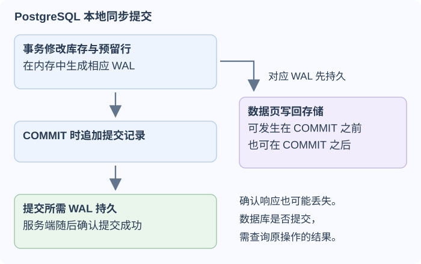
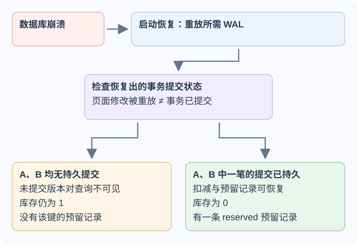

# 数据库确认提交后崩溃，靠什么恢复？

上一章讨论的是并发事务之间能看见什么；本章换一个问题：数据库已经对 `COMMIT` 回了确认，随即断电或进程崩溃，这次提交凭什么还在，没提交的修改又为什么不会冒出来。答案是 write-ahead log (预写日志，WAL)。本章以 PostgreSQL 18 本地单节点为例讲它怎样把“提交确认”和“数据页写回”分开、崩溃后怎样恢复，以及恢复到过去某个时点还需要什么。

## 提交为什么不必等数据页写回？

一笔事务改的行散落在不同的数据页上。如果每次提交都要把所有受影响的数据页同步写到磁盘，提交就要等多次随机写。WAL 用一条规则避开这个代价，这是本领域 WAL 的权威定义：

> **先把修改记入日志并持久化，才允许对应的数据页写回持久存储。**

由此得到提交路径：

1. 事务修改库存行和预留行，在内存里生成相应的 WAL 记录。
2. `COMMIT` 时追加一条提交记录。
3. 提交所需的 WAL 持久化之后，服务端才确认提交成功。
4. 数据页可以在提交之前或之后写回，唯一的要求是：写回某页之前，与它相关的 WAL 已经持久。

日志是顺序追加的，持久化一段连续日志比写回散落的数据页便宜；并发的小事务还可以共用一次 WAL 刷盘，即 group commit (组提交)。

*提交确认只等 WAL 持久；数据页写回与确认无先后约束，只要求晚于对应 WAL。*

这张图和下文的恢复结论都基于同一组前提，只在这里说一次：

- `synchronous_commit = on`（默认），服务端在确认前等待提交所需的 WAL 刷到本地持久存储；
- `fsync = on`，数据库确实发出刷盘请求；
- 文件系统、控制器和设备如实兑现刷盘，而不是只写进易失缓存就报告完成。

任何一条不成立，“已确认就一定能恢复”都不再成立。例如把 `synchronous_commit` 设为 `off`，确认不再等 WAL 刷盘，提交延迟变短，代价是数据库崩溃时可能丢掉最近几笔**已经确认过**的事务（不会损坏其他已提交数据）。下游若已按成功响应执行了外部动作，就要能承受这段风险。

图里还有一个容易忽略的点：确认本身也可能在返回途中丢失。客户端收不到确认，不等于没提交，这属于上一章的“提交结果未知”，要按原键回查，见[一笔事务失败后，该回滚、重试还是回查？](transactions-and-isolation.md#一笔事务失败后，该回滚、重试还是回查？)。

## 崩溃后，恢复怎样决定哪些修改可见？

沿用库存案例的初始状态：`SKU-7.available = 1`，没有 `reserve-demo-208` 的记录；A、B 是这件库存上全部的写入尝试，期间没有别的库存写者。这个前提让“恢复后看到什么”能完全归因到 A、B 的提交状态；若另有写者，库存值就不能这样解读。

*重放页面修改不等于事务已提交；可见结果取决于有没有持久的提交记录。*

启动恢复从最近的检查点起重放所需的 WAL，把尚未写回的页面修改补上。然后分两种情况：

- **有一笔尝试的提交记录已持久。** 库存只有一件，A、B 至多一笔能提交。即使数据页还没写回，重放也会补出库存扣减和那条预留记录。恢复后读到 `available = 0` 和一条 `reserved` 记录。
- **A、B 都没有持久的提交记录。** 重放仍可能把它们的页面修改写进数据页，但重放本身不等于提交。PostgreSQL 的行版本是否可见，取决于写入它的事务是否已提交；没提交的新库存版本和预留行对查询不可见，不需要把页面改回去。恢复后读到 `available = 1`，没有预留记录。

> [!example] 一次提交后立即崩溃，怎样检查结果
> 恢复后若读到 `available = 0` 和 `reserve-demo-208` 的 `reserved` 记录，说明其中一笔已持久提交，即使崩溃时数据页尚未写回；若读到 `available = 1` 且没有记录，说明两笔都没有持久提交。若 API 在收到提交确认前就失联，查到同键记录可以确认成功；暂时查不到不证明原事务已经结束，要保留原键处理。HTTP 响应不是数据库的提交记录。

这是单节点本地崩溃恢复。它保护的是“这台机器的进程或电源出故障”；整块盘损坏、机房故障这类跨故障域的问题，要靠复制与备份。

## 恢复到过去某个时点还需要什么？

WAL 不是 point-in-time recovery (时间点恢复，PITR) 的全部材料。要把库恢复到过去某一时刻，需要：

1. 一份适用的 base backup (基础备份)；
2. 从这份备份的起点到目标时刻**连续、完整**的 WAL 归档。

中间缺了一段 WAL，就不能从这份备份跨过缺口恢复到之后的时刻。缺口之后若另有一份适用的基础备份，就从那份备份开始一个新的可恢复范围。

> [!info] 实例：其他引擎各有自己的日志
> SQLite 有自己的回滚日志和 WAL 模式及其配置，不能把 PostgreSQL 的文件布局和恢复步骤直接套用。MySQL InnoDB 用 redo、undo 和 binlog 三种日志协作，崩溃时按 binlog 里的事务标识决定提交或回滚，见[InnoDB 怎样用索引记录、旧版本和日志处理同一笔库存事务？](mysql-innodb-locks-and-logs.md)。

> [!info]- 课程背景：ARIES 怎样确定重做和撤销的范围
> ARIES 是经典的 WAL 恢复算法，分三个阶段：
> - **analysis (分析)**：建立 dirty page table (脏页表)，记录崩溃时可能未写回的脏页。每页的 recLSN 是该页自上次干净以来可能需要 REDO (重做) 的最早日志位置；所有页中最小的 recLSN 就是 REDO 的起点。注意它是重做的起点，不是分析阶段要扫描的最早日志位置。
> - **redo**：从起点开始 repeat history (重演历史)，把所有记录过的修改重做一遍，包括未提交事务的修改。
> - **undo**：撤销崩溃时未完成的 loser 事务。
>
> 这是通用的课程算法。PostgreSQL 和 InnoDB 都使用预写日志，但都不按原版 ARIES 执行恢复；上文 PostgreSQL 不撤销页面、而靠提交状态判断可见性，就是一处差别。逐步推演的例题见[WAL 与 ARIES 的逐步恢复例题](../../archive/uni-subjects/COMP90050ADBS/condensed-note-w4-wal-and-aries-recovery.md)。

## 存得对之后，怎样读得对？

本章产出：WAL 把提交确认与数据页写回分开，提交只等日志持久；这个保证依赖同步提交、`fsync` 和设备如实刷盘；崩溃恢复按持久提交记录决定可见结果，重放不等于提交；PITR 还需要基础备份和连续的 WAL 归档。

到这里，写入路径上的保证已经齐了：条件写和唯一约束裁决并发，事务界定原子性与可见性，WAL 让确认过的提交扛过崩溃。想看同一笔库存事务在另一个引擎里怎样落地，可以读 [InnoDB 支线](mysql-innodb-locks-and-logs.md)。主线接下来转向读取路径：数据存对了，一条汇总查询仍可能因为空值、外连接和分组粒度算错，见[空值、外连接和分组会怎样改变一张汇总表的结果？](sql-nulls-joins-and-aggregates.md)。

> [!info]- 来源
> - **WAL 先于相关数据页持久、提交只需刷 WAL、崩溃后重放、基础备份加连续日志的时间点恢复**（“提交为什么不必等数据页写回？”“崩溃后……”）：[PostgreSQL 18, WAL Introduction](https://www.postgresql.org/docs/18/wal-intro.html)，§28.3，核对于 2026-11-12。
> - **同步与异步提交的确认差异；`synchronous_commit = off` 可能丢失最近确认的事务但不破坏一致性**（同上）：[PostgreSQL 18, Asynchronous Commit](https://www.postgresql.org/docs/18/wal-async-commit.html)，§28.4；**检查点、刷页与组提交相关配置**：[WAL Configuration](https://www.postgresql.org/docs/18/wal-configuration.html)，§28.5，核对于 2026-11-12。
> - **PITR 需要基础备份与连续 WAL 归档**（“恢复到过去某个时点……”）：[PostgreSQL 18, Continuous Archiving and Point-in-Time Recovery](https://www.postgresql.org/docs/18/continuous-archiving.html)，§25.3，核对于 2026-11-12。
> - **行版本可见性取决于事务提交状态**（“崩溃后……”）：[PostgreSQL 18, Introduction to MVCC](https://www.postgresql.org/docs/18/mvcc-intro.html)，§13.1，核对于 2026-11-12。
> - **SQLite 的独立事务与 WAL 机制**（实例）：[SQLite Transactions](https://www.sqlite.org/lang_transaction.html)；[Write-Ahead Logging](https://www.sqlite.org/wal.html)，核对于 2026-11-12。
> - **ARIES 的分析、重做、撤销与 recLSN**（课程背景）：[Mohan et al., ARIES: A Transaction Recovery Method Supporting Fine-Granularity Locking and Partial Rollbacks Using Write-Ahead Logging](https://research.ibm.com/publications/aries-a-transaction-recovery-method-supporting-fine-granularity-locking-and-partial-rollbacks-using-write-ahead-logging)，ACM TODS 1992。
