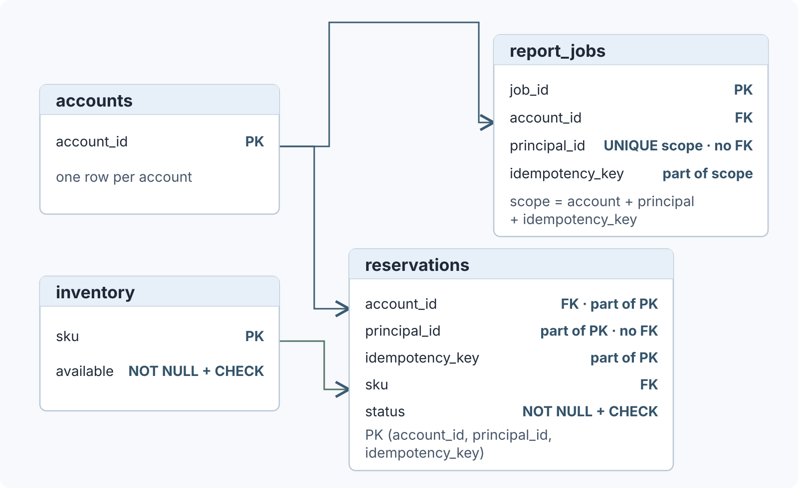

# 如何用约束保护业务规则并为读取建立索引？

**案例：** 报表服务接收账户 `acct-17`、主体 `user-17` 的幂等请求 `report-demo-208`，持久化任务 `job-demo-731`，之后按账户读取最近任务。数据库要保证库存不可为负、外键指向真实父行、同一作用域的报表键最多对应一行；读取任务列表时，索引则提供一个可能更省成本的路径。

本页的业务 schema 与索引说明以 **PostgreSQL 18** 为准；前一篇库存事务明确使用 PostgreSQL 18 Read Committed。这里的 `report-demo-208` 是报表操作键，`reserve-demo-208` 是另一篇库存案例的操作键，两者只是合成标识，不代表同一次业务操作。约束是所有写入方共享的数据规则；索引是需额外维护的查询结构，是否采用由计划器按成本决定。

## 先把不变量放在数据库边界

下面是一个**独立教学 schema**：它包含库存案例中的 `inventory` 与 `reservations`，并额外加入 `accounts` 父表及 `reservations.account_id` 外键，说明账户、SKU 和报表任务如何关联。不要在已按库存篇创建过同名表的数据库里原样重跑这些 `CREATE TABLE`。本例的 `principal_id` 是存储的作用域值，没有主体表外键；身份认证和访问授权不由这个字段或外键自动完成。

~~~sql
CREATE TABLE accounts (
    account_id TEXT PRIMARY KEY
);

CREATE TABLE inventory (
    sku TEXT PRIMARY KEY,
    available INTEGER NOT NULL CHECK (available >= 0)
);

CREATE TABLE reservations (
    account_id TEXT NOT NULL REFERENCES accounts(account_id),
    principal_id TEXT NOT NULL,
    idempotency_key TEXT NOT NULL,
    request_fingerprint TEXT NOT NULL,
    sku TEXT NOT NULL REFERENCES inventory(sku),
    status TEXT NOT NULL CHECK (status IN ('reserved', 'cancelled')),
    PRIMARY KEY (account_id, principal_id, idempotency_key)
);

CREATE TABLE report_jobs (
    job_id TEXT PRIMARY KEY,
    account_id TEXT NOT NULL REFERENCES accounts(account_id),
    principal_id TEXT NOT NULL,
    idempotency_key TEXT NOT NULL,
    request_fingerprint TEXT NOT NULL,
    status TEXT NOT NULL CHECK (
        status IN ('queued', 'running', 'succeeded', 'failed', 'cancelled')
    ),
    created_at TIMESTAMPTZ NOT NULL,
    CONSTRAINT report_jobs_idempotency_scope_key
        UNIQUE (account_id, principal_id, idempotency_key)
);

INSERT INTO accounts (account_id) VALUES ('acct-17');
INSERT INTO inventory (sku, available) VALUES ('SKU-7', 1);
~~~

约束分别保护不同的不变量：

| 要保护的事实 | 示例约束 | 它能保证什么 |
| --- | --- | --- |
| 每个账户、SKU、任务 ID 只对应一行 | `PRIMARY KEY` | 主键是唯一且非空的行标识；即使显式省略 `NOT NULL`，PostgreSQL 主键列也不接受 NULL。 |
| 库存有已知、非负的数值 | `available NOT NULL CHECK (available >= 0)` | 两条规则须并用：CHECK 结果为 TRUE 或 NULL 都算通过，单独 CHECK 不能拒绝 NULL。 |
| 子记录引用已有账户或 SKU | `REFERENCES` | 本例引用父表主键所标识的已有行。默认删除动作是 `NO ACTION`；级联删除须显式声明。 |
| 每个作用域操作键最多保存一条记录 | 复合主键或 `UNIQUE` | `reservations` 用复合主键；`report_jobs` 用任务 ID 主键和操作作用域唯一约束。 |
| 状态值来自允许集合 | `CHECK (status IN (...))` | 只限制当前值，不验证 `queued → running → succeeded` 之类的转移顺序。 |

PostgreSQL 的 `UNIQUE` 默认把含 NULL 的键视作彼此不同；需要把 NULL 也视为相同键时可用 `NULLS NOT DISTINCT`。此 schema 中唯一键每列都声明为 `NOT NULL`，因此操作键比较没有这个歧义。主键和唯一约束会自动建立唯一 B-tree 索引，不要再为相同键重复建一个索引。外键会使用父表主键/唯一键的索引查找父行；PostgreSQL 不会自动为子表的外键列建索引。这里的 `reservations` 主键和 `report_jobs` 作用域唯一索引都以 `account_id` 开头，已有索引可用于账户前缀查找和父账户变更时的子行检查。`reservations.sku` 不在主键索引中；若按 SKU 查预留或删除/更新库存 SKU 时需检查大量子行，可按负载评估单独的 `reservations(sku)` 索引。

CHECK 表达式检查的是当前行，不能可靠表达跨行或跨表不变量；应优先使用 UNIQUE、外键等约束，或把需要协调的写入放进合适的事务协议。`created_at TIMESTAMPTZ` 表示一个时间点：带时区的输入会换算后按 UTC 存储，原时区标签不保留，输出按会话时区显示；混合格式的本地时间文本不能直接当作可靠时间顺序。

在本例 DDL 中，唯一和外键约束未声明 `DEFERRABLE`，因此使用 PostgreSQL 默认的立即检查方式；CHECK 与 NOT NULL 在行插入或更新时立即检查。显式事务里若立即约束报错，当前事务进入失败状态，应用需回滚，或回滚到先前建立的 savepoint，才能继续执行。不能把这句话泛化到所有数据库：例如 SQLite 默认的 ABORT 冲突策略撤销失败语句的更改，但保留同一事务中之前语句的更改。

幂等键的唯一约束只裁决“最多一行”，本身不规定重放返回什么。报表 API 的应用契约是：成功持久化的任务才绑定键；已接受请求以相同键、相同参数重放时，返回已存任务 `job-demo-731` 及其当前状态查询入口；同键不同 `period` 或 `format` 则返回参数冲突。若并发请求先查无记录，那个语句快照只说明当时没有可见的已提交行，不能证明另一个事务尚未提交的任务不存在；最终由写入约束裁决。

例如，任务首次写入时，下面的 `INSERT` 是一条语句，其 `$1` 到 `$5` 由该语句单独绑定：

~~~sql
BEGIN ISOLATION LEVEL READ COMMITTED;
INSERT INTO report_jobs
    (job_id, account_id, principal_id, idempotency_key,
     request_fingerprint, status, created_at)
VALUES ($1, $2, $3, $4, $5, 'queued', now());
COMMIT;
~~~

本例首次 `INSERT` 的绑定为 `$1 = job-demo-731`、`$2 = acct-17`、`$3 = user-17`、`$4 = report-demo-208`、`$5 = fingerprint-A`。以下并发重放分支假设 B 为本次尝试生成新的候选任务 ID `job-demo-732`；它与 A 的其他作用域参数、指纹相同：

~~~sql
BEGIN ISOLATION LEVEL READ COMMITTED;
INSERT INTO report_jobs
    (job_id, account_id, principal_id, idempotency_key,
     request_fingerprint, status, created_at)
VALUES ($1, $2, $3, $4, $5, 'queued', now());
-- 这里是 B 并发 INSERT；A 的同键 INSERT 尚未提交。
~~~

B 这条 `INSERT` 的独立绑定是 `$1 = job-demo-732`、`$2 = acct-17`、`$3 = user-17`、`$4 = report-demo-208`、`$5 = fingerprint-A`。A 和 B 的 INSERT 是两条语句，各自从 `$1` 开始绑定；B 使用新的候选任务 ID，让此例只考察作用域键唯一约束。

| A 的事务结果 | B 等待中的 INSERT | B 接下来做什么 |
| --- | --- | --- |
| A 提交 `job-demo-731` | B 收到 `report_jobs_idempotency_scope_key` 冲突 | 回滚 B 的失败事务，再开新事务按作用域键回查。 |
| A 回滚 | 唯一键冲突消失，B 的 INSERT 可成功 | 提交 B 的事务，键绑定到 `job-demo-732`。 |

只有明确识别为 `report_jobs_idempotency_scope_key` 的冲突才是同键重放的查询线索。`job_id` 主键冲突也会产生 SQLSTATE `23505`，但它是任务 ID 冲突，不能仅凭同一错误码当作同键重放；应用应检查 PostgreSQL 错误诊断中的约束名。即使作用域键冲突，也要回查指纹才能区分重放与换参数。

若 B 因作用域唯一键冲突，先回滚失败事务，再在新事务回查。查询是另一条语句，重新从 `$1` 开始绑定账户、主体和操作键；SQL 位置参数不会跨语句共享一组编号。

~~~sql
ROLLBACK;

BEGIN ISOLATION LEVEL READ COMMITTED;
SELECT job_id, request_fingerprint, status, created_at
FROM report_jobs
WHERE account_id = $1
  AND principal_id = $2
  AND idempotency_key = $3;
COMMIT;
~~~

这条 recovery `SELECT` 的绑定独立为 `$1 = acct-17`、`$2 = user-17`、`$3 = report-demo-208`。本例重放结论假定重放窗口内绑定行仍被保留、作用域键未变。A 已提交时读到的是现有 `job-demo-731`，不是第二条已提交记录；同指纹复用该任务，异指纹返回参数冲突。若 A 回滚，B 的 INSERT 可继续而无需读到 A 的记录。具体 HTTP 重放与响应丢失契约见[请求超时后如何确认结果并安全重试？](../reliability/api-reliability-and-async-delivery.md)；库存的键绑定和失败不占键见[两个请求争夺最后一件库存时，怎样保证只预留一次？](database-fundamentals.md)。

## 复合索引怎样配合任务列表？

调用方已获得查看账户 `acct-17` 全部任务的授权，现在读取该账户最近 20 个任务，同一创建时间用任务 ID 决定稳定顺序：

~~~sql
CREATE INDEX report_jobs_by_account_recent
    ON report_jobs (account_id, created_at DESC, job_id DESC);

SELECT job_id, status, created_at
FROM report_jobs
WHERE account_id = $1
ORDER BY created_at DESC, job_id DESC
LIMIT 20;
~~~

这条查询自己的 `$1` 绑定为 `acct-17`。B-tree 按复合键的字典序排列：前导列 `account_id` 的等值条件通常最有效，能直接定位这个账户的键区间；`created_at DESC, job_id DESC` 随后给出该区间内要求的次序和稳定并列顺序。

| 索引键 | 查询中的作用 | 本例边界 |
| --- | --- | --- |
| `account_id` | `WHERE account_id = $1` 限定账户区间 | PostgreSQL 18 的多列 B-tree 也能利用非前导列条件或 skip scan；只是前导列等值条件通常更直接、更有效。 |
| `created_at DESC` | 在账户范围内按最近时间先读 | 匹配的 B-tree 可以避免另做排序，但计划器仍会比较它与顺序扫描加排序的成本。 |
| `job_id DESC` | 为相同时间的任务提供确定顺序 | 查询排序须与索引能够提供的列序和方向匹配；B-tree 也可反向扫描，不要求索引声明与查询方向逐字相同。 |
| `status` | 只在 SELECT 输出 | 本索引没有 `status`，需要从表行取值；它不是覆盖该查询的索引。 |

若计划器选择匹配的索引，`LIMIT 20` 可在收集到 20 条可见结果后停止继续取行；MVCC 可见性等条件可能使它检查多于 20 个索引项。它不保证只读前 20 个物理项，也不保证计划器必选索引。若查询需读取整表很大比例，顺序读表再排序可能更便宜。

索引列序应从过滤和排序需求推导，字段越多不等于越快。每个索引占磁盘和缓存，并增加写入和后续清理的维护成本；给表加索引后还需用目标数据库的真实数据、统计信息与 `EXPLAIN` 检查查询计划。`EXPLAIN ANALYZE` 会实际执行语句，评估有写入副作用的语句时要考虑它真的会改数据。

## 计划器为什么有时不用已建索引？

计划器比较不同访问路径的估算成本，不会因为索引存在就必定选它。前面的 PostgreSQL 列表索引已建好后，本机 PostgreSQL 14.24 两行小表的计划器估算后选择了顺序扫描加排序；数据、统计信息、目标版本都会影响计划。接着保留一个独立 SQLite 教学库：它的 `orders` 与下一篇 NULL / join 章节的同名表结构不同，需分别建表。这里合成 1,000 个订单，`customer_id = 17` 对应 10 行（`order_id` 为 17、117、……、917），再观察索引前后的查询计划。

> [!example]- 两行表上已有索引但仍选择顺序扫描（本地 PostgreSQL 14.24）
> 下面的两条任务插入到前面刚创建的 `report_jobs` 教学表；复现时表中只有这两行，查询用字面量绑定账户值：
>
> ~~~sql
> INSERT INTO report_jobs VALUES
>     ('job-demo-731', 'acct-17', 'user-17', 'report-demo-208',
>      'fingerprint-A', 'queued', '2026-11-10 12:00:00+00'),
>     ('job-demo-730', 'acct-17', 'user-17', 'report-demo-207',
>      'fingerprint-B', 'running', '2026-11-11 12:00:00+00');
> ANALYZE report_jobs;
>
> EXPLAIN (COSTS OFF)
> SELECT job_id, status, created_at
> FROM report_jobs
> WHERE account_id = 'acct-17'
> ORDER BY created_at DESC, job_id DESC
> LIMIT 20;
> ~~~
>
> 本机实际计划：
>
> ~~~text
> Limit
>   ->  Sort
>         Sort Key: created_at DESC, job_id DESC
>         ->  Seq Scan on report_jobs
>               Filter: (account_id = 'acct-17'::text)
> ~~~
>
> 对这两行表，PostgreSQL 14.24 的计划器估算后仍选了 `Seq Scan → Sort`，虽然匹配过滤和排序的索引已经存在。这是该版本、数据集和统计信息下的一次实际计划，不表示测得顺序扫描耗时更低，也不代表 PostgreSQL 18 或更大数据集会作出相同选择。

> [!example]- 用 1,000 个合成订单观察索引计划
> ~~~sql
> PRAGMA automatic_index = OFF;
> CREATE TABLE orders (
>     order_id INTEGER PRIMARY KEY,
>     customer_id INTEGER NOT NULL,
>     amount_cents INTEGER NOT NULL,
>     placed_at INTEGER NOT NULL
> );
> WITH RECURSIVE seq(n) AS (
>     VALUES(1)
>     UNION ALL
>     SELECT n + 1 FROM seq WHERE n < 1000
> )
> INSERT INTO orders
> SELECT n, n % 100, n * 25, n FROM seq;
>
> EXPLAIN QUERY PLAN
> SELECT order_id, amount_cents, placed_at
> FROM orders
> WHERE customer_id = 17
> ORDER BY placed_at DESC;
> -- SQLite 3.51.0：SCAN orders；USE TEMP B-TREE FOR ORDER BY
>
> CREATE INDEX orders_by_customer_and_time
>     ON orders(customer_id, placed_at);
>
> EXPLAIN QUERY PLAN
> SELECT order_id, amount_cents, placed_at
> FROM orders
> WHERE customer_id = 17
> ORDER BY placed_at DESC;
> -- SQLite 3.51.0：SEARCH orders USING INDEX orders_by_customer_and_time (customer_id=?)
> ~~~

本地 SQLite 3.51.0 实际输出显示：无索引时全表 `SCAN` 并用临时 B-tree 排序；创建 `(customer_id, placed_at)` 后改为按 `customer_id` 的索引 `SEARCH`，在等值筛出的客户区间内按索引反向读取以满足 `placed_at DESC`。这验证了该引擎、该数据集上的路径和排序变化，不是 PostgreSQL 的计划，也没有测量查询耗时或证明端到端延迟必然下降。查询取出 `amount_cents`，但索引不含该列，所以也不是覆盖索引。SQLite 的 `EXPLAIN QUERY PLAN` 输出是面向调试的描述，版本升级时格式可能变化。

**接下来：** 事务如何将扣库存与操作记录一起提交，见[事务隔离与预写日志能保证什么？](database-transactions-isolation-and-recovery.md)。NULL、外连接与聚合会如何改变报表行数，见[SQL 空值、连接与分组会怎样改变报表 42 的结果？](sql-null-joins-and-aggregates.md)。

> [!info]- 来源
> - 主键、唯一、外键、删除动作和 CHECK/NULL 语义：[PostgreSQL 18, Constraints](https://www.postgresql.org/docs/18/ddl-constraints.html)，§5.5；`TIMESTAMPTZ` 的输入、存储与显示：[Date/Time Types](https://www.postgresql.org/docs/18/datatype-datetime.html)，§8.5，核对于 2026-11-11。
> - 可延迟约束类型与立即检查边界：[PostgreSQL 18, SET CONSTRAINTS](https://www.postgresql.org/docs/18/sql-set-constraints.html)，核对于 2026-11-11。
> - 显式事务的原子性与失败后 `ROLLBACK` / savepoint 边界：[PostgreSQL 18, Transactions](https://www.postgresql.org/docs/18/tutorial-transactions.html)，§3.4；[ROLLBACK](https://www.postgresql.org/docs/18/sql-rollback.html)，核对于 2026-11-11。
> - 唯一索引检查会等待未提交竞争者并按其提交/回滚结果重检：[PostgreSQL 18, Index Uniqueness Checks](https://www.postgresql.org/docs/18/index-unique-checks.html)，§63.5；唯一违规可读取约束名等错误诊断字段，PK 与 UNIQUE 冲突都属 `23505`：[Error Codes](https://www.postgresql.org/docs/18/errcodes-appendix.html)，Appendix A，核对于 2026-11-11。
> - 报表任务 API 的同键重放、指纹与查询入口契约：[请求超时后如何确认结果并安全重试？](../reliability/api-reliability-and-async-delivery.md)，库存键策略另见[库存事务页](database-fundamentals.md)。
> - 多列 B-tree 的前导列、后续列与 skip scan：[PostgreSQL 18, Multicolumn Indexes](https://www.postgresql.org/docs/18/indexes-multicolumn.html)，§11.3；索引排序和 `ORDER BY` / `LIMIT`：[Indexes and ORDER BY](https://www.postgresql.org/docs/18/indexes-ordering.html)，§11.4，核对于 2026-11-11。
> - 索引维护成本与计划器取舍：[PostgreSQL 18, Indexes](https://www.postgresql.org/docs/18/indexes.html)，§11.1；索引更新和统计信息：[Indexes Introduction](https://www.postgresql.org/docs/18/indexes-intro.html)，§11.1；估算计划和实际执行的区别：[EXPLAIN](https://www.postgresql.org/docs/18/sql-explain.html)，核对于 2026-11-11。
> - SQLite 默认 ABORT 的语句级回滚范围：[SQLite, The ON CONFLICT Clause](https://www.sqlite.org/lang_conflict.html)；`SCAN`、`SEARCH` 和计划输出格式边界：[EXPLAIN QUERY PLAN](https://www.sqlite.org/eqp.html)；多列索引同时筛选和排序：[Query Planning](https://www.sqlite.org/queryplanner.html)，§§2.2、3.1，核对于 2026-11-11。
