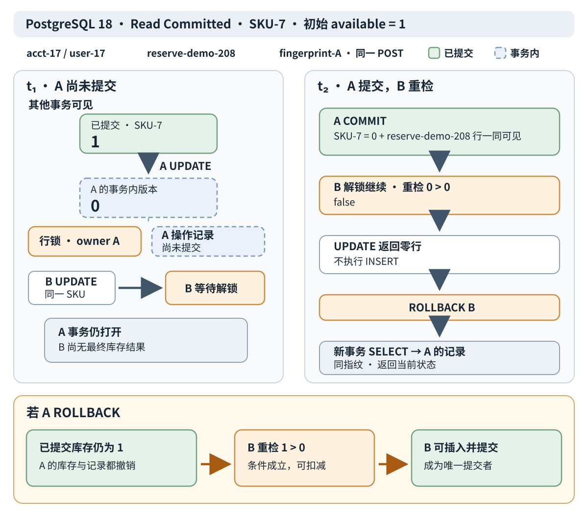
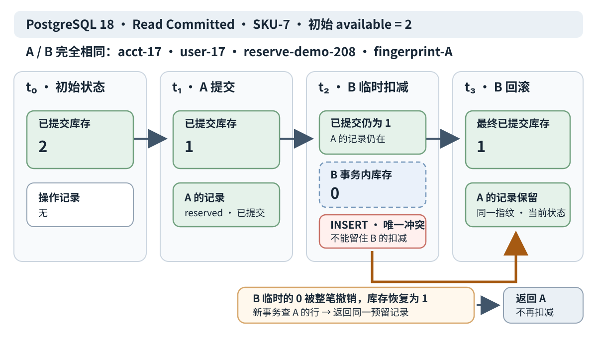
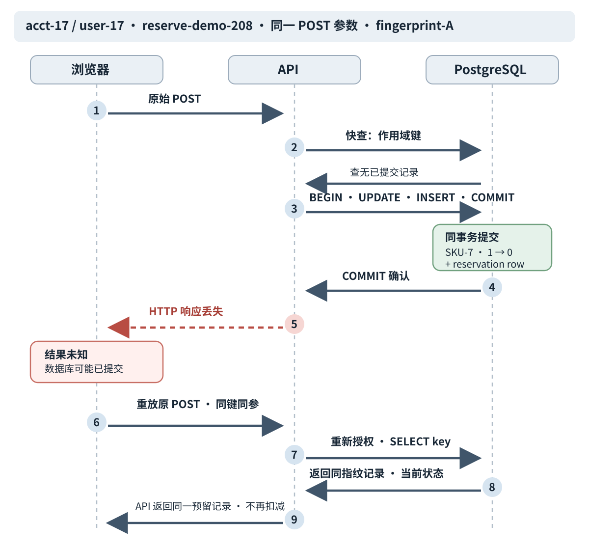

# 两个请求争夺最后一件库存时，怎样保证只预留一次？

**案例：** 账户 `acct-17`、主体 `user-17` 要预留 `SKU-7`，初始库存 `available = 1`。浏览器发送携带稳定操作键 `reserve-demo-208` 的 POST；请求 A 是首次尝试，B 可能是并发到达的重放。数据库必须保证不同操作不能把库存扣成负数，同一作用域键也不能提交两条预留记录。

本页的建表和并发时序以 **PostgreSQL 18 Read Committed（读已提交）**为准。复合键 `(account_id, principal_id, idempotency_key)` 标识一次逻辑操作；规范化业务参数的指纹用于识别同键请求是否仍表达同一意图。本文选定的 API 契约是：**成功提交的预留才绑定操作键；库存失败回滚且不占键；同键同指纹重放返回同一预留记录的当前状态。**这不是“逐字节重放第一次 HTTP 响应”。

## 为什么先读再无条件写会超卖？

如果两个不同操作先后 `SELECT available`，都读到 1，再按旧读数无条件写成 0，最终库存虽为 0，两个调用方却都可能得到“预留成功”。读取只是观察当时的值；它没有把“库存仍大于零”这个条件附着到之后的写入上。

把条件放进扣减语句，并把成功操作记录写在同一事务中：

~~~sql
-- PostgreSQL 18 DDL
CREATE TABLE inventory (
    sku TEXT PRIMARY KEY NOT NULL,
    available INTEGER NOT NULL CHECK (available >= 0)
);

CREATE TABLE reservations (
    account_id TEXT NOT NULL,
    principal_id TEXT NOT NULL,
    idempotency_key TEXT NOT NULL,
    request_fingerprint TEXT NOT NULL,
    sku TEXT NOT NULL REFERENCES inventory(sku),
    status TEXT NOT NULL CHECK (status IN ('reserved', 'cancelled')),
    PRIMARY KEY (account_id, principal_id, idempotency_key)
);

INSERT INTO inventory VALUES ('SKU-7', 1);
~~~

`inventory.sku` 的主键使每个 SKU 只有一行，`CHECK` 与 `NOT NULL` 一起禁止负数和未知库存；单独的 `CHECK` 不会拒绝表达式为 `NULL` 的值。`reservations` 的复合主键使同一账户、主体和操作键最多保存一条成功结果；外键让预留指向存在的 SKU。记录在重放承诺窗口内保留，`status` 可从 `reserved` 变为 `cancelled`，但取消不会释放这个作用键或删除其历史结果。约束如何作用于所有写入方，以及索引如何服务读取，见[如何用约束保护业务规则并为读取建立索引？](database-constraints-and-indexes.md)。

> [!info] SQL 方言边界
> `$1`、`$2` 等是 PostgreSQL 位置参数，由驱动对**每条语句分别**绑定；编号不会跨语句共享一组参数。SQLite 的参数形式另有 `?`、`?NNN` 和命名参数，不能不经方言转换就照抄。本页的并发结论也不应直接套到其他数据库。若另建 SQLite 对照表，需在每条连接启用外键；普通 SQLite 表的类型声明不等同 PostgreSQL 的强类型约束，可选用 SQLite 3.37+ 的 `STRICT` 表或适当检查。

## 条件更新怎样让两个并发请求竞争？

### 先查操作键是快路径，不是并发裁决

API 先按当前认证得到的账户和主体授权，再规范化业务参数并计算指纹。可先查询已提交的操作记录：

~~~sql
SELECT request_fingerprint, sku, status
FROM reservations
WHERE account_id = $1
  AND principal_id = $2
  AND idempotency_key = $3;
~~~

**这条 SELECT 自己绑定三个参数：**`$1 = acct-17`、`$2 = user-17`、`$3 = reserve-demo-208`。同键同指纹返回该预留记录的**当前** `status`；同键异指纹返回冲突。若记录状态已是 `cancelled`，重放仍返回该记录的当前状态，不会重新扣库存或把它“复活”。

快查没有找到记录，只能说明本条 SELECT 的语句快照里没有**已提交且可见**的记录；原事务可能仍在执行。不能据此断言旧操作已回滚，也不能跳过后面的行锁与唯一约束。

如果快查未命中，服务在一个事务中条件扣减并插入成功操作记录。每条语句的 `$1` 都从自己的绑定开始：UPDATE 只绑定 SKU；INSERT 另行绑定作用域键、指纹和 SKU。

~~~sql
BEGIN ISOLATION LEVEL READ COMMITTED;

UPDATE inventory
SET available = available - 1
WHERE sku = $1 AND available > 0
RETURNING available;
-- UPDATE 的绑定：$1 = SKU-7。
-- 恰好返回一行才执行 INSERT；返回零行则 ROLLBACK 并跳过 INSERT。

INSERT INTO reservations
    (account_id, principal_id, idempotency_key, request_fingerprint, sku, status)
VALUES ($1, $2, $3, $4, $5, 'reserved');
-- INSERT 的绑定：$1 = acct-17，$2 = user-17，$3 = reserve-demo-208，
--               $4 = fingerprint-A，$5 = SKU-7。

COMMIT;
~~~

UPDATE 的 `RETURNING` 返回实际更新行的新值：库存从 1 扣到 0 时，它返回**一行，值为 0**；“返回零行”才表示没有可扣减的库存行。两条 SQL 的参数编号各自从 `$1` 开始，不是一个跨语句的五参数列表。

> [!info] 更新行数为什么是业务判断
> `inventory.sku` 的主键保证每个 SKU 只有一行，因此这里最多更新一行。恰好一行才表示扣减成功；零行后要在新事务按幂等契约回查。若这条 SELECT 仍未看到已提交记录，API 才能按本例契约返回这次库存失败；这只表示该语句快照当时不可见，不保证另一个事务稍后不会提交同键记录。若 UPDATE 影响多行，说明实际 schema 没有维持本例的 SKU 唯一性。

图中 A 的未提交 `available = 0` 对其他事务不可见；A 同时插入的操作记录也尚不可见。B 等待 A 持有的 SKU 行锁。A 提交时，库存 0 和 `reserve-demo-208` 记录一同可见；B 随后在新行版本上重检 `available > 0`，条件为假，UPDATE 返回零行，所以 B 不执行 INSERT。B 回滚本次尝试，再以新事务按键查记录。

如果 A 回滚，库存更改和未提交记录一起撤销。等待中的 B 重检原值 1，条件成立时可扣减、写入该作用键并提交。行锁释放不表示前一个请求成功；结果取决于事务最终提交还是回滚。

### 零行或唯一冲突后，先回滚再开新事务查询

如果 B 的 UPDATE 返回零行，可能是 SKU 不存在或当前无库存；如果 INSERT 因复合主键冲突报错，本事务也不能保留之前的库存扣减。PostgreSQL 的普通唯一约束错误会使当前事务进入失败状态。两种路径都先结束整笔尝试，再用**另一条独立绑定的 SELECT**查询：

~~~sql
-- UPDATE 无行，或 INSERT 因唯一键报错后：
ROLLBACK;

BEGIN ISOLATION LEVEL READ COMMITTED;
SELECT request_fingerprint, sku, status
FROM reservations
WHERE account_id = $1
  AND principal_id = $2
  AND idempotency_key = $3;
-- 这条新 SELECT 独立绑定：$1 = acct-17，$2 = user-17，$3 = reserve-demo-208。
COMMIT;
~~~

这次 SELECT 的 `$1` 到 `$3` 与快查一样映射到账户、主体、键，但它是新语句、重新绑定；前面的 UPDATE/INSERT 参数不在这里延续。新事务取得新的 Read Committed 语句快照。

API 在已重新授权的作用域内比较指纹：这条新 SELECT 找到同键同指纹记录，就返回该记录的当前状态；异指纹就返回冲突。若 SELECT 仍未看到已提交记录，API 可按业务规则报告这次 SKU 不存在或已售罄。它不能据此断言并发请求之后不会提交。**失败回滚不占键**，所以完全相同的 POST 日后可在补货后成功；失败期间也没有一条“失败结果”供 API 永久重放。是否区分“不存在”和“售罄”，可通过另一次库存读取实现，但它只说明那次读取的新状态。

成功绑定的记录须在承诺的重放窗口内留存。响应未知时，浏览器重放原 POST；API 在 POST 处理过程中查记录，而不是要求浏览器调用本例未定义的“按键 GET”。窗口与重试边界见[请求超时后如何确认结果并安全重试？](../reliability/api-reliability-and-async-delivery.md)。

### 库存仍有余量时，同一操作键由唯一约束裁决

为了单独观察唯一约束路径，下面**只把 SKU-7 初始库存从 1 改为 2**。A 与 B 仍是同一 POST：账户、主体、SKU、操作键、请求参数和 `fingerprint-A` 全相同。A 未提交前，B 的快查也看不到 A 的记录。

A 把库存从 2 改成 1，并和预留记录一起提交。B 等待行锁后基于新值 1 重检，条件仍成立，所以本事务暂时把库存从 1 改到 0。B 随后插入同一复合主键，数据库不允许第二条记录。**不能只撤销 INSERT**：那会让 B 的临时扣减留在库里。B 必须 `ROLLBACK` 整笔尝试；库存恢复为已提交的 1，A 的记录仍在。新事务读到同键同指纹的 A 记录，API 返回同一预留记录的当前状态。

这个单 SKU 时序中，两个 UPDATE 先被库存行锁串行化；B 进入 INSERT 时 A 已提交，所以这里的唯一冲突立即判定，并没有等待未提交的唯一索引插入。其他并发插入写法可能在唯一性检查时等待未提交的竞争者结束，再判定冲突。本例的安全性来自原子事务、复合主键和整笔回滚，不是“预查曾经没有记录”。

### 同键但不同 SKU 的未提交边界

复合主键只在尝试写入 `reservations` 时裁决键冲突，并不会预先锁住所有使用该键的请求。假设 A 正在事务内预留有货的 `SKU-7`，还没提交；B 复用 `reserve-demo-208`，却改为无货的 `SKU-8`。SKU 是业务参数，因此 B 的指纹不同于 A。B 的快查看不到 A 尚未提交的记录，UPDATE 只触及 SKU-8 并返回零行；B 回滚后新事务查询时，A 的记录仍不可见。B **可以先返回无库存失败**，而 A 随后提交 SKU-7 的预留。若 B 之后再次提交 `SKU-8` 和 B 原有的其他请求参数，并继续使用 `reserve-demo-208`，快查会看到 A 的 SKU-7 记录并因指纹不同返回冲突。

| 时点 | A：`SKU-7` | B：`SKU-8`，复用同一键 | 可见性与结果 |
| --- | --- | --- | --- |
| A 尚未提交 | 事务内 `1 → 0`，操作记录未提交 | 快查没有可见记录 | B 的快查不能判断 A 已完成或已回滚 |
| B 尝试 | 仍持有 `SKU-7` 行锁 | 库存为 0，UPDATE 返回零行 | B 不碰 `SKU-7`，也没有执行 INSERT |
| B 回查 | 操作记录仍未提交 | 新事务 SELECT 仍无可见记录 | B 可以先返回无库存；A 随后仍可提交 |

这里没有承诺 B 必须等待 A，也没有承诺立即把 B 判为参数冲突，因为 B 在失败前没有尝试 INSERT，也没有占用键。如果 B 有库存并到达 INSERT，唯一约束才可能让它等待 A 的事务，然后在 A 提交后拒绝重复键；若 A 回滚，则 B 的 INSERT 可能成功。若产品要求**所有未提交的同键请求**都先裁决键与参数，需另行设计明确的占键/claim 协议；本例的最小成功记录模式不提供该承诺。

## 提交成功但响应超时，怎样认出原操作？

一次 POST 超时只说明浏览器没有收到响应。它不能单独区分请求未到服务器、数据库事务回滚、原事务仍在进行，或提交成功但 HTTP 响应丢失。以最后一种情况为例，数据库已经同时保存 `SKU-7.available = 0` 和 `(acct-17, user-17, reserve-demo-208, fingerprint-A)` 的预留记录；浏览器仍处于 unknown outcome（未知结果）。

浏览器在未知结果时重放**原 POST**，使用同一作用域键和原业务参数；本例没有按操作键查询的 GET 契约。API 重新验证当前主体权限，按账户、主体和键查持久记录并核对指纹。同键同指纹返回该预留记录的**当前状态**；若记录已取消，返回 `cancelled`，不会再次扣库存。这里承诺恢复的是同一业务记录与效果，不要求 HTTP 状态码、响应时间戳或字节表示和首次响应完全相同。RFC 9110 的幂等定义关注重复请求的预期效果；本页的记录及当前状态约定是这个 API 示例的具体契约。

若 API 查不到记录，结论仍只是“这条 SELECT 没看到已提交记录”，不能据此断定旧事务已回滚。相同 SKU 上仍由行锁、条件 UPDATE 和唯一约束决定后续结果；跨 SKU 的未提交边界见上一节，失败可先于另一事务提交返回。浏览器继续使用原 POST 与原键，不生成新键把重试伪装成第二项购买。

库存更新和操作记录必须处于同一数据库事务。如果扣减先提交、操作键之后另行写入，进程可能在两者之间崩溃；重试就无法判断是旧操作还是新购买。

这个事务只覆盖本数据库，不能同时提交远端支付或消息队列副作用。若要通知队列，应把待发指令作为 outbox 记录和本地业务效果一同提交，再由发送端重试投递；远端仍须以自己的业务键去重或核对，见[怎样设计可持久查询的账户报表？](../architecture/system-design-fundamentals.md)。本节的未知结果发生在 HTTP 响应交付路径；若还要承诺数据库故障后的提交持久性，需一并核对同步提交和存储 flush 配置，见[事务隔离与预写日志能保证什么？](database-transactions-isolation-and-recovery.md)。

## 同一库存不变量怎样用于抽奖？

抽奖服务可提供公开只读的 `GET /draws/{campaignId}`，返回活动规则、时间和可见状态；已认证参与者以 `POST /draws/{campaignId}/entries` 提交请求。服务先验证当前主体权限，再按 `(campaign_id, principal_id, idempotency_key)` 查该操作：同键同指纹且已有参与结果时，返回已保存的抽取结果和当前领奖状态，即使活动已关闭；同键异指纹返回冲突。只有该查询未看到已提交操作记录，才检查活动是否开放和参与资格，再尝试建立新参与记录。参与表必须有 `UNIQUE (campaign_id, principal_id)`，让同一参与者即使用不同操作键并发提交，也只能有一个参与结果。活动关闭要返回明确的 `campaign-closed` 状态。

若写参与记录时唯一约束冲突，先回滚本次事务并在新事务按同一 `(campaign_id, principal_id, idempotency_key)` 重新查询：查到同键同指纹已提交结果，说明这是同一 POST 的并发重放，应返回该结果；查到同键异指纹则返回操作键冲突；仍未看到该操作键时，才把 `(campaign_id, principal_id)` 冲突处理为“已经参与”，不把换键重试当作同一抽奖结果。这样既能恢复并发同键请求的已提交结果，也由唯一约束裁决换键重复参与。其他规则冲突应返回明确状态，不让浏览器从通用错误猜测结果。

本例把“报名已接受但奖品库存为零”定义为已完成的未中奖结果：服务在同一事务保存参与记录和权威 `no-prize` 结果，之后同键重放仍取回该结果，不会重新抽一次。如果某活动把库存不足定义为拒绝报名，则那次尝试不保存完成结果、不占键；活动规则必须选择其中一种语义。有限奖品的扣减与参与、中奖结果、待领取状态仍需同事务提交。随机性与审计须符合活动承诺；统计事件不能决定资格或权威中奖结果。抽奖操作记录也要在约定的重放窗口内保留。

`GET /draws/{campaignId}/entries/{entryId}` 只向当前结果所有者返回本人结果与领取状态。独立的 `POST /prizes/{prizeId}/claims` 再验证中奖记录所有者，只收集履约所需资料并写入履约状态；后台活动管理权限应比公开读取和本人参与更严格。旧档案保留导航入口，见[归档抽奖 API 规则入口](../../archive/front-end/Deprecated_Interview_Notes/prize-draw-api-invariants.md)。

**接下来：** 本页解释原子库存写入、操作结果和局部事务边界。NULL、连接与分组改变报表查询的方式见[SQL 空值、连接与分组会怎样改变报表 42 的结果？](sql-null-joins-and-aggregates.md)；隔离级别、WAL 和崩溃恢复见[事务隔离与预写日志能保证什么？](database-transactions-isolation-and-recovery.md)。

> [!info]- 来源
> - Read Committed 的语句快照、并发 `UPDATE` 等待以及在提交的新行上重检 `WHERE`；前一个更新者回滚时后一个可以继续：[PostgreSQL 18, Transaction Isolation](https://www.postgresql.org/docs/18/transaction-iso.html)，§13.2.1，核对于 2026-11-11。
> - `UPDATE ... RETURNING` 只返回实际更新行的新值；位置参数在各个预备语句内绑定：[PostgreSQL 18, UPDATE](https://www.postgresql.org/docs/18/sql-update.html)，§UPDATE；[PREPARE](https://www.postgresql.org/docs/18/sql-prepare.html)，§PREPARE，核对于 2026-11-11。
> - 主键、唯一、外键、CHECK 与 NOT NULL 的约束行为：[PostgreSQL 18, Constraints](https://www.postgresql.org/docs/18/ddl-constraints.html)，§5.5.1–5.5.5，核对于 2026-11-11。
> - 事务把多步写入作为一个全有或全无的边界、提交时一同可见、回滚撤销；错误后须回滚到保存点或结束失败事务：[PostgreSQL 18, Transactions](https://www.postgresql.org/docs/18/tutorial-transactions.html)，§3.4；[ROLLBACK](https://www.postgresql.org/docs/18/sql-rollback.html)，核对于 2026-11-11。
> - 竞争插入同一唯一键时等待并根据另一事务提交或回滚裁决：[PostgreSQL 18, INSERT](https://www.postgresql.org/docs/18/sql-insert.html)，§INSERT；[Index Uniqueness Checks](https://www.postgresql.org/docs/18/index-unique-checks.html)，§63.5，核对于 2026-11-11。本页单 SKU 时序展示行锁先串行化、插入时胜者已提交的具体路径。
> - 幂等方法重复请求的预期效果应等同于单次请求：[RFC 9110, §9.2.2](https://www.rfc-editor.org/rfc/rfc9110.html#section-9.2.2)，核对于 2026-11-11。RFC 不规定本例响应序列化或取消后的当前状态；这些是上文声明的 API 契约。
> - SQLite 外键默认关闭、须由应用启用；动态类型、`STRICT` 表及参数语法：[SQLite Foreign Key Support](https://www.sqlite.org/foreignkeys.html)，§1–2；[STRICT Tables](https://www.sqlite.org/stricttables.html)，§1–2；[SQL Language Expressions](https://www.sqlite.org/lang_expr.html)，§4 Parameters，核对于 2026-11-11。
