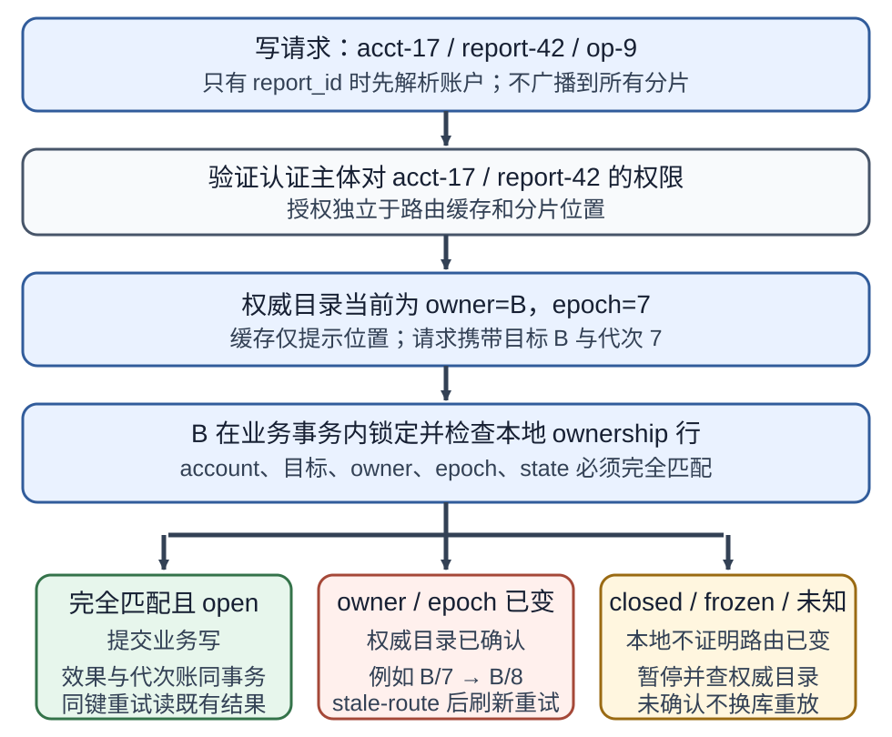
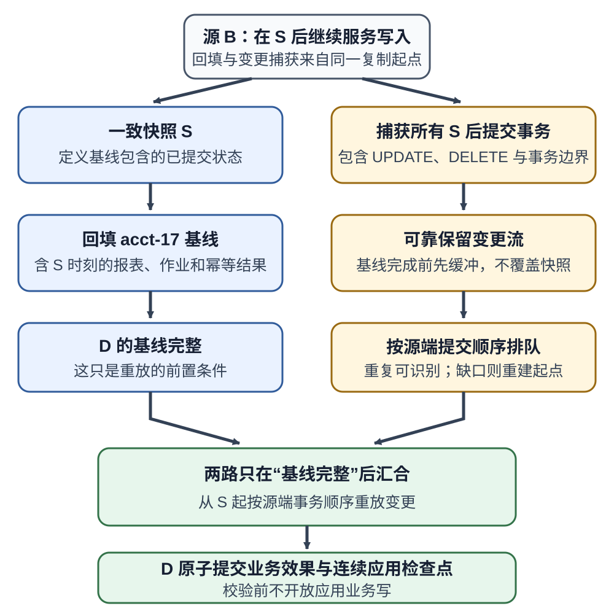
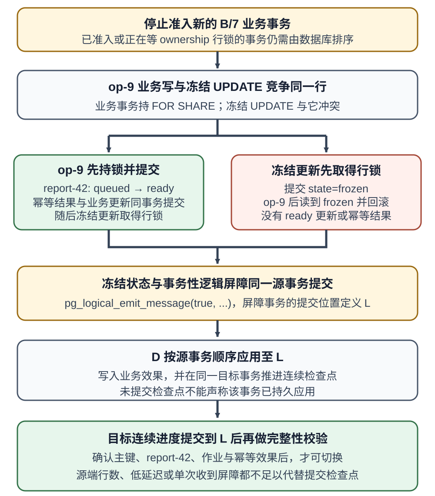
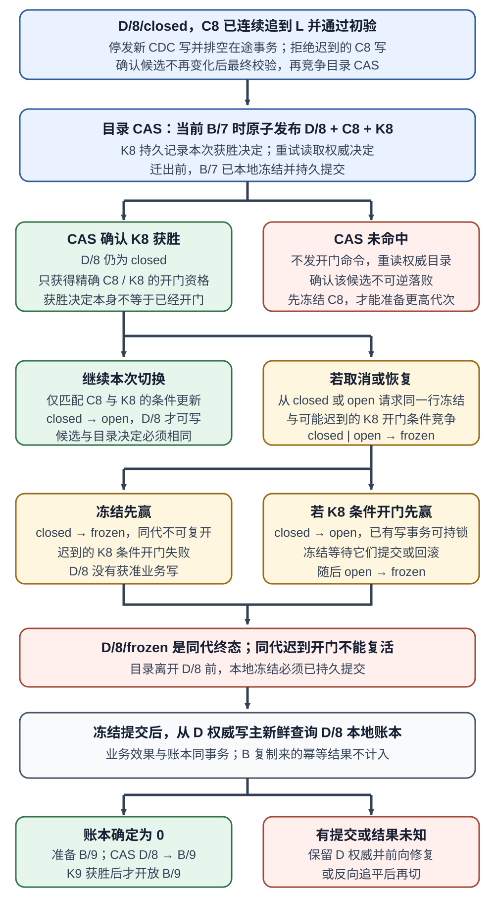

# 单库接近容量上限时，怎样分片并在搬迁中保持唯一写入者？

**案例：** 一个合成报表服务按账户保存报表、作业状态和幂等结果。报表 `report-42` 属于 `acct-17`。单库的安全容量或维护窗口不再满足需求，团队准备把账户分到多个数据库；搬迁期间，任何时刻都不能让旧库 B 与新库 D 同时接受 `acct-17` 的业务写入。

本章沿一次完整决策展开：先把必须一起提交的数据放在同一逻辑分片，按访问负载判断瓶颈是一组键还是单个热键，再把 `acct-17` 从 B 搬到 D。迁移以一致快照起点 S 回填，以捕获并有序应用 S 之后的变更追平；旧写入口在一条共享所有权记录上冻结，目标校验到屏障位置 L 后，路由目录以条件更新切换代次，再开放 D。路由缓存只是位置提示，授权、唯一写入者和数据完整性各自仍有明确责任。

下图只约定一个已知账户键的写请求如何进入分片。若请求只带 `report-42`，服务先解析它属于哪个账户；这一步不向全部分片广播。解析路由也不能代替逐次授权。



## 先决定哪些操作必须待在同一个分片

shard key（分片键）要同时适配主要查询和事务边界。本例选择 `account_id`：按账户列出报表、查询幂等结果、改变作业状态时都能用它直接定位；`report-42`、相关作业和账户范围内的操作记录因此位于同一个分片。账户内的一组更新仍可由一笔本地数据库事务提交。

这个选择也限定唯一性的范围。如果作业编号只要求在账户内唯一，应让唯一约束包含账户键，例如 `UNIQUE (account_id, job_id)`；若编号要求跨所有账户全局唯一，则需要可验证的全局命名空间、独立分配器或调用方提供的全局唯一键。每个数据库各有一条 `UNIQUE (job_id)` 只能保证**单库内**唯一，不能把不同分片上的冲突裁决掉。

`logical shard（逻辑分片）`是按分片键划出的数据范围及其当前写所有者；`physical node（物理节点）`是实际承载数据库实例的机器或服务端点。一个物理节点可以承载多个逻辑分片；逻辑分片也可以由一个主实例及多个副本组成。重映射逻辑分片与更换主实例是不同操作，后者本身并不改变哪个账户归哪个逻辑分片。

分片与 `replication（复制）`也解决不同问题：分片把不同键的主数据分开，扩展可承载的数据量和不同键的写入总量；复制让同一数据有冗余副本，可用于故障切换或读取扩展。采用单写者的复制拓扑时，增加只读副本不会把同一热账户的写入摊到更多主实例。多主或共识型系统可以采用不同的写入与冲突协议，不能据此省略本章例子所需的所有权契约。

请求若只携带 `report_id`，服务必须先由资源目录找出所属账户，或让稳定 ID 中带有可验证的路由信息。任意跨账户搜索会成为 `scatter-gather（散播后汇总）`：请求扇出到多个分片，再合并结果，尾延迟和失败面都会随参与分片增加。跨分片写入也不能假定单个 SQL `COMMIT` 能原子覆盖多个独立数据库；要么选用有明确故障恢复语义的协调事务，要么重构业务边界并接受可恢复的分步流程。事务、隔离和协调提交的边界见[事务隔离与 WAL 能保证什么？](database-transactions-isolation-and-recovery.md)。

路由只确定数据位置，不代表用户拥有该数据。服务仍须从认证主体和资源关系验证其对 `acct-17/report-42` 的权限；路由目录不可作为授权名单，也不可因缓存命中而跳过授权。

## 固定取模为何在加节点时大幅搬家？

先用可手算的合成映射比较扩容成本。假设 `h(acct-n) = n`，分片从 0 编号；这是为了算术透明而选的输入，不是生产哈希函数。三个分片时余数 `0/1/2` 分别映射到 A/B/C；新增 D 后，分片数变四，余数 `0/1/2/3` 映射到 A/B/C/D。

| 账户 | `h(key)` | `% 3` 目标 | `% 4` 目标 |
| --- | ---: | --- | --- |
| `acct-17` | 17 | `17 % 3 = 2 → C` | `17 % 4 = 1 → B` |
| `acct-20` | 20 | `20 % 3 = 2 → C` | `20 % 4 = 0 → A` |
| `acct-21` | 21 | `21 % 3 = 0 → A` | `21 % 4 = 1 → B` |
| `acct-35` | 35 | `35 % 3 = 2 → C` | `35 % 4 = 3 → D` |
| `acct-49` | 49 | `49 % 3 = 1 → B` | `49 % 4 = 1 → B` |
| `acct-52` | 52 | `52 % 3 = 1 → B` | `52 % 4 = 0 → A` |
| `acct-65` | 65 | `65 % 3 = 2 → C` | `65 % 4 = 1 → B` |
| `acct-70` | 70 | `70 % 3 = 1 → B` | `70 % 4 = 2 → C` |
| `acct-82` | 82 | `82 % 3 = 1 → B` | `82 % 4 = 2 → C` |

这九个键中有八个改变目标；`acct-49` 的余数保持为 1，所以仍到 B。固定取模的好处是映射容易计算，适合分片数长期稳定或可以整体重建数据的系统；代价是分片数变化时大批键可能重新映射。实际要迁移多少数据还取决于真实键的分布，不能只看键的数量。

`consistent hashing（一致性哈希）`把节点与键映射到循环哈希空间，键归给顺时针遇到的第一个节点。下面继续用 0–99 的玩具环，token 位置和键的哈希值都是教学输入。约定区间为 `(前一 token, 当前 token]`，所以新节点 D=20 会接管 `(0,20]`：

| 账户哈希点 | 原环 `A=0, B=33, C=66` | 加入 `D=20` 后 |
| ---: | --- | --- |
| 17 | B | D |
| 20 | B | D |
| 21 | B | B |
| 35 | C | C |
| 49 | C | C |
| 52 | C | C |
| 65 | C | C |
| 70 | A | A |
| 82 | A | A |

因此 `acct-17` 从 B 移到 D，九个样例中只有它与 `acct-20` 搬家；同一小样本里，固定取模搬 8/9，一致性哈希搬 2/9。这个比例只说明映射规则的差异，不是负载均衡实测。节点只有少数 token 时，各区间仍可能很不均匀；`virtual node（虚拟节点）`让一个物理节点在环上有多个 token，通常能缩小区间大小偏差，但不能保证真实数据和请求负载均匀。环给出候选位置，不会自动切换账户的权威目录；本章继续追踪 `acct-17`，只有回填、追平、校验和单写切换完成后才逐账户改路由。

哈希分片适合按离散键点查和均匀分摊许多键，但打散按键范围的局部性。`range partitioning（范围分区）`保留范围扫描、局部排序或按范围归档的便利，却可能让新时间戳或递增编号集中写到当前边界分区。迁移选择不能只问哪种函数“更均匀”：先看请求是否都带分片键、账户事务范围、排序/范围扫描需求和实际热点分布，再选能保留主要访问路径的映射。

## 怎样判断要重平衡还是拆开热键？

扩容前先区分三种量：所有分片的总数据、每个分片当前负载、每个分片里最重的单个键。平均负载会掩盖偏斜，数据行数也不等于资源消耗；报表生成写入、状态轮询和索引维护的代价可能不同。以下只用写工作量做一笔可复算的合成算例，假设每个请求消耗相同；这里 `1 work` 是一个等成本的标准化写请求，不是产品或硬件单位。物理节点经压测后暂以 `1,200 work/s` 作为安全目标。这不是数据库产品的固定容量，也不是测量结果。

| 物理节点 | 当前写工作量 | 其中 `acct-17` | 移出 `acct-17` 并加 D 后 |
| --- | ---: | ---: | ---: |
| A | 700 work/s | — | 700 work/s |
| B | 1,600 work/s | 1,000 work/s | 600 work/s |
| C | 700 work/s | — | 700 work/s |
| D（新） | — | — | 1,000 work/s |
| 合计 | 3,000 work/s | — | 3,000 work/s |

把 `acct-17` 从 B 搬走后，总工作量仍是 3,000 work/s；峰值从 1,600 降为 1,000，四台节点都低于本例假设的 1,200 安全目标。扩容在这里解决的是账户键分布偏斜，并没有减少请求成本或系统总工作量。若新 D 的目标也只有 900 work/s，整账户搬迁仍然不满足目标，必须换目标容量或进一步改变账户边界。

| 观测到的形态 | 更可能的瓶颈 | 下一步判断 |
| --- | --- | --- |
| 多个分片都接近 CPU、I/O、连接或存储安全上限 | 总容量或单请求成本 | 先降低请求/索引成本；再增加可用节点或分片，并按主要资源复核容量。复制只读副本只帮助符合读取契约的流量。 |
| 只有一两个分片超限，且过热分散在很多键 | 分配不均或当前分区边界不合适 | 移动部分逻辑分片/范围，或调整映射；搬迁前核对新节点在同一资源口径下有足够余量。 |
| 一个账户、一个设备或一个时间键独占大部分工作量 | 单热键；虚拟节点或加节点仍把整个键送往一个所有者 | 先决定能否在实体内部再按报表/事件键切分；若不能，就限速、缓存、排队或给该键独立容量，并接受跨子键事务和聚合的额外成本。 |
| 存储占满但请求量不高，体积集中于少数账户/范围 | 数据放置或保留策略 | 以字节数、索引体积、增长率估算搬迁与目标余量；必要时归档或调整分区，不用 QPS 代替容量依据。 |

生产判断要按时间窗记录每个物理节点与逻辑分片的 CPU、I/O、连接数、事务延迟、读写量和数据体积，并观察 p95/p99 与限流/锁等待；再用目标工作负载和安全余量压测，而不是把某次峰值直接设为容量常数。若单个账户超过单节点目标，给它一个独立分片只能隔离邻居，仍不能拆掉“一个账户只有一个写所有者”的上限。要拆账户内键，就要重新决定账户汇总、幂等唯一性、外键与跨键事务由谁协调。

## 复制数据时怎样保持一个写所有者？

迁移协议需要把**数据副本什么时候完整**与**谁获准写入**分开管理。目录对 `acct-17` 记录权威 `owner（写所有者）`、单调递增的 `epoch（路由代次）` 和切换状态；每个分片还有可事务锁定的本地所有权记录。请求携带目标分片与代次，旧缓存不能自行授权。每次业务写都在目标分片的同一数据库事务内锁定并核对本地所有权记录，再写报表、作业或幂等数据；检查和业务效果分成两个事务会留出冻结与写入竞态。

本章把本地所有权行约定为 `(account_id, owner, epoch, candidate_id, state)`。`open` 可接受业务写，`closed` 是已准备但尚未开放的候选，`frozen` 是本代的终态。曾经创建过的行或等价代次下限不能删除；任何可被提升为写主的副本都必须保留它，或在提升后、对外开放前重新从权威端核对，否则旧副本可能复活旧代次。

| 本地状态转换 | 必须满足的条件 |
| --- | --- |
| 首次初始化 → `open` | 仅该账户在此分片从未有过所有权行，且权威目录已唯一指定初始 owner 时，才建立初始所有者；本地第一行本身不给写权，后续迁移不能伪装成首次初始化。 |
| 较低代次 `frozen` → 更高代次 `closed` | 新代次高于持久下限；真正第一次建行则须由当前权威代次授权。完全相同的 prepare 重试只可读回仍为 `closed` 的同一候选。 |
| `closed` → `open` | 仅在目录 CAS 已成功并持久记录确切 `decision_id` 后；命令须匹配账户、owner、epoch、不可变 `candidate_id` 和该决策。只看到 owner/epoch 相等不构成授权。 |
| `closed` 或 `open` → `frozen` | 同一行上的条件更新。若原为 `open`，它会等已持业务共享锁的事务提交或回滚后再冻结。 |

同代次 `frozen` 不能改回 `closed` 或 `open`。未发布的 `closed` 候选也不能被新 prepare 随意覆盖：先从权威目录确认它已在 CAS 竞争中不可逆地落败，再将该行冻结，随后才可准备更高代次。目录离开任何已发布的 owner/epoch 前，必须先让该 owner 本地冻结且冻结持久。这样，迟到开门与取消开门的冻结会在同一行竞争：冻结先赢，旧开门条件失败；开门先赢，冻结等待业务事务排空后成为该代终态。

### 快照 S、持续变更与目标回填

先建立一个在逻辑上无缝相接的复制起点。`consistent snapshot（一致快照）`在坐标 S 表示：它包含源端截至 S 的一致业务数据版本；从同一 S 开始保留所有之后提交的源端变更流。目标 D 是候选副本，在验收完成前不接受应用的业务写入。



实施时要满足三件事：

1. **没有复制缺口。** 先确定快照 S 与 `change data capture（变更数据捕获，CDC）`起点属于同一复制契约，再开始回填。若源端在快照期间继续服务，S 之后的变更必须被可靠保留到目标追上；复制槽、日志保留空间或 CDC 缓冲一旦丢失了必要区间，就不能把“后来重新连上”当作无缺口，要重建快照或重新建立起点。还要监控消费者积压与源端可保留空间；复制槽会阻止尚需的日志被清理，长时间不推进会占用磁盘。
2. **不让旧快照覆盖较新变更。** 本例先完成 `acct-17` 在快照 S 中的基线回填，再从 S 按源端事务顺序应用捕获变更。若为了缩短追赶而并行回填和重放，必须以行版本/日志位置等机制证明旧快照行不会晚于新变更写入目标；仅仅让两个任务同时跑不构成顺序保证。
3. **复制完整业务效果。** CDC 要包含对该账户的插入、更新和删除，保留稳定主键与事务顺序；变更记录必须带足以定位账户的键列。以 PostgreSQL 18 为例，`logical decoding（逻辑解码）`的 UPDATE/DELETE 能否提供旧行列取决于表的 `replica identity（复制标识）`设置。重复投递要按源位置或等效变更标识安全去重。迁移控制用的 owner/epoch 行不当成普通业务表复制到目标；D 的候选所有权状态由切换控制单独准备。

目标追平位置可能包括整个数据库里别的账户的日志事件，但本次迁移只应用 `acct-17` 的业务数据。应用程序的事务也必须以账户边界为单位；如果一笔源事务原子地改变多个账户，本协议把它拆开后就不再保持那笔跨账户事务的原子性。此时要重新设计事务边界或使用能保留该原子性的分布式协调方案。

PostgreSQL 18 的逻辑解码提供一种具体参照：复制槽可导出与变更流衔接的一致快照；`log sequence number（日志序列号，LSN）`描述 `write-ahead log（预写日志，WAL）`位置。槽会保留后续所需日志，消费者也必须防止崩溃重启导致的重复变更造成副作用。它说明怎样实现快照与日志衔接，不意味着本章的账户目录、租户过滤和代次栅栏是 PostgreSQL 自动提供的迁移功能。

### 用同一所有权锁排空并冻结源端

在 epoch 7 稳定期，B 是 `acct-17` 唯一开放的写所有者。每笔业务事务先在本地 `account_ownership` 行上取得一个**与其他业务写兼容、但与冻结更新冲突**的锁，检查 `owner=B AND epoch=7 AND state='open'`，再在**同一事务**更改业务数据。PostgreSQL 18 可用 `SELECT ... FOR SHARE` 表示这一关系，冻结事务对该行的 `UPDATE` 会等待已持锁的业务事务结束；在 `Read Committed（读已提交）`下，等待并发更新后锁定语句会返回更新后的行版本，因此应用必须在拿到锁后检查状态。不同数据库要核对各自的锁模式。若每笔业务写都对所有者行取互斥锁，账户内写会被串行化；本例不要求这种吞吐成本。

以 PostgreSQL 18 为例，下面是事务内的应用伪码，不是可直接执行的 SQL 脚本。查询和更新必须用同一连接与事务；应用必须真的检查结果，SQL 注释本身不会阻止后续语句：

```text
BEGIN ISOLATION LEVEL READ COMMITTED
row = SELECT owner_shard, epoch, state
      FROM account_ownership
      WHERE account_id = $1
      FOR SHARE
if row_count != 1 or row != (B, 7, open):
    ROLLBACK
    reject or refresh the authoritative route
else:
    UPDATE reports
       SET status = $2
     WHERE account_id = $1 AND report_id = $3
    if this transaction creates a new business effect:
        INSERT local_business_commits(account_id, owner, epoch, operation_key)
        VALUES ($1, 'B', 7, $4)
    COMMIT
```

`local_business_commits` 是本教学协议的本地提交账本：对每个新业务效果，在包含该效果的同一事务写入 `(account_id, local owner, epoch, operation_key)`。重复请求若只读到既有幂等结果，不算新的本地业务提交；B 的账本不随 `acct-17` 的业务快照复制到 D。D/8 的账本只记录 D/8 本地产生的效果，须在回退判断期内保留，并在 D 的权威写主完成故障恢复后可查。若无法确认写主保留全部可能已提交的业务效果（包括数据库已提交、客户端却未收到回执的事务），结果就是未知，不按零提交回退。

冻结事务更新同一行。它会等已有兼容锁释放；应用必须确认条件更新恰好命中一行，才把 B/7 记作 frozen。下面仍是应用步骤伪码；`UPDATE ... RETURNING` 结果要由调用方检查：

```text
BEGIN
changed = UPDATE account_ownership
          SET state = 'frozen'
          WHERE account_id = $1
            AND owner_shard = 'B'
            AND epoch = 7
            AND state = 'open'
          RETURNING account_id
if changed != exactly one account_id:
    ROLLBACK
    reread authoritative state; do not claim B/7 was frozen
else:
    COMMIT
```

同一行上的兼容/冲突锁把“核对所有权”和“写业务数据”连成屏障；仅在应用内先检查再另开事务写数据并不安全。

迁移器先让 B 的入口停止接收**新**业务事务，避免继续扩大队列；但已准入、仍在执行或尚未取得 ownership 行锁的事务不因入口关闭自动消失。冻结更新拿到冲突锁之前，已经持兼容锁的业务事务必须结束；冻结提交之后，排在它后面的请求读取新状态并回滚。不能仅因请求更早到达 API 就算成已获数据库写权。



冻结事务在同一提交中写入一个消费端不会过滤的事务性逻辑消息，例如 PostgreSQL 18 的 `pg_logical_emit_message(true, 'migration_barrier', 'acct-17/B/7')`；使用 `pgoutput` 时还须启用 `messages` 选项。该消息所在源事务的提交位置定义为 L，不能把函数返回的消息记录位置误当成提交位置。由于它与冻结状态同事务提交，日志流中的屏障晚于所有已获准并提交的 B/7 业务写。目标只报告连续应用位置到 L，才说明已越过这个屏障；只读某个服务器当前 LSN 不自动等于 CDC 消费承诺。即使目标过滤掉其他账户的行变更，也要推进它已连续消费的源端位置。单看低复制延迟、估算复制百分比或源端行数都不够。对每个账户，D 从 S 之后的**剩余未应用前缀**继续追到 L，不会把已经应用的增量再盲目全量重放。

这里 `L` 是目标待满足的源端日志位置，不是墙上时钟，也不单独证明目标完整。贯穿本例：快照 S 中 `report-42` 仍为 `queued`；之后请求 `op-9` 在 B/7 的一个业务事务里将它改为 `ready`，并把该操作的幂等结果写入同一账户记录。若这笔事务先取得 ownership 共享锁并提交，冻结更新必须等它结束，屏障 L 就在它之后。D 的消费者要在同一目标事务中应用 `report-42=ready`、复制该幂等结果，并推进本地连续应用检查点；只有目标事务提交后，检查点才代表这些效果持久可见。新的 D/8 开放后，`op-9` 超时重试应读到已复制的幂等结果，不重新生成一份业务效果。若冻结先取得锁，`op-9` 事务看到 frozen 并回滚，源端不产生 ready 更新或幂等结果。

目标已应用连续位置到达 L 之后，还要核对业务不变量：迁移范围的主键覆盖无洞，报表 `report-42` 及其作业和幂等记录在目标可查，账户内唯一约束成立；根据大小与风险核对行数、按稳定主键范围计算的摘要/校验和及关键聚合。只比较总行数可能把“一行缺失、另一行重复”抵消掉。若任何一项不符，B 继续冻结或在安全条件下恢复为唯一写者；不得开放 D 让它边写边追赶。

### 用条件切换目录，再开放目标

先把候选 `candidate_id=C8` 准备为 `D/8/closed`，使其不接受应用业务写。D 连续应用到 L 并通过初步核对后，关闭 C8 的新回填/CDC 写入口并排空已经开始的复制事务；目标写资格门禁须拒绝任何随后到达或重放的 C8 复制事务。确认 C8 不能再改变候选数据后，重新做最终完整性校验。之后目录用 CAS 比较完整当前值 `B/7`，原子写入 `D/8 + C8 + decision_id=K8`。未命中时不发开门命令，重新读取权威目录；确认候选已不可逆地落败后，才把 D/8 同一行冻结并准备更高代次。CAS 成功或应答丢失后从权威目录确认 K8 已生效，才授权本地更新：`D/8/closed/C8 → D/8/open/C8`，并记录 K8。更新必须匹配同一账户、owner、epoch、candidate 与 K8；看见 `owner=D, epoch=8` 本身不够。旧 B/7 在此前已冻结，所以目录切换后允许短暂没有写者；未得到精确开门决策时保持 closed，不让两个数据库都开放。



旧路由继续送到 B/7 时，B 本地状态已是冻结，因此拒绝该写。只有请求入口能核对权威目录时，才把 owner/epoch 已改变报告为 `stale-route（路由过期）`并令客户端刷新；若 B 只知道本地冻结而无法查目录，应返回可重试的暂时不可用，客户端再从权威目录取路线。请求目标与 epoch 匹配但本地仍为 closed 时也是暂时暂停，不是 stale-route。超时后的非幂等请求不能仅因刷新了路由就换目标重放，仍需沿用稳定操作键查询或安全重试；每次重试照常校验权限。

目录切换后，按新 owner 查找的读取会去 D；本节的写入栅栏不会拦截还拿着旧缓存 B/7 的读，也不保证它们的新鲜度。副本读的延迟、旧路由读的处理方式以及 read-your-writes（读己之写）承诺，要由独立读取契约说明；一条陈旧读结果不能用来证明旧分片没有提交。

**出现异常时的恢复条件取决于谁已经提交过业务写：**

- 快照、日志捕获或回填在 B/7 冻结前失败：B/7 仍是唯一开放者，可以停止并重建候选 D。只有证明 CDC 区间没有丢失时才能从原位置续跑；否则重新建立一致快照与日志起点。
- B/7 已冻结，但权威目录仍是 `B/7`：D/8 与 B/8 都只能是 `closed` 候选；各自的目录 CAS 都要求当前仍为 B/7。若 `B/7 → B/8` 先成功，只能以该成功决策打开 B/8，D/8 的迟到开门没有成功凭据；若 `B/7 → D/8` 先成功，只能打开 D/8，B/8 不能再赢。输掉的 closed 候选须先从权威目录确认已经不可逆地落败，再在自身分片把同一行冻结，才能准备更高代次。目录切换后，目标开门仍需带与不可变 candidate 完全匹配的成功决策。
- 目录已经是 `D/8`，无论本地 D/8 仍为 `closed` 还是已 `open`，取消或恢复都先在同一行执行 `closed|open → frozen`。若为 open，冻结更新会等已经持业务共享锁的事务完成；若 D/8 的迟到开门先赢，冻结随后排空它。冻结提交后从 D 的权威写主取得新鲜快照，检查本地 epoch-8 提交账本；此账本须由每笔 D/8 新业务效果在同一事务写入、持久保留，并与从 B 复制来的幂等结果区分。账本缺失或无法确认时视作“未知”，不得按零处理。
- 冻结后的 D/8 账本确认为零：B 侧已有候选若仍是 `closed`，先确认其目录 CAS 已落败并冻结；随后在 B 准备 `B/9/closed`，目录 CAS `D/8 → B/9` 成功后，才用该确切决策开放 B/9。D/8 的同代冻结是终态，旧开门不能复活它。冻结后的账本有任一业务提交或结果未知：不能直接回到陈旧 B；保持 D 权威并前向修复，或先把 D 的新提交反向追平到 B、核验后再切。若只是需要在 D 恢复服务，也按更高代次经目录决定后开启 `D/9`，不重新打开冻结的 D/8。

epoch 只递增、不复用，使携带旧代次的调用始终落后于新所有者。此方案选择“基线复制、变更追平、短暂单写屏障、条件切换”，没有让应用同时向 B 与 D 双写；真正的互斥来自所有写入口都遵守分片内的 ownership 检查，而不是路由缓存更新得足够快。

Vitess 24.0 的稳定文档将重分片工作流拆为创建、监控、VDiff 数据核对、`SwitchTraffic` 切流和完成清理；文档也说明可以反向切流。这里引用它作为产品化迁移步骤的实例，不把本章的 B/7、D/8 ownership 行、CAS 条件和零提交回退规则说成 Vitess 提供的同名 API。不同产品可能接管复制、路由、写缓冲或验证的不同部分，采用产品流程时仍应确认其版本和每个步骤实际保证的状态。

若要复习本地事务如何保护唯一约束，可读[两个请求争夺最后一件库存时，怎样保证只预留一次？](database-fundamentals.md)；快照、WAL 与恢复的通用边界见[事务隔离与 WAL 能保证什么？](database-transactions-isolation-and-recovery.md)。

> [!info]- 来源与核实范围
> - 一致性哈希的环分配和虚拟节点用于改善节点间负载偏斜：[DeCandia 等，Dynamo: Amazon’s Highly Available Key-value Store，SOSP 2007](https://cdn.amazon.science/ac/1d/eb50c4064c538c8ac440ce6a1d91/dynamo-amazons-highly-available-key-value-store.pdf)，§4.2，pp. 199–200。本文 0–99 玩具环采用区间 `(前一 token, 当前 token]`，这是本例为了手算明确选择的边界约定；Dynamo 原文以“下一个节点位置大于键位置”定义顺时针归属，正落在 token 的键边界可能不同。九个键点也都是合成输入。
> - 分片行与物理数据库服务器、分片与复制是不同维度：[Vitess 24.0 Sharding](https://vitess.io/docs/24.0/reference/features/sharding/)，核对于 2026-11-13。版本页当日列 v24.0 为 Stable，v25.0 为 Development：[Vitess Releases](https://vitess.io/docs/releases/)。
> - 快照与逻辑复制流的衔接、复制槽在崩溃后可能重发、消费者去重、事务性屏障消息的配置及复制进度：PostgreSQL 18 [Logical Decoding Concepts](https://www.postgresql.org/docs/18/logicaldecoding-explanation.html) §47.2、[System Administration Functions](https://www.postgresql.org/docs/18/functions-admin.html#FUNCTIONS-REPLICATION) §9.28.6 的 `pg_logical_emit_message`、[Logical Streaming Replication Protocol](https://www.postgresql.org/docs/18/protocol-logical-replication.html) §54.5 的 `messages` 选项、[Replication Progress Tracking](https://www.postgresql.org/docs/18/replication-origins.html) §48。UPDATE/DELETE 旧行列的 `replica identity` 限定见 [Logical Decoding](https://www.postgresql.org/docs/18/logicaldecoding.html) §47 开篇；LSN 与 WAL 位置见 [WAL Internals](https://www.postgresql.org/docs/18/wal-internals.html) §28.6。核对于 2026-11-13。18 是当前稳定主版本，2026-11-12 发布 18.7；19 仍为 RC，机制引用固定到 18 文档：[18.7 发布通知](https://www.postgresql.org/about/news/postgresql-187-1712-1616-1520-1425-and-19-rc-2-released-3442/)、[Versioning Policy](https://www.postgresql.org/support/versioning/)。
> - PostgreSQL 行级锁阻塞冲突更新/锁定直到持锁事务结束，以及 Read Committed 锁定更新行后重检条件：[PostgreSQL 18 Explicit Locking](https://www.postgresql.org/docs/18/explicit-locking.html) §13.3.2、[Transaction Isolation](https://www.postgresql.org/docs/18/transaction-iso.html) §13.2.1。ownership 行与业务修改放同一事务，以及目录 CAS 是本章定义的教学协议，不是 PostgreSQL 自动保证的租户迁移服务。
> - Vitess VReplication 重分片流程、VDiff、切流与反向切流：[Vitess 24.0 Reshard](https://vitess.io/docs/24.0/reference/vreplication/reshard/)，核对于 2026-11-13。迁移状态表和数值工作量示例由本文合成，不是 Vitess 实测或性能承诺。
> - 高访问集中于少数分区键会形成热点、热点容量不能仅由总吞吐推断：[Amazon DynamoDB, Designing partition keys to distribute your workload](https://docs.aws.amazon.com/amazondynamodb/latest/developerguide/bp-partition-key-uniform-load.html)，核对于 2026-11-13。该产品文档仅佐证分区键偏斜的通用现象，不把 DynamoDB 的具体容量限制套用到关系数据库。
