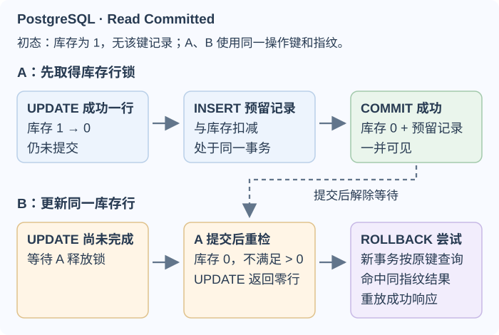
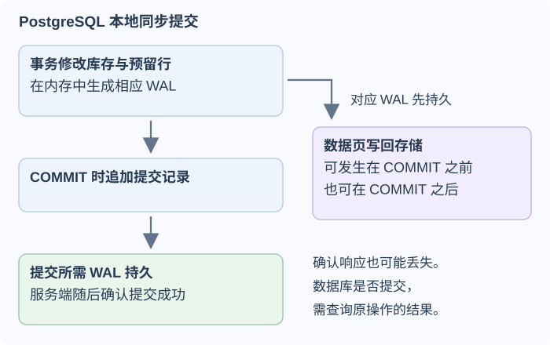
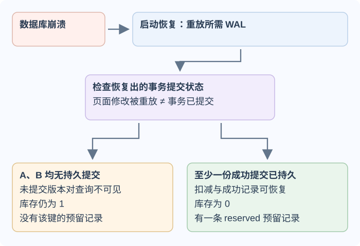

# 事务隔离与预写日志能保证什么？

**案例背景。** 库存服务同时收到两份来自账户 `acct-17`、主体 `user-17` 的请求，预留同一件 `SKU-7`。库存初值 `available = 1`，此前没有该操作键的预留记录。本例使用 PostgreSQL 18 的 Read Committed（读已提交）隔离级别，要求一次库存扣减与该操作记录一起提交。

两份请求代表同一逻辑操作，都携带稳定键 `reserve-demo-208` 和指纹 `fingerprint-A`。指纹是参与业务决定的参数（账户、主体、SKU 与操作内容）的稳定摘要，用来判断重复键是否仍代表原请求。成功事务保存 `SKU-7 / reserved` 结果，以便重复请求读取并返回；本例只保存成功结果。

`inventory.sku` 唯一标识库存行，`available` 是非负整数。`reservations` 的 `(account_id, principal_id, idempotency_key)` 复合唯一约束保证同一主体下的操作键只保存一份成功记录。连接超时只说明调用方没收到结论，不代表数据库已经回滚。

时序中的 A 先锁定并扣减库存，再写 `SKU-7 / reserved` 结果并提交；B 等待同一行锁。A 提交后，PostgreSQL Read Committed 会按最新库存重检 B 的更新条件，B 得到零行，回滚尝试后用新事务查询同键结果。若 A 回滚，B 可在锁释放后继续并成为成功者。最终库存为 0、只存在一条成功预留记录；两份同键同指纹请求返回同一成功状态。若两份请求使用不同操作键，且 B 的键原先无记录，B 的查询不会找到 A 的结果，应返回库存不足。

## 事务把哪些写入放在同一边界？

transaction（事务）把多条数据库语句放进同一次提交或回滚。ACID 是描述该边界的常用词，但每项都受数据库实现、配置与底层存储能力约束：

- **atomicity（原子性）**：同一事务中的写入一起提交，或由回滚一起撤销。
- **consistency（一致性）**：数据库约束和应用规则定义合法状态；事务不会自行发明业务不变量。
- **isolation（隔离性）**：并发事务按数据库实现的隔离级别观察或等待其他写入。
- **durability（持久性）**：成功提交能够抵抗配置和存储承诺范围内的故障；异步提交或不可靠存储会改变这个范围。

先读 `available = 1` 再无条件写成 0 不安全。例如两份不同操作各自先读到 1，再无条件把库存设为 0 并分别插入不同操作键，最终库存仍显示 0，却有两条成功预留。条件扣减保护库存不变量；复合唯一键则保护同一逻辑操作不会保存两份结果。下面使用 PostgreSQL 参数绑定；`$1 = SKU-7`、`$2 = acct-17`、`$3 = user-17`、`$4 = reserve-demo-208`、`$5 = fingerprint-A`，字段沿用[库存基础页](database-fundamentals.md)的 schema：

~~~sql
BEGIN;

UPDATE inventory
SET available = available - 1
WHERE sku = $1 AND available > 0
RETURNING available;
-- 应用取回结果：一行时继续 INSERT；零行时立即 ROLLBACK，不能执行 INSERT。

INSERT INTO reservations
    (account_id, principal_id, idempotency_key,
     request_fingerprint, sku, status)
VALUES ($2, $3, $4, $5, $1, 'reserved');

COMMIT;
~~~

若 INSERT 或其他写入因约束或数据库错误失败，PostgreSQL 事务进入失败状态；应用显式 `ROLLBACK`，不能继续尝试 `COMMIT`，并按错误类别返回或报告失败。`40001` 是整笔事务从开头重试的序列化失败；COMMIT 时连接响应丢失则是提交结果未知，不能当作普通失败处理。

如果本次条件更新返回零行，或插入因复合操作键冲突而失败，应用回滚这个事务，然后在新事务按 `(account_id, principal_id, idempotency_key)` 查询。查到相同指纹就返回已保存的当前结果——本例是 SKU-7 的 `reserved` 记录；指纹不同则冲突。在普通条件更新失败的路径中，若本次返回零行，且新事务回查也没有该键的已提交记录，就返回本次未预留、库存不足；这同样适用于重试此前没有保存结果的失败请求。失败结果没有持久写入，所以库存之后变化时，失败请求是否复用同一键由上层协议定义。

若 COMMIT 响应丢失，查到同键同指纹记录可确认已提交；查不到只说明这次查询没有看到提交记录，原事务仍可能在执行或提交中，不能当作失败后换新键再做一次业务操作。保留原键与同一指纹，沿相同条件更新和唯一约束路径安全重试，或稍后再次查询。复合键只在数据库中裁决并发写入，不会自动生成重放响应。完整请求重放与故障分支见[两个请求争夺最后一件库存时，怎样保证只预留一次？](database-fundamentals.md)。

## 隔离级别限制哪些并发现象？

dirty read（脏读）是读到其他事务尚未提交的写入；non-repeatable read（不可重复读）是同一事务重读一行时看到后来提交的新值；phantom read（幻读）是相同条件查询再次执行时，结果行集合因其他提交而变化；serialization anomaly（序列化异常）是一组成功事务的结果无法解释为某种串行执行顺序。SQL 标准以现象规定隔离级别最低限度要防止什么；数据库对同一名称可以提供更强保证，也可能采用不同的并发控制实现。

| PostgreSQL 18 级别 | 脏读 | 不可重复读 | 幻读 | 序列化异常 |
| --- | --- | --- | --- | --- |
| Read Uncommitted（读未提交） | 不发生；等同 Read Committed | 可能 | 可能 | 可能 |
| Read Committed（读已提交，默认） | 不发生 | 可能 | 可能 | 可能 |
| Repeatable Read（可重复读） | 不发生 | 不发生 | 不发生 | 仍可能出现写偏差 |
| Serializable（可串行化） | 不发生 | 不发生 | 不发生 | 不发生 |

在 PostgreSQL Read Committed 下，每条语句取得新快照。两个请求同时以 `WHERE available > 0` 更新同一 SKU 时，后执行者会等待；前者提交后，数据库用新行版本重检条件，库存已是 0，就更新零行。若前者回滚，等待者可继续更新旧值。这让单条条件更新直接表达“库存不能低于零”。在 Repeatable Read 下，事务若试图修改它的快照之后已被另一事务提交修改的同一行，会以 SQLSTATE `40001` 失败；应用要从最初读取开始重试整笔事务。PostgreSQL 的 Repeatable Read 快照始于事务中第一条非事务控制语句；隔离级别名称不是实现说明，例如下一页的 InnoDB Repeatable Read 以首次一致性读快照与索引锁协作。

> [!info] MVCC 不等于“无锁读取”
> multi-version concurrency control（多版本并发控制，MVCC）让快照读取按可见性规则选择版本；在 PostgreSQL 中，更新行会产生新 tuple 版本，旧快照仍可读到对它可见的已提交版本。这能减少部分读写等待，但不消除写写冲突：像本例 B 更新同一库存行仍会等待，Repeatable Read 冲突也可能失败；`FOR UPDATE` 等显式锁和其他资源等待同样仍会发生。各引擎保留、清理旧版本的实现不同；PostgreSQL 的 VACUUM 清理不再对活动快照可见的旧 tuple，长时间持有旧快照会延迟清理。

## 为什么稳定快照仍可能破坏共享规则？

write skew（写偏差）说明稳定快照不一定维护跨行规则。排班表有医生 A、B 两行，规则要求至少一人值班。事务 T1 读到两人都在岗后关闭 A 的排班；事务 T2 读到相同快照后关闭 B。两者修改不同的行，因此 PostgreSQL Repeatable Read 下都可能提交，最终没人值班。

修法取决于规则形状。可把规则改成单行值班人数，用条件更新维护计数，并在同一事务更新计数和医生行；也可在 Read Committed 下让所有写方先锁同一排班控制行，再用下一条 SELECT 检查状态。若 T1 关闭 A，T2 等控制行锁释放后，下一条语句取得新快照并看到只剩 B 在岗，于是拒绝关闭 B。Repeatable Read 的快照从事务中第一条非事务控制语句开始，等待不会刷新它，不能照搬这个两语句方案。另一选项是让所有维护这条规则的并发事务都运行 Serializable；若发生 `40001`，失败方从事务开头重试，看到只剩一人后放弃关闭。只重试最后一条 UPDATE 会沿用旧决策。

事务中不要执行无法撤销的远端支付或直接发布消息。可以在同一数据库事务写 outbox（发件箱）记录，提交后再异步投递；业务更新和待发送记录由数据库原子提交，但消息投递仍可能重复，消费者要能去重或幂等处理。开发时也应避免在事务中等待长时间网络调用。

## 预写日志如何把提交与数据页写回分开？

write-ahead log（预写日志，WAL）先记录数据页更改，再允许对应数据页写回持久存储。以 PostgreSQL 本地同步提交为例，默认 `synchronous_commit = on` 且 `fsync = on` 时，服务器在成功确认前会持久化提交所需的 WAL；被修改的数据页可以在提交前或提交后写回，只要写页前相应 WAL 已持久。并发小事务还可能共用一次 WAL 刷盘。这样不必在每次提交时同步刷新所有受影响的数据页。

下图把成功事务的提交路径与数据页写回分开。条件为 `synchronous_commit = on`、`fsync = on`，且存储正确兑现 flush（持久化刷新）。

下面的崩溃分支沿用开场状态：SKU-7 初始为 1、没有 `reserve-demo-208`，A 与 B 是此库存上的全部写入尝试，期间没有其他库存写者。这个前提使“无提交记录”能归因到两份请求都未成功；若另有写者，库存值不能只归因于 A/B。

如果至少一份尝试的提交记录已持久而数据页尚未写回，恢复会重放所需 WAL，使库存扣减与一条预留记录可见。若 A、B 两份尝试都没有持久提交记录，启动恢复仍可能重放数据页修改记录；重放本身不等于提交，未提交的库存新版本对查询不可见，未提交的预留行也不可见，因此查询仍读到旧库存 1 且没有预留。PostgreSQL 的这一例子是本地单节点崩溃恢复，不是跨故障域复制保证。把 `synchronous_commit` 设为 `off` 会缩短等待，却允许刚确认的事务在数据库崩溃时丢失（不应因此损坏其他已提交数据）；下游若按成功响应执行外部动作，就不能忽略这段风险。任何持久性保证仍依赖文件系统、设备与控制器正确兑现 flush。

WAL 也不是时间点恢复的全部材料。要恢复到过去时点，还需要适用的基础备份，以及从该备份起点到目标时刻连续、完整的 WAL 归档；若有一段缺失，就不能从这份备份跨过缺口恢复，之后另有适用基础备份时仍可有新的恢复范围。SQLite 有自己的回滚日志与 WAL 模式及配置，不能把 PostgreSQL 的文件布局和恢复步骤直接套用。

> [!example] 一次提交后立即崩溃时检查什么
> 在“只有 A/B 两份竞争尝试、期间没有其他库存写入”的前提下，若其中一份成功事务已按同步策略持久提交，即使数据页尚未写回，崩溃恢复也能重做库存扣减与预留记录；恢复后读到 `available = 0` 和一条 `reserved` 操作记录。若两份尝试都没有持久提交记录，恢复后的查询仍看到旧库存 `available = 1` 且没有该预留。若 API 在提交确认前失联，查到同键记录可确认成功；暂时查不到不证明原事务已经结束，应保留原键处理。HTTP 响应不是数据库提交记录。

## 哪些课程细节继续留在归档？

课程中的 ARIES 恢复推演仍保留在[WAL 与 ARIES 的逐步恢复例题](../../archive/uni-subjects/COMP90050ADBS/condensed-note-w4-wal-and-aries-recovery.md)：analysis（分析）阶段用 dirty page table（脏页表）记录恢复时涉及的脏页；每页的 recLSN 表示该页自上次干净后可能需要 REDO（重做）的最早日志位置，所有页中最小 recLSN 是 REDO 起点，不是分析阶段要扫描的最早日志范围。ARIES 的 repeat-history 后接 loser undo 是通用课程算法；这里的 PostgreSQL WAL 说明不表示 PostgreSQL 或 InnoDB 按原版 ARIES 执行恢复。

CAP 讨论分布式系统的故障边界：网络分区时，系统无法同时保证 linearizability（线性一致性）与 availability（可用性，即每个非故障节点收到的请求最终都得到响应）。two-phase commit（两阶段提交，2PC）协调多个参与者的提交决定；进入 prepared 并投赞成票的参与者仍持有锁，在获知全局提交或回滚决定前可能等待。这些机制都不能代替单库的库存约束、隔离或日志恢复。

**接下来：** 这里的并发例是 PostgreSQL Read Committed。要看同名隔离级别在另一引擎中如何由 read view、索引记录锁、redo 和 undo 落地，见[InnoDB 怎样用索引记录、旧版本与日志处理库存事务？](mysql-innodb-index-lock-and-recovery.md)。SQL 约束与索引决定哪些业务状态可写、哪些访问路径可用，见[如何用约束保护业务规则并为读取建立索引？](database-constraints-and-indexes.md)；ORM 的 Session、事务与连接持有时间见[如何限定 ORM Session 并诊断连接池耗尽？](../backend/data-access-and-connection-pools.md)。

> [!info]- 来源
>
> - 隔离现象定义、PostgreSQL 18 的各级别保证、Read Committed 等待后重检、Repeatable Read 冲突后整笔重试、Serializable 检测：[PostgreSQL 18, Transaction Isolation](https://www.postgresql.org/docs/18/transaction-iso.html)，§13.2，核对于 2026-11-12；`UPDATE ... RETURNING` 只返回实际更新的行：[PostgreSQL 18, UPDATE](https://www.postgresql.org/docs/18/sql-update.html)；`COMMIT` 使事务改动对其他会话可见并按数据库持久策略保证崩溃后保留：[PostgreSQL 18, COMMIT](https://www.postgresql.org/docs/18/sql-commit.html)，核对于 2026-11-12。
>
> - “Repeatable Read”名称不规定同一引擎策略：[MySQL 8.4, Transaction Isolation Levels](https://dev.mysql.com/doc/refman/8.4/en/innodb-transaction-isolation-levels.html)，§17.7.2.1；普通快照读与锁定读分别观察 read view 和最新状态，对照 [MySQL 9.7 的同一章节](https://dev.mysql.com/doc/refman/9.7/en/innodb-transaction-isolation-levels.html)，核对于 2026-11-12。
>
> - 快照可见性、VACUUM 与旧版本清理：[PostgreSQL 18, Introduction to MVCC](https://www.postgresql.org/docs/18/mvcc-intro.html)，§13.1；旧版本清理：[Routine Vacuuming](https://www.postgresql.org/docs/18/routine-vacuuming.html)，§24.1.2，核对于 2026-11-12。
>
> - WAL 先持久于相关数据页、崩溃重放与基础备份加连续日志的时间点恢复：[PostgreSQL 18, WAL Introduction](https://www.postgresql.org/docs/18/wal-intro.html)，§28.3；同步与异步提交的确认差异：[Asynchronous Commit](https://www.postgresql.org/docs/18/wal-async-commit.html)，§28.4；检查点刷页：[WAL Configuration](https://www.postgresql.org/docs/18/wal-configuration.html)，§28.5；PITR：[Continuous Archiving and Point-in-Time Recovery](https://www.postgresql.org/docs/18/continuous-archiving.html)，§25.3，核对于 2026-11-12。
>
> - SQLite 的独立事务机制：[SQLite Transactions](https://www.sqlite.org/lang_transaction.html) 与 [Write-Ahead Logging](https://www.sqlite.org/wal.html)，核对于 2026-11-12。
>
> - 课程 ARIES 推导与原始机制：[Mohan et al., ARIES: A Transaction Recovery Method Supporting Fine-Granularity Locking and Partial Rollbacks Using Write-Ahead Logging](https://research.ibm.com/publications/aries-a-transaction-recovery-method-supporting-fine-granularity-locking-and-partial-rollbacks-using-write-ahead-logging)；关联课程页[WAL 与 ARIES 的逐步恢复例题](../../archive/uni-subjects/COMP90050ADBS/condensed-note-w4-wal-and-aries-recovery.md)。CAP 原始证明：[Gilbert and Lynch, Brewer’s conjecture and the feasibility of consistent, available, partition-tolerant web services](https://www.cs.princeton.edu/courses/archive/spring24/cos418/papers/cap.pdf)；prepared 事务会继续持锁，需外部协调器最终发出 COMMIT PREPARED 或 ROLLBACK PREPARED：[PostgreSQL 18, PREPARE TRANSACTION](https://www.postgresql.org/docs/18/sql-prepare-transaction.html)，§Description and Caution，核对于 2026-11-12。
