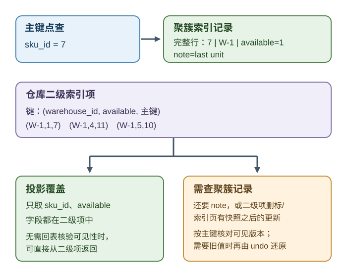
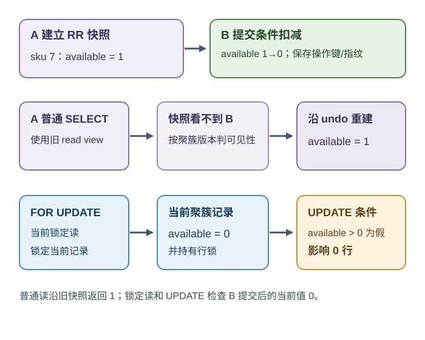
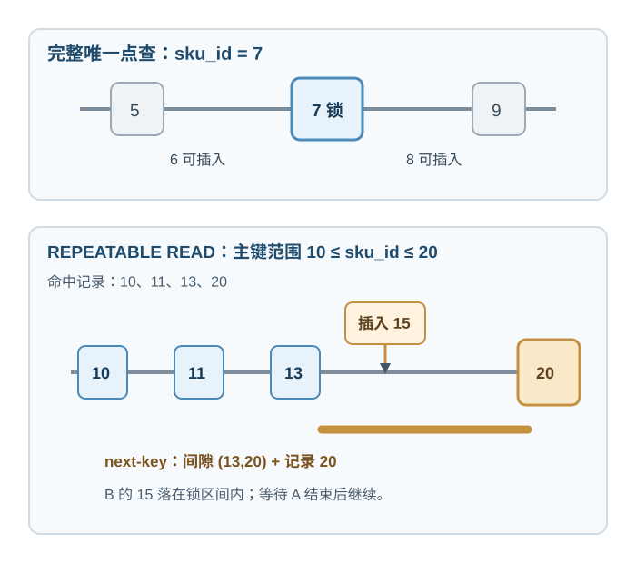
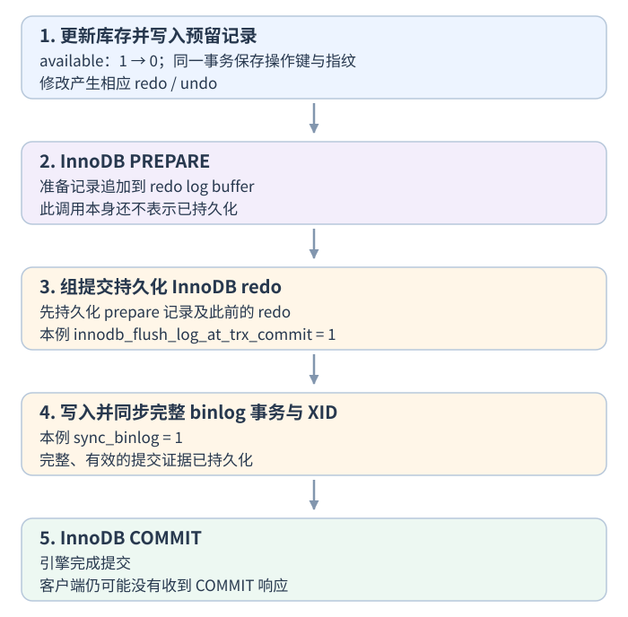
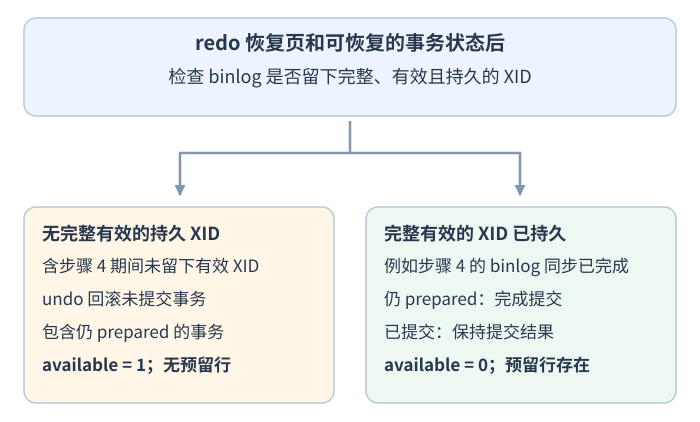

# InnoDB 怎样用索引记录、旧版本与日志处理库存事务？

**案例背景。** 全局 `SKU-7` 库存只剩一件，`available = 1`，此前没有 `reserve-demo-208` 结果。账户 `acct-17`、主体 `user-17` 是预留请求的作用域，不是库存分区；A、B 是同一逻辑请求的两次尝试，操作键为 `reserve-demo-208`，指纹为 `fingerprint-A`。指纹应是规范化业务参数的稳定摘要；这里用 `fingerprint-A` 作符号标签，省略实际摘要编码。会话 A 开启可重复读（`REPEATABLE READ`）事务并先用普通读建立快照，看到 1；会话 B 用条件更新扣成 0，在同一事务保存该操作键和指纹后提交。A 之后的普通读仍可能看到旧值 1，但锁定读和更新会针对当前记录。要判断“能读旧值”是否意味着“还能安全扣减”，必须分清 InnoDB 的索引路径、一致性读、当前锁定读以及崩溃恢复决策。

本文以 MySQL 8.4 长期支持（LTS）版本、InnoDB 为准：普通事务默认隔离级别为可重复读（`REPEATABLE READ`），示例仍显式设定；`sku_id = 7` 表示 `SKU-7`。单条独立 SQL 使用自动提交（`autocommit=1`），需要跨语句加锁的片段会显式开启事务。事务隔离与预写日志（WAL）的通用语义见[事务隔离与预写日志能保证什么？](database-transactions-isolation-and-recovery.md)；这里的快照、索引锁范围和 `undo log`（回滚日志）/`redo log`（重做日志）是 InnoDB 具体行为。

## 查询先走哪棵 InnoDB 索引？

本例用主键点查 SKU-7，并另外建仓库库存二级索引。InnoDB 的主键组织为 clustered index（聚簇索引），叶记录保存整行；每个 secondary index（二级索引）叶项保存二级键列与该行主键。若二级索引查询还需要 `note` 这样的非索引列，InnoDB 会用叶项中的主键再回聚簇索引取行。投影列都在二级索引记录里时，查询在字段层面可被覆盖；但 multi-version concurrency control（多版本并发控制，MVCC）的可见性检查仍可能要查聚簇记录。

> [!example]- 示例表结构和初始数据
>
> ~~~sql
> CREATE TABLE inventory (
>     sku_id INT NOT NULL PRIMARY KEY,
>     warehouse_id VARCHAR(16) NOT NULL,
>     available INT NOT NULL CHECK (available >= 0),
>     note VARCHAR(64) NOT NULL
> ) ENGINE = InnoDB;
>
> CREATE INDEX inventory_by_warehouse_stock
>     ON inventory (warehouse_id, available);
>
> CREATE TABLE reservations (
>     account_id VARCHAR(32) NOT NULL,
>     principal_id VARCHAR(32) NOT NULL,
>     idempotency_key VARCHAR(64) NOT NULL,
>     request_fingerprint CHAR(64) NOT NULL,
>     sku_id INT NOT NULL,
>     status VARCHAR(16) NOT NULL,
>     PRIMARY KEY (account_id, principal_id, idempotency_key),
>     FOREIGN KEY (sku_id) REFERENCES inventory(sku_id)
> ) ENGINE = InnoDB;
>
> INSERT INTO inventory VALUES
>     (5,  'W-2', 2, 'point-query neighbor'),
>     (7,  'W-1', 1, 'last unit'),
>     (9,  'W-2', 2, 'point-query neighbor'),
>     (10, 'W-1', 5, 'range example'),
>     (11, 'W-1', 4, 'range example'),
>     (13, 'W-2', 2, 'range example'),
>     (20, 'W-2', 1, 'range example');
> ~~~

`WHERE sku_id = 7` 是完整唯一主键点查，找到聚簇索引里的完整行。若用 `WHERE warehouse_id = 'W-1' AND available >= 1` 筛选仓库库存，优化器可能选择 `(warehouse_id, available)` 二级索引；若只取 `sku_id, available`，这些投影列都在二级项里，字段层面可覆盖查询。但若二级项已被标为删除，或二级索引页包含快照之后的更新，InnoDB 仍可能回聚簇记录核对 MVCC 可见性，再由 undo 重建旧版。例如 B 把 SKU-7 的 `available` 从 1 改成 0 后，二级项 `(W-1,1,7)` 会被标记删除；A 的旧视图即使只取 `sku_id, available`，也可能按主键查回旧值。若还取 `note`，则无论如何都要按 `sku_id` 查聚簇索引。索引是否实际使用取决于谓词、统计信息、数据分布和投影列，生产排查应看 `EXPLAIN`，不能从 WHERE 子句直接猜计划。

## 普通读为什么能看见已过时库存？

InnoDB 的 consistent read（一致性读）使用 read view（读视图）确定查询时点。在 `REPEATABLE READ` 下，同一事务的普通非锁定 `SELECT` 使用第一次一致性读建立的快照。若此后另一个事务更新了行，undo log（回滚日志）保留重建旧版所需的信息，普通读可以据此仍返回旧值；它也会看见本事务此前语句写入的变更。普通 `SELECT` 不锁住被读行，其他事务仍可更新。这是 MVCC 允许读者沿快照读取、写者修改当前版本的一种实现；读写等待可因此减少，但写写冲突、显式锁和所有等待并没有消失。

锁定读和 DML（data manipulation language，数据操作语言）语句不必服从这个普通读快照：`SELECT ... FOR UPDATE` 是 current read（当前读），读取最新可用记录并取得排他锁；`UPDATE` 同样要按当前可修改版本协调锁。下面按固定的双会话顺序推演，库存初始为 1：

~~~sql
-- 会话 A：先建立一致性读视图
SET SESSION TRANSACTION ISOLATION LEVEL REPEATABLE READ;
START TRANSACTION;
SELECT available FROM inventory WHERE sku_id = 7;
-- 结果 1；这是之后普通 SELECT 的快照时点。

-- 会话 B：使用当前库存完成同一逻辑操作
SET SESSION TRANSACTION ISOLATION LEVEL REPEATABLE READ;
START TRANSACTION;
UPDATE inventory
SET available = available - 1
WHERE sku_id = 7 AND available > 0;
-- 应用检查受影响行数：若为 0，立即 ROLLBACK 并结束尝试；不执行 INSERT。
-- 只有影响恰好 1 行，应用才继续 INSERT。
INSERT INTO reservations
    (account_id, principal_id, idempotency_key,
     request_fingerprint, sku_id, status)
VALUES
    ('acct-17', 'user-17', 'reserve-demo-208',
     'fingerprint-A', 7, 'reserved');
-- 只有 UPDATE 影响 1 行且 INSERT 成功，应用才走成功分支：
COMMIT; -- 成功分支才执行
-- 若 INSERT 因重复键或其他约束/写入错误失败，不能继续 COMMIT。
-- InnoDB 通常只回滚失败语句；
-- 应用必须显式 ROLLBACK 整笔事务，撤销前面的库存扣减。
-- 重复操作键错误：整笔回滚后用新事务按作用域键回查，再比较指纹。
~~~

会话 B 提交后，会话 A 仍在原事务中继续：

~~~sql
-- 普通一致性读：沿旧读视图，仍是 1。
SELECT available FROM inventory WHERE sku_id = 7;

-- 当前锁定读：最新值是 0，同时锁定该索引记录。
SELECT available FROM inventory WHERE sku_id = 7 FOR UPDATE;

UPDATE inventory
SET available = available - 1
WHERE sku_id = 7 AND available > 0;
-- 影响 0 行；不能按快照中的 1 再扣一次，也不插入预留记录。
ROLLBACK;

-- 回滚后以新事务确认同键请求的已提交结果。
START TRANSACTION;
SELECT request_fingerprint, sku_id, status
FROM reservations
WHERE account_id = 'acct-17'
  AND principal_id = 'user-17'
  AND idempotency_key = 'reserve-demo-208';
COMMIT;
-- 同键同指纹：返回已保存的业务结果；同键异指纹：报告操作键冲突。
-- 查询仍无记录时，竞争事务可能尚未结束；不把空结果当作另一事务已失败。
~~~

若 `INSERT` 因复合主键重复而失败，MySQL/InnoDB 通常只回滚这条语句，之前成功的库存 `UPDATE` 仍在原事务里。因此应用必须先 `ROLLBACK` 整个尝试，之后才能在新事务查键和指纹；同键同指纹返回已有业务结果，同键异指纹返回操作键冲突。若其他约束或写入错误导致失败，也整笔回滚并按具体错误返回，不能沿失败路径照常 `COMMIT`。竞争事务仍在执行时，新事务暂时查空也不是“对方已经失败”的证据，应保留原键并重试/重查。

这里的旧值是“普通读仍可见的版本”，不是可用来再次扣减的当前库存。读视图按事务可见性判断聚簇记录的版本；只要 A 的快照仍可能需要旧值，update undo 就不能清理。在本例 B 已提交、A 条件更新影响零行的顺序下，若 A 与 B 是不同操作键，A 在回滚后查不到自己的键，应报告本次库存不足；同键同指纹才返回 B 保存的结果，同键异指纹则返回冲突。若回查为空，也可能是同键竞争事务尚未结束，不能仅凭一次空结果断言对方失败。若 B 仍未提交而 A 先执行 `FOR UPDATE`，A 会等待 B 提交或回滚：在没有其他写入的本例中，B 提交则看到 0，B 回滚则看到 1。通常不应在 `REPEATABLE READ` 同一事务中随意混合普通快照读与锁定读；此处是为了展示两条读取路径为何得出不同值。完整的原请求重试与幂等键约定见[库存扣减与同键重试如何保证只生效一次？](database-fundamentals.md)。

## 唯一命中与范围扫描为什么锁不同？

InnoDB 的行锁实际落在索引记录上。若完整唯一索引等值条件只命中一条已存在记录，通常只锁该索引记录，不锁它前面的间隙。若排他搜索经二级索引完成，InnoDB 还会锁对应的聚簇索引记录。复合唯一索引如果只给部分键列，便不是完整唯一命中，可能需要扫描并锁定一段索引范围。

~~~sql
-- 独立示例一：完整主键点查，只锁 sku_id=7 记录。
SET SESSION TRANSACTION ISOLATION LEVEL REPEATABLE READ;
START TRANSACTION;
SELECT available FROM inventory WHERE sku_id = 7 FOR UPDATE;
ROLLBACK;

-- 独立示例二：完整主键上的范围扫描。
-- 会话 A 保持事务时，会话 B 的 INSERT 15 要等 A 结束。
-- 会话 A
SET SESSION TRANSACTION ISOLATION LEVEL REPEATABLE READ;
START TRANSACTION;
SELECT sku_id FROM inventory FORCE INDEX (PRIMARY)
WHERE sku_id BETWEEN 10 AND 20
FOR UPDATE;
-- 结果 10、11、13、20；A 暂不结束事务。

-- 会话 B，autocommit=1 的单条 INSERT
INSERT INTO inventory VALUES (15, 'W-1', 2, 'insert in protected gap');
-- 等待 20 记录之前的间隙被释放。

-- 会话 A
COMMIT;
-- A 释放范围锁后，B 才能继续并提交。
~~~

在这个 `REPEATABLE READ` 主键范围中，记录 20 的 next-key lock（临键锁）由记录锁加其前方 gap lock（间隙锁）组成，保护 `(13, 20]`；要插入的 15 落在该区间，所以 B 等 A 提交或回滚后才继续。间隙锁只抑制冲突插入，不表示这条语句锁住整张表。读已提交（`READ COMMITTED`）下的搜索和扫描通常不使用间隙锁，但外键检查与重复键检查仍可能用；具体范围取决于真正扫描的索引、谓词和计划。遇到等待时先用 `EXPLAIN` 确认访问路径，再看 InnoDB 锁信息。

## 崩溃时 redo 和 undo 各做什么？

redo log（重做日志）为页修改提供恢复记录，能把尚未写回表空间的变更前滚；它也可能记录后来被判为未提交的事务修改。undo log（回滚日志）一方面用于一致性读重建旧版本，另一方面用于撤销未完成事务。因此“redo 重放过页面变化”不等于“业务事务已经提交”。

本例假设 binary log（二进制日志，binlog）已启用，`innodb_flush_log_at_trx_commit = 1`、`sync_binlog = 1`，且文件系统、控制器与设备真实兑现 flush。MySQL 8.4 对启用 binlog 的 InnoDB 表使用隐式 XA two-phase commit（两阶段提交）来协调两个日志：事务执行完更新与预留插入后，InnoDB 的 `PREPARE` 将准备记录写入 redo 日志缓冲区，但调用本身不表示已持久化；组提交刷新阶段先持久化 prepare 及此前的 redo，再把完整事务和 transaction identifier（事务标识符，XID）写入并同步到 binlog；之后 InnoDB 才完成提交。XA 是服务器协调器内部使用的协议，不是应用发出 `XA` SQL。客户端可能在提交已形成后断线，所以是否收到 `COMMIT` 响应不能代替恢复时的日志决策。

图中的五步只追踪本例单笔事务在各阶段的先后。同组多笔事务可以共用日志刷盘。

从独立初态 `SKU-7.available = 1` 且无 `reserve-demo-208` 开始；假定本例只有 B 这一笔事务修改该库存，没有其他库存写入。组提交中的 redo 刷盘在 binlog 刷新之前，因此恢复时可以用 redo 恢复页及可恢复的事务状态，再用完整、有效的 binlog XID 作事务决策；崩溃发生在步骤 4 中也要看最终是否留下可恢复 XID：没有完整有效 XID 时回滚，有则完成仍 prepared 的提交。分支如下：

> [!info]- 恢复两条路径的完整条件
>
> | 崩溃时可恢复的提交证据 | 重启恢复路径 | 恢复后的业务状态 |
> | --- | --- | --- |
> | 完整、持久且可恢复的 binlog 事务和 XID 已存在；客户端可能没收到响应 | redo 恢复页面修改；若事务仍处于已准备（prepared）状态，MySQL 通知 InnoDB 完成提交；已完成的提交保持不变 | `available = 0`，操作键记录存在；重试查询可确认结果 |
> | 没有完整、持久且可恢复的 XID；包括步骤 4 期间崩溃而未留下有效 XID | redo 可先重放页面修改；未提交事务用 undo 回滚，若 prepared 事务不在有效 binlog XID 集合中也回滚 | 在没有其他库存写入的前提下，`available = 1`，无该预留记录 |

MySQL 可在 redo 应用后尽早接受新连接，未完成事务回滚可能在后台继续，期间新事务仍可能遇到这些行上的锁等待。若崩溃发生在 binlog XID 已同步、InnoDB 尚未完成提交的窗口，恢复会完成 prepared 事务；若 XID 没有持久化，则恢复会回滚它。两种分支都要求这里设定的日志刷盘条件可信；设备谎报 flush、整盘损坏或故障域丢失都需要备份/复制策略处理。

`innodb_flush_log_at_trx_commit = 1` 使 InnoDB 在事务提交时写并刷 redo；`sync_binlog = 1` 使 binlog 同步到磁盘。Point-in-time recovery（时间点恢复，PITR）仍需合适备份和其后的连续二进制日志；redo/undo 不代替备份。这个 XID 协调与 InnoDB 恢复步骤是 MySQL 的具体实现，不能因同样使用预写日志就称为 PostgreSQL 或课程 ARIES 的同一算法。

若想从通用事务边界、PostgreSQL 隔离异常与 WAL 的角度再看同一库存案例，见[事务隔离与预写日志能保证什么？](database-transactions-isolation-and-recovery.md)。

> [!info]- 来源
>
> - 以 MySQL 8.4 LTS 手册和 8.4.13 源码为本页实现基线；另与 MySQL 9.7 手册交叉核对，不把 9.7 称为最新发行版。Oracle 已于 2026-10-20 发布 MySQL 26.10.0：[MySQL 26.10.0 Release Notes](https://dev.mysql.com/doc/relnotes/mysql/26.10/en/news-26-10-0.html)。本页关键声明核对于 2026-11-12。
>
> - 聚簇索引保存完整行，二级索引叶项包含二级键和主键：[MySQL 8.4, Clustered and Secondary Indexes](https://dev.mysql.com/doc/refman/8.4/en/innodb-index-types.html) §17.6.2.1；二级项被删除标记或索引页含较新更新时，MVCC 可见性检查可能回到聚簇记录，因此覆盖索引只说明投影字段齐全：[InnoDB Multi-Versioning](https://dev.mysql.com/doc/refman/8.4/en/innodb-multi-versioning.html) §17.3。
>
> - DDL 中 `CHECK (available >= 0)` 的约束语义：[MySQL 8.4, CHECK Constraints](https://dev.mysql.com/doc/refman/8.4/en/create-table-check-constraints.html)，§15.1.20.6。
>
> - REPEATABLE READ 首次一致性读建立事务快照、READ COMMITTED 每条一致性读新快照、普通读与 DML/锁定读可能看到不同状态：[MySQL 8.4, Consistent Nonlocking Reads](https://dev.mysql.com/doc/refman/8.4/en/innodb-consistent-read.html) §17.7.2.3 与 [Transaction Isolation Levels](https://dev.mysql.com/doc/refman/8.4/en/innodb-transaction-isolation-levels.html) §17.7.2.1；undo 支持旧版重建：[Undo Logs](https://dev.mysql.com/doc/refman/8.4/en/innodb-undo-logs.html) §17.6.6。
>
> - 完整唯一索引命中与范围扫描的记录锁、间隙锁、next-key 边界，以及 READ COMMITTED 例外：[MySQL 8.4, InnoDB Locking](https://dev.mysql.com/doc/refman/8.4/en/innodb-locking.html) §17.7.1；语句锁范围、二级索引排他搜索时锁对应聚簇记录：[Locks Set by Different SQL Statements](https://dev.mysql.com/doc/refman/8.4/en/innodb-locks-set.html) §17.7.3；`FOR UPDATE` 取最新可用记录并持锁到事务结束：[Locking Reads](https://dev.mysql.com/doc/refman/8.4/en/innodb-locking-reads.html) §17.7.2.4，核对于 2026-11-12。
>
> - 重复键错误通常只回滚失败语句；前面已成功的 UPDATE 仍留在事务中，应用须显式回滚整笔尝试：[InnoDB Error Handling](https://dev.mysql.com/doc/refman/8.4/en/innodb-error-handling.html) §17.20.5，核对于 2026-11-12。
>
> - redo 前滚与不完整事务后台回滚：[MySQL 8.4, InnoDB Recovery](https://dev.mysql.com/doc/refman/8.4/en/innodb-recovery.html) §17.18.2；InnoDB redo 日志：[Redo Log](https://dev.mysql.com/doc/refman/8.4/en/innodb-redo-log.html) §17.6.5；PITR 用完整备份后的二进制日志回放：[Point-in-Time Recovery Using Binary Log](https://dev.mysql.com/doc/refman/8.4/en/point-in-time-recovery-binlog.html) §9.5.1。
>
> - binlog 与 InnoDB 隐式 XA 两阶段提交、恢复扫描完整 XID 并完成 prepared 事务：[MySQL 8.4, The Binary Log](https://dev.mysql.com/doc/refman/8.4/en/binary-log.html) §7.4.4；8.4.13 源码说明 `prepare()` 将记录先写入日志缓冲，再由组提交刷新阶段先刷新引擎日志：[sql/binlog.cc](https://github.com/mysql/mysql-server/blob/mysql-8.4.13/sql/binlog.cc#L8087-L8116)、[组提交 flush 阶段](https://github.com/mysql/mysql-server/blob/mysql-8.4.13/sql/binlog.cc#L8518-L8525)、[InnoDB redo flush](https://github.com/mysql/mysql-server/blob/mysql-8.4.13/storage/innobase/handler/ha_innodb.cc#L5903-L5940)。`innodb_flush_log_at_trx_commit=1`、`sync_binlog=1` 与 flush 设备假设：[InnoDB System Variables](https://dev.mysql.com/doc/refman/8.4/en/innodb-parameters.html) `innodb_flush_log_at_trx_commit`。同组事务可共用 binlog 同步，见 [Binary Logging Options and Variables](https://dev.mysql.com/doc/refman/8.4/en/replication-options-binary-log.html#sysvar_binlog_group_commit_sync_delay) 的 `binlog_group_commit_sync_delay` 和 `sync_binlog`。
>
> - MySQL 9.7 手册交叉核对 Repeatable Read 快照、索引锁策略与 binlog XID 恢复：[Transaction Isolation Levels](https://dev.mysql.com/doc/refman/9.7/en/innodb-transaction-isolation-levels.html) §17.7.2.1；[The Binary Log](https://dev.mysql.com/doc/refman/9.7/en/binary-log.html) §7.4.4，核对于 2026-11-12。此处将 9.7 仅作版本交叉核对；发行版本已到 MySQL 26.10.0。
>
> - PostgreSQL 同名级别使用不同并发行为的对照：[PostgreSQL 18, Transaction Isolation](https://www.postgresql.org/docs/18/transaction-iso.html) §13.2；具体比较见[事务隔离与预写日志能保证什么？](database-transactions-isolation-and-recovery.md)。
