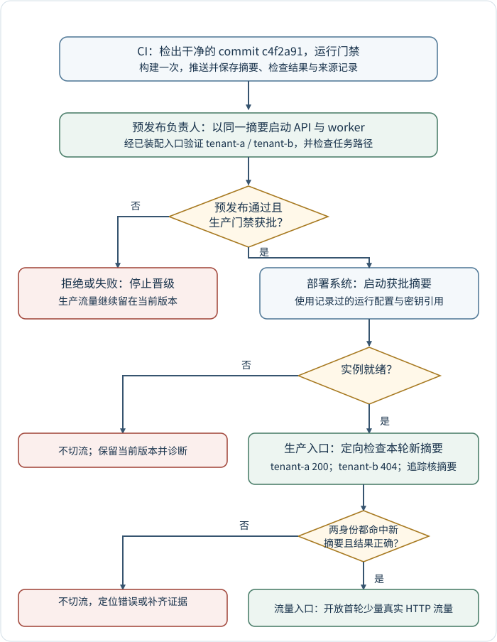
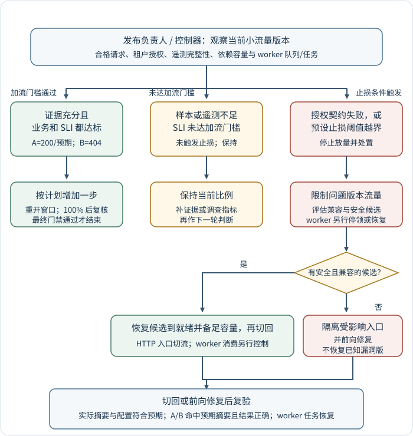

# 如何晋级并回滚已验证的报表服务产物？

**案例背景。** 一个假设的报表服务修复了租户授权漏洞，提交标识为 `c4f2a91`。发布要让用户逐步用上已经验证的版本；若验证失败，还要能转到安全、数据兼容的版本。本章沿这次发布，解释源码、镜像、配置、流量和数据分别在什么时候交接。

continuous integration (持续集成，CI) 先检查这份源码，并构建一次镜像。预发布环境用这份 image digest (镜像摘要) 启动服务，复放租户授权和异步任务。生产环境获批后也启动这份摘要，等待就绪并检查关键业务路径，再开放少量真实 HTTP 请求。之后，发布负责人或控制器根据新版本的请求、依赖和 worker (工作进程) 信号，决定加流、保持比例或止损。

continuous delivery (持续交付，CD) 指通过检查后随时可发布；continuous deployment (持续部署) 指门禁满足后自动发布。审批允许部署继续，流量仍要等后续条件满足才切换；API 入口切流也不会自动改变独立 worker 的消息消费。

以下流程从已隔离已知风险入口的状态开始；图中的“不切流”表示继续阻止真实用户请求进入尚未验收的新摘要。

图中的批准、启动、就绪和切流是四个不同状态。各角色也有不同责任：CI 检出并检查源码、构建产物、记录证据；预发布检查负责人确认业务验收；环境审批者放行生产部署；部署系统启动被批准的版本；流量入口只对就绪目标分配请求；发布负责人或已配置的控制器判断何时增加流量和何时止损。进入 10% 小流量是本例的示意起点，不是通用部署比例。随后继续、保持、停止或回退的条件在第二节说明。

## 一次构建，逐级测试并记录产物身份

先固定发布输入。CI 应检出确切的 commit (提交) `c4f2a91`，确认工作区干净，并把经过检查的源码树用作唯一 build context (构建上下文)。构建上下文是发送给 builder (构建器) 的文件集合；目录 `.` 只有在它就是预期源码根、且没有未跟踪的本机文件时才代表该提交。`.dockerignore` 应排除 `.git/`、虚拟环境、本机日志、真实 `.env` 和密钥文件。依赖锁文件、Dockerfile、基础镜像解析结果、构建器版本、平台和构建参数也属于产物来源记录。基础镜像 tag (标签) 和外部依赖可移动或更新，因此从同一源码树分别重建也可能得到不同内容；预发布与生产应晋级一次构建得到的摘要，不应各自重新构建。

检查随风险而定：提交级检查确认静态规则、单元和集成路径；涉及租户授权时，用两个独立认证身份访问同一张示例报表 42，tenant-a 必须返回 200 和预期内容，tenant-b 必须得到本例约定的 404。两种身份都经真实认证流程建立，不能用客户端自行填写的租户头代替身份；涉及 worker 时还要走真实消息代理的投递、持久化与 acknowledgement（确认，ACK）路径。若合并或重写提交改变了源码树，应在最终构建提交上重跑必要门禁，或提供可核验的树相同证据。构建和检查不能只靠同一条可移动标签推断彼此对应。

推送构建的例子把 metadata file (元数据文件) 放在本次任务独有的临时路径。`set -euo pipefail` 使 buildx 失败时命令串立即停止；`jq -e` 要求本次文件里有格式正确的 SHA-256 digest。最后的 `imagetools inspect` 按该摘要读取 registry (镜像仓库) 的实际清单：

~~~bash
set -euo pipefail
metadata_file="$(mktemp "${TMPDIR:-/tmp}/report-build.XXXXXX")"
trap 'rm -f "$metadata_file"' EXIT

docker buildx build \
  --push \
  --metadata-file "$metadata_file" \
  --tag registry.example.com/team/report-api:c4f2a91 \
  .
digest="$(
  jq -er '
    ."containerimage.digest"
    | select(type == "string" and test("^sha256:[0-9a-f]{64}$"))
  ' "$metadata_file"
)"
docker buildx imagetools inspect \
  "registry.example.com/team/report-api@$digest"
~~~

命令中的 registry、tag 和提交均是示意值；它从当前已确认的干净目录 `.` 构建。若 buildx 失败，脚本不会读取任何旧文件；若 metadata 缺字段或不是 SHA-256 摘要，`jq -e` 会失败；推送命令成功后仍通过远端检查确认 registry 清单。`containerimage.digest` 固定的是镜像清单内容身份，不会单独证明内容来自 `c4f2a91`。CI 还应保留提交、依赖锁、基础镜像摘要、构建器、目标平台和测试结果，并用可核验的 provenance (构建来源证明) 关联源码与产物。示例命令会实际向 registry 发布镜像；这里仅展示，不执行。

Buildx 的 `--load` 等价于 `--output=type=docker`，把结果载入本机 image store (镜像存储)；是否能载入多平台镜像取决于 builder 和 image store。classic image store (经典镜像存储) 不支持 image index 或 manifest list (清单列表)，因此不能在本机载入多平台镜像；containerd image store (containerd 镜像存储) 支持。Docker Engine 29.0+ 新安装默认使用 containerd image store，Docker Desktop 也默认使用它；升级旧 Engine 的机器仍可能保留 classic store。单看本地输出和 metadata 不证明 registry 已收到该镜像。多平台 build 可能生成一个 index digest (索引摘要)，该索引引用 `linux/amd64`、`linux/arm64` 等平台各自的 manifest digest (清单摘要)。核对索引与子摘要只证明清单之间的映射；如果预发布只运行了 amd64，而生产选用 arm64，就还没有验证实际生产子镜像。要在对应生产平台的预发布目标运行并验收每个将部署的子摘要，或把生产目标限制为预发布实际运行的平台。

门禁职责也要明确。GitHub Actions `environment` 可以配置必需审查者、部署分支限制、等待规则和环境 secrets（密钥）；引用该 environment 的 job 必须通过生效的保护规则后，才会执行受保护的部署步骤或取得相应 secret。规则可用性受计划和仓库配置影响，审批通过只表示允许该 job 继续，部署、启动、就绪和切流仍是后续状态。

第三方 GitHub Action（自动化操作）的 `uses: owner/repo@ref` 要固定到已核验的完整 commit SHA；也可对已纳入锁文件的 workflow 使用 workflow dependency lockfile (工作流依赖锁文件)，锁定远端步骤级 Action 及其传递依赖。仓库里存在锁文件不表示每条 workflow 都已纳入。本地步骤级 Action 的 `uses: ./path` 来自调用工作区，默认不作为锁文件依赖锁定。同仓的 reusable workflow (可复用工作流) 若写为 `uses: ./.github/workflows/deploy.yml`，由调用者的同一 commit 确定，不需要添加 `@ref`；跨仓可复用工作流的 `owner/repo/.github/workflows/deploy.yml@ref` 是另一种引用，应固定完整 SHA。其 Action 依赖只能由定义该 workflow 的仓库在将该 workflow 纳入相应依赖锁文件后锁定；调用仓库的锁文件不能替它锁定。GitHub 于 2026-10-28 宣布 workflow lockfiles 一般可用。Action 锁文件不锁 job 级可复用 workflow 调用、构建参数、secret 或 runner (工作流执行器) 镜像。

应用配置跟随部署版本记录，但密钥值留在 secret store (密钥存储服务)：数据库地址、启用的功能开关及配置版本可纳入受控配置，部署记录保存 secret 的名称或版本引用和适用范围，不保存值。若静态前端跨环境晋级同一 bundle (打包文件)，但各环境的非秘密值不同，可由 bundle 在运行时读取环境专属配置端点或配置文件；部署记录保存 bundle ID、配置版本和校验和，密钥仍只由服务端或密钥服务提供。编译期写进浏览器 bundle 的值可被用户读取，不能放秘密。静态资源的缓存与构建细节见[前端构建产物如何部署与缓存？](../../frontend/tooling/build-tools.md)。

## 将环境门禁、启动检查和渐进放量接起来

部署前核对目标环境的 identity and access management (身份与访问管理，IAM) 权限、网络路由、密钥来源和数据库迁移状态。环境审批通过后，部署系统用预发布已验收的同一摘要启动生产实例，附上版本化运行配置和密钥引用。新实例通过目标平台的 readiness check (就绪检查) 前，入口继续把流量送给当前版本。就绪只表示实例满足平台接流量的条件，不表示报表授权、异步导出或租户数据都正确。先执行 production smoke test (生产冒烟检查)：通过生产入口的受控测试路由，将专用测试身份 tenant-a 和 tenant-b 对示例报表 42 的请求都固定到同一轮新发布目标，检查 tenant-a 得到 200 和预期内容、tenant-b 得到 404，并在两次内部追踪中都确认请求命中本轮新摘要。任一身份结果错误时不开 10% 流量并定位业务错误；追踪、版本或摘要证据缺失时不开流并补齐证据。多平台发布还记录该实例的平台子摘要，并确认它等于该平台已验收的子摘要；仅确认它属于已验收索引不足以证明实际运行过该平台内容。测试路由必须保留正常认证与授权逻辑；若平台不能保证两项请求都命中新摘要，就先不开放 10% 小流量。两项请求都通过后才开放本例 10% 的真实 HTTP 小流量。readiness 只表明平台可把新流量发给实例；生产冒烟检查验证目标版本的关键业务路径；之后的用户 service level indicator (服务等级指标，SLI) 则按发布版本和平台子摘要归属统计，不能让稳定版结果掩盖本轮版本。

Kubernetes 中，Pod (容器组) 是承载一个或多个容器的调度单元，可配置 startup probe (启动探针)、liveness probe (存活探针) 和 readiness probe (就绪探针)：配置 startup 后，在它成功前 kubelet (节点上的容器管理代理) 不执行另两种探针；startup 或 liveness 达到 `failureThreshold` 后，kubelet 终止容器，再按 Pod 策略重启。readiness 失败会把 Pod 标成未就绪；默认 EndpointSlice (端点切片) 仍保留其地址，但将 `ready` 标为 `false`，匹配的 Service (服务对象) 不再把它作为就绪端点发送常规新流量。Service 设置 `publishNotReadyAddresses: true` 时该条件会被忽略。readiness 失败不会重启容器。Deployment (部署控制器) 的 Pod 模板只允许 `restartPolicy: Always`；这些是 Kubernetes 的行为，其他平台应查自己的语义。不要让 liveness 依赖每个短暂下游故障，否则多个副本可能一起重启，反而放大故障。

SLI 的短期放量每一轮都要有完整证据。每轮先用生产冒烟检查对本轮目标摘要执行受控身份复测，并确认追踪记录中的版本和摘要；然后只统计归属于该版本的合格请求、错误/延迟、依赖容量，以及 worker 的队列最老消息年龄、未确认量和代表性任务结果。若版本标签缺失、聚合无法区分新旧版本，或两种身份测试未命中新摘要，就保持流量比例并补证据，不以稳定版结果替新版本背书。可承接[发布后故障诊断](../reliability/observability-slos-and-incident-response.md)中的示例短期条件：滚动 10 分钟内至少有 100 个符合条件的目标版本请求，好事件率达到至少 99%，并通过上述授权与任务检查。这里的 10 分钟、100 次和 99% 是合成示例，不是所有服务通用的阈值；另有告警若需连续 5 分钟越界才触发，不能用“告警没响”代替当前放量条件。若 100 个目标版本请求中 98 个为好事件，本例的 99% 加流门槛未达标；若尚未触发另行定义的止损条件，就保持比例并调查。租户授权契约失败仍须立即止损，不等统计窗口。

对每一轮小流量，发布负责人或控制器按以下规则决定。tenant-b 若读到不属于自己的内容是已确认的数据泄露，不能被 99% 汇总成功率平均掉，必须立即止损：

| 观察结果 | 动作 | 为什么 |
|---|---|---|
| 本轮新摘要的样本达到当前窗口要求、遥测完整、本轮 SLI 达到加流门槛、两种授权测试都确认命中新摘要并通过、依赖与任务信号在发布门槛内 | 按预定小步提高入口比例，每次都用目标版本的新窗口复核；达到 100% 后先检查最终窗口，全部门禁仍达标才结束本轮放量 | 只有可归因到本轮目标版本且达到本轮 SLI 门槛的代表性结果，才能支持更多用户经过它 |
| 请求不足、任一身份测试未确认命中新摘要、业务测试未执行、遥测缺失或聚合延迟；或本轮 SLI 低于加流门槛但尚未越过止损阈值，因而当前无法加流 | 保持当前比例；调查指标并补齐定向身份测试或版本遥测，取得完整窗口后再决定 | 未达加流门槛就不能增加流量；尚未触发止损条件也不等于必须回退 |
| 租户授权契约失败，或错误/延迟、依赖饱和、任务结果越过预先定义的止损阈值 | 停止继续增加比例，限制或移除问题版本的相关流量；检查安全候选并执行回退、隔离或前向修复 | 已确认的用户伤害不能靠尚未触发的告警门槛抵消 |

小流量本身可能无法产生 100 个符合条件的新摘要请求。如果合成请求被纳入分母，应在度量定义中事先说明并单独标记；不要将反复运行的测试身份伪装成真实用户流量。对于低流量服务，可结合生产冒烟检查、依赖和任务信号，或者在更长但仍预先定义的窗口收集目标版本证据；无论如何，样本不足时保持现有比例，不把不确定性记作成功。若稳定版已知有与本次修复相关的漏洞，在开出金丝雀前先隔离受影响入口，不能让仍暴露的稳定实例继续承担该路径。

HTTP 入口和 worker 是两个独立的控制面。入口按版本或实例权重分配新的请求，不会停止旧 worker 或让新 worker 自动切换队列消费。发布 worker 时，应单独决定是否暂停旧消费者、等待或释放在途任务、启动多少新消费者，以及如何检查队列延迟和 ACK；API readiness 只影响 API 流量。消息提交、重投和重复处理的边界见[发布确认与消费者 ACK](../reliability/queue-delivery-and-acknowledgement.md)；进程优雅停止的职责见[报表 API 与异步 worker 应由什么运行时承接？](production-application-runtime.md)。

## 回退代码时不要假设数据也回去了

每次发布前记下当前稳定的镜像摘要、配置版本、入口路由比例、worker 部署状态、数据库结构版本和候选回退摘要。secret 只记录版本或引用，不复制密钥值。数据库变化和远端副作用也要列出兼容条件。发布出问题时，先停止放量并处置仍落在坏版本上的流量；如果已知旧版本仍含 tenant-a/tenant-b 跨租户漏洞，就不能把入口恢复到那个旧摘要。在开放 10% 金丝雀之前也先评估稳定实例：若它仍会接收有漏洞的受影响请求，先隔离该路径或让流量避开危险实例。部署前要确认的对象是当前安全、数据兼容且能恢复容量的候选版本，可能是最近稳定版本，也可能是更早的修复版。

安全候选已运行且就绪、有足够容量时，入口可先把新请求切回该候选、将不安全版本的权重降到零；若候选已下线或容量不足，先按记录恢复准确摘要与兼容配置并补足容量，等待目标就绪后再将流量切过去。若任何历史版本都不满足权限或数据不变量，就隔离受影响入口或功能，停止危险 worker 消费，并前向发布修复版。切流只是控制面提出的期望状态，回退或前向修复完成后还需核对：坏摘要已不再接请求；实际运行的目标摘要和适用配置正确；API 经生产入口以受控身份访问 report 42 时，tenant-a 得到 200/预期内容、tenant-b 得到 404，且追踪确认两者命中预期摘要；worker 的代表性任务和 ACK/队列年龄恢复。数据或遥测样本未达条件时保持修复后的低风险状态并继续取证，不因“恢复命令已成功”宣布完成。

数据库迁移通常先让新旧版本可共存，再在确认旧版本不会回来后收缩。假设旧列为 `report_name_old`，新列为 `report_name`：

1. **扩展。** 添加新列并暂时保持旧列为权威写入源。旧版 API 或 worker 此时仍只写旧列。
2. **捕获并回填。** 在回填开始前启用数据库触发器或变更捕获，记录旧列每次更新。分批回填时用行版本或更新时间保护并发修改，避免一个已读出的旧快照覆盖更新后的值；也可按提交顺序重放捕获的变更。旧列仍是写入权威，持续核对两列并追到明确水位，但这次核对还不能授权切换：旧写入仍可能在检查后提交。
3. **兼容发布与切换权威。** 新版代码先保持对新旧结构的兼容；旧列仍是读写权威，新版可在同一事务更新两列，而旧版写入由触发器或捕获流程复制到新列。对异步捕获，在切读写权威之前先暂停旧侧接收新写、排空在途任务，再记录旧侧最后一个已提交变更水位；等待捕获流程追到该水位并核对差异后，才把读写权威切到新列并开放新写入。若数据库事务能原子维护两种表示、原子选择权威，且没有绕过事务的写入者，可在事务边界协调切换，不必把停写扩大成所有方案都必须停写。
4. **保留可回退窗口。** 若允许回退到只读取旧列的版本，就要把新列权威期的每次写入也同步回旧列，例如同一事务双写，或使用有序反向变更捕获。异步模式下，切回旧列前先暂停新侧接收新写、排空在途任务，再记录新侧最后提交水位；保持新侧写入冻结或隔离，直到反向捕获追平并核对，然后才把读写权威交回旧列。随后在解冻旧版写入前，重新启用旧到新的同步或等价兼容写路径，确保旧版写入继续更新新列。无法维持这一条件时，冻结或隔离新写并缩小可回退版本集合；若数据已不兼容，就隔离或前向修复，不能假定旧版读旧列仍能得到当前事实。
5. **收缩。** 只有所有现行进程、在途任务和获准恢复的旧版本都不再读取或写入旧列，才停止同步并删除旧列。

捕获、回填、双写和反向同步的具体实现依数据库与业务写入模型设计；异步捕获必须定义提交顺序、水位和重放/重复处理语义，并在切换读写权威前暂停离任侧新写、排空在途写并等待最后提交追平。独立迁移任务与锁只避免并发执行，不保证任务严格执行一次；任务还需要版本记录、幂等批次、检查点和可恢复步骤。重试前核实部分批次的真实数据库状态。

例如 Amazon ECS 的 rolling deployment（滚动部署）断路器可以在配置开启时，因任务无法进入 steady state（稳定状态）判定部署失败；配置 rollback 后可恢复到最近一个 `COMPLETED` 部署。该自动回退只适用于 ECS 的 rolling update 部署类型且依赖已有完成版本，不是一般 canary（金丝雀发布）、蓝绿部署或任意平台的通用保证。平台的任务健康也不验证租户授权和 worker 业务契约；切回后仍要执行前述实际入口和任务复验。

无论应用是否回退，都不会自动撤销已经提交的 job、已引用的对象、已发出的邮件或已完成的支付。需要恢复的外部效果必须有对应补偿、幂等和审计边界；数据库备份恢复可能丢失备份之后的写入，是单独的数据恢复决策。发布版本、安全状态、数据兼容和外部效果要一起复核，才能确认止损已完成。

> [!info]- 来源
> - 持续交付与持续部署：[DORA continuous delivery](https://dora.dev/capabilities/continuous-delivery/)，checked 2026-11-12；将随时可发布与门禁满足后自动发布区分开。
> - 构建输入、缓存与机密：[Dockerfile reference](https://docs.docker.com/reference/dockerfile/)、[building best practices](https://docs.docker.com/build/building/best-practices/)、[optimize cache usage](https://docs.docker.com/build/cache/optimize/)、[Build secrets](https://docs.docker.com/build/building/secrets/)，checked 2026-11-12；覆盖 `RUN`/`CMD`/`ENTRYPOINT`、`.dockerignore`、层缓存、BuildKit secret mount 与不得把密钥放入 `ARG`/`ENV` 的边界。
> - 摘要、平台清单、Buildx metadata 与来源证明：[Docker Buildx build](https://docs.docker.com/reference/cli/docker/buildx/build/)（`--load`、`--push`、`--metadata-file`）、[Docker Desktop containerd image store](https://docs.docker.com/desktop/features/containerd/)（classic store 不支持多平台镜像，containerd store 支持）、[Docker multi-platform builds](https://docs.docker.com/build/building/multi-platform/)（Docker Engine 29.0+ 的默认 image store）、[imagetools inspect](https://docs.docker.com/reference/cli/docker/buildx/imagetools/inspect/)、[Docker image digests](https://docs.docker.com/dhi/explore/security-concepts/digests/)（tag、索引与子清单）、[Build provenance attestations](https://docs.docker.com/build/metadata/attestations/slsa-provenance/)，checked 2026-11-12；本机多平台加载的能力分支见 [Buildx v0.39.0 exporter 选择](https://github.com/docker/buildx/blob/v0.39.0/build/opt.go#L494-L538)：发现 OCI importer 时切换导出类型，否则多平台 Docker 导出会报错。CLI 单平台示例不能据此推成所有 builder/store 的限制。摘要标识内容；代码提交与产物的联系需额外来源证据。
> - GitHub 环境门禁及 workflow 依赖：[deployments and environments](https://docs.github.com/en/actions/reference/workflows-and-actions/deployments-and-environments)、[secure use](https://docs.github.com/en/actions/reference/security/secure-use)、[workflow dependency lockfiles](https://docs.github.com/en/actions/how-tos/secure-your-work/lock-workflow-dependencies)、[2026-10-28 lockfiles GA announcement](https://github.blog/changelog/2026-10-28-github-actions-workflow-lockfiles-are-generally-available/)、[reusable workflows](https://docs.github.com/en/actions/how-tos/reuse-automations/reuse-workflows)，checked 2026-11-12。GA 公告列出 Enterprise Cloud（含 data residency）、Team、Free；依赖须按 workflow 逐条纳入锁文件；锁文件覆盖相应远端步骤级 Action 和传递依赖，但默认不锁本地路径 Action；跨仓可复用 workflow 的调用 `@ref` 应固定完整 SHA，其 Action 依赖只有在定义仓库也将该 workflow 纳入自身锁文件后才会被该仓锁定，调用仓库的锁文件不能替代。同仓相对 workflow 来自同一调用提交。
> - Kubernetes 探针、EndpointSlice 条件与 Deployment API：[Kubernetes releases](https://kubernetes.io/releases/)、[Liveness, Readiness, and Startup Probes](https://kubernetes.io/docs/concepts/workloads/pods/probes/)、[EndpointSlice conditions](https://kubernetes.io/docs/concepts/services-networking/endpoint-slices/#conditions)、[Deployment API](https://kubernetes.io/docs/reference/kubernetes-api/apps/deployment-v1/) 及 [Pod lifecycle](https://kubernetes.io/docs/concepts/workloads/pods/pod-lifecycle/)，Kubernetes v1.37.1 当前维护文档 checked 2026-11-12；readiness 失败时 v1.37 controller 保留地址并将 `ready` 置 `false`（`publishNotReadyAddresses` 除外），Deployment 模板只允许 `restartPolicy: Always`。探针文档正文称 EndpointSlice 控制器移除 Pod IP；版本控制器的 `podToEndpoint` 则把保留地址与 `ready: false` 条件写入 Endpoint，本文按该具体 API 对象解释，见 [v1.37 controller 的 `podToEndpoint`](https://github.com/kubernetes/kubernetes/blob/v1.37.1/staging/src/k8s.io/endpointslice/utils.go#L33-L53)。
> - ECS 滚动部署失败检测：[deployment failure detection](https://docs.aws.amazon.com/AmazonECS/latest/developerguide/deployment-failure-detection.html)、[deployment circuit breaker API](https://docs.aws.amazon.com/AmazonECS/latest/APIReference/API_DeploymentCircuitBreaker.html)，checked 2026-11-12；断路器仅支持 rolling update，回滚目标需为先前 `COMPLETED` 部署。
> - 并行代码与结构迁移：[AWS blue/green deployment whitepaper—Decoupling schema changes from code changes](https://docs.aws.amazon.com/pdfs/whitepapers/latest/blue-green-deployments/blue-green-deployments.pdf) 与[数据同步和 schema changes 最佳实践](https://docs.aws.amazon.com/whitepapers/latest/blue-green-deployments/best-practices-for-managing-data-synchronization-and-schema-changes.html)，checked 2026-11-12。文中捕获变更、回填防覆盖和保留回退读路径是按本文示例推导的通用安排，实际机制须匹配所选数据库与写入模型。
> - 放量信号的窗口示例：[怎样定义 SLI、SLO 和恢复证据？](../reliability/observability-slos-and-incident-response.md#按证据缓解并确认恢复)，该章示例的 10 分钟、100 个合格请求和 99% 好事件率仅为说明条件的合成值，checked 2026-11-12。
