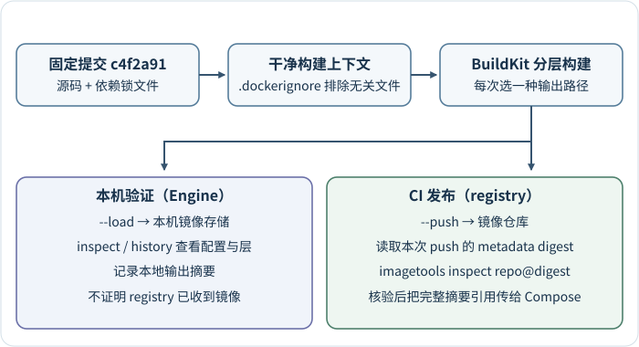
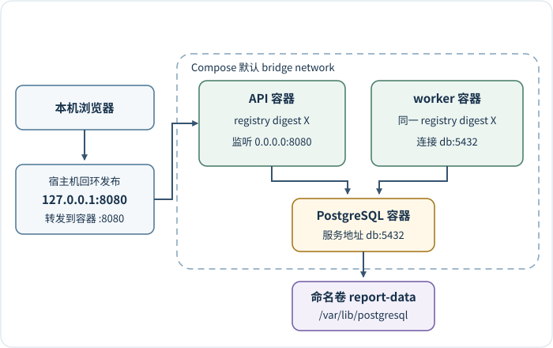

# Docker 如何把报表服务的源码构建成可运行镜像？

**案例背景。** Git commit（提交）`c4f2a91` 修复了报表 42 对 `tenant-a` 的读取授权。本章承接这份已检查的源码和依赖锁文件，说明怎样构建容器镜像、在本地 Compose 中组合 API、worker 与数据库，并观察镜像和容器状态。CI 发布时还要把本次 registry（镜像仓库）摘要交给部署流程；预发布、生产晋级和切流见[如何晋级并回滚已验证的报表服务产物？](application-deployment-and-ci-cd.md)。

报表服务的 application programming interface（应用程序接口，API）与异步 worker（工作进程）从同一份源码构建，但承担不同进程职责。Dockerfile（镜像构建文件）把受控源码、依赖与基础镜像变成 container image（容器镜像）：镜像以只读层保存程序及默认配置。container（容器）启动时，运行时在镜像上叠加该容器自己的可写层，再组合进程命令和运行配置；容器删除后，可写层中的改动也丢失，需跨容器保留的数据库文件应写入 volume（数据卷）。镜像不保存某个环境的数据库密码。image digest（镜像摘要）标识具体镜像内容；tag（可变标签）只是会移动的名字。Docker Compose 负责把容器接成服务、network（网络）与数据卷。

本地 `--load` 将镜像载入本机，供后续启动容器检查；CI 的 `--push` 把另一轮构建输出发布到 registry。两次构建即使来自同一提交，也不能假定得到相同摘要。下面分别跟踪这两条路径，最后把 CI 验证过的远端摘要交给运行环境。

## 按运行所需文件分层构建

一次 build（构建）从 build context（构建上下文）开始：Docker CLI（命令行客户端）将指定的文件集合交给 builder（构建器）。`.dockerignore` 在发送前按相对构建根目录的路径模式排除无关或私密文件；它不会代替 Git 的忽略规则，也不会把上下文之外的文件传进去。需要匹配任意层级的文件时用 `**/`，单写 `*.log` 等规则不等于递归匹配。通常先复制依赖锁定文件再复制源码，使源码变更不必重装依赖。BuildKit 根据指令及其输入复用 build cache（构建缓存）；某层输入改变时，该步骤及后续步骤需重做。缓存既不代表外部依赖仍最新，也不自动让构建可复现：基础镜像 tag、依赖索引或下载内容、平台和构建工具都可能变化，因此相同源码的独立重建仍可能生成不同镜像。

下面用官方 `python:3.15-slim` 镜像说明结构。实际应用先确认框架、依赖和 native extension（原生扩展）支持该解释器，再在每个 `FROM` 固定审核过的基础镜像 digest。`requirements.lock` 应覆盖直接和传递依赖、精确版本与 SHA-256；`pip --require-hashes` 会逐项校验下载内容。若没有适用 wheel（预构建安装包）而需从源码编译，构建阶段除 compiler（编译器）和 header（头文件）外，还要审核并控制包的 build backend（构建后端）及 build-time dependencies（构建依赖）；pip 会为源码包另建隔离构建环境，运行时依赖锁文件本身不锁定该环境。运行阶段只保留所需共享库。

~~~dockerfile
# syntax=docker/dockerfile:1
FROM python:3.15-slim AS deps
WORKDIR /build
COPY requirements.lock .
RUN --mount=type=cache,target=/root/.cache/pip \
    python -m pip install --prefix=/install --require-hashes -r requirements.lock

FROM python:3.15-slim AS runtime
WORKDIR /app
ENV PYTHONDONTWRITEBYTECODE=1 \
    PYTHONUNBUFFERED=1
COPY --from=deps /install /usr/local
COPY --chown=10001:10001 app ./app
USER 10001:10001
CMD ["uvicorn", "app.main:app", "--host", "0.0.0.0", "--port", "8080"]
~~~

两个 stage（构建阶段）都应使用已审核的基础镜像摘要：单平台固定对应平台 manifest digest；多平台可固定已核验的基础镜像 index digest，由每个 stage 按目标架构选择相同的平台 manifest。代码使用 tag 让结构容易读，生产 Dockerfile/构建参数还需以真实摘要固定它。`COPY --from=deps` 只带入运行依赖，非 root `USER` 降低应用进程的权限；应用若需要写文件，应明确把输出目录放到受控挂载点，不能依赖容器可写层跨替换保留。示例 Uvicorn 在容器内监听 `0.0.0.0:8080`，让容器网络接口可以接收映射流量；宿主机端仍可只发布到 `127.0.0.1:8080`。若应用只绑定容器内的 `127.0.0.1`，宿主机端口映射不能替它改变监听地址。`CMD` 是默认启动命令。Dockerfile 的 `RUN` 在构建时执行并把构建结果交给后续步骤；`CMD` 和 `ENTRYPOINT` 在容器启动时定义进程。使用 exec form（JSON 数组形式）可让应用作为 PID 1（容器内首进程）收到停止信号。若镜像定义了 `ENTRYPOINT`，Compose `command` 会替换 `CMD` 或追加到 exec-form `ENTRYPOINT`，不会自动改写 `ENTRYPOINT`；若 Compose `entrypoint` 非空，则镜像默认 `CMD` 被忽略。

`.dockerignore` 至少要排除版本库、虚拟环境、缓存、本机日志、真实 `.env` 与 secret（密钥）文件，例如：

~~~text
.git/
**/.git/
.venv/
**/.venv/
__pycache__/
**/__pycache__/
*.py[cod]
**/*.py[cod]
*.log
**/*.log
.env
.env.*
**/.env
**/.env.*
secrets/
**/secrets/
~~~

若私有依赖源需要认证，BuildKit secret mount（构建密钥临时挂载）只在某条 `RUN` 期间暴露文件，例如 `RUN --mount=type=secret,id=pip_config,target=/etc/pip.conf ...`，调用构建时用 `--secret id=pip_config,src=/安全路径/pip.conf`。不要把 token 写进 `ARG`、`ENV`、COPY 文件或 shell 命令参数；不要让 verbose 日志打印认证配置。secret mount 的挂载本身不会把密钥写入镜像层；`RUN` 中的命令仍可能把它复制到产物、输出到日志或发送到网络，builder 和依赖源也必须受信。

下面的 shell 示例假设运行环境提供 Bash、Docker Buildx 和 `jq`，构建上下文内有 `app/` 与 `requirements.lock`。本地单平台验证可以把结果载入本机 Docker Engine：

> [!example]- 本地构建：本次 metadata、inspect 与 history
>
> ~~~bash
> set -euo pipefail
> metadata_file="$(mktemp "${TMPDIR:-/tmp}/report-api-build.XXXXXX")"
> trap 'rm -f "$metadata_file"' EXIT
>
> docker buildx build \
>   --load \
>   --metadata-file "$metadata_file" \
>   --tag report-api:c4f2a91 \
>   .
> digest="$(
>   jq -er '
>     ."containerimage.digest"
>     | select(type == "string" and test("^sha256:[0-9a-f]{64}$"))
>   ' "$metadata_file"
> )"
> printf 'Local build digest: %s\n' "$digest"
> docker image inspect report-api:c4f2a91
> docker image history report-api:c4f2a91
> ~~~

示例从源码根 `.` 构建；执行前应确认 checkout（检出）正是 `c4f2a91`，工作区干净且根目录就是预期上下文。临时 metadata 避免 build 失败后误读上次摘要，`set -e` 使构建失败即停止，`jq -e` 要求本次输出有格式正确的 digest，并明确打印本地构建摘要。标签 `report-api:c4f2a91` 只是本地别名；tag 不会验证源码是否确为该提交。`docker image inspect` 查看本机镜像配置和已知摘要，`history` 查看构建层线索；历史不是镜像文件的完整审计，也不证明 registry 中的产物。`--load` 是 `--output=type=docker` 的 CLI 简写；本例只请求一个平台。多平台本地载入受 builder 和 Engine image store 约束。当前 Buildx 可在探测到目标 Engine 支持 OCI importer 时选择可导入多平台的路径；classic store 不支持本地多平台 index，containerd store 支持，但仍需确认当前 builder 与输出组合。不要把本机 metadata digest 当作 registry 已收到镜像的证明。

本地检查和发布是两条不同输出。生产候选由 CI 从同一经检查的 commit 干净检出后，通过 `--push` 单独构建并发布；以下脚本读取的 metadata 属于这次 push，不能拿前一段 `--load` 的摘要代替：

> [!example]- CI 发布：核验 registry 摘要后交给运行环境
>
> ~~~bash
> set -euo pipefail
> metadata_file="$(mktemp "${TMPDIR:-/tmp}/report-api-push.XXXXXX")"
> trap 'rm -f "$metadata_file"' EXIT
>
> docker buildx build \
>   --push \
>   --metadata-file "$metadata_file" \
>   --tag registry.example.com/team/report-api:c4f2a91 \
>   .
> digest="$(
>   jq -er '
>     ."containerimage.digest"
>     | select(type == "string" and test("^sha256:[0-9a-f]{64}$"))
>   ' "$metadata_file"
> )"
> registry_ref="registry.example.com/team/report-api@$digest"
> docker buildx imagetools inspect "$registry_ref"
> printf 'REPORT_IMAGE=%s\n' "$registry_ref"
> ~~~

CI 只在 `imagetools inspect` 通过后把打印出的完整 `registry@sha256:…` 值作为后续 Compose job 的 `REPORT_IMAGE`。Compose 插值中的 `${REPORT_IMAGE:?…}` 仅拒绝空值，不校验它一定是 digest；调用方要传入这次 push 核验的完整引用。多平台构建要从远端清单检查每个生产架构的 manifest digest；index 里还可能有 provenance 等非运行平台附件，不能把任意子项当成可启动的架构镜像。预发布和生产晋级同一已核验的 registry 摘要，不分别重建。

registry digest 固定镜像 manifest 或多平台 index 的内容，但不说明由哪个源码提交构成。构建记录应把确切 commit（提交）、依赖锁文件、基础镜像摘要、Buildx/BuildKit 版本、平台、构建参数、continuous integration（持续集成，CI）检查和 provenance（构建来源证明）连接起来。跨 `linux/amd64` 与 `linux/arm64` 晋级时，index digest 证明所包含的描述项映射，不证明每个平台子镜像已运行。应在对应生产平台的预发布目标运行并验收将部署的每个子摘要，或限制生产目标为预发布实际运行的平台；检查时区分平台镜像 manifest 与 provenance 等附件。

## 容器、服务网络与数据存留是不同状态

下图采用本地 Compose 的默认 bridge/NAT 配置。API、worker 和 PostgreSQL 通过服务网络互通；HTTP 暴露在宿主机端口，数据库文件写入命名卷。API 与 worker 共用前图核验过的 registry 引用，生产路由和密钥存储则由相应运行平台配置：

下面的 Compose Specification（Compose 规范）片段要求外部提供 `REPORT_IMAGE`，其值应是前面 `--push` 和远端 `imagetools inspect` 已核验的 `registry.example.com/team/report-api@sha256:…` 实际摘要，而非本地 `--load` 摘要。`${REPORT_IMAGE:?…}` 只检查非空；CI 或传值的人必须保证它是该次 push 的不可变引用。API 与 worker 使用同一镜像身份，后者只替换默认命令；Compose 片段本身不创建应用角色或执行结构迁移。

若只做本机开发，可把服务的 `image` 设为前面已载入的 `report-api:c4f2a91` 并设置 `pull_policy: never`，使用本机已有镜像；另选 `build: .` 则从当前目录重新构建。这两种开发配置都不作为 registry 发布的证据，下例继续沿用 CI 交付的摘要。

> [!example]- Compose 配置：共享镜像、独立身份与命名卷
>
> ~~~yaml
> services:
>   api:
>     image: "${REPORT_IMAGE:?set REPORT_IMAGE to an immutable image digest}"
>     ports:
>       - "127.0.0.1:8080:8080"
>     environment:
>       DATABASE_HOST: db
>       DATABASE_NAME: reports
>       DATABASE_USER: report_app
>       DATABASE_PASSWORD_FILE: /run/secrets/app_db_password
>     secrets:
>       - app_db_password
>     depends_on:
>       db:
>         condition: service_healthy
>
>   worker:
>     image: "${REPORT_IMAGE:?set REPORT_IMAGE to an immutable image digest}"
>     command: ["python", "-m", "app.worker"]
>     environment:
>       DATABASE_HOST: db
>       DATABASE_NAME: reports
>       DATABASE_USER: report_app
>       DATABASE_PASSWORD_FILE: /run/secrets/app_db_password
>     secrets:
>       - app_db_password
>     depends_on:
>       db:
>         condition: service_healthy
>
>   db:
>     image: postgres:18
>     environment:
>       POSTGRES_DB: reports
>       POSTGRES_PASSWORD_FILE: /run/secrets/db_admin_password
>     secrets:
>       - db_admin_password
>     volumes:
>       - report-data:/var/lib/postgresql
>     healthcheck:
>       test:
>         - CMD-SHELL
>         - >-
>           pg_isready -h 127.0.0.1 -p 5432
>           -U "$${POSTGRES_USER:-postgres}"
>           -d "$${POSTGRES_DB:-postgres}"
>       interval: 5s
>       timeout: 3s
>       retries: 5
>
> secrets:
>   app_db_password:
>     file: ./secrets/app_db_password.txt
>   db_admin_password:
>     file: ./secrets/db_admin_password.txt
>
> volumes:
>   report-data:
> ~~~

新建空卷时，先确认 `REPORT_IMAGE` 指向本次 push 后已核验的 registry digest，再执行 `docker compose up -d db` 单独启动数据库。`POSTGRES_DB: reports` 让官方镜像在初始化这个空数据目录时创建 `reports`；默认管理用户是具备高权限的 `postgres`，不要把 `POSTGRES_USER` 改成 `report_app`。数据库的 TCP healthcheck 变为 healthy 后，运行项目提供的受控 bootstrap/migration（引导和迁移）任务：任务通过获准的 secret access 读取数据库管理员密码和 `app_db_password`，创建使用应用密码的 `report_app`，只授予 `reports` 中应用需要的权限并完成 schema migration（结构迁移）。成功后再执行 `docker compose up -d api worker`。这段 Compose 没有定义具体迁移任务；它必须在 API 和 worker 之前成功完成，不能由 `depends_on` 的数据库健康检查代替。现有卷不会因环境变量更新而自动补建数据库或修改凭据，启动服务前应核对其实际状态。

healthcheck 用 `pg_isready -h 127.0.0.1 -p 5432` 明确探测正式 TCP 监听端口；不带 `-h` 时会走 Unix socket，而官方 Postgres 镜像初始化期间会启动只供本地脚本用的临时服务器，可能让 socket 检查在正式 TCP 服务前过早通过。健康检查中的 `-U`/`-d` 提供连接请求信息，不是身份验证，也不证明角色、密码或迁移正确。`depends_on: condition: service_healthy` 只等待这个 TCP 健康状态；若把 API/worker 和 db 一起启动，它不等待独立的引导任务，因此要先完成上述初始化，再启动应用服务。

Compose 自动创建项目的 default bridge network（默认桥接网络），服务可以通过 service name（服务名）互相发现。API 与 worker 都连到 `db:5432`，那是数据库容器端口；只有要从宿主机或外部进入的 API 映射了 host port（宿主机端口）8080。API 进程在容器内监听 `0.0.0.0:8080`，Compose 的 `127.0.0.1:8080:8080` 只把宿主机回环地址映射到这个容器端口。若省略宿主机 IP，默认会绑定所有宿主机接口，应视作对其他可路由主机开放。Docker Engine 28.0.0 起，localhost 发布在默认 bridge/NAT 路径的预期行为是只由 Docker 主机访问；更早版本有同一 L2 网络的其他主机可访问 localhost 发布端口的例外。特殊 network mode（网络模式）、direct routing（直接路由）和宿主机路由/防火墙仍可能改变边界，按实际 Engine 与网络设置核实。无论端口是否开放，服务名可达都不代表数据库身份通过，也不代替应用认证或租户授权。

容器通过 `db` 发现对端，不要保存容器 IP：Compose 重建服务时会分配新 IP，但服务名不变；已有连接会断开，客户端应重新解析并连接。`depends_on: condition: service_healthy` 只在 Compose 启动依赖方时等待数据库 TCP 健康检查，不会在之后数据库故障时接管恢复；`pg_isready` 说明 TCP 服务在接入，不证明应用凭据有效、迁移完成或业务查询正确。端口映射只建立转发关系，也不证明 API 进程健康。

Compose `secrets` 显式把相应凭据文件挂给获准服务；本例以 Linux 容器为前提。本地 `file:` secret 通过 bind mount 提供，`uid`、`gid`、`mode` 覆盖会被忽略，应按实际宿主文件权限确保容器的 `USER 10001` 能读取。这里 `db_admin_password` 供官方 Postgres 镜像初始化管理员；`app_db_password` 是独立的最小权限应用账号密钥，API/worker 代码必须自行读取 `DATABASE_PASSWORD_FILE`。官方镜像中的 `POSTGRES_PASSWORD_FILE` 只在空数据目录首次初始化时设置管理员密码；后来改宿主 secret 文件不会修改数据库里已存在的密码。轮换必须先在数据库中更新账号，再让应用切到匹配的 secret。Compose 本地 secret 方便开发，不等同于加密的生产 secret store；不要把 `secrets/` 加入版本控制。

PostgreSQL 官方镜像自 major version（主版本）18 起采用版本专属数据路径，PostgreSQL 18 的默认 `PGDATA` 是 `/var/lib/postgresql/18/docker`，volume 应挂在父目录 `/var/lib/postgresql`；官方示例中的下一个大版本会将路径中的 `18` 换成其主版本号。17 及更早镜像的数据路径是 `/var/lib/postgresql/data`，此时应挂载该实际数据目录，单纯改成父目录可能不能持久化旧数据。切换 PostgreSQL 主版本不能靠更改 image tag 自动迁移现有数据库：18 的目录布局变化也要求先检查/调整旧卷结构；主版本升级须按官方升级路径备份并用支持的升级流程转换。本文用 PostgreSQL 18 说明该目录约定。即便 `postgres:18` 是主版本 tag，它也会移动到新的 18.x 镜像；生产记录并固定实际摘要、及时更新补丁。

容器可写层随容器移除而丢失；named volume（命名数据卷）由 Docker 管理，容器替换后可重新挂载；anonymous volume（匿名数据卷）没有稳定项目名称，新容器通常不会自动挂载同一个卷。bind mount（绑定挂载）直接映射宿主路径，适合开发时共享源码，不适合作为生产数据库备份方案。卷只解决容器替换后的文件存留，不保证异机备份、时间点恢复、加密、访问控制或数据正确；仍须独立备份和恢复演练。普通 `docker compose down` 移除容器与网络但保留命名卷，`docker compose down -v` 会删除 Compose 文件声明的项目命名卷及附着的匿名卷，连同其中的数据。

## 从构建状态检查到运行状态观察

检查时分清镜像、容器与 Compose 项目：

| 命令 | 查看的对象 | 能回答的问题 | 不能单独证明 |
|---|---|---|---|
| `docker image ls` | 本机镜像和 tag | 镜像是否已载入、本地有哪些名字 | 容器运行中或 registry 有同一内容 |
| `docker image inspect report-api:c4f2a91` | 本机镜像配置 | 平台、启动命令、环境、image ID（配置对象标识）和已知 RepoDigests（仓库摘要引用） | 当前 registry 发布状态或来源可信 |
| `docker ps -a` | 本机容器 | 容器是否运行、退出或停止 | 应用业务健康 |
| `docker compose ps` / `docker compose ps -a` | Compose 服务容器 | 默认只列运行中服务；`-a` 也列已停止容器 | 未配置 healthcheck（健康检查）时的就绪，或用户结果 |
| `docker compose logs api worker` | 两服务的标准输出/错误 | 启动错误和应用日志 | 端到端追踪、租户授权和完整指标 |
| `docker compose exec api /bin/sh` | 正在运行的 API 容器 | 查看进程环境或执行诊断命令 | 容器必有 shell；distroless/精简镜像可能没有 |
| `docker image history report-api:c4f2a91` | 本地镜像层记录 | 哪些构建步骤留下层线索 | 完整文件审计或密钥从未进入层 |

`docker compose up -d` 和 `docker run -d` 的 detached mode（分离运行模式）只让命令在后台返回；它不是独立进程监督器，也不自动确保健康检查、重启策略和告警已配置。容器的 `running`、`healthy` 和应用业务正确是不同判断：只有定义了 healthcheck 才有 Docker 健康状态；存活探针也不能证明 report 42 的租户授权。预发布后再到生产逐步放量的门禁和用户结果见[如何晋级并回滚已验证的报表服务产物？](application-deployment-and-ci-cd.md)。运行时停止 API 与 worker、释放在途任务的职责见[报表 API 与异步 worker 应由什么运行时承接？](production-application-runtime.md)。

镜像与容器的日常操作可以按对象生命周期读：`docker pull redis:7` 把可变 tag 拉到本机；生产若要求固定版本，应使用 registry digest。`docker run --name cache -d redis:7` 从镜像创建并启动一个新容器；`docker ps -a` 也能看到已停止容器。`docker stop cache` 向容器主进程发送配置的停止信号，宽限时间后再强制终止；`docker start cache` 重新启动同一个容器及其写层，不会从新版镜像重建它。`docker rm cache` 移除已停止容器；`docker rm -f cache` 会对运行中容器的主进程发送 `SIGKILL` 并移除它，没有 `docker stop` 的优雅停止宽限期；在途任务可能被中断，容器写层也随之丢失。单独的 volume 是否还在，取决于卷类型和删除操作。`docker image rm redis:7` 移除该本地镜像引用，其他标签或正在使用它的容器可能仍使层保留。

手动推送时，`docker login registry.example.com` 登录仓库，`docker tag` 给本地内容添加仓库名和标签，`docker push` 才把镜像发布到远端。登录会存储凭据，推送会写入 registry。生产发布应由受控 CI 身份完成，记录 registry 返回的摘要并按摘要部署，不把可变 tag 当作验收结果。

> [!info]- 来源
> - 镜像、容器与 Dockerfile：[What is an image?](https://docs.docker.com/get-started/docker-concepts/the-basics/what-is-an-image/)、[What is a container?](https://docs.docker.com/get-started/docker-concepts/the-basics/what-is-a-container/)、[Dockerfile reference](https://docs.docker.com/reference/dockerfile/) 与[多阶段构建](https://docs.docker.com/get-started/docker-concepts/building-images/multi-stage-builds/)，checked 2026-11-12；CMD、ENTRYPOINT、exec/shell form、USER 与镜像/容器关系按 Docker 当前文档核实。
> - 上下文、cache、密钥和摘要：[build context patterns](https://docs.docker.com/build/concepts/context/#syntax)、[build best practices](https://docs.docker.com/build/building/best-practices/)、[cache optimization](https://docs.docker.com/build/cache/optimize/)、[Build secrets](https://docs.docker.com/build/building/secrets/)、[buildx build](https://docs.docker.com/reference/cli/docker/buildx/build/)、[Buildx exporter selection source](https://github.com/docker/buildx/blob/v0.39.0/build/opt.go#L494-L538)、[imagetools inspect](https://docs.docker.com/reference/cli/docker/buildx/imagetools/inspect/)、[Build attestations](https://docs.docker.com/build/metadata/attestations/)、[Docker Engine containerd image store](https://docs.docker.com/engine/storage/containerd)、[Docker Desktop containerd image store](https://docs.docker.com/desktop/features/containerd/) 与[image digests](https://docs.docker.com/dhi/explore/security-concepts/digests/)，checked 2026-11-12；涵盖 `.dockerignore` 递归模式、cache mount、`--load` CLI shorthand、`--push`、metadata、registry 核验、index 附件、digest 与受 builder/store 影响的多平台载入边界。
> - Python 依赖校验：[pip secure installs](https://pip.pypa.io/en/stable/topics/secure-installs/) 与 [pip install `--require-hashes`](https://pip.pypa.io/en/stable/cli/pip_install/#cmdoption-require-hashes) 与 [pip build system](https://pip.pypa.io/en/stable/reference/build-system/)，checked 2026-11-12；哈希模式要求逐项锁定直接和传递依赖并为发行包提供哈希，源码包的隔离构建环境另有 build-time dependencies。
> - Compose 文件和服务：[Compose Specification](https://docs.docker.com/reference/compose-file/)、[Compose history](https://docs.docker.com/compose/intro/history/)、[services reference](https://docs.docker.com/reference/compose-file/services/)、[Compose secrets](https://docs.docker.com/compose/how-tos/use-secrets/)、[startup order](https://docs.docker.com/compose/how-tos/startup-order/) 和[variable interpolation](https://docs.docker.com/reference/compose-file/interpolation/)，checked 2026-11-12；旧顶层 `version` 字段已过时；当日 Docker Docs 支持的 Compose CLI 为 v2 与 v5，均采用 Compose Specification。`command`、`entrypoint`、`depends_on` 和健康检查取决于服务配置。
> - 网络、端口和卷：[Compose networking](https://docs.docker.com/compose/how-tos/networking/)、[port publishing](https://docs.docker.com/engine/network/port-publishing/)、[volumes](https://docs.docker.com/engine/storage/volumes/)、[bind mounts](https://docs.docker.com/engine/storage/bind-mounts/) 与 [`docker compose down`](https://docs.docker.com/reference/cli/docker/compose/down/)，checked 2026-11-12；localhost 端口边界按 Engine 版本、网络模式和路由说明。
> - 本地 secret 与 Postgres 初始化：[Compose secrets](https://docs.docker.com/compose/how-tos/use-secrets/)、[official Postgres image initialization scripts](https://github.com/docker-library/docs/blob/master/postgres/README.md#initialization-scripts)、[official image entrypoint](https://github.com/docker-library/postgres/blob/master/docker-entrypoint.sh)、[environment variables](https://hub.docker.com/_/postgres#environment-variables)、[PostgreSQL 18 `pg_isready`](https://www.postgresql.org/docs/18/app-pg-isready.html) 与[PGDATA](https://github.com/docker-library/docs/blob/master/postgres/README.md#pgdata)，checked 2026-11-12；Compose `file:` secrets 由具体实现挂载；`pg_isready` 检查服务器是否接受连接，不验证角色认证或迁移；Postgres 初始化环境变量不会修改非空数据目录中的已有账号。
> - 版本选择：[Python 3.15.2](https://www.python.org/downloads/release/python-3152/)、[official Python image `slim` layer](https://hub.docker.com/layers/library/python/slim/)；[PostgreSQL versioning policy](https://www.postgresql.org/support/versioning/) 与 [PostgreSQL 19 RC 1 schedule](https://www.postgresql.org/about/news/postgresql-19-rc-1-released-3409/)，checked 2026-11-12。Python 3.15.2 已发布，Docker Hub 的 `python:3.15-slim` 对应其官方镜像；PostgreSQL 19 的 general availability（正式可用，GA）当时仍计划在 2026-11-19，本文用 PostgreSQL 18 说明已发布版本的目录边界。
> - 操作与观察：[docker run](https://docs.docker.com/reference/cli/docker/container/run/)、[docker stop](https://docs.docker.com/reference/cli/docker/container/stop/)、[`docker rm --force`](https://docs.docker.com/reference/cli/docker/container/rm/#force)、[docker image rm](https://docs.docker.com/reference/cli/docker/image/rm/)、[docker image history](https://docs.docker.com/reference/cli/docker/image/history/)、[docker compose ps](https://docs.docker.com/reference/cli/docker/compose/ps/)、[docker compose logs](https://docs.docker.com/reference/cli/docker/compose/logs/)、[docker compose exec](https://docs.docker.com/reference/cli/docker/compose/exec/)、[docker login](https://docs.docker.com/reference/cli/docker/login/)、[docker tag](https://docs.docker.com/reference/cli/docker/image/tag/) 和[docker push](https://docs.docker.com/reference/cli/docker/image/push/)，checked 2026-11-12；强制移除运行中容器会发送 `SIGKILL`，不等同于先执行 `docker stop` 的宽限终止。
