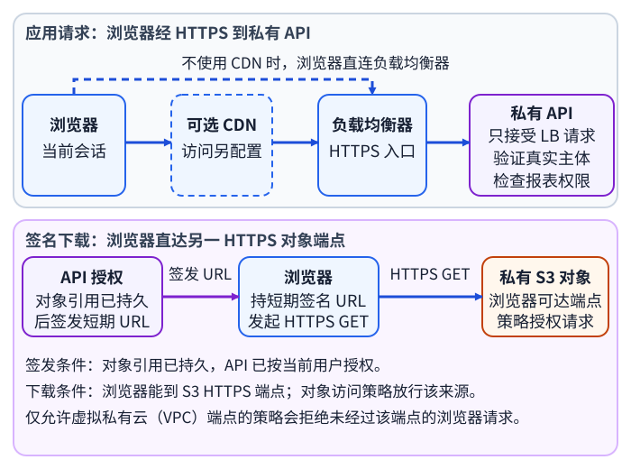
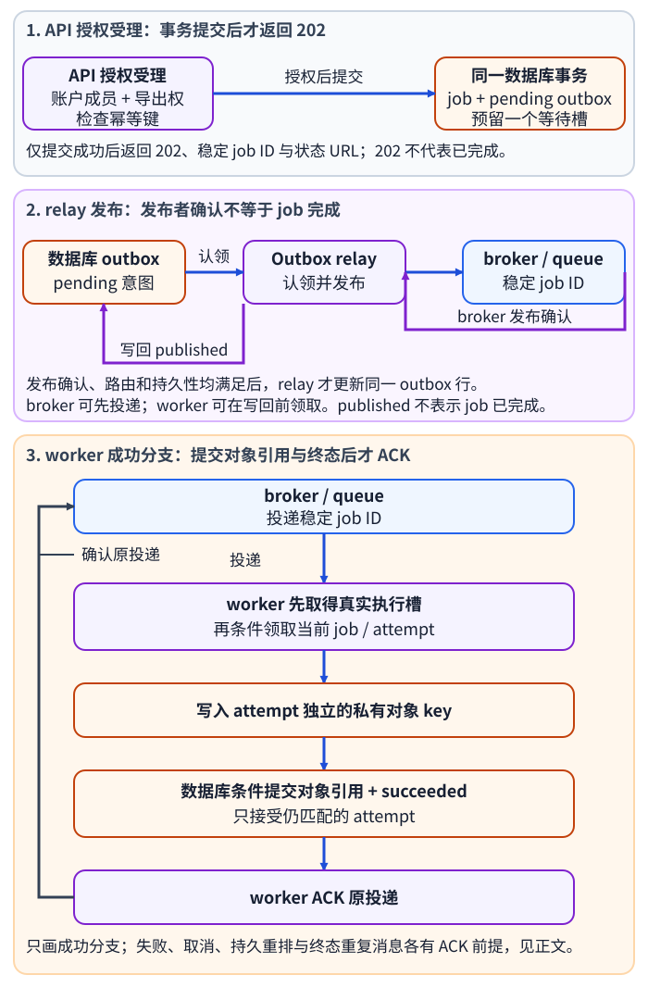
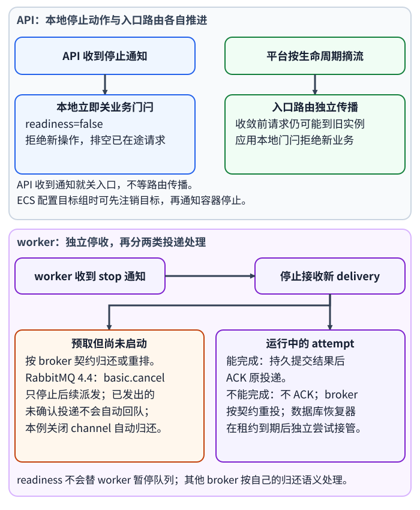

# 报表 API 与异步 worker 应由什么运行时承接？

上一章从已检查的源码提交 `c4f2a91` 构建镜像，并将经过远端清单核验的 registry（镜像仓库）摘要交给后续环境。本章直接承接该摘要作为 application programming interface（应用程序接口，API）与 worker（工作进程）的运行产物；二者可以用不同启动命令运行，不重新构建。outbox relay（事务发件箱转发进程）是另一独立进程；只有实际镜像包含它的执行入口时才可复用该摘要，否则须交接 relay 自己经过核验的镜像摘要。本章说明这些运行角色怎样分别配置网络、身份、容量与停止行为。API 经 Hypertext Transfer Protocol Secure（超文本传输安全协议，HTTPS）入口提供服务；生产预发布、授权冒烟和逐步切流由[如何晋级并回滚已验证的报表服务产物？](application-deployment-and-ci-cd.md)继续说明。

合成例中，tenant-a 读取 report 42 应得到 200 和预期内容，tenant-b 猜中同一报表 ID 应得到 404。acct-17 的调用者先通过当前身份认证，并被确认属于该账户且有 `report:export` 权限；`report:read` 只允许读取，不能替代导出授权。通过授权后，API 使用 idempotency key（幂等键）`report-demo-208`，在同一个数据库事务中写入 job（任务）`job-demo-731`、transactional outbox（事务发件箱，outbox）意图，并预留一个等待槽。新任务只有在事务提交后才返回 `202 Accepted`（已受理）、稳定 job ID 和 Uniform Resource Locator（统一资源定位符，URL）形式的状态查询地址；202 只表示任务意图已受理，不表示报表已经完成或最终必然成功。每次重复请求也先重新授权，同一账户、主体和规范化请求的幂等键重放会返回原 job，不再预留新槽，同键对应不同报表参数则冲突。之后查询状态或下载结果时仍按当前调用者重新授权；排队期间 worker 也要在读取报表前复核发起人当前的导出权限。

等待槽是数据库维护的排队准入额度：每个未领取的排队轮次占一个，接管重排时重新预留，领取时释放；它不是 broker（消息代理）的 prefetch（预取）或锁。relay（转发进程）读取待发意图并发布到 queue（队列）；worker（工作进程）领取任务、计算结果、写入私有对象，成功时在持久提交对象引用和任务状态后才发送 consumer acknowledgement（消费者确认，ACK）。只读请求的授权结果与导出任务的成功或失败是两种不同的用户结果。本文的账号、ID 和数据均为教学用合成值。

job、outbox 和等待槽在同一数据库事务提交，但该事务不包含 broker 写入。relay 只有在所选 broker 的发布确认、路由和持久性条件都满足后，才把对应 outbox 意图记为 `published`；这个状态只表示发送端完成发布步骤，不表示 worker 已处理或 job 已成功。broker 可在 relay 更新 outbox 行之前就投递消息，worker 也可能先完成领取，所以 `published` 不是 worker 可见消息的前置状态。若 broker 已接收消息而 relay 在更新数据库前崩溃，重试可能再次发布。队列只携带稳定 job ID，worker 仍要从数据库条件领取当前 attempt（尝试）；重复消息不能仅凭消息本身启动并行 attempt。发布者确认、消费者 ACK 和业务 job 终态是三个不同边界；本例的状态细节见[怎样设计一个可持久查询的账户报表？](../architecture/system-design-fundamentals.md)与[报表任务的发布确认、消费者确认与业务完成各证明什么？](../reliability/queue-delivery-and-acknowledgement.md)。

图中的 API 入口与异步任务由不同进程承接。CDN 可选：不使用时浏览器直接到 load balancer（负载均衡器）入口。应用的公共入口只提供 HTTPS（超文本传输安全协议）；下载是另一条直达对象端点的 HTTPS 路径：只有任务结果和对象引用已持久、API 按当前用户授权后，API 才签发短期 URL，浏览器随后直接向 Amazon S3 请求对象，不经过 API 数据路径。私有 bucket（存储桶）仍须允许浏览器所在网络到达 S3 端点，并在 bucket 和访问控制策略中允许该签名请求；若策略只允许来自指定 Virtual Private Cloud（虚拟私有云，VPC）endpoint（端点）的请求，未经过该端点的浏览器即使拿到正确签名也会被拒绝。对象访问 URL 是持有者即可使用的 bearer token（持有者令牌），不能当成可公开缓存的普通地址。

## 网络路径和身份策略分开

网络路由、防火墙或安全组决定“谁能连到哪个地址”；工作负载身份和资源策略决定“该服务主体能对哪个资源做什么”；API 的业务授权再决定“当前用户能否读取 tenant-a 的 report 42、是否能导出 acct-17 的数据”。三者不能互相替代。HTTPS 加密浏览器到应用入口之间的传输，却不会替代 API 对当前主体的授权；Hypertext Transfer Protocol（超文本传输协议，HTTP）请求如何从浏览器到达响应见[浏览器请求如何到达 HTTP 响应？](../networking/http-protocols-and-websockets.md)。常见拓扑只公开应用的 HTTPS 入口；API 只接受负载均衡器送来的应用请求；数据库只允许 API、worker、outbox relay 和数据库租约恢复器各自的私有网络身份进入，例如为恢复器单独配置安全组或等效网络规则。恢复器再使用独立的数据库主体（例如 `runtime_recovery`），不借用 worker 或 relay 的凭据。浏览器直达 S3 的签名下载是独立的 HTTPS 端点，端点可达与对象授权都必须成立。各服务的数据库网络白名单仍要配合最小 SQL 权限：relay 只操作 outbox 发布意图；恢复器只读取扫描和争用所需的 job 标识、状态、attempt、lease 截止时间与取消标志，并以条件事务接管匹配 job、原子预留等待槽、写入 recovery outbox 或持久化终态。该主体不能读取报表内容，也不获准发布 broker 消息或代替 API 做用户授权。

| 请求或进程 | 网络上需要到达 | 身份与数据权限边界 |
|---|---|---|
| 浏览器只读 API 请求 | 公共入口 → 可选 CDN → 负载均衡器 → 私有 API | API 从真实会话或令牌取得当前主体，再逐请求检查租户与报表权限；客户端自填租户头不能代替身份 |
| API | 数据库；签名 URL 可在本地基于凭据生成，不需代理对象文件 | 按租户/账户范围读取报表、成员关系、授权和 job 状态；写 job/outbox/等待槽；签名者只获准读取对应结果对象 |
| outbox relay | 数据库 + broker | 只读/认领 pending outbox 并更新同一发布意图；只向获准队列发布，不能用它承载用户授权 |
| worker | 数据库 + broker + 私有对象存储 | 按 job 的租户/账户范围读取报表输入和当前授权；条件领取并更新该 job/attempt；对象写入限制到报表前缀；先持久业务结果，再按所选 broker 契约 ACK |
| 数据库租约恢复器 | 独立私有网络身份直连数据库；重排意图由 outbox relay 另行发布 | 独立数据库主体只读扫描与竞争所需的 job 标识、状态、attempt、lease 截止时间和取消标志；条件更新接管或终态，重排时原子预留等待槽并插入 pending outbox；不读报表数据、无 broker 发布权，也不替用户授权 |
| 浏览器下载 | 持有 URL 后直达浏览器可达的对象 HTTPS 端点；本例不经 API | URL 只授予被签名的对象操作且有效时间受限；bucket 与对象资源策略仍须允许这条来源路径；浏览器不取得 worker 的云角色 |

worker 的数据库账号或数据库角色要有与任务相符的限定读取权：按 job 的租户/账户读取报表参数与数据，并读取该账户当前成员关系及 `report:export` 授权状态；状态写入仍限于被条件领取的 job/attempt。API 同样需要按范围读取报表与授权数据，并读取可查询的 job 状态；它只写受理事务所需的 job、outbox 和等待槽。若把这些读取放到受限查询服务，API 与 worker 对该服务的身份、数据范围和失败语义也要单独定义。队列消息只携带稳定 job ID，worker 在读输入前复核发起主体当前仍有导出权限；若已撤销，就持久写入 `failed` 终态及有界错误码 `authorization_revoked`，不读取报表。消息 ID、worker task role 或“已经提交过请求”都不能代替这项用户授权。

worker 的 Amazon Web Services（AWS）task role（任务角色）只需写指定报表对象前缀；身份与访问管理（Identity and Access Management，IAM）策略还应限定目标 bucket、对象前缀和可执行动作。签发下载 URL 的 API task role 还需对目标对象有 `GetObject` 权限。S3 按签发 URL 的主体权限判断请求；该 URL 可在有效期内重复使用，实际有效期不超过所选临时凭据的到期时间，相关凭据被撤销、删除或停用也会使其失效。应用撤销用户业务权限不会自动撤销已经签发的 URL。浏览器端还要能到达被签名的对象 HTTPS endpoint（端点），策略也要允许该请求上下文；“对象私有”表示未授权请求不能读取，不表示浏览器无法连接服务。仅允许某个 VPC endpoint 的 bucket policy 会拒绝未经过该 endpoint 的浏览器请求。若浏览器网络不能直达 S3，可经应用代理或配置私有源站的 CDN 提供下载；CloudFront 等 CDN 还需单独设置签名访问、私有源站和缓存策略，确保用户不能绕过 CDN 直接访问源对象。不能照搬公共静态文件缓存规则，签名 URL 与 CDN URL 的签名方式也不是一回事。

### `job-demo-731` 的领取、恢复和 ACK

job 处于 `queued` 时占一个数据库等待槽。worker 先取得本进程一个真实可用的执行槽，再用条件事务尝试领取；领取成功后把 job 变成 `running`、写入 attempt 代次与 lease（租约）截止时间，并释放这轮等待槽。物理执行槽要保持占用，直到该 attempt 实际停止并释放进程资源；数据库租约到期或 job 状态改写都不会让仍在运行的进程自动空出 CPU、内存或连接。没有执行槽时不能先领取再把工作塞进无界的进程内队列，也不能 ACK 掉唯一的恢复信号；应暂停消费或按 broker 契约延后处理，并限制 prefetch 和本地缓冲。

假设 worker-A 已领取 attempt 1 后失联且没有 ACK。broker 重投的消息仍只是 job ID；消费者先读权威 job 行，看到 `running/attempt 1` 就不能单靠重复消息再启动计算。独立的数据库恢复器扫描已过 lease 截止的 running job。到期只让恢复器有资格争取接管，不会单独撤销 worker-A 的提交权：A 的完成事务只在状态、当前 attempt 匹配且 `cancel_requested=false` 时才可成功；恢复器也用状态、attempt 和取消标志做条件竞争，先提交者决定状态。若 A 先提交成功，恢复器重读后看到终态，不再重排。若恢复器先提交且发现 `cancel_requested=true`，就直接写入 `cancelled`，不争用新等待槽；若仍可重试，它把匹配的 attempt 改回 `queued`、重新预留等待槽并写入新的 outbox 意图。只有这次接管提交成功后，job 状态/attempt 谓词才会 fence（隔离）旧 attempt；A 随后完成时条件更新影响零行。若重排时没有等待槽可预留，则持久写入 `capacity_exhausted` 终态，不无限重发。

新的 worker 仍须先有自己的物理执行槽，才可条件领取 attempt 2。每个 attempt 写独立对象键，例如 `private-reports/acct-17/job-demo-731/attempt-2.csv`；attempt 1 即使在接管提交后还活着，也不能覆盖 attempt 2 的对象。worker 先将对象写入私有存储，再以“job 仍为 running、attempt 仍匹配且未请求取消”为条件，在数据库提交对象引用和成功终态，随后才 ACK。若上传成功但条件数据库提交失败，对象没有权威引用，是可清理的孤儿；只有旧 attempt 已被接管或 job 已终结、数据库确认无引用、上传时限上界和额外安全宽限都已过，才回收对象，避免删除仍可能被合法提交引用的结果。

ACK 的依据取决于数据库已持久化的结果：成功或业务失败/取消终态提交后可 ACK；准备重试时，要先持久提交新的 `queued` 状态、等待槽和 outbox 意图，再 ACK 旧投递。若 DB 已提交终态而 ACK 丢失，重投只需重读 job 并 ACK，不重做计算。若看到 job 仍 `running`，只有确认有独立且持久的租约恢复器负责它时才可 ACK 重复投递；否则应保留或延后这条恢复信号。取消一个排队 job 也要在条件终态事务中只释放一次等待槽。

预取但尚未开始的投递也必须有归还路径。broker 对暂停、取消和关闭的具体保证不同；例如 RabbitMQ 4.4 中 `basic.cancel` 只阻止后续分发，不会丢弃或重排已经发出但未确认的投递。本例通过关闭 channel（通道），自动将其中仍未确认的投递归还队列；保留通道时，也可用 `basic.reject` 或 `basic.nack` 并设 `requeue=true` 显式重排相应投递。这条 RabbitMQ 行为不能外推为所有 broker 的通用规则；上线前要按实际客户端和 broker 的取消、关闭、重投语义设置预取与停机流程。

本地 Compose 能验证服务发现和容器间网络，但不能证明运行时身份、生产入口或租户授权正确。相同镜像摘要进入预发布后，仍要使用正常认证路径，经已配置入口以两个独立身份复放 tenant-a → 200 / 预期内容与 tenant-b → 404，并从追踪确认两次请求都命中被验收的本轮摘要；发起导出还需单独验证 acct-17 的账户成员关系和 `report:export` 授权，持有 `report:read` 不足以通过该门禁。入口和业务结果的发布门禁见[生产入口的就绪、授权冒烟与渐进放量](application-deployment-and-ci-cd.md#将环境门禁、启动检查和渐进放量接起来)。

## 托管平台管理什么，应用仍拥有哪部分

| 层 | 平台通常负责 | 应用团队仍负责 |
|---|---|---|
| 计算 | 按服务方案提供主机维护、调度和运行环境 | 镜像/包、启动退出、资源上限、扩缩容策略、健康规则 |
| 数据库 | 所选配置包含的基础设施、补丁、备份或故障切换 | schema 和迁移、查询/连接行为、权限授予、保留期、恢复演练 |
| 对象存储 | 服务可用性及文档承诺的持久性机制 | 私有命名、保留/生命周期、上传上限、谁能拿 signed URL 及其过期/撤权策略 |
| 队列 | 在服务合同和配置限制内存储和投递消息 | 幂等处理、重试退避、毒消息处理、队列年龄和dead-letter queue（死信队列，DLQ）恢复 |

“托管”减少平台运维，但不会替工作负载选择安全配置。托管数据库不会修复缺索引查询或连接风暴；托管队列也不会使非幂等 worker 在重试时安全。

## 按任务时长、并发和停止行为选择运行时

运行时选择不是按“云上”或“无服务器”作标签，而要看工作何时开始、最长会运行多久、并发怎样到达、能否安全重试、需要哪些连接和状态，以及平台停止进程时能否完成当前交接。

| 运行形态 | 适合的约束 | 必须核对的边界 |
|---|---|---|
| function service（函数托管服务） | 由事件触发、每次工作有明确上限，且供应商重试、并发和执行上下文能匹配业务 | 单次上限、冷启动、并发和配额、网络与连接池、触发及重试语义；需要持久进度时要用平台支持的状态编排，而不把内存当跨调用状态 |
| managed container service（托管容器服务） | HTTP 服务或队列消费者需要长期进程、明确的并发上限、连接生命周期和停止钩子 | 健康检查如何影响流量、扩容是否足以及时、停止宽限期是否覆盖排空、多个副本如何共享外部数据库/队列而不共享进程内状态 |
| virtual machine（虚拟机，VM） | 依赖主机级配置、守护进程、内核能力或遗留运行环境 | 团队需要安排主机补丁、容量与故障替换；若使用的是托管 VM 产品，应按其服务合同重新划定平台和应用责任 |

按峰值与稳态负载、最低常驻容量、启动延迟容忍度、长连接、并行度、数据库连接预算、单次执行限制和团队运维能力比较。serverless（无服务器计算）仍有状态、网络、配额和费用边界；“自动扩展”不会自动给数据库增加连接容量，也不保证尖峰请求立即获得新实例。队列到达率、处理时长和下游连接预算怎样共同限制准入与并行度，见[如何估算并限制异步工作管线？](../reliability/api-capacity-and-backpressure.md)。

目前 AWS Lambda 文档将默认函数调用、Lambda Managed Instances 和 durable functions（持久函数）区分：默认单次调用最长 15 分钟，Managed Instances 的异步或事件源映射调用可到 90 分钟，持久函数可用检查点跨多次调用并让异步执行最长到一年。它们的状态、并发和恢复语义不同，不能用“函数最长多久”概括所有产品模式。默认执行环境可能复用全局对象和 `/tmp`，可做可丢弃缓存或连接复用；环境会被回收，不能把它当跨运行持久数据，未完成后台回调也不能依赖将来继续执行。

在报表例中，HTTP API 要持续接收读请求；worker 则常驻等待队列，再访问数据库和对象存储，且在停止时要完成当前任务或安全交还 delivery（消息投递）。因此可将 API、outbox relay 与 worker 作为分开的可扩缩容服务运行；API 与 worker 可沿用 Docker 交付的同一镜像摘要并设置不同启动命令、网络和身份。relay 是否能复用该摘要取决于镜像是否包含其执行入口；若是独立构建，就要交接 relay 自己经过核验的摘要。API 与 worker 要单独配置并发和容量；relay 也独立控制，避免把它错误地包进 API 健康状态或 worker 的消息暂停开关。只有当导出任务可被拆成明确有界的事件步骤，且平台触发、重试、最大时长和连接约束都适合时，才把计算阶段拆成函数。已归档的[托管函数取舍笔记](../../archive/front-end/Deprecated_Interview_Notes/hosted-functions-tradeoffs.md)保留了旧代 Cloud Run 的历史比较；当前产品限制应以相应平台的现行文档为准。

容量规划要同时核算逻辑等待槽、worker 物理执行槽和每个进程的连接池。一个教学部署若有 4 个 worker 副本、每副本 2 个进程、每进程 8 个 attempt 执行槽，则有 `4 × 2 × 8 = 64` 个物理执行槽；worker 不能靠增加 prefetch 把这 64 个槽伪装成更多并行能力。若 API 和 worker 也各按 4 副本 × 2 进程运行、每进程连接池上限为 `8 + 2`，两组分别最多占 80 个数据库连接。容量例把其他共用服务预留 40 个，配置上限为 200；在假设预算 240 下只余 40。relay、数据库恢复器、迁移工具若未纳入这 40，就必须另列预算。扩 worker 副本会同时扩执行槽和连接池上限，不能只看队列排空时间。

进程收到停止信号后，各服务应立即在自己的控制面开始关闭，不等待入口传播或其他服务先结束：

- **API：**进程收到通知即关闭本地业务门闩，拒绝开始新业务操作，并开始排空已在途请求；同时让 readiness probe（就绪探针）返回未就绪，让平台异步更新常规路由目标。路由摘除传播期间仍可能有请求抵达，所以本地门闩不能依赖探针传播；已开始的请求须在宽限期内完成或按应用契约安全中止。然后关闭数据库连接池、线程、临时文件与 telemetry exporter（遥测导出器）。
- **worker：**独立停止领取新的 delivery（消息投递），并对运行中 attempt 与已预取但未启动的投递分别处理。运行中的 attempt 能在截止前完成时，先持久提交业务结果再 ACK；否则不 ACK，让 broker 重新投递，数据库恢复器按租约规则接管。尚未启动的投递要按 broker 的关闭/归还契约重排。readiness probe 不会替 worker 暂停队列。
- **outbox relay：**停止认领新的 pending 意图；宽限期内等待已开始的发布达到可判定结果。只有选定 broker 的确认、路由和持久性合同都满足，且数据库 `published` 更新成功，才标记该意图完成。缺少确认或数据库更新未提交时不伪记成功；若实现了认领租约则释放认领或等待租约过期，由新 relay 重试。重复发布同一稳定 job ID 是允许的，worker 的持久条件领取负责安全去重。监控最老 pending outbox 年龄，避免 relay 停摆时队列深度仍看起来正常。

Kubernetes 与 ECS 的平台摘流顺序不能合并成一条通用时间线。Kubernetes v1.37 的 Pod 删除会让控制面评估 EndpointSlice（端点切片）的同时，由 kubelet 在节点上开始容器优雅停止；终止中的 endpoint（端点）可暂时留在 EndpointSlice 中，但标为 `ready: false`，不是物理删除。默认 Service 代理通常忽略 terminating（正在终止）endpoint，不过若所有可用端点都在终止，可能向同时 `serving` 和 `terminating` 的端点路由；配置 `publishNotReadyAddresses` 的 Service 则会把 `ready` 设为 true。readiness 失败可从普通 Service 目标中摘除 Pod，liveness probe（存活探针）或 startup probe（启动探针）失败可触发重启；Deployment 的 `restartPolicy` 只允许 `Always`。探针的状态传播与 Pod 本地终止是不同动作，不能当作唯一停止流程。

Amazon Elastic Container Service（Amazon ECS）只有在 service task 配置了负载均衡目标组时，任务才会先在 `DEACTIVATING` 注销目标，然后进入 `STOPPING` 并通知 Linux 容器停止。容器定义字段拼写是 `stopTimeout`；超时后 ECS 发 `SIGKILL`，正常停止信号默认是 `SIGTERM`。Fargate 未设置时默认 30 秒、最大 120 秒；ECS on EC2 未设置时使用 agent 的 `ECS_CONTAINER_STOP_TIMEOUT`，都未配置则默认 30 秒。宽限期须覆盖停止拉取、排空、提交或归还、清理；不能把 ECS 的先注销顺序套到 Kubernetes，也不能假设只把 readiness 设 false 就已完成平台摘流。可复用的 Node.js 服务状态与停机顺序见[Node.js 服务如何排空并关闭？](../backend/node-service-shutdown.md)，消息结果与 ACK 边界见[报表任务的发布确认、消费者确认与业务完成各证明什么？](../reliability/queue-delivery-and-acknowledgement.md)。

## worker 凭据怎样注入、轮换并撤销？

先区分三类授权。本节从报表服务的 AWS 工作负载身份，切换到另一个独立 sender/receiver 工作负载，用一个合成 Webhook（回调通知）协议说明共享密钥轮换；它不是报表导出 worker 的职责或凭据。300 秒的签名新鲜度窗口与 `createdAt + 30 天` 投递截止时间都是该合成协议的教学常数，不是 Webhook 通用标准，也不是所有提供方的默认值。协议载荷、身份映射、重试和时间规则见[合成 Webhook 接收方如何验证并可靠受理？](../reliability/webhook-delivery-and-verification.md)。

| 凭据 | 谁获授权、用来做什么 | 谁有权读取或验证 | 撤销边界 |
|---|---|---|---|
| task role（任务角色）临时凭据 | 一个运行任务调用 AWS API，例如 worker 向报表前缀写对象 | 该 ECS task 中的应用容器通过容器凭据提供程序取得 | IAM 角色、目标资源策略或 task 凭据失效；不能替用户授予报表访问权 |
| Webhook HMAC（基于哈希的消息认证码）密钥 | 独立的 Webhook sender（发送端）对消息签名、receiver（接收端）验证对应来源 | 同一端点/来源的两端必须持有同一个共享密钥。ECS 启动注入时由 task execution role（任务执行角色）授权 ECS agent 读取指定 Secret ARN；task role（任务角色）只控制应用代码的运行期 AWS API 权限，不是此注入授权的来源 | 接收端停用 keyId、部署移除旧值，并停止旧 sender/receiver 进程 |
| 用户 OAuth 2.0 grant（用户授权） | 某用户允许应用访问特定下游资源和权限范围 | 只在绑定的用户/租户/受众/scope 上下文中使用 | 用户撤权、授权到期或 provider 撤销语义；不应影响其他用户的 grant |

以 ECS 为一个具体例子，容器镜像只包含代码，task definition（任务定义）引用 Secrets Manager 中的 Secret Amazon Resource Name（Amazon 资源名称，ARN），不写密钥值。task execution role（任务执行角色）授予 ECS agent 启动任务时读取对应 Secret ARN 的 `secretsmanager:GetSecretValue` 权限；若使用客户自管 AWS Key Management Service（AWS KMS，密钥管理服务）key 解密，还需要该 key 上的 `kms:Decrypt`。这项权限供 ECS agent 在启动阶段取值并注入，不直接提供给应用代码；应用自己的 task role（任务角色）只控制运行期 AWS API 动作。sender 和 receiver 可各自引用一份只含本工作负载配置的 Secret，并使用分开的 execution role 与 task role：execution role 限制 agent 能取哪些 ARN，task role 限制应用运行期能做什么。两端 Secret 中代表同一来源的 HMAC key 值仍须相同；分角色不能把共享密钥变成单向能力。

本例明确选用相互独立的 Linux Fargate task。Fargate 在 task 间提供隔离边界，但同一个 task 内多个容器共享该 task 的权限，不应把互不信任的应用放进同一 task。ECS on EC2 中同一宿主机上的并置 task 与宿主机访问边界不同；ECS 官方明确说明容器本身不是安全边界，严格隔离应按当前 launch type 配置和平台文档复核。task role 提供短期工作负载凭据；ECS 将凭据 URI 交给容器，支持的 AWS software development kit（软件开发工具包，SDK）标准 credential provider 可自动取得并更新凭据。应用不应把临时凭据复制成长期静态密钥。

HMAC 是共享密钥消息认证码：同一 endpoint/source 的 sender 和 receiver 必须用相同 keyId 对应的同一个密钥值。持有该密钥的任一方都能计算有效签名，因此 sender/receiver 分成独立进程、execution role 与 task role 有助于限制其他 Secret 和业务动作的暴露面，却不能在密码学上保证 receiver 只能验证、不能签名。若业务要求签名权与验证权真正分离，应选用非对称签名方案。本例将 sender 的 `keyId` 与 key、receiver 的整张验证映射分别存成完整 JSON Secret；两端配置中同一 `keyId` 对应的密钥值必须一致，Secret JSON 整体内容并不相同。

接收服务把整份允许的 keyId→密钥映射 Secret 注入单一环境变量 `WEBHOOK_VERIFY_KEYS_JSON`；sender 则把整份 `{"keyId":"…","key":"…"}` 配置 Secret 注入单一环境变量 `WEBHOOK_SIGNING_CONFIG_JSON`，由应用从同一份 JSON 解析 ID 与密钥。这样不会在分别注入两个值期间遇到 `AWSCURRENT` 移动，形成新 key 配旧 keyId。task execution role 只读取对应工作负载的 Secret ARN；应用 task role 不承担读取这次启动注入 Secret 的工作。ECS `valueFrom` 也允许引用完整 secret、JSON key、version-stage 或 VersionId；没有指定 stage/VersionId 时默认读取 `AWSCURRENT`，两种版本选择不能同时指定。本例跟随 `AWSCURRENT`，但每个进程只取一个完整 JSON Secret 值。对 Linux Fargate，注入特定 JSON key 或版本要求平台版本 1.4.0 或更高；注入完整 secret 至少需要 1.3.0。Secret 在 task 启动时注入，移动 staging label 不会更新在运行任务中的环境变量；必须启动新 task 或强制服务滚动部署。若固定 VersionId，则先发布引用新版本的 task definition revision，再替换 task。容器内应用、日志和调试工具都可能读环境变量，因此不要 dump 环境、在异常里回显配置，也不要把密钥放进镜像层、版本库、命令参数、前端 bundle、请求日志或模型 prompt/checkpoint。

正常轮换按“接收端先兼容、发送端再切换、接收端最后移除旧键”进行。本合成 Webhook outbox 保存未签名正文，sender 每次新投递才签名：

1. 生成新 keyId 和新密钥；将 receiver 的完整配置 JSON 更新为含旧、新两项的 `WEBHOOK_VERIFY_KEYS_JSON`，移动该 Secret 的 `AWSCURRENT` 并强制部署 receiver task。若 task definition 固定 VersionId，就发布引用新版本的 revision；确认旧 receiver task 已退出。
2. 将 sender 的完整 `WEBHOOK_SIGNING_CONFIG_JSON` Secret 更新为同一条新 keyId/key 配置，移动 `AWSCURRENT` 并替换 sender task；应用从单个注入值解析两项。新尝试使用新密钥重签相同 eventId 与原始正文。等待旧 sender task 全部退出，并从持久投递记录取得所有旧签名时间戳的最大值 `Tmax`。按本协议的本地验签时钟规则，只有每个仍可能接收旧请求的 receiver 自己的时钟都已严格晚于 `Tmax + 300 秒`、且任何已通过新鲜度检查的在途验证都已结束，旧键才不会再被接受；此判定使用 receiver 自己的时钟，不要再把同一时钟偏差加一次。若由轮换协调器的可信时钟统一判定，则需在 `Tmax + 300 秒` 上额外覆盖一次已测得的最大 receiver 时钟落后量，并等待在途验证结束。不能只从部署新 sender 的时刻等 300 秒，因为旧实例可能之后仍发送过旧签名。
3. 将接收端映射改为仅新键并强制替换 receiver task；若固定 VersionId，也更新 task definition revision。确认旧 receiver 进程全部退出后，旧密钥才不再驻留于进程。过期 Secrets Manager 版本再按保留策略清理。
4. 若实现预先排队的是已签名请求，而不是未签名正文，就须在旧签名失效前重新签名，或等这些旧签名全部失效后再移除旧键。

移动 `AWSCURRENT` 本身不会改变 sender/receiver 已运行环境；每个引用该 Secret 的 service 都要部署新 task。若双方固定 VersionId，各自发布的新 revision 要指向正确版本。

若 key 已泄漏，不能保留新旧双接受窗口。先预先生成新键，暂停事件交付并阻断旧 receiver 入口或停掉旧 receiver task；部署只含新键的 receiver，接着原子更新 sender 的完整 `WEBHOOK_SIGNING_CONFIG_JSON`（新 keyId 和 key 同在一个 Secret 值中）并替换旧 task，确认旧进程退出后恢复交付。若 task definition 固定 VersionId，两端都更新 revision。还没有可用新键时就撤销旧键并保持暂停，不能为可用性继续接受泄漏密钥。发送端按被撤销的 keyId 找到未确认事件，只能在原 `createdAt + 30 天` 前，以原 eventId、原正文和新 attemptId 重签；换键不重置绝对期限。若旧请求已受理但响应丢失，持久 inbox 会识别重复；已确认 2xx 的事件不重放。删除 Secret 值不会清除进程中已经注入的副本，必须替换 task。其他可直接访问资源的凭据还需在签发方或目标资源撤销；OAuth access token 怎样停止使用则按 provider 契约处理。

用户 OAuth grant 代表的是另一个授权主体：按用户、租户、目标 audience（受众）、scope（权限范围）和有效期隔离，并在用户撤权后阻止新调用。它不是 ECS task role，也不是服务级 Webhook HMAC 密钥。Refresh Token（刷新令牌）不得塞进所有 worker 的共享环境、日志、模型上下文或恢复快照；运行时只可为已经绑定的用户 grant 取用。Web session 与 OAuth grant 的身份边界见[Cookie 会话与 OIDC 令牌怎样建立身份？](../security/web-sessions-and-oidc.md)。

把 Secret 读取与业务 API 调用分开审计。Secrets Manager 的 `GetSecretValue` 会生成 CloudTrail 事件；该事件可用于调查哪个授权主体请求了哪个 Secret ARN，但不能假设它带有 taskArn 或 API 响应中的 VersionId。GetSecretValue API 响应本身含 VersionId，敏感的 SecretString/SecretBinary 值不会进入 CloudTrail。把读取事件与 task definition revision、task 启动和部署控制面记录关联：固定 VersionId 时 revision 记录期望版本；跟随 `AWSCURRENT` 时另保存 staging label 移动和滚动部署的时间线。若必须证明每个运行 task 实际解析的版本，应固定 VersionId，或使用平台确实提供的非敏感解析版本证据；仅凭 revision 与标签时间线不能断言竞态期间每个 task 实际读到哪一版。应用以 task role 调用 AWS API 的 CloudTrail session 可带 taskArn；这条业务调用审计不能替代 Secret 注入审计。所有自建日志也不能记录密钥、完整签名头或正文。审计轨迹说明谁在何时请求或启用了凭据，但不能单独证明 IAM policy 与对象前缀已最小化。

## 用失败信号和成本边界检查组件

| 边界 | 计划中的失败 | 观察信号 | 成本/限制 |
|---|---|---|---|
| 负载均衡 / 网络 | 错路由、无健康目标、出站流量受阻、证书过期 | 请求错误、连接失败、目标健康数 | 请求与字节、网络地址转换、数据传输 |
| 计算服务 | 启动失败、崩溃循环、CPU/内存饱和、扩容慢 | 就绪实例、CPU/内存、重启与请求排队 | 最低副本和运行时间；扩容不是瞬时容量 |
| 数据库 | 连接耗尽、锁等待、I/O/存储或故障切换 | 连接池等待、连接数、查询时延、锁 | 计算、存储、I/O、备份保留 |
| 对象存储 | 权限错误、路由故障、对象意外公开、无限保留 | API 错误、对象增长、下载量 | 存储、请求、生命周期、复制、出站流量 |
| outbox relay | relay 停摆、确认缺失、pending 意图反复重试 | 最老 pending outbox 年龄、认领过期数、发布确认失败 | relay 运行时间、数据库扫描与发布请求 |
| 队列 / worker | 重复/延迟投递、毒消息、积压上升、执行槽耗尽、过期租约接管 | 最老消息年龄、队列深度、未确认数、死信队列、物理执行槽、过期 lease 与恢复结果 | 保留消息、worker 计算、积压排空与孤儿对象清理 |

平台容量与业务结果要分开观察。CPU 不高并不能证明 report 42 可正确读取；queue 有消费者也不代表报表已经成功。组件信号还要与用户的 service level indicator（服务等级指标，SLI）和 request/job 结果连接；报表服务如何定义目标结果并定位发布故障，见[怎样从报表服务信号定位发布后的故障？](../reliability/observability-slos-and-incident-response.md)。

> [!info]- 来源
> - **HTTP 异步受理状态。** [IETF RFC 9110](https://www.rfc-editor.org/rfc/rfc9110.html) §15.3.3 定义 `202 Accepted` 表示请求已接受处理但尚未完成；本文在此基础上要求只有 job/outbox/等待槽事务提交后才回 202，后者是本案例的持久受理契约，不是 RFC 单独规定的数据库实现；checked 2026-11-12。
> - **网络入口、私有对象和 bearer URL。** Amazon S3 [Download and upload objects with presigned URLs](https://docs.aws.amazon.com/AmazonS3/latest/userguide/using-presigned-url.html)：URL 按签发主体权限授权、可在到期前重复使用、浏览器可以直接使用，临时凭据到期或撤销会提前失效；[Controlling access from VPC endpoints with bucket policies](https://docs.aws.amazon.com/AmazonS3/latest/userguide/example-bucket-policies-vpc-endpoint.html)：bucket policy 可拒绝没有经过指定 VPC endpoint 的请求；checked 2026-11-12。CloudFront [Serve private content with signed URLs and signed cookies](https://docs.aws.amazon.com/AmazonCloudFront/latest/DeveloperGuide/PrivateContent.html) 与[Restrict access to files](https://docs.aws.amazon.com/AmazonCloudFront/latest/DeveloperGuide/private-content-overview.html)：若用 CDN 分发私有对象，应配置签名访问并限制绕过 CDN 直达源站的路径；checked 2026-11-12。
> - **函数时长、重试和环境复用。** AWS Lambda [Designing Lambda applications](https://docs.aws.amazon.com/lambda/latest/dg/concepts-application-design.html) §“Build for on-demand data instead of batches” 和 [Understanding the Lambda execution environment lifecycle](https://docs.aws.amazon.com/lambda/latest/dg/lambda-runtime-environment.html) §“Invoke phase”：默认函数调用上限、Lambda Managed Instances、durable functions 的不同期限与检查点语义；函数可能复用环境，但不会永久保留，重复事件要求幂等；checked 2026-11-12。这些结论只适用于所列 Lambda 模式，不代表所有函数服务。
> - **Kubernetes 探针与终止。** Kubernetes v1.37 当前文档 [Liveness, Readiness, and Startup Probes](https://kubernetes.io/docs/concepts/workloads/pods/probes/)、[EndpointSlice conditions](https://kubernetes.io/docs/concepts/services-networking/endpoint-slices/#conditions)、[Pod Lifecycle](https://kubernetes.io/docs/concepts/workloads/pods/pod-lifecycle/) 和 [Deployment API](https://kubernetes.io/docs/reference/kubernetes-api/apps/deployment-v1/)：Pod 删除时控制面评估 EndpointSlice 与 kubelet 本地优雅停止同时开始；终止中的端点可暂时保留但 `ready: false`，代理对全体端点均终止时存在继续路由至 `serving && terminating` 端点的行为，`publishNotReadyAddresses` 会影响 `ready`；Deployment 的 `restartPolicy` 只允许 `Always`；checked 2026-11-12。集群代理、入口控制器和 Service 配置会影响实际路由。
> - **ECS 身份、密钥注入和停止。** [ECS task IAM role](https://docs.aws.amazon.com/AmazonECS/latest/developerguide/task-iam-roles.html)、[task execution role](https://docs.aws.amazon.com/AmazonECS/latest/developerguide/task_execution_IAM_role.html)、[IAM role best practices](https://docs.aws.amazon.com/AmazonECS/latest/developerguide/security-iam-roles.html)、[Secrets Manager environment injection](https://docs.aws.amazon.com/AmazonECS/latest/developerguide/secrets-envvar-secrets-manager.html) 与 [task lifecycle](https://docs.aws.amazon.com/AmazonECS/latest/developerguide/task-lifecycle-explanation.html)：区分容器应用的 task role 与平台 agent 的 execution role、临时凭据、Secret 在启动时注入、版本引用规则与强制新部署、容器/task 隔离边界；仅配置负载均衡目标组的 service task 在 DEACTIVATING 注销目标，再于 STOPPING 发停止信号。[ContainerDefinition API](https://docs.aws.amazon.com/AmazonECS/latest/APIReference/API_ContainerDefinition.html) 中字段名为 `stopTimeout`，核到 Fargate 默认 30 秒/最大 120 秒与 ECS on EC2 agent 默认；checked 2026-11-12。AWS SDK [standardized credential providers](https://docs.aws.amazon.com/sdkref/latest/guide/standardized-credentials.html) 与 [container credential provider](https://docs.aws.amazon.com/sdkref/latest/guide/feature-container-credentials.html)：标准支持的 credential provider 会自动尝试更新临时凭据，具体仍由 SDK 实现决定；checked 2026-11-12。
> - **队列取消和 ACK。** RabbitMQ 4.4 [Consumers: Cancelling a consumer](https://www.rabbitmq.com/docs/consumers#cancelling-a-consumer-unsubscribing)：`basic.cancel` 阻止后续分发，但已有未确认投递不会自动丢弃或重排；关闭 channel 会自动重排其中仍未确认的投递；checked 2026-11-12。[Negative Acknowledgement and Requeuing](https://www.rabbitmq.com/docs/confirms#consumer-nacks-requeue) 同时说明 `basic.reject` / `basic.nack` 配合 `requeue=true` 可显式重排。上述行为只适用于 RabbitMQ 的相应协议/客户端路径，其他 broker 要按自身契约验证。
> - **Secrets Manager 审计与加密。** [GetSecretValue API](https://docs.aws.amazon.com/secretsmanager/latest/apireference/API_GetSecretValue.html) 说明 API response 有 VersionId、SecretString/Binary 是敏感字段、不写入 CloudTrail，以及客户自管 KMS key 时需要 `kms:Decrypt`；[CloudTrail entries for Secrets Manager](https://docs.aws.amazon.com/secretsmanager/latest/userguide/cloudtrail_log_entries.html) 说明 GetSecretValue 产生日志事件；checked 2026-11-12。API 响应字段不等于 CloudTrail 事件字段，因此本文不假定事件含 VersionId 或 taskArn。
> - **合成 Webhook 契约与 HMAC。** [Webhook 接收方如何验证并可靠受理？](../reliability/webhook-delivery-and-verification.md) 明确其 HMAC、时间窗、事件期限和重试配置都是应用自定的合成协议；本文的 300 秒和 30 天仅复用该教学例，checked 2026-11-12。HMAC 的通用构造见 [IETF RFC 2104](https://www.rfc-editor.org/rfc/rfc2104.html) §2：签名与验证都依赖共享密钥，因此同一持钥方可以计算或验证 MAC；RFC 不规定 Webhook 的 keyId、请求字段或时间期限。
> - 本文用一个通用拓扑说明网络/身份边界，并分别标明 S3、ECS、Lambda、Kubernetes 的平台行为；实际系统应按部署所用版本、网络策略和服务合同核对。
