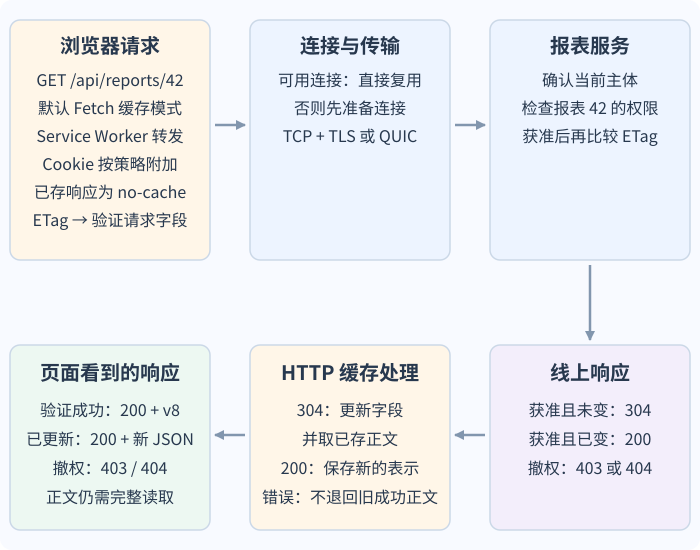
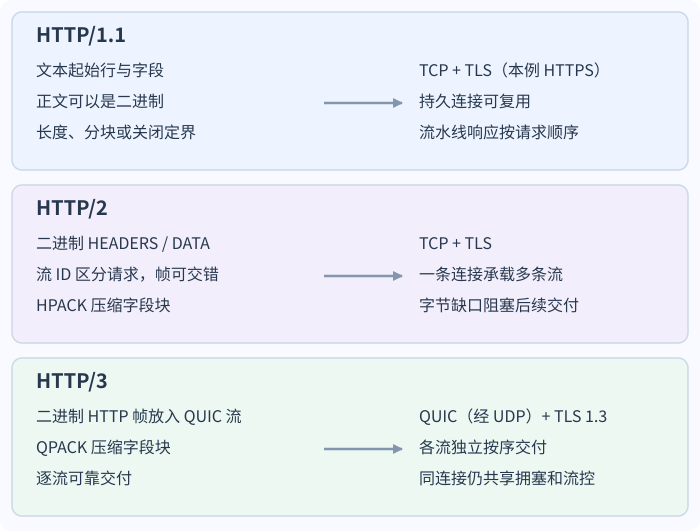
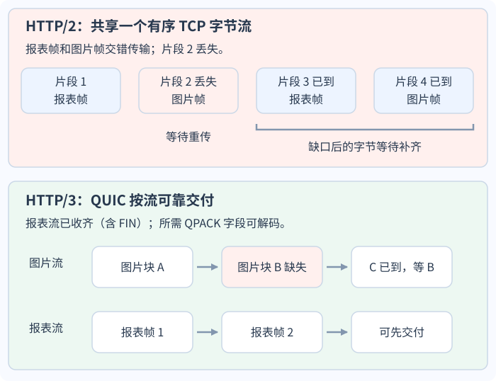

# 浏览器请求如何到达 HTTP 响应？

**案例背景。** 查看者已登录，并获准读取报表 42。浏览器先前收到版本 8 的 JavaScript Object Notation (JSON，JavaScript 对象表示法) 表示，以及 Entity Tag (ETag，实体标签) 验证值 `"report-42-v8"`；浏览器把正文和 ETag 一并存入私有 HTTP 缓存。页面脚本再次读取报表时，以浏览器 Fetch API（网页请求接口）的默认缓存模式调用 `fetch()`，需要在仍有权限时看到当前版本。缓存可以跳过不必要的网络传输，但不能替服务端决定这次是否仍有权读取。

本章跟着 `https://reports.example` 上这次读取走完请求、服务端判断和页面取得结果。Hypertext Transfer Protocol (HTTP，超文本传输协议) 规定方法、目标资源、状态和表示的含义；HTTP/1.1、HTTP/2、HTTP/3 用不同线格式和连接承载这些语义。先看本例需要访问网络的路径，上排向服务端发送请求，下排把结果交回页面。

图只画本例的网络路径：假设 Service Worker（服务工作线程）继续转发，页面脚本没有手写条件字段；浏览器按 Cookie 策略附加会话凭据，并由 HTTP 缓存根据已存 ETag 自动加入验证字段。服务端必须先检查当前身份与报表权限，再判断表示是否变化。线上 `304` 经浏览器缓存更新后，页面通常收到原 `200` 状态和已存正文；线上 `200` 交付新正文；拒绝时页面进入错误分支，不拿旧正文冒充成功。若 Service Worker 自己合成响应，该响应遵循应用自己的授权与缓存策略。键匹配且策略允许直接复用的新鲜响应可以跳过网络；某些指令或配置也允许复用特定过期响应，但不适用于本例的 `no-cache` 路径。

## 浏览器把报表请求表达成什么？

Uniform Resource Identifier (URI，统一资源标识符) 标识目标资源，方法说明调用方希望对资源执行什么操作。请求还可带查询参数、字段和内容；响应带状态码、字段及可选内容。服务端返回的 representation（表示）是面向该请求选定的媒体类型、语言等形式，不一定等同于数据库里的一行记录。

下面用 HTTP/1.1 可读文本展示缓存自动生成的验证请求。页面表达普通 GET，并选择 JSON 与语言偏好；浏览器按 Cookie 策略附上 Cookie，而 HTTP 缓存从已存 ETag 生成 `If-None-Match`。网页脚本不能任意手设 `Cookie` 字段。HTTP/2 和 HTTP/3 传输同样的语义，但线上不会使用这段逐行文本。

~~~http
GET /api/reports/42 HTTP/1.1
Host: reports.example
Accept: application/json
Accept-Language: zh-CN, en;q=0.8
Cookie: __Host-session=<opaque-session-id>
If-None-Match: "report-42-v8"
~~~

此前保存的响应节选可以是下面这样。为明确持久连接中的正文边界，`Content-Length` 是所示 JSON UTF-8 字节数（不计代码块排版换行）；示例省略 `Date` 等不影响这里讨论的字段。

~~~http
HTTP/1.1 200 OK
Content-Type: application/json
Content-Language: zh-CN
Content-Length: 63
ETag: "report-42-v8"
Cache-Control: private, no-cache
Vary: Accept-Language

{"id":42,"title":"Service health","status":"ready","version":8}
~~~

若当前权限仍允许读取、表示没有变化，网络上可以只出现下面这个无正文的验证响应节选。完整响应还包含源站时钟可用时要求发送的 `Date` 字段：

~~~http
HTTP/1.1 304 Not Modified
ETag: "report-42-v8"
Cache-Control: private, no-cache
Vary: Accept-Language
~~~

`Accept` 表示调用方能处理或偏好的响应媒体类型；`Content-Type` 说明消息内容是什么媒体类型；`Accept-Encoding` 表示调用方支持的内容编码，`Content-Encoding` 说明表示是否经过 `gzip`、`br` 等压缩，解码后仍得到该媒体类型。`Accept-Language` 表达语言偏好，`Content-Language` 标记该表示面向的自然语言；服务器可以没有首选语言的版本。`Vary: Accept-Language` 告诉缓存只有在语言请求字段匹配时才能复用这个表示。若请求有正文，`Content-Type` 描述的是该请求正文，而不是整个 HTTP 消息。

请求凭据与资源授权是另一条线：Cookie 或 `Authorization` 可以提供认证信息，application programming interface (API，应用程序接口) 仍须根据当前主体、租户和资源检查授权。跨源读取也由浏览器的 Cross-Origin Resource Sharing (CORS，跨源资源共享) 规则控制；某些跨源请求会先发 `OPTIONS` 预检。允许浏览器脚本读取响应不等于允许该用户读取报表，详见[浏览器安全控制分别保护什么信任边界？](../security/web-browser-security-boundaries.md)。

safe method（安全方法）表示调用方预期只读取、不改变目标资源状态；服务端仍可能记录访问日志等附带效果。idempotent method（幂等方法）表示把同一请求重复应用多次，其预期服务器效果与应用一次相同，而不要求每次响应相同。例如第一次 DELETE 可以回 204，第二次回 404，资源最终仍不存在。GET 和 HEAD 既安全又幂等；PUT 和 DELETE 幂等但不安全。PATCH 是否幂等由补丁操作和 API 契约决定，POST 默认不保证幂等。PUT 正文描述成功后目标资源应呈现的状态，不必然表示未提交字段要被清空。方法语义不能确认连接中断前的业务副作用是否已提交；未知结果要用稳定的业务请求标识确认，见[请求超时后如何确认结果并安全重试？](../reliability/api-reliability-and-async-delivery.md)。

> [!info] HTTP 方法与 REST 不是一回事
> Representational State Transfer (REST，表述性状态转移) 是一组架构约束，包括客户端与服务端分离、无状态交互、可缓存、统一接口和分层系统；代码按需下发是可选约束。统一接口还要求以资源标识目标、用表示操纵资源、自描述消息以及超媒体控制。用 HTTP 方法和 JSON 不会自动满足全部约束；要称为 REST 风格，还要检查这些约束是否成立。

## 缓存何时直接交付，何时要问源站？

HTTP 缓存按响应的可缓存性、缓存键和新鲜度判断能否复用。`max-age=60` 表示响应只有在当前年龄小于 60 秒时才新鲜；年龄正好达到 60 秒时已经不新鲜。按默认缓存规则，符合缓存键且策略允许直接复用的新鲜响应可以不问源站；有些指令或配置也会明确允许特定过期响应被使用，因此“已经过期”与“绝不送出”不是同一判断。本例的 `no-cache` 要求每次复用前验证。`private` 禁止共享缓存存储，却允许浏览器一类的私有缓存存储；它既不是用户间授权隔离，也不能保证内容保密。缓存通常按请求方法和目标 URI 区分表示，响应中的 `Vary` 再列出决定表示的请求字段，例如语言或编码偏好。缓存键和验证值必须覆盖 API 实际协商的表示范围，不能把它们当作对象权限检查。

`no-cache` 容许缓存保存响应，但禁止未验证就拿它满足后续请求；它不是“不要保存”。`no-store` 要求缓存不要存储这次请求或响应的内容，但也不能单独作为隐私保证。如果 `private, max-age=60` 的新鲜窗口内撤销了访问权限，浏览器仍可能在窗口结束前交付旧正文。若每次重用前都要重新确认访问权，应选择 revalidation（重新验证）策略；对敏感内容也可禁用存储。无论采取哪种缓存策略，API 的授权检查仍是最终边界；[如何逐次授权租户内的报表资源？](../security/web-security-and-authentication.md)继续说明逐次检查。

本例响应采用 `private, no-cache`，因此保存的响应每次复用前都要重新验证。默认 `fetch()` 缓存模式下，页面发普通 GET，HTTP 缓存在网络请求中自动附上已存的 `If-None-Match: "report-42-v8"`。服务器先确认请求者仍可读报表 42，再判断被选中的表示是否仍匹配这个 ETag。若权限已撤销，服务器按隐私政策回 `403` 或隐藏式 `404`；缓存不能用旧成功正文绕过授权。若权限有效且表示未变，网络回无正文的 `304 Not Modified` 和更新缓存所需的字段；缓存更新存储响应后，把存储的 `200` 与原正文交给页面。若表示已变，网络和页面都得到带新正文与新 ETag 的 `200`。

页面脚本若自己在默认缓存模式的请求字段中加入 `If-None-Match`，Fetch 会把缓存模式改为 `no-store`；这不是上面的自动重验证路径。此时网络 `304` 可以作为页面所见的 `304`，`response.ok` 为 `false`，也没有旧缓存正文自动拼回页面。通常应让浏览器缓存管理验证；只有应用明确要自己管理条件请求和 `304` 时，才手动设置验证字段。ETag 应针对被选中的表示生成；语言或媒体类型不同的版本要与 `Vary` 和验证逻辑保持一致。

## 请求何时需要 DNS、TCP、TLS 或 QUIC？

页面的请求先经过浏览器控制：Service Worker 可以根据自己的脚本响应或继续执行 `fetch`；之后由 HTTP 缓存决定可否复用、是否需要验证，或是否转向网络。Service Worker 缓存、浏览器 HTTP 缓存、域名地址缓存和连接池是不同的存储或快路径：命中其中之一不意味着其余几层也被命中。本文按 Service Worker 转发的路径讲解；若 Worker 自行合成响应，应用要自行保证它没有把已撤权用户的旧私有数据交付出去。Fetch 标准也将网络缓存和连接获取分开规定。

若需访问网络，浏览器会先找能服务该来源且仍可用的连接。已有连接能复用时，不必为每个请求重新解析域名或握手。缺少连接时，浏览器或系统解析器会检查 Domain Name System (DNS，域名系统) 地址缓存；没有仍有效的记录才向递归解析器查询，解析器也可能直接从缓存回答，或沿 DNS 委派逐级查询。资源记录中的 time to live (TTL，生存时间) 限定缓存保留期限；负缓存也可能暂存“名称不存在”的结果。因此连接关闭后地址仍可能可用，而 DNS 记录过期也不一定要求关闭现有连接。

Transmission Control Protocol (TCP，传输控制协议) 为应用提供有序可靠字节流；HTTPS 用 Transport Layer Security (TLS，传输层安全协议) 保护连接。QUIC 则在 User Datagram Protocol (UDP，用户数据报协议) 上提供多路复用的可靠流，并集成 TLS。它们不会替 API 验证用户身份或逐次授权资源，也不能确认超时的业务操作是否已经提交。域名解析或连接准备可能早于本次请求发生；HTTP/1.1 也可以承载明文 HTTP。

若新连接使用 TCP，常见建连过程是客户端发 SYN（synchronize，同步初始序号），服务端回 SYN-ACK（确认请求并给出自己的初始序号），客户端再以 ACK（acknowledgment，确认）收尾；TCP 给应用有序、可靠的字节流，但不会保留一次写入对应一次读取的消息边界。所谓“粘包”通常是把字节流误当消息队列；应用协议仍需用长度、分隔符或其他规则划分消息。连接关闭时，TCP 两个方向可以分别结束；一方向已关闭后，另一方向仍可发送数据，因此常见 FIN（结束标志）/ACK 关闭图示不表示每次都有固定四个独立报文。随后 HTTPS 上的 TLS 握手协商密钥并验证服务端证书中的服务身份是否与访问名称相符。QUIC 则在 UDP 上建立自己的连接和可靠流，并把 TLS 1.3 密钥协商纳入传输建连，不执行 TCP 三次握手。证书验证失败或连接失败属于传输/安全层失败，不是 API 返回了 500。

浏览器与服务端还要确定使用的 HTTP 版本。HTTPS 上的 HTTP/2 通过 TLS 的 Application-Layer Protocol Negotiation (ALPN，应用层协议协商) 识别 `h2`；HTTP/3 端点可由 `Alt-Svc` 等方式发现，浏览器随后尝试 QUIC。若网络阻断 UDP，客户端应尝试 TCP 承载的 HTTP 版本。成功复用连接时，本次请求跳过了新的地址解析和建连；没有复用时，协议协商才是新连接路径的一部分。

TLS 1.3 的恢复连接可以选择发送 zero round-trip time (0-RTT，零往返时间) early data（早期数据），在握手完成前把请求送出。早期数据可能被攻击者重放；HTTP 规则允许客户端在没有额外信息时把安全方法放进早期数据，并禁止发送不安全或安全性未知的方法。服务端仍要按资源判断是否可以安全地提前处理；可延迟处理、部署防重放措施，或在不愿承担重放风险时返回 `425 Too Early`（过早请求）。安全方法本身也可能触发附带效果，所以涉及不可重复业务副作用的接口还须有应用层重放防护和去重。恢复连接也不能保证业务操作只执行一次。

> [!info] 资源提示能提前准备什么？
> `preload` 提示浏览器尽早取得当前页面已确定会用的关键资源；`prefetch` 提示可以低优先级准备可能在后续导航使用的资源；`preconnect` 可以提前解析可信来源并准备连接；`dns-prefetch` 只提前查询来源的域名。浏览器会按实现与当前资源条件处理提示，并不保证照单全收。连接提示会占用连接与网络资源，适合确实很快要访问的来源。
>
> ~~~html
> <link rel="preload" href="/fonts/main.woff2" as="font" crossorigin>
> <link rel="prefetch" href="/next-page.js">
> <link rel="preconnect" href="https://reports-cdn.example">
> <link rel="dns-prefetch" href="//reports-cdn.example">
> ~~~

## HTTP/1.1、HTTP/2 与 HTTP/3 怎样承载同一语义？

三个版本都能表达本例的 GET、目标 URI、协商字段和响应状态，但线上帧、连接并发与丢包等待不同。HTTP/1.1 用文本起始行和字段；消息是否含正文及边界由方法、状态、`Content-Length`、分块传输编码或连接结束等规则确定，正文自身可以是二进制。持久连接可复用，但它没有 HTTP 流多路复用层。它允许流水线发送多个请求，而服务器仍须按请求顺序返回对应响应，所以前一响应慢会令后一响应等待；客户端也可用多条连接并发请求。持久连接只复用请求与响应的通道，不表示服务端可以在没有请求时凭空推送 HTTP 响应。

HTTP/2 将字段块和内容装进二进制 `HEADERS`、`DATA` 等帧，并以流 ID 区分并发的请求/响应；HPACK 压缩字段块。帧可在同一 TCP 连接中交错，应用层不必等前一个响应完整结束才处理另一个流。HTTP/2 另有逐流和连接级流量控制；可发送额度耗尽时，相应的数据发送会等待补充额度。可是 TCP 仍要求按字节序交付：较早的 TCP 段丢失时，后续字节即使已抵达，也要等缺口重传，可能让该连接上的多个 HTTP/2 流一起停住。

HTTP/3 保持同一 HTTP 语义，将帧放到 QUIC 流上，并以 QPACK 压缩字段块。QUIC 对每条流实施 flow control（流量控制），连接总量也有额度；congestion control（拥塞控制）与网络资源则由连接共享。若图片流有缺口，而报表流的正文、字段和相关 QPACK 动态表项都已到达，图片流的缺口不会阻止报表流的数据被处理；要把报表响应视为完整，还必须收到其 QUIC 流发送方向结束的 FIN。连接级拥塞和流控会限制尚未发送的数据，不会让已经到达的报表字节重新等待；报表流自身有缺口或所需 QPACK 表项未到时，也不能完成响应。因此 HTTP/3 缓解了跨流队头阻塞，并不消除共享网络瓶颈。

**同样的 `GET /api/reports/42 → 200 + JSON`，线上怎样承载？**

三行使用的输入与结果固定为 `GET /api/reports/42 → 200 + JSON`，只换版本怎样编码和调度它。HTTP 版本决定帧和流如何承载语义；`Content-Encoding: br` 一类表示压缩是另一层概念，不能与 HTTP/1.1 的分块传输或 HTTP/2、HTTP/3 的帧混为一谈。

**同一连接丢失一段数据，哪些流需要等待？**

在 HTTP/2 示例里，报告和图片的帧混在同一个 TCP 字节流；中间一段 TCP 数据丢失时，TCP 不会把其后的帧字节先交给 HTTP/2。HTTP/3 的图则假设报表响应流（包括结束方向的 FIN）已完整到达、所需字段可解码，而图片流有缺口；此时不再等待图片流，也不需要额外流控额度来交付已收到的报表字节。HTTP/1.1 的流水线等待发生在应用协议的响应顺序；HTTP/2 的跨流等待来自共享 TCP 的传输顺序；两种等待是不同层次的 head-of-line blocking（队头阻塞，HOL）。

在 HTTP/1.1 中，`Transfer-Encoding: chunked` 是消息分帧方式；`Content-Encoding: gzip` 描述表示本身的编码，解码前后媒体类型相同。HTTP/2 和 HTTP/3 用 DATA 等帧分段消息，帧自身不一定表示响应结束：HTTP/2 由最后一个 `HEADERS` 或 `DATA` 帧上的 `END_STREAM` 标志结束响应；HTTP/3 在服务端发送完最终响应后，由 QUIC 流发送方向结束（FIN）表明最终消息结束。它们不使用 HTTP/1.1 的 transfer-coding 字段。TCP 或 QUIC 给出的底层字节流/流边界也不是 WebSocket（可持续双向消息通道）、Server-Sent Events (SSE，服务器发送事件) 等应用消息的全部边界；应用协议仍要解释自己的帧、分隔符或事件。

## 服务端返回了什么，页面何时才能使用？

服务端路由请求后，先完成身份验证和报表级授权，再读取或修改资源并选择状态与表示。状态码只描述这次 HTTP 请求的处理结果类别，不描述整个业务生命周期，也不代表正文已完整到达。

| 响应与常见含义 | 需要留意 |
| --- | --- |
| **`1xx`**：继续处理的中间信息，如 `100 Continue` | 不是最终结果 |
| **`2xx`**：`200` 返回当前表示；`201` 已创建；`202` 已接受异步处理 | `202` 不表示报表作业已完成 |
| **`3xx`**：`304` 表示条件读取可复用此前存储的表示 | 304 无正文，只用于适用的条件 GET/HEAD |
| **`4xx`**：`400` 请求格式无效；`401` 缺少或无效凭据；`403` 拒绝；`404` 不存在或按策略隐藏；`409` 冲突；`429` 请求过多 | `401` 响应须给出适用的 `WWW-Authenticate` 认证质询 |
| **`5xx`**：`500` 未预期的服务端错误；`502` 上游响应无效；`503` 暂时不能处理；`504` 网关等待上游超时 | 这些是服务端或网关响应；客户端自己的等待超时没有 HTTP 状态码 |

浏览器 `fetch()` 收到 HTTP 响应后，即使状态是 `404` 或 `500`，也会兑现 Promise（异步承诺对象）；页面要检查 `response.ok` 或 `status`。在浏览器 HTTP 缓存自动重验证时，网络 `304` 已先被缓存层转换为存储的响应，所以页面看到 `200` 与原正文；若页面手动设置条件字段，线上 `304` 则可能作为页面的 `304`，`response.ok` 为 `false`，没有自动拼回的正文。响应头到达不代表正文读取完毕，`response.json()` 或流读取仍可能因连接中断、内容解码失败而拒绝；字节读完后，JSON 语法错误也会让解析失败。Axios 默认按 `validateStatus` 判断非 2xx 是否进入错误分支，HTTP 错误响应通常可从错误对象取得；设置 `validateStatus` 会改变此规则。XMLHttpRequest（浏览器传统异步请求 API）的 `load` 表示请求成功完成，`error` 表示传输失败，`timeout` 与 `abort` 表示各自的中止路径；`load` 不表示状态码是 2xx，仍要检查 `status`。需要上传进度时也仍可使用其上传事件。Axios 实例如何限定凭据、取消过期请求并校验运行时 JSON，见[Axios 如何连接 React 报表界面的 HTTP 请求？](../../archive/front-end/0-1_Learning_Notes/react_typescript/axios-in-react.md)。浏览器 API、客户端库和协议的错误边界不要互相代替。

**接下来：** 若报表页面要连续接收更新，还需决定消息方向、事件边界及断线恢复方式，见[何时选择轮询、SSE、流式 Fetch 或 WebSocket？](real-time-web-updates.md)。实时通道同样要让每次连接重新授权，并且明确“重连”是否补齐中断期间的业务事件。

> [!info]- 来源
>
> - HTTP 通用语义、表示、字段、方法、安全性/幂等性、条件请求、状态码、CORS 外的协议边界：[IETF RFC 9110, HTTP Semantics](https://www.rfc-editor.org/rfc/rfc9110.html)，§3、§6–§10、§11–§13、§15，2022-06；`401` 认证质询见 §11.3；核对于 2026-11-12。
>
> - 缓存键、`Vary`、新鲜度、`max-age`、`private`、`no-cache`、`no-store` 和条件验证：[IETF RFC 9111, HTTP Caching](https://www.rfc-editor.org/rfc/rfc9111.html)，§3–§5，2022-06；核对于 2026-11-12。
>
> - HTTP/1.1 消息语法、正文定界、持久连接和流水线：[IETF RFC 9112](https://www.rfc-editor.org/rfc/rfc9112.html)，§2、§6、§9，2022-06；HTTP/2 流、帧和 TCP 队头阻塞：[IETF RFC 9113](https://www.rfc-editor.org/rfc/rfc9113.html)，§1、§3–§6，2022-06；HTTP/3 与 QUIC 的映射和按流可靠交付：[IETF RFC 9114](https://www.rfc-editor.org/rfc/rfc9114.html)，§1–§4，2022-06；均核对于 2026-11-12。
>
> - HTTP/2 字段压缩：[IETF RFC 7541, HPACK](https://www.rfc-editor.org/rfc/rfc7541.html)，§1–§2，2015-05；HTTP/3 字段压缩、动态表阻塞：[IETF RFC 9204, QPACK](https://www.rfc-editor.org/rfc/rfc9204.html)，§1–§2.1.2，2022-06；均核对于 2026-11-12。
>
> - TCP 连接建立、字节流和半关闭：[IETF RFC 9293, Transmission Control Protocol](https://www.rfc-editor.org/rfc/rfc9293.html)，§3、§3.5–§3.6.1，2022-08；QUIC 流与流量控制：[IETF RFC 9000](https://www.rfc-editor.org/rfc/rfc9000.html)，§2–§4，2021-05；连接级拥塞控制：[IETF RFC 9002](https://www.rfc-editor.org/rfc/rfc9002.html)，§7，2021-05；QUIC 中的 TLS：[IETF RFC 9001](https://www.rfc-editor.org/rfc/rfc9001.html)，§4–§5，2021-05。TLS 1.3 现行版本与早期数据重放边界：[IETF RFC 9846, TLS 1.3](https://www.rfc-editor.org/info/rfc9846/)，2026-07，§1.2、§2、§8；HTTP 早期数据与 `425 Too Early`：[IETF RFC 8470](https://www.rfc-editor.org/rfc/rfc8470.html)，§2–§5，2018-09。均核对于 2026-11-12。
>
> - TLS 服务身份与访问名称匹配：[IETF RFC 9525](https://www.rfc-editor.org/rfc/rfc9525.html)，§1、§6，2023-11；DNS 委派和解析器缓存：[IETF RFC 1034](https://www.rfc-editor.org/rfc/rfc1034.html)，§4–§5，1987-11；DNS 负缓存：[IETF RFC 2308](https://www.rfc-editor.org/rfc/rfc2308.html)，§3–§5，1998-03。均核对于 2026-11-12。
>
> - Fetch 请求、连接获取、响应与 CORS：[WHATWG Fetch Standard](https://fetch.spec.whatwg.org/)，Living Standard，最后更新 2026-10-19，核对于 2026-11-12；XMLHttpRequest 事件与上传接口：[WHATWG XMLHttpRequest Standard](https://xhr.spec.whatwg.org/)，Living Standard，最后更新 2026-11-11，核对于 2026-11-12；Axios 的非 2xx 错误与 `validateStatus`：[Axios Error Handling](https://axios-http.com/docs/handling_errors)，当前文档核对于 2026-11-12。
>
> - 429 Too Many Requests 状态：[IETF RFC 6585](https://www.rfc-editor.org/rfc/rfc6585.html)，§4，2012-04；资源提示类型：[WHATWG HTML Living Standard, Link types](https://html.spec.whatwg.org/multipage/links.html#linkTypes)，§4.6.8.5、§4.6.8.18–§4.6.8.20，核对于 2026-11-12。
>
> - REST 约束：[Roy T. Fielding, Architectural Styles and the Design of Network-based Software Architectures](https://www.ics.uci.edu/~fielding/pubs/dissertation/rest_arch_style.htm)，第 5 章，2000。
