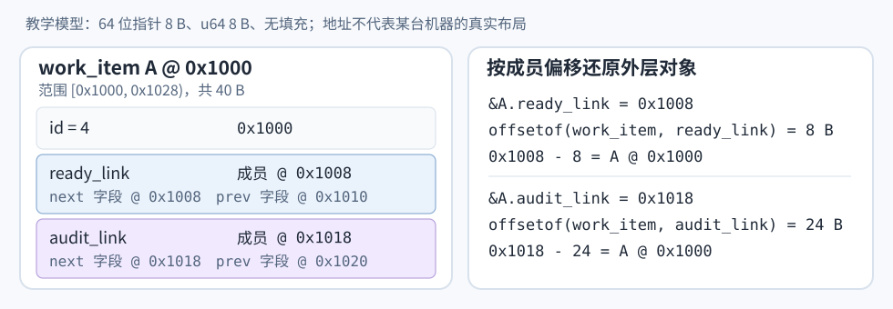
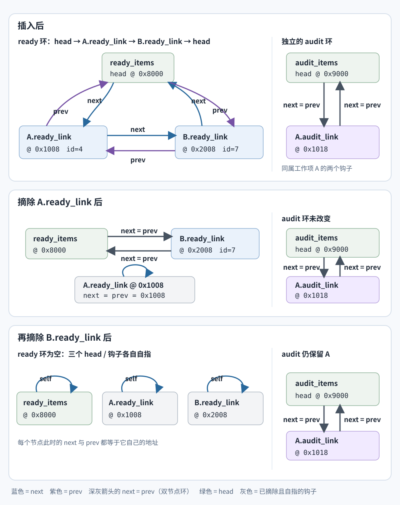

# Linux 内核为什么把链表节点嵌入对象？

假设内核要把一个 work item（工作项）放进待处理队列，同时还要把同一对象放进审计队列。Linux 内核的 `struct list_head` 是一对 `next`、`prev` 链接；把它作为成员嵌进工作项，就能让通用链表代码只修改链接，不必为每种关系再分配独立包装节点。

本例中，`ready_items` 与 `audit_items` 本身也是 `struct list_head`，各自充当环形链表的 head（头节点/哨兵）；空表时 head 的两个指针都指向自身。教学地址约定为 A 的基址 `0x1000`、B 的基址 `0x2000`、两个 head 分别为 `0x8000` 和 `0x9000`；因此 A.ready 为 `0x1008`、A.audit 为 `0x1018`，B.ready 为 `0x2008`。链中的指针值指向嵌入的 `list_head` 成员，例如 `0x1008` 是 A 的 `ready_link` 地址，不是外层 A 的起始地址。下图先给出对象布局和成员地址；假设指针为 8 B、`u64` 为 8 B 且结构体无填充，所有地址均为合成值。

## container_of 怎样从钩子找到对象？

Linux 链表节点不是一个含 payload 指针的单独 wrapper。`struct list_head` 本身就放在被链接的结构体内；`container_of(ptr, type, member)` 根据成员偏移，概念上从钩子地址减去 `offsetof(type, member)`，还原出外层对象地址。`list_entry()` 建立在这一机制上，`list_for_each_entry()` 则直接让循环变量指向外层结构体。

~~~c
#include <linux/list.h>
#include <linux/types.h>

struct work_item {
    u64 id;
    struct list_head ready_link;
    struct list_head audit_link;
};

static LIST_HEAD(ready_items);

static void inspect_ready_items(void)
{
    struct work_item *item;

    list_for_each_entry(item, &ready_items, ready_link) {
        /* item 是外层 work_item，可读取 item->id。 */
    }
}
~~~

这要求传入的指针确实指向指定类型中的那个成员；成员名和外层类型必须匹配。`container_of` 做的是地址计算，不会寻找节点，也不消除遍历时读取 `next` 的依赖。它是 Linux 内核提供的宏，不是标准 C 设施；当前 mainline 的 `container_of()` 会丢弃 `const`，新代码应优先使用保留限定符的 `container_of_const()`。链表迭代宏仍使用同一成员偏移关系。

对象入链期间不能改换存放地址：邻接钩子仍会指向旧地址。对已入链对象做浅拷贝也不会把副本加入链表，更不会让邻接节点改指副本。副本逐字段复制原钩子的指针值：例如 A 已入 ready 时，A 的副本会得到 `next=0x2008`、`prev=0x8000`，但 ready 邻居仍指向原 A 的 `ready_link @ 0x1008`。若要独立使用副本，先对副本自己的每个 `list_head` 调用 `INIT_LIST_HEAD`，再分别加入需要的链表。释放原对象前仍要摘掉原对象的全部钩子。

上面的遍历片段是独立示意：`list_for_each_entry` 按 `ready_link` 的成员偏移把每个钩子还原为 `work_item`；走到 `ready_items` head 就停止，所以空表不会进入循环体，head 也不会被当成工作项累加。该片段假设队列在遍历期间不会被并发修改，而且对象始终存活。共享队列的锁定与 A/B 调用顺序见下一个独立示例。

## 插入、遍历和摘除分别改变什么？

下面是独立的内核风格示例：A/B 的 `id` 在对象创建时设好，再初始化两个钩子；之后按 A、B 的顺序尾插 ready，并把 A 插入 audit。两个 head 都用代码中的名字 `ready_items` 和 `audit_items`。调用者必须让传入对象在函数等待互斥锁以及整个调用期间保持存活；锁保护链表和锁内读取，不会替正在等锁的参数保活。

这段 driver 假设两张静态表从空表开始，仅顺序运行这一轮操作，没有其他调用者在步骤之间插入或摘除节点。

~~~c
#include <linux/list.h>
#include <linux/mutex.h>
#include <linux/types.h>

struct work_item {
    u64 id;
    struct list_head ready_link;
    struct list_head audit_link;
};

static LIST_HEAD(ready_items);
static LIST_HEAD(audit_items);
static DEFINE_MUTEX(items_lock);

static void init_work_item(struct work_item *item)
{
    INIT_LIST_HEAD(&item->ready_link);
    INIT_LIST_HEAD(&item->audit_link);
}

static bool enqueue_ready(struct work_item *item)
{
    mutex_lock(&items_lock);
    /* 检查与插入共用一把锁，避免重复挂入同一钩子。 */
    if (!list_empty(&item->ready_link)) {
        mutex_unlock(&items_lock);
        return false;
    }
    list_add_tail(&item->ready_link, &ready_items);
    mutex_unlock(&items_lock);
    return true;
}

static bool record_for_audit(struct work_item *item)
{
    /* audit_link 独立于 ready_link，但同样只能加入一张表。 */
    mutex_lock(&items_lock);
    if (!list_empty(&item->audit_link)) {
        mutex_unlock(&items_lock);
        return false;
    }
    list_add_tail(&item->audit_link, &audit_items);
    mutex_unlock(&items_lock);
    return true;
}

static u64 sum_ready_ids(void)
{
    struct work_item *item;
    u64 total = 0;

    mutex_lock(&items_lock);
    list_for_each_entry(item, &ready_items, ready_link)
        total += item->id;
    mutex_unlock(&items_lock);
    return total;
}

static void clear_ready_links(void)
{
    struct work_item *item;
    struct work_item *next;

    mutex_lock(&items_lock);
    list_for_each_entry_safe(item, next, &ready_items, ready_link)
        list_del_init(&item->ready_link);
    mutex_unlock(&items_lock);
}

static bool run_example_once(void)
{
    struct work_item a = { .id = 4 };
    struct work_item b = { .id = 7 };
    u64 before;
    u64 after;

    /* 本次使用新对象；两个新钩子尚未发布，id 已先赋值且示例中保持不变。 */
    init_work_item(&a);
    init_work_item(&b);
    enqueue_ready(&a);
    enqueue_ready(&b);
    record_for_audit(&a);

    before = sum_ready_ids();
    clear_ready_links();
    after = sum_ready_ids();

    /* 此刻 a.ready_link 已摘下，但 a.audit_link 仍挂着；返回前再摘 audit。 */
    mutex_lock(&items_lock);
    list_del_init(&a.audit_link);
    mutex_unlock(&items_lock);

    return before == 11 && after == 0;
}
~~~

调用者在进入 `enqueue_ready(&a)` 之前已经拥有 `a`，并在它取得和释放 `items_lock` 期间一直保留这个对象；若对象可能由别的线程并发销毁，真实接口还需引用计数或等价的所有权协议。`id` 在发布前赋值，示例中不再修改。互斥锁只保证检查和链表更新不会被同一队列的并发操作穿插。

这里的 `list_empty(&item->ready_link)` 利用本例的状态约定：新钩子初始化后自指，已入链钩子则指向相邻项或 head。由于本例的插入和摘除都持有同一把锁，这个检查能避免重复挂入；它不是通用的“该节点属于哪张表”查询。

`run_example_once()` 的 `before` 是 11。`clear_ready_links()` 使用 safe 迭代先摘 A，再摘 B：摘 A 后 ready head 与 B 互相指向，A.ready 自指；摘 B 后 ready head 与 A.ready、B.ready 各自自指，所以 `after` 是 0。清空函数返回时，A.audit 仍接在 audit 环；示例只因随后在同一把锁下也摘掉 A.audit，才可让栈上的 A 离开作用域。

图中每个方框是一个 `list_head`（head 或对象内的钩子）。在多节点环里，蓝色箭头标 `next`，紫色箭头标 `prev`；两节点环里，每个节点的 `next` 与 `prev` 都指向唯一邻居，因此深灰箭头按方向标 `next = prev`。绿色始终表示 head，包括空 ready 环；灰色表示已摘除且自指的钩子。地址写在目标节点旁，可沿箭头核对两项指针字段；A.ready 与 A.audit 是同一个 `work_item A` 内的两个独立成员。

`list_add_tail` 和 `list_del_init` 只需改动固定数量的链接，链表长度不会增加这部分指针操作的数量。但这不是整个操作的耗时保证：调用者可能还要扫描查找节点、取得锁、等待缓存或管理对象本身。`list_del_init` 只把该钩子从队列摘下并重新初始化；它既不释放 `work_item`，也不会摘掉同一对象的 `audit_link`。

`list_for_each_entry_safe` 会在循环体删除当前节点前保存下一游标，因此适合“遍历时删除当前项”；它不保护并发修改，也不能让已保存的下一节点在释放或并发摘除后仍可安全访问。上例用同一把锁保护所有读写；锁的类型与持有范围要符合调用上下文。互斥锁是可睡眠锁，不能用于硬件或软件中断上下文。

## 对象生命周期和并发访问由谁负责？

嵌入链表不会自动管理外层对象的生命周期。释放对象前，需要摘掉所有仍挂入链表的钩子，并确认没有其他读者或引用者还会访问对象。一个工作项在待处理队列中已摘除、但仍留在审计队列时，仍然不能释放。

普通链表操作本身不负责并发安全。多个线程或 CPU 并发修改同一链表时通常要用合适的锁。读多写少时，RCU（read-copy-update，读-复制-更新）可以让读者在 `rcu_read_lock()` 与 `rcu_read_unlock()` 之间用 `list_for_each_entry_rcu()` 遍历，而不持有写者的互斥锁；写者之间仍须用锁或既有协议串行化。Linux RCU 文档的审计规则示例允许读者短暂看到刚删除的规则；若不能接受旧项，内核也展示了用每项 `deleted` 标记和自旋锁拒绝它的做法，因此“容忍陈旧结果”是最简单的 RCU 用法，不是使用 RCU 的唯一条件。

普通清空用 `list_del_init()` 立即把摘下的钩子重置为自指；RCU 清单不能这样做。`list_del_rcu()` 会从当前环中摘除钩子，但保留 `next` 前向链接供已经走到该节点的读者继续前进（当前 mainline 会标记 `prev` 为 poison）。它不会把钩子重置成可再次入链的空钩子，所以在宽限期结束前不能对同一钩子调用 `INIT_LIST_HEAD`、按普通 `list_del_init` 图示自指，或重新插入。`synchronize_rcu()` 会等待先前的读侧临界区结束；`call_rcu()` 只负责登记回调，必须等回调在宽限期后执行，才能回收或复用对象及钩子。若 RCU 版本还要保留本例的 FIFO 尾插顺序，应配对使用 `list_add_tail_rcu()`；`list_add_rcu()` 是插到 head 后面。

RCU 是读侧与生命周期协议，不是把普通 `list_for_each_entry_safe` 换个名字。内核互斥锁是可睡眠锁，不能用于硬件或软件中断上下文。

## 内嵌节点什么时候划算？

当对象由当前模块拥有、地址在入链期间稳定、一个对象需要参加多种频繁更新的关系，且减少独立包装节点的分配和查找有实际价值时，侵入式链表很合适。每种同时存在的关系仍需一个钩子，每个 `list_head` 仍有两个指针；设计并没有消除链接存储成本。

它也不会把对象放到物理连续的内存中。相邻链表节点可能远隔内存，遍历时仍要先取当前节点的 next 指针，再按它到达下一处数据。应把它看作简化关系表示和已知节点更新的办法，不要把它当作解决缓存局部性的办法。主要操作是顺序扫描时，连续数组往往更合适，具体比较见[为什么连续扫描往往比链表遍历快？](memory-hierarchy-and-data-locality.md)。

这也不是说所有非侵入式列表都会“给业务对象再包一层指针并分配两次”。C++ 标准规定 `std::list` 的容器语义与操作复杂度，不规定具体节点布局；以 GCC libstdc++ 为例，内部节点把 T 放在节点自带的对齐存储中。那是一个实现样本，不是所有 `std::list` 实现的布局保证。

**相关机制：** [数据结构怎样匹配访问方式，复杂度界何时成立？](../algorithms/core-data-structures.md)说明已知节点与查找前驱的复杂度差别；[内存层次如何改变实际访问成本？](memory-hierarchy-and-data-locality.md)比较连续读取与逐节点指针依赖。

> [!info]- 来源
> - 内嵌 `list_head`、`container_of()`、初始化、尾插、遍历和摘除时遍历：[Linux 内核 Linked Lists in Linux](https://docs.kernel.org/core-api/list.html)，Declaring a node / list、Adding nodes、Traversing、Removing nodes、Concurrency considerations；2026-11-11 核对。
> - `list_head { next, prev }` 结构、self-init、`list_add_tail`、`list_del_init` 与 `list_for_each_entry_safe`：[Linux mainline `include/linux/types.h`](https://github.com/torvalds/linux/blob/master/include/linux/types.h)、[`include/linux/list.h`](https://github.com/torvalds/linux/blob/master/include/linux/list.h)；当前实现，2026-11-11 核对。
> - `container_of()` 的成员类型检查、`offsetof` 地址计算及 `container_of_const()` 的 const 保留：[Linux mainline `include/linux/container_of.h`](https://github.com/torvalds/linux/blob/master/include/linux/container_of.h)；当前实现，2026-11-11 核对。
> - 互斥锁是可睡眠锁及中断上下文限制：[Linux 内核 Generic Mutex Subsystem](https://docs.kernel.org/locking/mutex-design.html)，What are mutexes? / Semantics；2026-11-11 核对。
> - RCU 读者可能看到并发加入/移除的项、写者互相串行化、宽限期后回收及不容忍陈旧项时的每项锁与删除标记：[Linux 内核 Using RCU to Protect Read-Mostly Linked Lists](https://docs.kernel.org/RCU/listRCU.html)，Examples 1、2、4；2026-11-11 核对。
> - `list_add_rcu` 插到 head 后、`list_add_tail_rcu` 尾插；`list_del_rcu` 保留 `next` 供前向 RCU 读者并将 `prev` 标记为 poison，不可立即初始化或复用钩子：[Linux mainline `include/linux/rculist.h`](https://github.com/torvalds/linux/blob/master/include/linux/rculist.h)；当前实现，2026-11-11 核对。
> - `std::list` 标准只规定容器语义与复杂度：[C++ 工作草案 list.overview](https://eel.is/c++draft/list.overview)；GCC 15.2.0 样本的 list node 在节点内用对齐存储保存 T：[libstdc++ `stl_list.h`](https://github.com/gcc-mirror/gcc/blob/releases/gcc-15.2.0/libstdc%2B%2B-v3/include/bits/stl_list.h)。
