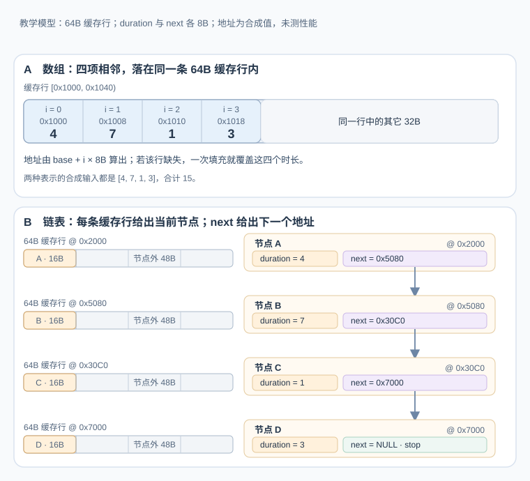

# 为什么连续扫描往往比链表遍历快？

假设代码要累计四个事件的时长。为了把内存位置画清楚，下面用一个合成例子：数组依次保存时长 `[4, 7, 1, 3]`，链表节点保存相同的时长，并额外保存 `next` 指针；两者的和都是 `15`。两边都访问 n 项，时间复杂度都是 O(n)，但复杂度不表示处理器要传输多少字节、何时知道下一次读取地址，或需要等待多少次缓存未命中。

图中的 cache line（缓存行）指缓存一次填充取得的一段相邻字节。本例假设每个时长和指针各占 8 B、节点无额外填充共 16 B、缓存行是 64 B；合成地址特意让数组项相邻、链表节点各自落在不同的缓存行。图示没有测量性能。

下图给同一组时长画出两种布局：数组的后续地址由基址和下标得出，链表的后续地址则来自当前节点的 `next`。

数组的第 i 项地址可从基址和 i 算出，不必先读完第 i 项才能知道第 i+1 项在哪。若该数组缓存行不在所观察的缓存层中，一次填充会把这 64 B 取入，其中已包含四个时长。链表里，节点 A 的 `next` 值是 `0x5080`；处理器要先取得 A 所在缓存行，才能读到这个地址并发出对节点 B 的依赖读取。

在同一缓存层中，若图中涉及的缓存行起初都缺失且没有预取抢先填充，数组访问触发 1 次 64 B 填充，链表访问四条不同的节点缓存行触发 4 次、共 256 B 填充。这只比较该层的传输量，不表示耗时或性能比值。这里链表行分散是人为假设；若多个节点落在同一行，后续节点可能复用该次填充，但仍要读到当前节点的 `next` 才能确定其地址。数组跨越多行时也会需要相应的更多填充。

若链表各节点行都未命中、又没有预取先行，单条链的后续 demand load（按需读取）就按 `next` 的地址依赖顺序发出。这个结论不表示每条链表必然一次节点一行或一次访问一次缓存未命中。

这条依赖链不等于 central processing unit（中央处理器，CPU）整体停住：缓存命中时等待较短，处理器也可能执行链外的独立指令或读取。某些硬件能识别规则地址模式，甚至改善固定步幅的指针追逐；任意分散的链表地址通常更难提前预测。图示只展示一种分散布局和冷缓存分支，不给出固定耗时或实测快慢。

## 延迟与带宽限制的是不同事情

一次内存读取的 latency（延迟）是从请求发出到数据可用的时间；bandwidth（带宽）是单位时间内能传送的数据量。读取若命中 cache（缓存），数据从相应缓存层级提供；未命中则还需从更远的缓存层级或主存取得。数据到达后，指令才能使用它，通常会把结果送入寄存器。缓存层数、容量、带宽和延迟随处理器与系统配置变化，代码不能假定固定层级或耗时。

cache line（缓存行）是缓存填充以及 cache coherence（缓存一致性）处理中常用的数据粒度。请求一个地址时，缓存通常按缓存行取得数据，因此相邻字节可能随同带回；之后访问相邻元素，就有机会直接使用已缓存的数据。这是 spatial locality（空间局部性）。短时间再次使用同一数据，它仍留在缓存中的机会较高，这是 temporal locality（时间局部性）。局部性增加命中机会，不保证每次都命中。

若流式循环平均每项实际传输 s 字节，可用带宽为 B 字节/秒，而且循环已受带宽限制，那么吞吐量上限约为 B/s 项/秒。这个估算不包含计算时间，也不能预测一次数据依赖读取的等待时间；延迟与带宽是不同约束。

Wulf 与 McKee 在 1995 年讨论处理器能力与内存供数能力之间逐渐扩大的差距，并称之为 memory wall（内存墙）。当程序在关键路径上等待数据或达到带宽上限时，再提高算术指令吞吐未必能加速整体工作。若工作集已在缓存或计算量占主导，内存供数就不一定是瓶颈。彼此独立的读取可以重叠等待、隐藏一部分延迟，但仍消耗共享带宽；独立请求足够多时，带宽同样会饱和。

## 连续地址让后续读取容易提前安排

下面的 C 片段要求实现提供 `uint64_t`。它们展示 C 的值与指针运算；图中的 8 B 指针和无填充 16 B 节点是教学布局，不是所有 C ABI 的保证。在 C 中，`durations[i]` 是数组中的第 i 个元素。`&durations[i]` 的字节地址可写成基址加上 i 乘以元素字节数；C 的指针加法本身已按元素大小前进，不能对指针再额外乘一次 `sizeof`。

~~~c
#include <stddef.h>
#include <stdint.h>

uint64_t sum_array(void) {
    uint64_t durations[] = {4, 7, 1, 3};
    size_t count = sizeof durations / sizeof durations[0];
    uint64_t total = 0;
    for (size_t i = 0; i < count; i++) {
        total += durations[i];
    }
    return total;
}
~~~

本例四项只占一条缓存行，展示的是同一填充内的空间复用。数组跨越多条缓存行时，处理器不必等待当前行的数据返回，就能算出后续地址；许多 hardware prefetcher（硬件预取器）可以利用这种规律，处理器也可能让多个彼此独立的读取同时在途，这类并行请求能力常称为 memory-level parallelism（内存级并行度，MLP）。

这只说明预取和重叠有机会发生，不保证一定发生。上述求和的 `total` 有逐次累加依赖；编译器是否展开循环或改用多个累加器、硬件能否发出多个读取，还取决于数据依赖、编译结果、可用请求资源和目标处理器。因此不能只凭代码外形承诺向量化或吞吐量。

## 链表遍历必须先取到下一个指针

下面的函数假设链表无环、尾节点的 `next` 为 `NULL`。每轮从当前节点读取 `next`；只有该字段的值可用以后，程序才能确定下一节点的地址。这种 pointer chasing（指针追逐）让一条普通链形成地址依赖。

~~~c
#include <stddef.h>
#include <stdint.h>

struct event_node {
    uint64_t duration;
    struct event_node *next;
};

uint64_t sum_events(struct event_node *head) {
    uint64_t total = 0;
    for (struct event_node *node = head;
         node != NULL;
         node = node->next) {
        total += node->duration;
    }
    return total;
}
~~~

节点的 `duration` 和 `next` 通常位于同一对象内；在图示的合成布局中，一次缓存行填充会同时带回这两个字段所在的数据。字段读取仍须从节点内存中取得，下一节点的地址仍要等 `next` 值可用。若多个节点恰好共处一条缓存行，后续节点可能复用填充；若节点分散且各行未命中，则链上的每个地址依赖都可能暴露等待。

乱序执行的处理器仍可执行这条链之外的独立工作；其它线程或另一条独立链也能产生在途请求。链上的依赖指令仍要等数据。若处理器没有别的就绪工作，这段等待就会影响整体进度。常见的 stream prefetcher（顺序流预取器）较难预测任意散布的指针链，但不能说指针链绝对不可预取：可识别的固定步幅等地址模式，在一些处理器上能降低有效延迟；software prefetch（软件预取）是否有益也要对目标负载测量。

## 渐进复杂度没有包含布局、移动与分配

两种遍历的渐进复杂度都可为 O(n)，这不代表实际耗时相同，也不表示两种表示每步读取相同的数据：

- 数组按下标访问通常为 O(1)；中间插入或删除需要移动后续元素，工作量为 O(n)，但移动范围连续，运行库或处理器可以使用优化过的批量操作。
- 链表按值查找通常为 O(n)。只有已经持有目标节点和所需链接时，插入或删除才需要有限次指针更新，可视为 O(1)；若还需先扫描定位，整个操作仍是 O(n)。
- 分配节点、节点大小、缓存未命中、锁竞争和访问顺序都会改变实际成本。对象池可以改变分配成本，却不保证链表顺序就是地址顺序。

因此，主要工作是按顺序扫描时，连续数组常是更好的起点；若系统频繁改动已知节点、要求节点地址稳定，或同一对象要参加多个关系，链表可能更合适。先按操作和所有权选择，再测量代表性数据规模与访问模式。Linux 内核文档也提醒，能满足需求的简单数组通常有更好的数据局部性。

## “数组”在语言中不总是同一种布局保证

C 数组的元素连续，多维数组按行优先排列。C++ `std::vector<T>` 对 `T` 非 `bool` 保证连续容器语义；`vector<bool>` 是专门化，不属于这项保证。C++ `std::list<T>` 规定容器操作、迭代器与复杂度，但标准不承诺其内部节点的具体布局。

ECMAScript 定义 JavaScript `Array` 的索引属性、长度和操作行为，并不承诺像 C 数组那样连续存储。引擎可以优化常见数组；以 V8 为例，元素种类可区分 packed（紧凑）和 holey（有空位）等实现状态，这属于 V8 实现，不是 JavaScript 语言对物理布局的承诺。`TypedArray` 则以固定数值元素类型查看 `ArrayBuffer` 的字节范围；它也不能让程序据此推断物理地址或缓存行。

## 其他数据结构也会受访问模式影响

| 对比 | 何时可能改变选择 |
|---|---|
| 线性搜索与二分搜索 | 二分搜索要求输入有序或满足相应单调条件；最坏比较次数随规模按对数增长，线性搜索最坏按规模线性增长。小数组、目标位置、比较成本和缓存状态会改变实际时间。 |
| 行遍历与列遍历 | C 的 row-major（行优先）布局中，按最后一维顺序扫描更连续；跨距读取会改变缓存利用率。 |
| false sharing（伪共享） | 多个 CPU 核心访问同一缓存行，且至少一方写入时，彼此独立的字段也可能引起缓存一致性流量；纯并发读取不构成伪共享。Linux 的 `perf c2c` 可帮助定位受争用的缓存行，再结合结构布局检查对应字段。 |
| PostgreSQL B-tree 与 red-black tree（红黑树） | PostgreSQL 的 B-tree 索引页存放多个索引项，叶页用右兄弟链接支持有序范围扫描；内存中的指针式红黑树逐节点查找。这是 PostgreSQL 的具体布局，不代表所有 B-tree。主导成本可能是存储页、缓存未命中或更新。 |
| 无分支代码与可预测分支 | 去掉分支可能增加无效工作或数据依赖；分支预测稳定时，保留分支也可能更快。 |
| 扁平与节点式哈希表 | 以 Abseil Swiss Tables 为例，扁平表密集组织元数据并分组探测；节点式表将值放入独立节点，较易保持元素地址，但查找需额外间接访问。扩容、删除与引用稳定性也重要。 |
| 结构体填充 | 对齐和字段布局会影响对象大小；应查看目标 ABI 下的 `sizeof` 与成员偏移，再判断是否值得调整。 |
| 增加核心数 | 更多核心可执行更多独立工作，但共享带宽、一致性流量或同步争用可能成为瓶颈。 |

这些比较是定位访问瓶颈的线索，不是脱离负载的通用性能结论。

least recently used（最近最少使用，LRU）缓存常用 Map 按键定位节点，再用双向链表维护新旧顺序；Map 已给出节点、而节点提供前驱和后继时，移到最近使用端只需有限次链接更新。若没有索引而要遍历链表找键，查找仍是 O(n)，指针追逐也没有消失。可继续看[队列、LRU 等数据结构的实际实现](../algorithms/practical-data-structure-implementations.md)。

**相关机制：** [数据结构怎样匹配访问方式，复杂度界何时成立？](../algorithms/core-data-structures.md)说明链表更新所需的前驱与树高条件；[Linux 内核为什么把链表节点嵌入对象？](intrusive-lists-in-linux.md)说明内嵌节点减少了哪种分配，以及为什么它仍然保留指针依赖。

> [!info]- 来源
> - 内存墙的历史背景：[Wulf 与 McKee, Hitting the Memory Wall: Implications of the Obvious（1995）](https://doi.org/10.1145/216585.216588)。
> - C 数组的连续存储、数组下标语义，以及指针加减按元素前进：[WG14 N3220，ISO/IEC 9899:2024 工作草案](https://www.open-std.org/jtc1/sc22/wg14/www/docs/n3220.pdf)，§6.2.5、§6.5.3.2、§6.5.7。
> - 缓存层级、规则访问预取、指针追逐与独立读取重叠：[Intel 64 and IA-32 Architectures Optimization Reference Manual，248966-050US（version 050）](https://cdrdv2-public.intel.com/821612/248966-Optimization-Reference-Manual-V1-050.pdf)，§9.5.2–9.5.4（包括固定步幅指针追逐的示例）；这些微架构说明不是所有 CPU 的固定行为。
> - 简单数组与链表数据局部性的权衡：[Linux 内核 Linked Lists in Linux](https://docs.kernel.org/core-api/list.html)，导言；2026-11-11 核对。
> - 伪共享所需的并发读写条件，以及 `perf c2c` / `pahole` 的定位用途：[Linux 内核 False Sharing](https://docs.kernel.org/kernel-hacking/false-sharing.html)，2026-11-11 核对。
> - `std::vector`（非 `bool`）连续保证与 `std::list` 操作契约：[C++ 工作草案 vector.overview](https://eel.is/c++draft/vector.overview)、[list.overview](https://eel.is/c++draft/list.overview)，2026-11-11 核对。
> - JavaScript 数组的语言级索引语义与 `TypedArray` 对 `ArrayBuffer` 的视图：[ECMAScript 2026 Indexed Collections](https://tc39.es/ecma262/2026/multipage/indexed-collections.html)，§23.1–23.2；[Structured Data](https://tc39.es/ecma262/2026/multipage/structured-data.html)，§25.1。
> - V8 packed / holey 元素种类：[V8 Elements kinds](https://v8.dev/blog/elements-kinds)，2025-02-28 更新；2026-11-11 核对。
> - PostgreSQL 18 B-tree 的索引页、叶页和有序范围扫描：[B-Tree Indexes](https://www.postgresql.org/docs/18/btree.html)，§65.1.4.1；[REL_18_STABLE 的 nbtree README](https://github.com/postgres/postgres/blob/REL_18_STABLE/src/backend/access/nbtree/README)，扫描部分。该布局说明只适用于 PostgreSQL。
> - 扁平与节点式哈希表的元数据、值布局和地址稳定性：[Abseil Swiss Tables Design Notes](https://abseil.io/about/design/swisstables)，2026-11-11 核对。
