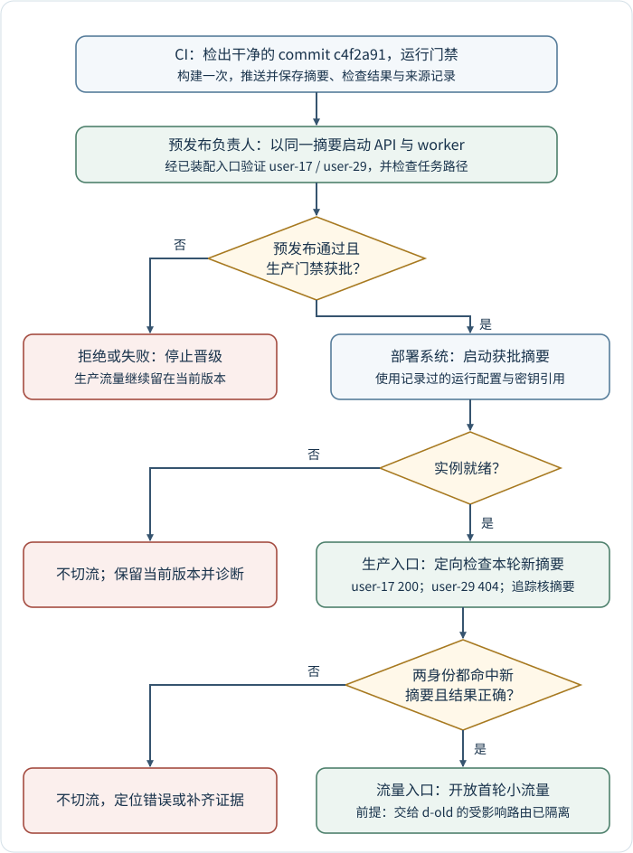

# 已验证的产物怎样原样晋级到生产？

沿用主线五的案例。[镜像章](container-images-and-builds.md)交来经 registry 核验的报表服务镜像 `d-new`，以及把它和修复提交 `c4f2a91` 连起来的构建记录；生产当前跑的仍是带着跨账户缺陷的稳定版 `d-old`。本章回答：发布流程里“通过了”分别指哪一步；为什么预发布和生产必须运行同一个摘要，而不是各自重建；多平台镜像验收的是哪个平台；谁能放行部署，流水线和配置又怎样固定下来。

产出是一个已在预发布验收、获批并以同一摘要启动的生产部署。它就绪之后怎样用生产冒烟检查和小流量逐步放量，是[金丝雀章](canary-rollout-and-rollback.md)的问题。

## “通过了”指的是哪一步

先分开两个常被混用的词。continuous delivery (持续交付) 指代码通过检查后随时**可以**发布；continuous deployment (持续部署) 指门禁满足后**自动**发布。两者都不意味着“CI 绿了，用户就用上了”。

从提交到用户流量，中间至少有四个不同的状态，各由不同角色负责，前一个成立推不出后一个：

| 状态 | 负责方 | 成立时说明什么 |
|---|---|---|
| 构建与预发布验收通过 | CI；预发布检查负责人 | 这个摘要通过了约定的检查与业务验收 |
| 批准 | 环境审批者 | 部署可以继续，流量还没动 |
| 启动并就绪 | 部署系统；平台探针 | 获批的摘要在运行，平台认为可以给它发流量 |
| 切流 | 流量入口；发布负责人或预先配置的控制器 | 真实用户请求开始到达新版本 |

批准不等于部署，就绪不等于业务正确，HTTP 入口切了流也不会改变独立 worker 消费哪些消息。下图把整条路径画在一起，本章讲到“启动获批摘要”为止，之后的冒烟检查和首轮流量在金丝雀章。

## 为什么只构建一次、按摘要晋级

镜像章已经说明：基础镜像 tag 和外部依赖会移动或更新，同一份源码分别重建可能得到不同的内容。如果预发布构建一次、生产再构建一次，预发布验收的就不是生产运行的东西。所以规则是：**CI 只构建一次，预发布和生产都按这次构建的 image digest 拉取和启动，不各自重建。** 晋级的单位是摘要，不是 tag，也不是“同一个提交”。

这条规则只在构建输入本身被固定时才有意义。CI 应检出确切的 `c4f2a91`，确认工作区干净，用检查过的源码树作为唯一构建上下文；依赖锁文件、Dockerfile、基础镜像解析结果、构建器版本、平台和构建参数都进入构建记录。若合并或改写提交改变了源码树，就要在最终用于构建的提交上重跑必要的门禁，或者给出可核验的“源码树相同”证据。构建和检查用了同一个可移动标签，不能证明它们针对的是同一份内容；验收证据要绑定到同一个提交 ID 和同一个摘要，提交一侧的做法见 [Git 章](git-snapshots-and-recovery.md)。

检查随风险而定。提交级检查覆盖静态规则、单元和集成路径（测试该放在哪一层，见[测试章](testing-by-failure-boundary.md)）。这次修复涉及账户授权，预发布要用同一个 `d-new` 启动 API 与 worker，然后：

- 用两个经真实认证流程建立的身份读取报表 42：`user-17` 经 acct-17 读到 `200` 和预期内容；`user-29` 经自己的 acct-29 请求 `GET /v1/accounts/acct-29/reports/42`，得到与不存在的报表 43 相同的通用 `404`。不能用客户端自填的账户头代替身份。
- worker 走真实消息代理的投递、持久化与 ACK 路径，确认导出任务的条件领取仍然只成功一次。

通过后，预发布记录的是“`d-new` 通过了这些检查”，交给生产的也正是 `d-new`。

## 多平台镜像验收的是哪个平台

多平台构建得到一个 index digest，它再引用 `linux/amd64`、`linux/arm64` 等平台各自的 manifest digest。核对索引和子摘要，只证明清单之间的映射关系。如果预发布只在 amd64 上跑过，生产却运行 arm64，生产实际运行的子镜像从来没有被验证过。

做法有两种：在与生产平台一致的预发布目标上运行并验收每个将要部署的子摘要；或者把生产限制在预发布实际运行过的平台。无论哪种，生产都要记录实例实际运行的平台子摘要，并确认它等于该平台验收过的子摘要；“它属于验收过的索引”还不够。

## 谁能放行部署，流水线自己也要固定

产物身份固定后，还要明确谁能放行部署、部署脚本本身会不会变。

> [!info] 实例：GitHub Actions 的环境门禁与依赖固定（核对于 2026-11-12）
> `environment` 可以配置必需审查者、部署分支限制、等待规则和环境 secrets；引用该 environment 的 job 只有通过已生效的保护规则，才会执行受保护的部署步骤或拿到相应 secret。哪些规则可用取决于 GitHub 计划和仓库配置。审批通过只表示这个 job 可以继续。
>
> 流水线引用的外部代码也要固定，否则同一份 workflow 可能在不同时刻执行不同的代码：
>
> - 第三方 Action `uses: owner/repo@ref` 的 `ref` 固定为已核验的完整 commit SHA；或者把 workflow 纳入 workflow dependency lockfile (工作流依赖锁文件)，由它锁定远端步骤级 Action 及其传递依赖。GitHub 于 2026-10-28 宣布该功能正式可用（GA 公告列出 Enterprise Cloud、Team、Free 计划）。锁文件按 workflow 逐条纳入，仓库里有锁文件不代表每条 workflow 都已纳入。
> - 本地步骤级 Action `uses: ./path` 来自调用方的工作区，默认不被锁文件锁定。
> - 同仓 reusable workflow (可复用工作流) `uses: ./.github/workflows/deploy.yml` 的版本由调用方的同一个提交决定。跨仓引用 `owner/repo/.github/workflows/deploy.yml@ref` 要固定完整 SHA；它内部的 Action 依赖只能由定义它的仓库把它纳入自己的锁文件来锁定，调用方的锁文件替代不了。
> - Action 锁文件不锁定 job 级可复用 workflow 调用、构建参数、secret 或 runner (工作流执行器) 镜像。

## 配置与密钥随版本记录

镜像之外，运行配置也要随部署版本一起记录，但密钥值始终留在 secret store：

- 数据库地址、启用的功能开关和配置版本可以放进受控配置，部署记录写明用的是哪个配置版本。
- 部署记录只保存 secret 的名称或版本引用及其适用范围，不保存值。
- 静态前端若要在各环境间晋级同一个 bundle (打包文件)，而各环境的非秘密配置不同，就让 bundle 在运行时读取各环境自己的配置端点或配置文件；部署记录保存 bundle ID、配置版本和校验和。编译期写进浏览器 bundle 的值任何用户都能读到，不能放秘密，密钥只由服务端或密钥服务提供。前端构建侧的做法见[前端构建产物](../../frontend/delivery/build-pipeline-and-bundling.md)。

这份记录到回退时会再用到：回退目标是“摘要 + 配置版本 + secret 引用”的组合，不只是一个旧摘要。

## 进入生产前核对什么

环境审批之前，先核对目标环境的 IAM 权限、网络路由、密钥来源和数据库迁移状态。审批通过后，部署系统用预发布验收过的同一个 `d-new` 启动生产实例，并附上带版本的运行配置和 secret 引用。

此时 `d-new` 在生产里运行，但还没有真实用户流量。平台怎样判断它已启动、可以接流量，以及以后怎样停止它，要看运行时和探针的语义；就绪也只说明平台可以给它发流量，不说明账户授权和异步导出在生产环境里正确。

## 交给下一步的是什么

本章结束时：`d-new` 在预发布通过了验收，生产已获批并以同一个摘要启动，部署记录写明了摘要、平台子摘要、配置版本和 secret 引用。下一个问题是平台层面的：这个服务该跑在哪种运行时上，平台怎样探测它是否就绪、怎样停止它，每个运行角色拿着什么身份？见[生产运行时章](production-runtime.md)。

> [!info]- 来源
> - **持续交付与持续部署**（“‘通过了’指的是哪一步”）：DORA，[Continuous delivery](https://dora.dev/capabilities/continuous-delivery/)，核对于 2026-11-12；区分随时可发布与门禁满足后自动发布。
> - **构建输入、缓存与来源记录**（“为什么只构建一次、按摘要晋级”）：Docker Docs，[Building best practices](https://docs.docker.com/build/building/best-practices/)、[Optimize cache usage](https://docs.docker.com/build/cache/optimize/)、[Build provenance attestations](https://docs.docker.com/build/metadata/attestations/slsa-provenance/)，核对于 2026-11-12。
> - **多平台索引与子清单**（“多平台镜像验收的是哪个平台”）：Docker Docs，[Multi-platform builds](https://docs.docker.com/build/building/multi-platform/)、[Image digests](https://docs.docker.com/dhi/explore/security-concepts/digests/)（tag、索引与子清单）、[`imagetools inspect`](https://docs.docker.com/reference/cli/docker/buildx/imagetools/inspect/)，核对于 2026-11-12。
> - **GitHub 环境门禁与 workflow 依赖**（GitHub Actions 实例 callout）：GitHub Docs，[Deployments and environments](https://docs.github.com/en/actions/reference/workflows-and-actions/deployments-and-environments)、[Secure use reference](https://docs.github.com/en/actions/reference/security/secure-use)、[Lock workflow dependencies](https://docs.github.com/en/actions/how-tos/secure-your-work/lock-workflow-dependencies)、[Reuse workflows](https://docs.github.com/en/actions/how-tos/reuse-automations/reuse-workflows)；GitHub Changelog，[Workflow lockfiles are generally available](https://github.blog/changelog/2026-10-28-github-actions-workflow-lockfiles-are-generally-available/)（2026-10-28），核对于 2026-11-12。锁文件默认不锁本地路径 Action；跨仓可复用 workflow 的依赖只能由定义仓库锁定。
> - **配置与密钥分离**（“配置与密钥随版本记录”）：Docker Docs，[Build secrets](https://docs.docker.com/build/building/secrets/)，核对于 2026-11-12；构建期不把密钥放入 `ARG`/`ENV`。部署记录只存 secret 引用、前端 bundle 运行时读配置是本章基于这一边界的工程安排。
