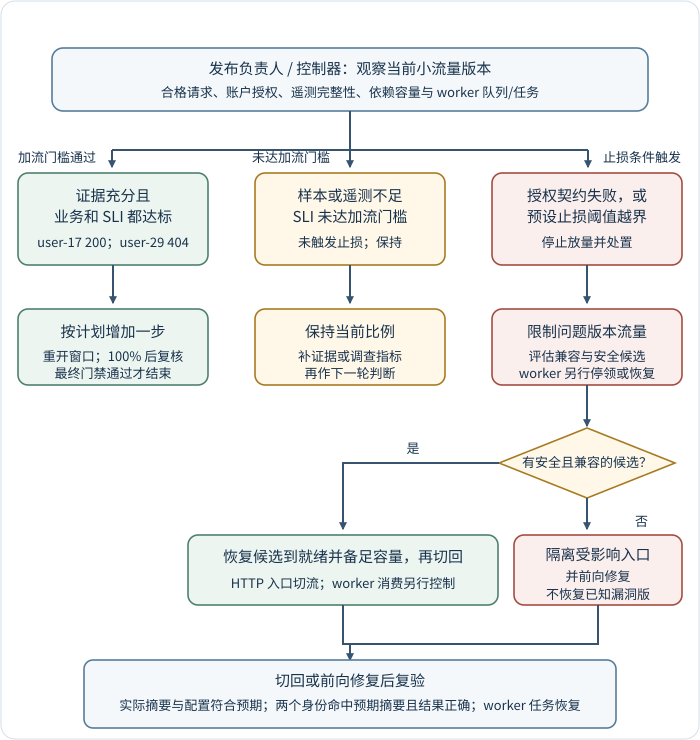
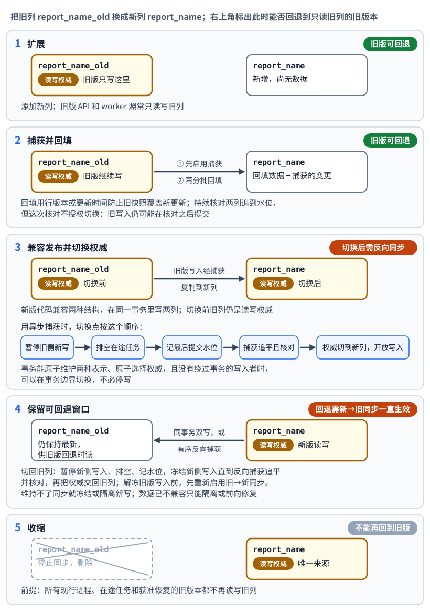

# 新版本怎样逐步放量，出问题时能撤回什么？

沿用主线五的案例。`d-new` 已在生产以同一摘要启动并通过就绪探针（见[生产运行时章](production-runtime.md)），[上一章](slis-slos-and-error-budgets.md)定义了按摘要统计的读取 SLI 和分钟级门禁：滚动 10 分钟、至少 100 个合格请求，好事件低于 99% 且持续 5 分钟即止损。本章回答：开放第一个真实请求之前还要检查什么；每一轮怎样在加流、保持和止损之间判定；HTTP 入口放量为什么管不到 worker；止损时能退到哪里，数据库结构和外部副作用又为什么不会跟着回去。章末一节换到前端，看独立部署的微前端怎样共存与回退。

## 就绪之后、开流之前：生产冒烟检查

**先处理稳定版。** 本例的 `d-old` 正带着这次要修的跨账户缺陷：`user-29` 经 `GET /v1/accounts/acct-29/reports/42` 能读到 acct-17 的报表 42。若直接开放 10% 金丝雀，留在 `d-old` 的 90% 流量里，走这条路径的请求仍在泄露。所以开放金丝雀之前，先隔离受影响的入口，让跨账户读取到不了 `d-old` 的缺陷代码：

- **用不依赖 `d-old` 代码的控制。** 例如在入口为交给 `d-old` 的这条读取路由加一道临时的归属预检（报表不属于路径里的账户，就直接返回与报表 43 相同的通用 `404`），或者暂时停用受影响的功能。本例用前者。
- **只加在交给 `d-old` 的流量上。** 钉到 `d-new` 的冒烟请求不经过它，冒烟检查检验的才是修复本身。
- **它只是止血。** 隔离只挡住这一条已知路径，缓存、导出等旁路仍要靠修复版；它是否生效，要用 `user-29` 经 `d-old` 复测确认。

就绪只说明平台可以把新流量发给实例。开放真实流量前，先做一次 production smoke test (生产冒烟检查)：经生产入口的受控测试路由，把 `user-17` 经 acct-17、`user-29` 经 acct-29 读取报表 42 的请求都钉到 `d-new` 上。测试路由必须走正常的认证和授权逻辑。期望结果是 `user-17` 得到 `200` 和预期内容，`user-29` 得到与报表 43 相同的通用 `404`，并且两条追踪都显示请求命中了 `d-new`。

判断规则：

- 任一身份的结果错误：不开放流量，先定位业务错误。
- 追踪、版本或摘要证据缺失，或平台无法保证两条请求都命中 `d-new`：同样不开放，先补齐证据。
- 多平台发布：还要确认实例实际运行的平台子摘要等于该平台验收过的子摘要（见[晋级章](build-once-promote-by-digest.md#多平台镜像验收的是哪个平台)）。
- 两条都通过，且上面的隔离已确认生效：才开放本例的首轮 10% 真实 HTTP 流量。10% 只是示意起点，不是通用比例。

三种检查各回答一个问题：readiness 说明平台可以发流量；冒烟检查验证目标版本的关键业务路径；之后的用户 SLI 按版本统计，说明真实用户经过它时结果如何。

## 每一轮怎样判定：加流、保持、止损

每一轮都要有完整、可归因到本轮目标摘要的证据：先用冒烟检查对目标摘要重测两个身份，并从追踪确认版本与摘要；再只统计属于该版本的合格请求、错误与延迟、依赖容量，以及 worker 的最老消息年龄、未确认消息数和代表性任务结果。版本标签缺失、聚合数据分不清新旧版本，或两个身份没有命中新摘要，都不拿稳定版的结果替新版本背书。

然后按三分规则判定：

| 观察结果 | 动作 | 为什么 |
|---|---|---|
| 样本达到窗口要求、遥测完整、SLI 达到加流门槛、两个身份都命中新摘要并通过、依赖与任务信号在门槛内 | **加流**：按预定小步提高比例，每次都用目标版本的新窗口复核；到 100% 后检查最终窗口，全部门禁仍达标才结束放量 | 只有可归因到本轮版本、达到门槛的代表性结果，才能支持更多用户经过它 |
| 样本不足、身份测试未确认命中、业务测试未执行、遥测缺失或聚合延迟；或 SLI 低于加流门槛但未越过止损线 | **保持**当前比例，调查指标，补齐身份测试或版本遥测，拿到完整窗口再判 | 未达加流门槛就不能加流；没触发止损也不等于必须回退。不确定不记作成功 |
| 授权契约失败，或错误、延迟、依赖饱和、任务结果越过预定的止损线 | **止损**：停止加流，限制或移除问题版本的流量，检查安全候选，执行回退、隔离或前向修复 | 已确认的用户伤害不能靠尚未触发的告警门槛抵消 |

授权失败单独处理：`user-29` 读到 acct-17 的内容，就是已确认的数据泄露，不能被 99% 的汇总成功率平均掉，必须立即止损，不等统计窗口。

套用上一章的门禁：某一分钟的评价点看到 `d-new` 为 `98/100`，低于 99%，但还没持续 5 分钟，落在第二行，**保持**并调查；若此后六个评价点都满足样本条件且低于 99%，就进入第三行。

**低流量怎么办。** 10% 的流量在一个窗口内未必凑得够 100 个合格的 `d-new` 请求。若要把合成请求计入分母，就在度量定义里事先写明并单独标记，不能把反复运行的测试身份伪装成真实用户流量。低流量服务可以结合冒烟检查、依赖与任务信号，或改用更长但同样事先定义好的窗口。无论哪种，样本不足时都保持当前比例。

## HTTP 入口放量管不到 worker

上面的放量只控制 HTTP 入口。入口按版本或实例权重分配新请求，不会停止旧 worker，也不会让新 worker 自动切换队列消费；API 的 readiness 只影响 API 流量。发布 worker 要单独决定：是否暂停旧消费者，在途任务等待完成还是交还（见[生产运行时章](production-runtime.md#停止时各角色怎样关门)），启动多少新消费者，以及用队列年龄和 ACK 观察切换是否正常。

还有一条兼容性约束：发布期间，API、relay 和 worker 对数据库结构和消息字段的兼容期，必须覆盖所有已经受理的任务。队列里可能还有旧版本 API 受理、旧格式的消息，outbox 里可能还有尚未发布的旧意图；升级不能假定队列里只剩新版本消息。

## 回退前先确认目标当前安全、数据兼容、有容量

止损时，“回到上一个版本”并不总是安全。每次发布前要记下：当前稳定的镜像摘要、配置版本、入口路由比例、worker 部署状态、数据库结构版本和候选回退摘要；secret 只记版本或引用，不复制值；数据库变化和远端副作用要列出兼容条件。

回退目标要同时满足三个条件：

1. **当前安全。** 目标版本不能带着已知会伤害用户的缺陷。本例的 `d-old` 过不了这一条：它正带着这次修复的跨账户缺陷，简单切回去就是重新打开泄露。所以顺序是先确认受影响的入口仍被隔离，再回退到已证明安全的版本（可能是更早的某个修复版），或者前向发布修复。切回 `d-old` 只在隔离持续生效时才成立，而且只是争取时间的临时状态，修复仍要前向发布。任何版本都不满足条件时，就隔离受影响的入口或功能，停掉危险的 worker 消费，直接前向修复。
2. **与当前数据兼容。** 旧代码要能读写新版本运行期间写下的数据，见下一节。
3. **有容量。** 候选版本已运行、就绪且容量足够时，入口可以直接把新请求切回它、把问题版本的权重降到零；候选已下线或容量不足，就先按记录恢复准确的摘要和兼容配置、补足容量，等它就绪后再切流。

切流只是控制面提出的期望状态。回退或前向修复之后还要核对：问题摘要已不再接请求；实际运行的目标摘要和配置正确；经生产入口用 `user-17`、`user-29` 复测得到 `200` 和 `404`，且追踪确认命中预期摘要（切回 `d-old` 时，`user-29` 的 `404` 来自隔离，要同时确认隔离仍覆盖全部交给它的流量）；worker 的代表性任务和 ACK、队列年龄恢复正常。样本或遥测不足时，保持修复后的低风险状态继续取证，不因“恢复命令执行成功”就宣布完成。

## 数据库结构怎样迁移才能回退：expand/contract

代码可以切回旧摘要，数据库结构却不会跟着回去。所以结构迁移采用 expand/contract (扩展/收缩)：先让新旧版本能共存，确认旧版本不会再回来之后再收缩。设要把旧列 `report_name_old` 换成新列 `report_name`，下图逐阶段画出两列由谁写、读写权威在哪一列、同步朝哪个方向，以及此时还能不能回退到只读旧列的旧版本：

图上画的是顺序，下面补上为什么必须是这个顺序：

- **先捕获再回填。** 回填读出的是某一刻的快照；若回填开始之后才启用捕获，这之间旧列上的更新就没有记录。防覆盖之外，也可以按提交顺序重放捕获的变更。
- **核对追平不等于可以切换。** 第 2 阶段的核对之后，旧侧仍可能提交写入，所以异步捕获的切换依据是暂停旧侧新写、排空之后记下的最后提交水位。
- **可回退窗口靠反向同步维持。** 新列成为权威后若不同步回旧列，退回只读旧列的版本就会读到过时的事实；切回旧列后若不先恢复旧→新同步，旧版的写入又会让新列落后。

捕获、回填、双写和反向同步的具体实现取决于数据库和业务写入模型；异步捕获必须定义提交顺序、水位和重放与重复处理的语义。独立迁移任务和锁只防止并发执行，不保证任务恰好执行一次；任务还需要版本记录、幂等批次、检查点和可恢复的步骤，重试前先核实部分批次的真实数据库状态。

## 平台自动回退与外部副作用

有些平台提供自动回退，但范围有限，而且不验证业务契约。

> [!info] 实例：Amazon ECS 部署断路器（核对于 2026-11-12）
> ECS rolling deployment (滚动部署) 开启断路器后，任务无法进入 steady state (稳定状态) 时判定部署失败；同时配置了 rollback，就恢复到最近一个 `COMPLETED` 部署。它只适用于 rolling update 部署类型，并要求之前有已完成的部署；不是 canary、蓝绿部署或其他平台的通用保证。任务健康也不验证账户授权和 worker 业务契约，切回后仍要做前面的入口与任务复验。

无论应用是否回退，都不会自动撤销已经提交的 job、已被引用的对象、已发出的邮件或已完成的支付。要恢复的外部效果必须有对应的补偿、幂等和审计边界；从数据库备份恢复可能丢掉备份之后的写入，是一个单独的数据恢复决策。发布版本、安全状态、数据兼容和外部效果要一起复核，才能确认止损完成。回退只撤回平台管理的那部分。AI 系统的发布单元是模型、提示词、工具等组成的版本组合，同一套判定在那里的应用见[AI 部署、放量与回滚](../../ai-engineering/evaluation-and-release/deployment-rollout-and-rollback.md)。

## 微前端：独立部署的前端怎样共存与回退？

前面讲的是后端服务的放量。前端拆成独立部署的部分后，同样会遇到“新旧版本并存、按人群分流、回退要求数据兼容”的问题。这里换用页面编辑器的独立例（与报表服务无关），因为它的文档格式最能说明新旧前端怎样共享数据。

### 先判断是否值得拆

micro-frontend (微前端) 把前端的一部分按业务或团队边界独立开发、集成和发布，集成方式可以是构建时组合、运行时加载，也可以是 iframe 或 Web Components。它是组织与部署边界，不是“把组件拆成多个项目”的同义词。

只有组件库、页面编辑器和资产管理分属不同团队、确实有各自的发布节奏、集成契约也稳定时，拆分才可能减少发布协调。若画布、检查器和资产面板由同一个团队一起发布，一个模块化应用通常更直接；若当前的问题是两处各存一份节点副本，拆成微前端只会把同步问题推给跨应用通信。运行时集成还会新增路由、深链、身份传递、样式隔离、依赖版本、可访问性、故障处理和监控等方面的契约，这些成本要由独立发布的收益抵消。

### 外壳持有路由，按 cohort 分流

设编辑器入口要从 `/editor/assets/42?panel=inspector&node=heading-1` 逐步迁到 `/assets/42/edit?panel=inspector&node=heading-1`，由新版 `EditorV2` 接替旧版 `EditorV1`。shell (应用外壳) 持有顶级路由、公共导航和错误边界；新旧地址先并存，避免旧书签和历史项没有去向：

| 地址 | 外壳的选择 |
|---|---|
| 旧地址 | 迁移窗口内继续交给 V1 |
| 新地址，用户不在 cohort (灰度分组) 中 | 交给 V1，不显示空白占位页 |
| 新地址，用户在 cohort 中 | 加载 V2，显示加载或失败状态 |

这是一种契约选择；也可以让子应用共享同一个路由器，或在构建时组合，但不能让两个互不知情的路由器同时争抢浏览器历史。几条配套规则：

- **路由格式是跨应用契约。** 改路径或参数时，要更新所有链接来源和消费者；子应用通过明确的 `navigate()` 或同源链接请求跨边界导航。
- **服务端配合。** 对这些前端深链地址都返回外壳的 HTML，由前端路由接手；`/api/` 下的请求仍交给 API 服务。
- **URL 参数只是界面状态。** `node=heading-1` 是可恢复的选择，不是文档内容；文档加载后再与该修订的稳定节点 ID 对照，节点不存在就清除选择并照常显示，不把参数当成任意资源的读取入口。

深链里的 fragment 定位、`pushState`/`replaceState` 与 `popstate` 的细节，见前端的[导航历史与 URL 状态](../../frontend/browser/navigation-history-and-url-state.md)。子应用之间怎样传递身份、为什么同页加载的远程脚本不构成隔离，见[会话与浏览器边界章](../services/sessions-and-browser-boundaries.md)；这里只需记住，客户端“能显示这个路由”不代替服务端的逐次授权，授权拒绝也不能被误判成代码加载失败而静默切换版本。

### 新旧版本并存时的数据兼容与回退

这与上面的 expand/contract 是同一个问题，只是数据在文档格式里：

- **新字段。** V2 要写 V1 不认识的新字段，前提是 V1 会原样保留未知字段，或路由能保证旧版不再打开这些文档。V1 若只是忽略未知字段，下次保存时就可能把它删掉。
- **删除或改语义。** 要等旧版不再负责读写这些文档。
- **加载失败的回退。** V2 加载失败若发生在用户开始编辑之前，可以安全地把新地址映射回 V1；编辑开始之后若已有未保存的草稿，就先转换并交接草稿，或留在当前编辑器给出错误，不能静默切回而丢掉用户的修改。

上线按路由逐步更换处理者：先验证外壳能加载两版并保持同一输入契约；再把新地址的一小组 cohort 交给 V2；检查直接深链与刷新、Back/Forward、未授权请求、V2 代码块加载失败、V1/V2 文档兼容与草稿保留，再扩大分流。V2 错误率越过预设门槛，就把新地址重新交给 V1。有效回退还要求 V1 的代码仍可加载、且兼容当前数据格式；只把流量开关拨回去，却没有旧代码或兼容格式，并不能恢复服务。构建资源的版本并存与缓存见[前端构建产物](../../frontend/delivery/build-pipeline-and-bundling.md)。

## 交给下一步的是什么

本章给出了放量的完整判定：开流前的冒烟检查，每一轮按版本归因的三分规则，worker 与兼容期的单独控制，回退目标的三个条件，以及数据库结构与外部副作用为什么不随回退复原。剩下的问题是：真的越线了、用户结果变坏时，怎样从信号走到根因，又怎样用同一口径确认已经恢复？见[事故诊断与恢复](incident-diagnosis-and-recovery.md)。

> [!info]- 来源
> - **放量信号的窗口与门槛**（“每一轮怎样判定”）：本领域 [SLI 章](slis-slos-and-error-budgets.md)的门禁定义；10 分钟、100 个与 99% 是合成教学值。
> - **ECS 滚动部署断路器**（ECS 实例 callout）：AWS，[Deployment failure detection](https://docs.aws.amazon.com/AmazonECS/latest/developerguide/deployment-failure-detection.html)、[DeploymentCircuitBreaker API](https://docs.aws.amazon.com/AmazonECS/latest/APIReference/API_DeploymentCircuitBreaker.html)，核对于 2026-11-12；仅支持 rolling update，回滚目标需为先前的 `COMPLETED` 部署。
> - **结构变更与代码变更解耦**（“数据库结构怎样迁移才能回退”）：AWS Whitepaper，[Blue/Green Deployments on AWS](https://docs.aws.amazon.com/pdfs/whitepapers/latest/blue-green-deployments/blue-green-deployments.pdf) §“Decoupling schema changes from code changes”、[Best practices for managing data synchronization and schema changes](https://docs.aws.amazon.com/whitepapers/latest/blue-green-deployments/best-practices-for-managing-data-synchronization-and-schema-changes.html)，核对于 2026-11-12。捕获变更、回填防覆盖、水位与反向同步的具体安排是按本例推导的通用做法，实际机制须匹配所选数据库与写入模型。
> - **微前端的收益、集成方式与成本；路由作为跨应用契约**（“先判断是否值得拆”“外壳持有路由，按 cohort 分流”）：Cam Jackson，[Micro Frontends](https://martinfowler.com/articles/micro-frontends.html)，2019-06-19，§Benefits、§Integration approaches、§Downsides、§[Cross-application communication via routing](https://martinfowler.com/articles/micro-frontends.html#Crossapplicationcommunicationviarouting)。
> - **客户端检查不代替服务端授权**（cohort 一节的授权提醒）：OWASP，[Micro Frontend Security Cheat Sheet](https://cheatsheetseries.owasp.org/cheatsheets/Micro_Frontend_Security_Cheat_Sheet.html) §“Authorize Every Request on the Server”、[Input Validation Cheat Sheet](https://cheatsheetseries.owasp.org/cheatsheets/Input_Validation_Cheat_Sheet.html) §“Client-only checks”，核对于 2026-11-12。
