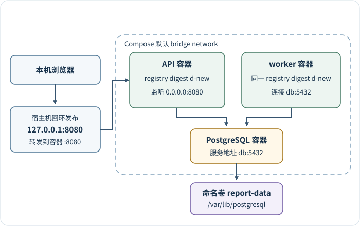

# 用 Compose 在本地起一套服务时，网络、健康检查、密钥和数据各怎样配？

[镜像章](container-images-and-builds.md)交来一个经 registry 核验的报表服务镜像引用 `d-new`。本支线用 Docker Compose 在一台开发机上把 API、worker 和 PostgreSQL 一起跑起来，依次回答：服务之间怎样互相找到、哪些端口对外；数据库什么时候算“可以用了”；本地密钥怎样交给容器；数据库文件在什么情况下能活过容器替换。最后列出观察和收尾命令各能证明什么。

本支线只讲本机服务栈。它能验证服务发现和容器间网络，验证不了生产入口、工作负载身份和账户授权；那些分别在[生产运行时章](production-runtime.md)和后续发布章处理。

## 一份 Compose 配置

下面的 Compose Specification (Compose 规范) 片段让 API 与 worker 共用同一个镜像引用，只替换 worker 的启动命令（覆盖规则见镜像章的[启动命令由谁决定](container-images-and-builds.md#启动命令由谁决定)）。`REPORT_IMAGE` 由外部传入，应是 CI `--push` 后核验过的完整 `registry.example.com/team/report-api@sha256:…`，而不是本地 `--load` 的摘要。`${REPORT_IMAGE:?…}` 只拒绝空值，不检查它是不是摘要引用。

只做本机开发时，也可以把 `image` 设成本地已载入的 `report-api:c4f2a91` 并加 `pull_policy: never`，或改用 `build: .` 从当前目录重建。这两种配置都不能当作 registry 发布的证据。

> [!example]- Compose 配置：共享镜像、独立凭据与命名卷
>
> ~~~yaml
> services:
>   api:
>     image: "${REPORT_IMAGE:?set REPORT_IMAGE to an immutable image digest}"
>     ports:
>       - "127.0.0.1:8080:8080"
>     environment:
>       DATABASE_HOST: db
>       DATABASE_NAME: reports
>       DATABASE_USER: report_app
>       DATABASE_PASSWORD_FILE: /run/secrets/app_db_password
>     secrets:
>       - app_db_password
>     depends_on:
>       db:
>         condition: service_healthy
>
>   worker:
>     image: "${REPORT_IMAGE:?set REPORT_IMAGE to an immutable image digest}"
>     command: ["python", "-m", "app.worker"]
>     environment:
>       DATABASE_HOST: db
>       DATABASE_NAME: reports
>       DATABASE_USER: report_app
>       DATABASE_PASSWORD_FILE: /run/secrets/app_db_password
>     secrets:
>       - app_db_password
>     depends_on:
>       db:
>         condition: service_healthy
>
>   db:
>     image: postgres:18
>     environment:
>       POSTGRES_DB: reports
>       POSTGRES_PASSWORD_FILE: /run/secrets/db_admin_password
>     secrets:
>       - db_admin_password
>     volumes:
>       - report-data:/var/lib/postgresql
>     healthcheck:
>       test:
>         - CMD-SHELL
>         - >-
>           pg_isready -h 127.0.0.1 -p 5432
>           -U "$${POSTGRES_USER:-postgres}"
>           -d "$${POSTGRES_DB:-postgres}"
>       interval: 5s
>       timeout: 3s
>       retries: 5
>
> secrets:
>   app_db_password:
>     file: ./secrets/app_db_password.txt
>   db_admin_password:
>     file: ./secrets/db_admin_password.txt
>
> volumes:
>   report-data:
> ~~~

下面逐项解释这份配置背后的规则。

## 服务网络、端口发布与监听地址

Compose 为项目自动创建一个 default bridge network (默认桥接网络)，服务之间用 service name (服务名) 互相发现。API 和 worker 都连 `db:5432`，那是数据库容器内的端口，不需要映射到宿主机。不要保存容器 IP：Compose 重建服务时会分配新 IP，服务名不变；已有连接会断开，客户端要重新解析并连接。

只有需要从宿主机进入的 API 映射了宿主机端口。这里有两个独立的地址：

- **容器内监听地址**：API 进程监听 `0.0.0.0:8080`，映射进来的流量才能到达它（见镜像章的 Dockerfile 一节）。
- **宿主机发布地址**：`127.0.0.1:8080:8080` 只把宿主机回环地址映射到容器端口。省略宿主机 IP 时默认绑定宿主机所有接口，应视作对其他可路由主机开放。

端口映射只建立转发关系，不证明 API 健康；服务名可达也不代表数据库身份验证通过，更不代替应用认证和账户授权。

> [!info] 实例：localhost 发布的边界与 Engine 版本有关（核对于 2026-11-12）
> 从 Docker Engine 28.0.0 起，在默认 bridge/NAT 路径上发布到 localhost 的端口，预期只能从 Docker 主机本身访问；更早的版本存在例外，同一二层网络中的其他主机可能访问到这些端口。特殊 network mode (网络模式)、direct routing (直接路由) 以及宿主机路由和防火墙仍可能改变这个边界，要按实际 Engine 版本和网络设置核实。

## 健康检查、启动依赖与引导迁移

`depends_on: condition: service_healthy` 让 Compose 在启动 API 和 worker 之前，等数据库的健康检查通过。它的作用到此为止：

- 它只在 Compose 启动依赖方的那一刻等待，之后数据库出故障，它不接管恢复。
- 它不等待任何独立的引导任务。
- 健康检查本身也证明得很少。`pg_isready` 只说明服务器在接受连接；命令里的 `-U`/`-d` 只是连接请求的信息，不是身份验证，不证明角色、密码或结构迁移正确。

健康检查要写 `-h 127.0.0.1 -p 5432`，显式探测正式的 TCP 监听端口。不带 `-h` 时它走 Unix socket；官方 Postgres 镜像在初始化期间会启动一个只供本地脚本用的临时服务器，socket 检查可能在正式 TCP 服务就绪之前就提前通过。

所以一个新建空卷的本地栈要分三步启动：

1. 确认 `REPORT_IMAGE` 是本次 push 后核验过的引用，然后 `docker compose up -d db` 单独启动数据库。`POSTGRES_DB: reports` 让官方镜像在初始化空数据目录时创建 `reports` 库；默认管理用户是高权限的 `postgres`，不要把 `POSTGRES_USER` 改成应用账号 `report_app`。
2. 等 TCP 健康检查变成 healthy，运行项目提供的受控 bootstrap/migration (引导与迁移) 任务：它读取管理员密码和 `app_db_password`，创建使用应用密码的 `report_app`，只授予 `reports` 中应用需要的权限，并完成 schema migration (结构迁移)。上面的 Compose 片段没有定义这个任务。
3. 引导成功后，再 `docker compose up -d api worker`。

已有的卷不会因为环境变量改了就自动补建数据库或修改凭据，启动服务前要核对它的实际状态。

## 本地 secret 与数据库初始化凭据

Compose 的 `secrets` 把凭据文件显式挂给获准的服务，容器内出现在 `/run/secrets/<名字>`。本例的两份 secret 用途不同：

- `db_admin_password` 只交给数据库容器，供官方镜像初始化管理员。
- `app_db_password` 是独立的最小权限应用账号密码，交给 API 和 worker；应用代码要自己读取 `DATABASE_PASSWORD_FILE` 指向的文件。

本地 `file:` secret 通过 bind mount (绑定挂载) 提供（本例以 Linux 容器为前提），`uid`、`gid`、`mode` 覆盖会被忽略；要靠宿主机文件权限保证容器里的 `USER 10001` 能读到它。

`POSTGRES_PASSWORD_FILE` 只在空数据目录首次初始化时设置管理员密码。之后改宿主机上的 secret 文件，不会修改数据库里已有的密码。轮换要先在数据库里更新账号，再让应用切换到匹配的 secret。本地 secret 方便开发，但不等于加密的生产 secret store (密钥存储服务)；`secrets/` 目录不要进版本控制。

## 卷类型决定数据能活多久

容器可写层随容器删除而丢失。要让数据库文件活过容器替换，就要挂卷，而不同挂载方式的寿命不同：

| 挂载方式 | 容器替换后 | 适合 |
|---|---|---|
| named volume (命名数据卷) | 由 Docker 管理，新容器可以重新挂上同一个卷 | 本地数据库文件 |
| anonymous volume (匿名数据卷) | 没有稳定的项目名称，新容器通常不会自动挂上同一个卷 | 临时数据 |
| bind mount (绑定挂载) | 直接映射宿主机路径 | 开发时共享源码；不适合当生产数据库的备份方案 |

卷只解决“容器换了文件还在”。它不提供异机备份、时间点恢复、加密、访问控制，也不保证数据正确；这些要靠独立的备份与恢复演练。`docker compose down` 移除容器和网络、保留命名卷；`docker compose down -v` 会删除 Compose 文件声明的项目命名卷及附着的匿名卷，连同其中的数据。

> [!info] 实例：PostgreSQL 18 官方镜像改了数据路径（核对于 2026-11-12）
> 上面的卷挂在 `/var/lib/postgresql`，而不是常见的 `/var/lib/postgresql/data`。官方镜像从主版本 18 起改用按版本区分的路径：默认 `PGDATA` 是 `/var/lib/postgresql/18/docker`，卷应挂在父目录 `/var/lib/postgresql`；以后的主版本把路径中的 `18` 换成各自的版本号。PostgreSQL 19 已于 2026-11-19 发布；本例仍固定在 18 主版本，换主版本是一次需要迁移的升级，见下段。17 及更早版本的数据路径是 `/var/lib/postgresql/data`，应直接挂这个目录；只改挂父目录，可能无法持久化旧数据。
>
> 升级主版本不能靠改 image tag 自动迁移数据：18 的目录布局变化要求先检查并调整旧卷结构，主版本升级本身要先备份，再走官方支持的升级流程。`postgres:18` 这样的主版本 tag 仍会随 18.x 补丁移动；生产环境要记录并固定实际摘要，同时及时更新补丁。

## 观察与收尾命令各能证明什么

| 命令 | 看的对象 | 能回答 | 不能单独证明 |
|---|---|---|---|
| `docker compose ps` / `docker compose ps -a` | Compose 服务的容器 | 默认只列运行中的服务；`-a` 也列已停止的容器 | 没配 healthcheck 时的就绪，或用户结果 |
| `docker compose logs api worker` | 两个服务的标准输出与错误 | 启动错误和应用日志 | 端到端追踪、账户授权和完整指标 |
| `docker compose exec api /bin/sh` | 正在运行的 API 容器 | 查看进程环境、执行诊断命令 | 容器里一定有 shell（distroless 或精简镜像可能没有） |

`docker compose up -d` 只是让命令在后台返回，不是进程监督器，也不自动配置健康检查、重启策略和告警。容器 `running`、Docker 健康状态 `healthy` 和应用业务正确是三种不同的判断：只有定义了 healthcheck 才有 `healthy`，而它也证明不了 `user-29` 读不到 acct-17 的报表 42。

## 本地栈之后

这套本地栈能确认：同一个 `d-new` 的 API 和 worker 能起来，能经 `db:5432` 访问按最小权限引导好的数据库，数据库文件存在命名卷里。它确认不了预发布和生产的身份、入口与授权。回到主线：同一个摘要怎样经过预发布验收、获批进入生产，见[一次构建、按摘要晋级](build-once-promote-by-digest.md)。

> [!info]- 来源
> - **Compose 文件与服务配置**（“一份 Compose 配置”）：Docker Docs，[Compose Specification](https://docs.docker.com/reference/compose-file/)、[Services reference](https://docs.docker.com/reference/compose-file/services/)、[Variable interpolation](https://docs.docker.com/reference/compose-file/interpolation/)、[Compose history](https://docs.docker.com/compose/intro/history/)，核对于 2026-11-12；旧的顶层 `version` 字段已过时，当日文档支持的 Compose CLI 均采用 Compose Specification。
> - **服务网络与端口发布**（“服务网络、端口发布与监听地址”及 Engine 28 callout）：Docker Docs，[Networking in Compose](https://docs.docker.com/compose/how-tos/networking/)、[Port publishing and mapping](https://docs.docker.com/engine/network/port-publishing/)，核对于 2026-11-12。
> - **启动顺序与健康检查**（“健康检查、启动依赖与引导迁移”）：Docker Docs，[Control startup order](https://docs.docker.com/compose/how-tos/startup-order/)；PostgreSQL 18，[`pg_isready`](https://www.postgresql.org/docs/18/app-pg-isready.html)（检查服务器是否接受连接，不验证认证）；官方 Postgres 镜像 [Initialization scripts](https://github.com/docker-library/docs/blob/master/postgres/README.md#initialization-scripts) 与 [docker-entrypoint.sh](https://github.com/docker-library/postgres/blob/master/docker-entrypoint.sh)（初始化期间的临时本地服务器），核对于 2026-11-12。
> - **本地 secret 与初始化凭据**（“本地 secret 与数据库初始化凭据”）：Docker Docs，[Use secrets in Compose](https://docs.docker.com/compose/how-tos/use-secrets/)；官方 Postgres 镜像 [Environment variables](https://hub.docker.com/_/postgres#environment-variables)，核对于 2026-11-12；初始化变量不修改非空数据目录中已有的账号。
> - **卷与数据路径**（“卷类型决定数据能活多久”及 PostgreSQL 18 callout）：Docker Docs，[Volumes](https://docs.docker.com/engine/storage/volumes/)、[Bind mounts](https://docs.docker.com/engine/storage/bind-mounts/)、[`docker compose down`](https://docs.docker.com/reference/cli/docker/compose/down/)；官方 Postgres 镜像 [PGDATA](https://github.com/docker-library/docs/blob/master/postgres/README.md#pgdata)；[PostgreSQL versioning policy](https://www.postgresql.org/support/versioning/)，核对于 2026-11-12。
> - **观察命令**（“观察与收尾命令各能证明什么”）：Docker CLI reference，[docker compose ps](https://docs.docker.com/reference/cli/docker/compose/ps/)、[docker compose logs](https://docs.docker.com/reference/cli/docker/compose/logs/)、[docker compose exec](https://docs.docker.com/reference/cli/docker/compose/exec/)，核对于 2026-11-12。
