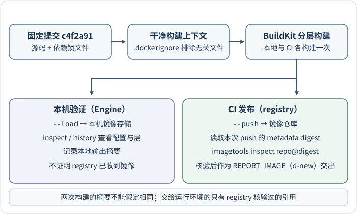

# 源码怎样变成可运行、可追溯的容器镜像？

沿用主线五的案例。报表服务的修复提交 `c4f2a91` 把读取改成按 `(account_id, report_id)` 显式查询，并带上了跨账户反例测试；[Git 章](git-snapshots-and-recovery.md)保证被测的快照就是这个提交的快照。本章把这份源码变成容器镜像：先分清镜像、容器和摘要，再看构建读到哪些文件、Dockerfile 怎样写才可审计、构建期凭据怎样不进镜像，最后看本地检查和 CI 发布为什么是两次不同的构建，以及摘要能证明什么、不能证明什么。

本章的产出是一个经 registry (镜像仓库) 核验的不可变引用 `registry.example.com/team/report-api@sha256:…`，本主线把这个摘要记作 `d-new`（生产上仍带着跨账户缺陷的稳定版记作 `d-old`），外加一份把它和源码连起来的构建记录。

## 镜像、容器和摘要各是什么

报表服务的 API 和异步 worker 从同一份源码构建，运行时却是两个不同的进程。要说清它们共享什么、各自拥有什么，先区分几个对象：

- **container image (容器镜像)**：用只读层保存程序、依赖和默认配置（默认启动命令、工作目录、运行用户）。镜像不保存某个环境的数据库密码，那属于运行配置。
- **container (容器)**：运行时在镜像之上叠加这个容器独有的可写层，再加上进程命令和运行配置。删除容器，可写层里的改动随之丢失；要跨容器保留的数据（例如数据库文件）写进 volume (数据卷)。
- **image digest (镜像摘要)**：形如 `sha256:…`，由镜像清单的内容算出，内容不变它就不变。
- **tag (标签)**：如 `report-api:c4f2a91`，只是一个指向某份内容的名字，可以被移到别的内容上。

所以 API 与 worker 可以用同一个摘要启动，只换启动命令；它们共享镜像内容，各自有自己的可写层、进程和身份。

## 构建上下文和层缓存决定构建读到什么

一次 build (构建) 从 build context (构建上下文) 开始：Docker CLI 把指定的一组文件交给 builder (构建器)，Dockerfile 里的 `COPY` 只能取这组文件。`docker buildx build .` 中的 `.` 只有在它就是干净检出的 `c4f2a91` 源码根、且没有未跟踪的本机文件时，才代表这个提交。

发送之前，`.dockerignore` 按相对构建根目录的路径模式排除文件。它和 Git 的忽略规则互不替代，也不能把上下文之外的文件加进来。只写 `*.log` 只匹配根目录；`**` 可以匹配任意层目录（包括零层），所以 `**/*.log` 覆盖整个上下文。至少要排除版本库、虚拟环境、缓存、本机日志、真实 `.env` 和密钥文件：

~~~text
**/.git
**/.venv
**/__pycache__
**/*.py[cod]
**/*.log
**/.env
**/.env.*
**/secrets
~~~

BuildKit 按每条指令及其输入复用 build cache (构建缓存)：某一步的输入变了，这一步和之后的所有步骤都要重做。因此 Dockerfile 通常先复制依赖锁文件、安装依赖，再复制源码，只改源码时就不必重装依赖。

缓存命中不说明依赖仍是最新的，也不让构建自动可复现。基础镜像 tag、依赖索引或下载内容、目标平台和构建工具都可能变化，同一份源码分别重建，仍可能得到内容不同的镜像。这一点决定了下一章的做法：各环境晋级同一次构建的摘要，而不是各自重建。

## 一份可审计的 Python 多阶段 Dockerfile

报表服务用 Python，下面是它的两阶段 Dockerfile。示例写 tag 是为了好读；生产用的 Dockerfile 或构建参数要在每个 `FROM` 换成审核过的基础镜像摘要。

~~~dockerfile
# syntax=docker/dockerfile:1
FROM python:3.15-slim AS deps
WORKDIR /build
COPY requirements.lock .
RUN --mount=type=cache,target=/root/.cache/pip \
    python -m pip install --prefix=/install --require-hashes -r requirements.lock

FROM python:3.15-slim AS runtime
WORKDIR /app
ENV PYTHONDONTWRITEBYTECODE=1 \
    PYTHONUNBUFFERED=1
COPY --from=deps /install /usr/local
COPY --chown=10001:10001 app ./app
USER 10001:10001
CMD ["uvicorn", "app.main:app", "--host", "0.0.0.0", "--port", "8080"]
~~~

逐项看它为什么这样写：

- **基础镜像固定到摘要。** 单平台构建固定该平台的 manifest digest (清单摘要)；多平台构建可以固定已核验的 index digest (索引摘要)，由每个 stage (构建阶段) 按目标架构从中选出对应平台的清单。
- **依赖逐项校验。** `requirements.lock` 列出直接和传递依赖的精确版本与 SHA-256，`pip --require-hashes` 逐项校验下载内容。但锁文件只管运行时依赖：若某个包没有适用的 wheel (预构建安装包)、要从源码编译，pip 会为它另建一个隔离的构建环境，其中的 build backend (构建后端) 和 build-time dependencies (构建依赖) 不受这份锁文件约束，要另外审核和控制；编译器和头文件也只该出现在构建阶段。
- **多阶段与权限。** `COPY --from=deps` 只把安装好的依赖带进运行阶段，运行阶段只保留需要的共享库；非 root 的 `USER` 降低应用进程的权限。应用若要写文件，输出目录应放在受控的挂载点，而不是指望容器可写层在替换容器后还在。
- **监听地址。** Uvicorn 在容器内监听 `0.0.0.0:8080`，容器的网络接口才能收到映射进来的流量。若应用只绑定容器内的 `127.0.0.1`，宿主机的端口映射替它改不了监听地址，外部流量进不来。宿主机一侧发布到哪个地址是另一回事，见 [Compose 支线](compose-local-stack.md)。

> [!info] 版本说明
> 示例用官方 `python:3.15-slim`（Python 3.15.2，核对于 2026-11-12）。实际项目要先确认框架、依赖和原生扩展都支持所选 Python 版本。

### 启动命令由谁决定

`RUN` 在构建时执行，结果留在层里交给后续步骤；`CMD` 和 `ENTRYPOINT` 在容器启动时决定运行哪个进程，其中 `CMD` 是默认启动命令。用 exec form (JSON 数组形式) 书写时，应用直接成为容器里的 PID 1 (首个进程)，能亲自收到停止信号；平台怎样发这个信号、给多长宽限，见[生产运行时章](production-runtime.md)。

worker 复用同一镜像时只替换启动命令。Docker Compose 的覆盖规则是：

- `command` 替换镜像的 `CMD`。若镜像定义了 exec form 的 `ENTRYPOINT`，`command` 作为参数追加给它，不改写 `ENTRYPOINT`。
- Compose 设置了非空的 `entrypoint` 时，镜像默认的 `CMD` 被忽略。

本例镜像没有 `ENTRYPOINT`，所以 worker 写 `command: ["python", "-m", "app.worker"]` 就完整替换了默认的 Uvicorn 命令。

## 构建期凭据只在一条 RUN 里出现

若私有依赖源需要认证，用 BuildKit secret mount (构建密钥挂载) 只在某条 `RUN` 执行期间提供凭据文件：

~~~dockerfile
RUN --mount=type=secret,id=pip_config,target=/etc/pip.conf \
    python -m pip install --prefix=/install --require-hashes -r requirements.lock
~~~

调用构建时传 `--secret id=pip_config,src=/安全路径/pip.conf`。挂载本身不会把凭据写进镜像层。但 `RUN` 里的命令仍可能把它复制进产物、打印到日志或发到网络，所以 builder 和依赖源也必须可信，verbose 日志不能打印认证配置。不要把 token 放进 `ARG`、`ENV`、被 `COPY` 的文件或命令行参数：这些都会留在层、镜像配置或构建记录里。

## 本地 --load 与 CI --push 是两次输出

同一个提交会走两条构建路径。本地用 `--load` 把结果载入本机 image store (镜像存储)，方便启动容器检查；CI 用 `--push` 从干净检出另做一次构建，并发布到 registry。即使源码相同，两次构建也不能假定得到相同的摘要；本地摘要更不能证明 registry 收到了什么。

两段脚本结构相同，假设运行环境有 Bash、Docker Buildx 和 `jq`，当前目录是已确认干净的 `c4f2a91` 源码根：

- `mktemp` 为本次构建新建一个 metadata file (元数据文件)，避免构建失败后误读上一次的摘要；`set -euo pipefail` 让 buildx 一失败整串命令就停止。
- `jq -e` 要求本次文件里有格式正确的 `containerimage.digest`，缺字段或格式不对就失败。
- 本地路径接着用 `docker image inspect` 和 `history` 看本机镜像的配置与层；CI 路径则用 `imagetools inspect` 按摘要从 registry 读回实际清单，确认远端确实有这份内容。

> [!example]- 本地构建：读取本次 metadata，再 inspect 与 history
>
> ~~~bash
> set -euo pipefail
> metadata_file="$(mktemp "${TMPDIR:-/tmp}/report-api-build.XXXXXX")"
> trap 'rm -f "$metadata_file"' EXIT
>
> docker buildx build \
>   --load \
>   --metadata-file "$metadata_file" \
>   --tag report-api:c4f2a91 \
>   .
> digest="$(
>   jq -er '
>     ."containerimage.digest"
>     | select(type == "string" and test("^sha256:[0-9a-f]{64}$"))
>   ' "$metadata_file"
> )"
> printf 'Local build digest: %s\n' "$digest"
> docker image inspect report-api:c4f2a91
> docker image history report-api:c4f2a91
> ~~~

> [!example]- CI 发布：核验 registry 摘要后交给运行环境
>
> ~~~bash
> set -euo pipefail
> metadata_file="$(mktemp "${TMPDIR:-/tmp}/report-api-push.XXXXXX")"
> trap 'rm -f "$metadata_file"' EXIT
>
> docker buildx build \
>   --push \
>   --metadata-file "$metadata_file" \
>   --tag registry.example.com/team/report-api:c4f2a91 \
>   .
> digest="$(
>   jq -er '
>     ."containerimage.digest"
>     | select(type == "string" and test("^sha256:[0-9a-f]{64}$"))
>   ' "$metadata_file"
> )"
> registry_ref="registry.example.com/team/report-api@$digest"
> docker buildx imagetools inspect "$registry_ref"
> printf 'REPORT_IMAGE=%s\n' "$registry_ref"
> ~~~
>
> 这段命令会真实地向 registry 发布镜像；registry 地址、tag 和提交都是示意值。

本地 tag `report-api:c4f2a91` 只是别名，不会验证源码是否真的来自该提交。只有 `imagetools inspect` 通过后，CI 才把打印出的完整 `registry@sha256:…` 交给后续步骤，作为环境变量 `REPORT_IMAGE`，这就是 `d-new`。接收方若用 Compose 插值 `${REPORT_IMAGE:?…}`，它只拒绝空值，不检查值是不是摘要引用；传值的一方要保证传的是这次 push 核验过的引用。

> [!info]- 实例：本机能否载入多平台镜像（Docker Buildx，核对于 2026-11-12）
> `--load` 是 `--output=type=docker` 的 CLI 简写，本例只构建一个平台。本机能否载入多平台镜像取决于 builder 和 Engine 的 image store：classic image store (经典镜像存储) 不支持 image index 或 manifest list (清单列表)，载入不了多平台镜像；containerd image store 可以。Docker Engine 29.0 起新安装默认用 containerd image store，Docker Desktop 也默认用它；从旧版本升级的 Engine 可能仍是 classic store。当前 Buildx 探测到目标 Engine 支持 OCI importer 时会改走能导入多平台镜像的路径，否则多平台的 docker 导出会报错。无论哪种，本机输出和 metadata 都不能证明 registry 已收到镜像。

## 摘要标识内容，不证明来源

registry 摘要固定了镜像清单（或多平台 index）的内容：谁拿着 `d-new` 去拉取，得到的都是同一份内容。它回答不了“这份内容由哪个源码提交、用什么依赖构建”。CI 若检出错了提交、用了被篡改的依赖，产物照样有一个合法的摘要。

所以构建记录要把这些东西和摘要绑在一起：确切的提交 `c4f2a91`、依赖锁文件、基础镜像摘要、Buildx/BuildKit 版本、目标平台、构建参数和 CI 检查结果，并用可核验的 provenance attestation (构建来源证明) 把源码和产物关联起来。之后有人问“生产里这个摘要是从哪来的”，查的是这份记录，而不是摘要本身。

多平台构建还多一层：index digest 只证明它包含哪些平台子清单，不证明每个平台的子镜像都运行过；index 里还可能挂着 provenance 等不能运行的附件，不能把任意子项当成可启动的平台镜像。哪个子摘要算验收过，在[下一章](build-once-promote-by-digest.md)处理。

## 观察命令各能证明什么

排查时先分清看的是本机镜像、本机容器，还是 registry：

| 命令 | 看的对象 | 能回答 | 不能单独证明 |
|---|---|---|---|
| `docker image ls` | 本机镜像与 tag | 镜像是否已载入、本机有哪些名字 | 有容器在运行，或 registry 有同一内容 |
| `docker image inspect report-api:c4f2a91` | 本机镜像配置 | 平台、启动命令、环境、image ID（配置对象的标识）与已知的 RepoDigests | registry 当前的发布状态，或来源可信 |
| `docker image history report-api:c4f2a91` | 本机镜像的层记录 | 哪些构建步骤留下了层 | 完整的文件审计，或密钥从未进入层 |
| `docker ps -a` | 本机容器（含已停止的） | 容器在运行、已退出还是已停止 | 应用业务健康 |
| `docker buildx imagetools inspect <ref>@sha256:…` | registry 中的清单 | 远端确有这份内容，index 含哪些子项 | 内容来自哪个提交 |

`docker run -d` 的 detached mode (分离运行模式) 只让命令在后台返回，它不是进程监督器，也不替你配置健康检查、重启策略和告警。

容器的生命周期命令可以按对象理解。下面换一个与报表服务无关的 Redis 缓存容器，因为它最能单独展示每条命令动了什么：

- `docker pull redis:7` 把可变 tag 拉到本机；要固定版本，就用 registry 摘要。
- `docker run --name cache -d redis:7` 从镜像创建并启动一个新容器。
- `docker stop cache` 向容器主进程发送配置的停止信号，宽限期过后再强制终止；`docker start cache` 重新启动同一个容器和它原来的可写层，不会从新版镜像重建。
- `docker rm cache` 移除已停止的容器。`docker rm -f cache` 直接对运行中容器的主进程发 `SIGKILL` 再移除，没有 `stop` 的宽限期：在途工作可能被打断，可写层也随之丢失。卷是否还在，取决于卷的类型和删除方式。
- `docker image rm redis:7` 移除这个本地镜像引用；其他标签或仍在用它的容器可能让这些层继续保留。

手动发布时，`docker login registry.example.com` 登录并在本机存储凭据，`docker tag` 给本地内容加上仓库名和标签，`docker push` 才写入 registry。生产发布应由受控的 CI 身份完成，记录 registry 返回的摘要并按摘要部署，不把可变 tag 当作验收结果。

## 交给下一步的是什么

本章结束时手上有两样东西：经 registry 核验的 `d-new` 引用，以及一份把它和 `c4f2a91`、依赖、构建器、平台连起来的构建记录。想在本机用 Compose 把 API、worker 和数据库一起跑起来，看[本地服务栈支线](compose-local-stack.md)。要让这同一个摘要原样经过预发布、获批进入生产，问题就变成：哪些状态要分别通过，谁对哪一步负责？这是[一次构建、按摘要晋级](build-once-promote-by-digest.md)的内容。

> [!info]- 来源
> - **镜像、容器、可写层与 Dockerfile 指令**（“镜像、容器和摘要各是什么”“启动命令由谁决定”）：Docker Docs，[What is an image?](https://docs.docker.com/get-started/docker-concepts/the-basics/what-is-an-image/)、[What is a container?](https://docs.docker.com/get-started/docker-concepts/the-basics/what-is-a-container/)、[Dockerfile reference](https://docs.docker.com/reference/dockerfile/)（`RUN`/`CMD`/`ENTRYPOINT`、exec 与 shell form、`USER`）、[Multi-stage builds](https://docs.docker.com/get-started/docker-concepts/building-images/multi-stage-builds/)，核对于 2026-11-12。
> - **构建上下文、`.dockerignore` 与缓存**（“构建上下文和层缓存决定构建读到什么”）：Docker Docs，[Build context](https://docs.docker.com/build/concepts/context/)（§.dockerignore files：`**` 匹配任意层目录，包括零层）、[Building best practices](https://docs.docker.com/build/building/best-practices/)、[Optimize cache usage](https://docs.docker.com/build/cache/optimize/)，核对于 2026-11-12。
> - **构建期密钥**（“构建期凭据只在一条 RUN 里出现”）：Docker Docs，[Build secrets](https://docs.docker.com/build/building/secrets/)，核对于 2026-11-12；secret mount 不进镜像层，不应把密钥放进 `ARG`/`ENV`。
> - **Python 依赖校验与源码包构建环境**（Dockerfile 一节）：pip，[Secure installs](https://pip.pypa.io/en/stable/topics/secure-installs/)、[`pip install --require-hashes`](https://pip.pypa.io/en/stable/cli/pip_install/#cmdoption-require-hashes)、[Build system interface](https://pip.pypa.io/en/stable/reference/build-system/)，核对于 2026-11-12；哈希模式要求锁定直接与传递依赖，源码包的隔离构建环境另有构建依赖。
> - **Python 版本**（版本说明 callout）：[Python 3.15.2 release](https://www.python.org/downloads/release/python-3152/)、Docker Hub [python `slim` 镜像](https://hub.docker.com/layers/library/python/slim/)，核对于 2026-11-12。
> - **Compose `command`/`entrypoint` 覆盖与插值**（“启动命令由谁决定”“本地 --load 与 CI --push 是两次输出”）：[Compose services reference](https://docs.docker.com/reference/compose-file/services/)、[Variable interpolation](https://docs.docker.com/reference/compose-file/interpolation/)，核对于 2026-11-12。
> - **`--load`/`--push`、metadata、registry 核验与 image store**（“本地 --load 与 CI --push 是两次输出”及多平台 callout）：Docker Docs，[`docker buildx build`](https://docs.docker.com/reference/cli/docker/buildx/build/)、[`imagetools inspect`](https://docs.docker.com/reference/cli/docker/buildx/imagetools/inspect/)、[Docker Engine containerd image store](https://docs.docker.com/engine/storage/containerd)、[Docker Desktop containerd image store](https://docs.docker.com/desktop/features/containerd/)、[Multi-platform builds](https://docs.docker.com/build/building/multi-platform/)（Engine 29.0+ 默认 image store），核对于 2026-11-12；OCI importer 分支见 [Buildx v0.39.0 `build/opt.go`](https://github.com/docker/buildx/blob/v0.39.0/build/opt.go#L494-L538)。
> - **摘要、索引附件与来源证明**（“摘要标识内容，不证明来源”）：Docker Docs，[Image digests](https://docs.docker.com/dhi/explore/security-concepts/digests/)、[Build attestations](https://docs.docker.com/build/metadata/attestations/)、[SLSA provenance attestations](https://docs.docker.com/build/metadata/attestations/slsa-provenance/)，核对于 2026-11-12；摘要标识内容，提交与产物的联系需要额外的来源证据。
> - **观察与生命周期命令**（“观察命令各能证明什么”）：Docker CLI reference，[docker run](https://docs.docker.com/reference/cli/docker/container/run/)、[docker stop](https://docs.docker.com/reference/cli/docker/container/stop/)、[`docker rm --force`](https://docs.docker.com/reference/cli/docker/container/rm/#force)、[docker image rm](https://docs.docker.com/reference/cli/docker/image/rm/)、[docker image history](https://docs.docker.com/reference/cli/docker/image/history/)、[docker login](https://docs.docker.com/reference/cli/docker/login/)、[docker tag](https://docs.docker.com/reference/cli/docker/image/tag/)、[docker push](https://docs.docker.com/reference/cli/docker/image/push/)，核对于 2026-11-12；强制移除运行中容器发送 `SIGKILL`，没有 `stop` 的宽限期。
